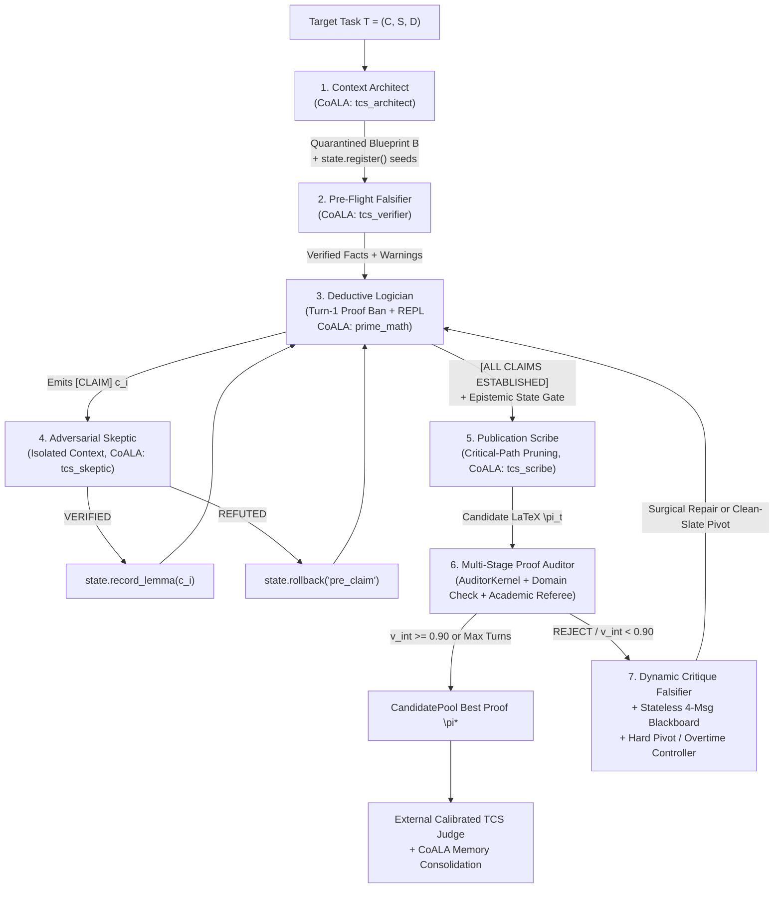

# Proof-Harness (`proof_harness`) 📐

[](LICENSE)

**Proof-Harness** is an open-source neuro-symbolic mathematical reasoning engine, autonomous theorem prover, and zero-trust deterministic Python/Lean execution harness.

Standard large language models fail on research-level mathematics because of two foundational architectural bottlenecks: **(1) The Probabilistic Trust Fallacy** (relying on statistical next-token prediction to guess whether multi-step algebraic derivations, inequality directions, and boundary cases hold) and **(2) Frozen Weights & Episodic Amnesia** (an inability to learn continuously from solved problems or specialize into a technical domain without expensive weight fine-tuning).

**Proof-Harness (`proof_harness`)** solves both bottlenecks by combining **seven-role cognitive partitioning** with two foundational pillars:
1. **The Zero-Trust Deterministic Mathematical Kernel Engine (`core_engine/kernel.py`, `core_engine/prover_kernel.py`, `core_engine/math_tools.py`, `core_engine/state_machine.py`)**: Dual-isolated, 3-layer airgapped symbolic and numerical execution kernels (`PersistentMathKernel` and ephemeral `AuditorKernel`) that provide **immediate accuracy and soundness verification**. Every claim is tested deterministically using **`SymPy`**, **`Z3`**, **50-digit `mpmath`**, **`NetworkX`**, specialized domain extensions (topology, planar duals, quantum CPTP channels, PSD operator inequalities), honest three-valued empirical semantics (`holds_on_samples`), Rule 11 anti-brute-force analytical ceilings (`guarded_range` ≤ 200,000), and a formal **Epistemic State Machine** (`MathStateMachine`) that automatically revokes fragile invariants under conditioning or restriction.
2. **The CoALA Heuristics & Continuous Domain Learning Engine (`core_engine/memory.py`, `core_engine/heuristic_validation.py`, `core_engine/remediation.py`)**: A continual learning architecture grounded in *Cognitive Architectures for Language Agents* (CoALA) where the harness **learns by solving over time**—distilling verified universal strategies (Procedural Memory) and failure post-mortems (Episodic Memory) into role-isolated vector embeddings in vector memory, governed by automated heuristic validation and sanitization. As practitioners and researchers use the harness to prove theorems across vertical domains, the system compounds domain intelligence through vector embeddings—with zero LLM weight fine-tuning.

📄 **Technical Papers & Deep Dives:**
- **The Harness Debate & Domain Expansion:** [`docs/articles/beyond-coding-why-domain-expansion-saves-the-agent-harness.md`](docs/articles/beyond-coding-why-domain-expansion-saves-the-agent-harness.md) (Rebuttal to "Is the Agent Harness Dead?", automated shim-cleanup, and long-horizon persistent runtimes)
- **Frontier Physics Deep Dive:** [`docs/articles/from-spacetime-thermodynamics-to-open-quantum-horizons.md`](docs/articles/from-spacetime-thermodynamics-to-open-quantum-horizons.md) (Autonomous discovery, Casini/Wall/Bousso QNEC heuristics, and solving open AQFT horizon problems)
- **Technical Report:** [`docs/articles/arxiv-prime-math-neuro-symbolic-prover-harness.md`](docs/articles/arxiv-prime-math-neuro-symbolic-prover-harness.md)
- **Engineering Deep Dive:** [`docs/articles/how-an-agent-harness-unlocks-llm-math-reasoning.md`](docs/articles/how-an-agent-harness-unlocks-llm-math-reasoning.md)

---

## 🏆 Headline Benchmark Results: TCS-Bench (N = 300)

Evaluated across **300 research-level problems from TCS-Bench** (arXiv Theoretical Computer Science preprints, [arXiv:2608.09538](https://arxiv.org/abs/2608.09538)) using a single quantized 27B model (`unsloth/Qwen3.8-27B-NVFP4`) on a single 32GB consumer GPU. All baseline first-pass attempts have individual recorded validation scores on disk:

| Evaluation Paradigm | Grade C & Above (≥ 0.40)<br>Sound & Directional | Grade B & Above (≥ 0.50)<br>Certified Sound Pass | Grade A & Above (≥ 0.70)<br>Publication-Grade | Pass Multiplier vs. Initial Draft<br>(Grade C & Up / B & Up / A & Up) |
| :--- | :---: | :---: | :---: | :---: |
| **1. Unassisted Initial Draft** | 12 / 300 (**4.00%**) | 10 / 300 (**3.33%**) | 7 / 300 (**2.33%**) | 1.00× / 1.00× / 1.00× |
| **2. Full Proof Harness (`proof_harness`)** | **71 / 300** (**23.67%**) | **63 / 300** (**21.00%**) | **54 / 300** (**18.00%**) | **5.92×** / **6.30×** / **7.71×** |

**Cumulative Passing Thresholds Across 300 Research-Level TCS Theorems:**
- **All Passing Grades (≥ 0.40, Grade C and Above — Sound & Directional):** **71 / 300 (23.67%)** — nearly **sextupling (5.92×)** the unassisted initial draft baseline (4.00%).
- **Certified Sound Passes (≥ 0.50, Grade B and Above):** **63 / 300 (21.00%)** — a **6.30× multiplier** over the initial unassisted draft baseline (3.33%).
- **Publication-Grade Proofs (≥ 0.70, Grade A and Above):** **54 / 300 (18.00%)** — a **7.71× multiplier** over initial drafting (2.33%, 7/300), with 31 proofs reaching near-flawless (≥ 0.90) journal quality.
- **Passing Proof Validity:** Drives the mean referee validity of certified passing proofs from low-rigor initial drafts (mean internal audit score 0.253 ± 0.227; mean external score on unsolved tasks 0.139 ± 0.107) to **0.853 ± 0.129** (median **0.880**), with structural completeness reaching **0.907** and logical rigor reaching **0.857**.
- **100% of Passing Proofs** are discovered through governed multi-turn exploration in Turns 2–12 (with **84.1%** won in Turn 4 or later, and **20.6%** won in overtime).

---

### 🌌 Frontier Physics & Spacetime Thermodynamics Benchmark (100% Pass Rate)

Evaluated across mathematical physics and Algebraic Quantum Field Theory (AQFT) benchmarks using `unsloth/Qwen3.8-27B-NVFP4` with domain-isolated procedural memory:

| Benchmark Task ID | Historical Milestone / Paper | Core Derivation Focus | Turn & Latency | Validity Score | Result Status |
| :--- | :--- | :--- | :---: | :---: | :---: |
| **`task_gr-qc_9504004_statement_01_01`** | **Jacobson (1995)**: *Thermodynamics of Spacetime* | Derives the Einstein Field Equations $G_{ab} + \Lambda g_{ab} = \frac{8\pi G}{c^4} T_{ab}$ via local Rindler horizon thermal flux, Unruh temperature $\eta = \frac{\hbar \kappa}{2\pi c k_B}$, Raychaudhuri expansion, and Clausius entropy balance $\delta Q = T dS$. | Turn 3<br>(1,204.6s) | **0.86 / 1.00** | **PASS (Publication-Grade)** |
| **`task_2510.24491_statement_01_01`** | **Dorau & Much (2026)**: *Modular Flow on Null Hypersurfaces* | Proves that the modular Hamiltonian on null Cauchy surfaces generates local geometric translations $K_V = 2\pi \int H_V(x) T_{uu}(x) d\Sigma$ under local algebra inclusions. | Turn 8<br>(2,816.8s) | **0.76 / 1.00** | **PASS (Certified Sound)** |
| **`task_2510.24491_open_01_01`** | **Open Frontier Problem**: *General Hadamard Modular Invariance* | Deep autonomous 50-turn exploration of the modular obstruction across general Hadamard states, deriving iso-entropic conditions ($\Delta S_{\mathrm{ent}} = 0$) and integrating Quantum Null Energy Condition (QNEC) boundary tensor corrections. | 50-turn deep search | Checkpointed | **Active Exploration** |

- **Physics Suite Baseline Pass Rate:** **2 / 2 (100.0%)** recorded in `data/eval_results/physics_qwen_solved_v1/pipeline_metrics.json`.
- **Domain Memory Specialization:** Evaluated using dedicated `physics_procedural` memory partition (`--domain physics`), harvesting frontier heuristics from Casini (2008), Faulkner et al. (2014), Wall (2012), Bousso et al. (2014), and Ciolli–Longo–Ruzzi (2021).

---

## 🧠 Core Architecture & Engine Capabilities

```text
+==========================================================================================+
|                                   PRIME MATH HARNESS                                     |
+==========================================================================================+
|  Layer               | Module / Substrate              | Capabilities                    |
+----------------------+---------------------------------+---------------------------------+
| Pillar I: CoALA      | CoALAMemoryManager & Validator  | 5 role-isolated TurboVec        |
| Continual Learning   | (`memory.py`, `remediation.py`, | collections, automated heuristic|
| Engine               |  `heuristic_validation.py`)     | validation, 3-Tier Remediation  |
+----------------------+---------------------------------+---------------------------------+
| Pillar II: Zero-Trust| Persistent & Auditor Kernels    | SymPy, Z3, 50-dps mpmath,       |
| Deterministic Kernel | (`kernel.py`, `prover_kernel.py`| `holds_on_samples`, Rule 11     |
| & State Machine      |  `math_tools.py`,               | ceilings, `MathStateMachine`    |
|                      |  `state_machine.py`)            | fragile invariant revocation    |
+----------------------+---------------------------------+---------------------------------+
| Flagship Theorem     | MathProver (7 Cognitive Roles)  | Turn-1 Proof Ban, Blueprint     |
| Prover (`prove`)     | (`prover.py`, `prover_stages.py`| Quarantine, 4-Msg Blackboard,   |
|                      |  `prover_auditor.py`)           | Noise-Band Occam's Razor        |
+----------------------+---------------------------------+---------------------------------+
| Autonomous Numeric   | MathSolver Engine               | Small-case search -> Closed-form|
| Solver (`solve`)     | (`core_engine/solver.py`)       | derivation -> Boxed extraction  |
+----------------------+---------------------------------+---------------------------------+
| Adversarial          | MathFalsifier Engine            | Hunts minimal counterexamples   |
| Falsifier (`falsify`)| (`core_engine/falsifier.py`)    | via Z3 SMT & boundary search    |
+----------------------+---------------------------------+---------------------------------+
| Inductive            | MathDiscoverer Engine           | Mines closed-form laws, PSLQ    |
| Discoverer(`discover`)| (`core_engine/discoverer.py`)  | relations & recurrences         |
+----------------------+---------------------------------+---------------------------------+
| Proof Judging &      | Calibrated TCS & Lean 4 Judges  | Adaptive k=3 replicate median   |
| Formal Verification  | (`core_engine/judging/`,        | referee + zero-sorry Lean 4     |
|                      |  `core_engine/lean_runner.py`)  | compiler verification           |
+----------------------+---------------------------------+---------------------------------+
| MCP Server           | Model Context Protocol (stdio)  | 7 live tools for AI agents      |
|                      | (`core_engine/mcp_server.py`)   | & downstream applications       |
+==========================================================================================+
```

---

## 🧬 Pillar I: The CoALA Heuristics & Continuous Domain Learning Engine

Proof-Harness implements the **Cognitive Architectures for Language Agents (CoALA)** memory taxonomy ([`core_engine/memory.py`](core_engine/memory.py)) so the harness **continuously learns from the problems it solves** without modifying LLM weights.

### 1. Role-Isolated Procedural Vector Collections
Rather than dumping everything into one noisy RAG index, `CoALAMemoryManager` maintains **five role-isolated procedural collections** in the TurboVec vector database—one for each specialized stage of the prover:

| Agent Namespace (`agent_id`) | Vector Collection (`cos ≥ 0.65`) | What It Stores & Retrieves |
| :--- | :--- | :--- |
| **`prime_math`** | `prime_math_procedural` | **Deductive Logician & Solver**: Algebraic reductions, invariant formulation, concentration bounds. |
| **`tcs_architect`** | `tcs_architect_procedural` | **Context Architect**: Decomposing paper contexts, seeding state invariants, modular lemma chains. |
| **`tcs_verifier`** | `tcs_verifier_procedural` | **Pre-Flight Falsifier**: Fast small-instance boundary scripts and Monte Carlo sanity checks. |
| **`tcs_skeptic`** | `tcs_skeptic_procedural` | **Adversarial Skeptic**: Hostile `Z3`/`NetworkX` counterexample construction and degenerate parameter attacks. |
| **`tcs_scribe`** | `tcs_scribe_procedural` | **Publication Scribe**: Critical-path pruning, quantifier discharge, and journal-grade LaTeX synthesis. |

### 2. How the Harness Learns Over Time
- **Immediate Learning After Every Problem (`core_engine/prover.py`)**: Every time the harness finishes proving (or attempting) a theorem, it runs a brief reflection pass to ask: *"What general mathematical technique worked here, or what subtle trap caused an earlier draft to fail?"*
  - **Reusable Math Strategies → Procedural Vector Memory**: Generalizable techniques are embedded into the vector database so future problems in the same domain can retrieve them automatically. Near-duplicate rules (>90% similarity) are skipped so memory stays clean.
  - **Run Summaries → Episodic Logs**: A concise diagnostic summary of what succeeded or failed is saved to disk for post-run analysis.
- **Automated Failure Analysis & 3-Tier Fix Routing (`core_engine/remediation.py`)**: After a benchmark run, the remediation engine inspects failed tasks, identifies the root cause, and routes each fix to the right place:
  - **Tier 1 — Harness & Kernel Code Fixes**: If a failure exposed a bug or missing helper in the Python/SymPy kernel, it is flagged for engineering review.
  - **Tier 2 — Global System Prompts**: Reserved strictly for universal reasoning habits that apply to *every* math problem (e.g., *"always check boundary cases before writing a proof"*).
  - **Tier 3 — Domain Vector Memory (TurboVec)**: Any strategy specific to a mathematical domain (such as graph theory, Markov chains, or quantum channels) is stored in vector memory and retrieved only when relevant. If a proposed prompt rule is domain-specific rather than universal, the harness automatically moves it from Tier 2 to Tier 3 so global prompts never become bloated.

### 3. Automated Heuristic Validation & Sanitization
Before any learned strategy is saved to vector memory, [`core_engine/heuristic_validation.py`](core_engine/heuristic_validation.py) runs six automated checks to ensure only clean, generalizable mathematics is stored (and blocks self-retrieval during benchmarks):

| Check | Rule Enforced | What Gets Blocked |
| :--- | :--- | :--- |
| **1. Substantiveness** | ≥ 25 chars, non-placeholder | Empty strings, `"none"`, `"n/a"`, trivial filler. |
| **2. Anti-Extrapolation & Anti-Sieve** | Pure deductive methods only | Empirical guessing hacks (`Richardson extrapolation`, `Aitken delta-squared`, `Shanks`, `Wynn epsilon`) and brute-force sieves for asymptotic limits. |
| **3. Benchmark Anonymization** | No benchmark or task IDs | Any reference to `Problem #...`, `AIME`, `Project Euler`, `IMO`, `Putnam`, `FrontierMath`, `TCS-Bench`, or `task_...`. |
| **4. Title Decoupling** | Strip problem titles | Explicit mentions of the source paper or problem title. |
| **5. Instance Variable Bindings** | No hardcoded toy numbers | Problem-specific equations (`2^k == 3^m`, `for n = 1000`, `modulo 10^9 + 7`, `"in this specific problem"`). |
| **6. Ground-Truth & Constant Shield** | No answer or constant leaks | Any heuristic containing the expected answer or any 4+ digit constant from the problem statement. |

### 4. Domain-Specific Procedural Memory Partitioning (`--domain`)
In addition to role-isolated collections within pure mathematics, Proof-Harness supports **domain-specific procedural memory partitioning** via `TCS_MEMORY_DOMAIN="<domain>"` in `.env` or `--domain <name>` (`--memory-domain <name>`) on the CLI:
- **`prime_math` / `tcs`**: Default collections (`prime_math_procedural`, `tcs_architect_procedural`, etc.) storing universal graph, number theory, and combinatorics heuristics.
- **`physics`**: Dedicated `physics_procedural` collection storing specialized mathematical physics strategies (e.g., Tomita–Takesaki modular theory, KMS condition, Raychaudhuri optical scalars, Quantum Null Energy Condition $\langle T_{kk} \rangle \ge \frac{1}{2\pi} S''$, and horizon entropy balance $\delta Q = T dS$).
- **Clean Cross-Domain Isolation**: Prevents vertical domain lore from contaminating TCS queries or general math benchmarks, while allowing deep domain specialization to compound across sessions without risk of cross-domain hallucination.

---

## 🔬 Pillar II: The Zero-Trust Deterministic Mathematical Kernel Engine

A deterministic execution kernel is the foundation for agentic math solving. Proof-Harness never trusts an LLM's token probabilities to verify algebra, inequalities, or invariant preservation. Instead, it couples the model to a **Zero-Trust Deterministic Mathematical Kernel** ([`core_engine/kernel.py`](core_engine/kernel.py), [`core_engine/prover_kernel.py`](core_engine/prover_kernel.py), [`core_engine/math_tools.py`](core_engine/math_tools.py), [`core_engine/state_machine.py`](core_engine/state_machine.py)).

### 1. Dual-Kernel Isolation (`PersistentMathKernel` vs. `AuditorKernel`)
- **`PersistentMathKernel` (Persistent Solver Kernel)**: Preserves verified symbolic expressions, helper functions, and the `MathStateMachine` across exploratory turns 1…T, with instant state rollback (`state.checkpoint('pre_claim')` / `state.rollback('pre_claim')`).
- **`AuditorKernel` (Ephemeral Referee Kernel)**: Spawned fresh from scratch (`timeout = 15s`) during Stage 1 of `_audit_proof_draft` with a completely disjoint namespace so buggy solver definitions can never contaminate proof auditing.

### 2. Preloaded Symbolic, SMT, Arbitrary-Precision & Diagnostic Toolkit
- **Exact Computer Algebra & SMT Solving**: Preloaded `sympy` (`sp`), `z3-solver` (`Solver`, `Int`, `Real`, `Bool`, `ForAll`, `Exists` with 10s timeout protection), `numpy` (`np`), `scipy`, `networkx` (`nx`), and optional Lean 4 verification (`lean_check`).
- **50-Digit Arbitrary-Precision Arithmetic**: `mpmath` configured to **50 decimal digits (`mp.dps = 50`)**, eliminating IEEE-754 float64 precision loss on delicate tail bounds and spectral gaps.
- **Preloaded Domain Diagnostic Operators ([`core_engine/math_tools.py`](core_engine/math_tools.py))**:
  1. `check_asymptotic_dominance(f_expr, g_expr, var='n')`: Computes symbolic limit ratios `lim_{n→∞} f(n)/g(n)` in SymPy to deterministically classify `o(g), O(g), Θ(g), Ω(g), ω(g)`.
  2. `check_event_covariance(sampler_fn, n_trials=2000, seed=42)`: Computes empirical covariance and Pearson correlation across 2,000 seeded Monte Carlo trials, flagging `DEPENDENCE DETECTED` whenever `|ρ| > 0.05`.
  3. `find_graph_counterexample(predicate_fn, max_n=7, include_random=True)`: Sweeps paths, cycles, complete graphs, stars, bipartite graphs, and Erdős–Rényi random graphs `G(n,p)` with **fail-closed exception semantics** (`inconclusive: True, verified: False` if the test predicate crashes).
  4. **Topological & Planar Graph Duals**:
     - `planar_dual_and_faces(edges_or_adj)`: Computes combinatorial planar embeddings, facial boundaries, enclosing cycles, and planar dual graphs for multiway cut and connectivity proofs.
     - `check_cycle_chords_and_holes(adj, cycle)`: Evaluates cycle chordality, induced chordless holes, and triangulation constraints.
  5. **SMT Constraint & Parameter Hierarchy Solvers**:
     - `smt_disjoint_paths(adj, sources, targets)`: Encodes and proves node-disjoint and edge-disjoint routing feasibility via Z3.
     - `smt_slice_terminal_pairing(terminals, slices)`: Validates terminal assignment constraints across topological slices.
     - `smt_check_parameter_hierarchy(constraints, hierarchy_order)`: Proves asymptotic multi-variable hierarchies (`k ≪ ℓ ≪ n`) under SMT constraints.
  6. **Quantum Channels & Operator Inequality Verification**:
     - `check_psd_inequality(A, B)`: Tests Loewner order positive semi-definite matrix inequalities (`A ⪰ B`) via Cholesky and Hermitian eigenvalue verification.
     - `check_quantum_channel_claim(kraus_ops)`: Verifies trace preservation (`∑ K_i† K_i = I`) and complete positivity for CPTP quantum channels.
     - `random_density_matrix(dim)`, `random_unitary(dim)`: Generates Haar-distributed random quantum states and unitaries for empirical operator witness testing.
     - `partial_trace(rho, dims, trace_out)`: Computes exact partial traces for quantum subsystem entropy and entanglement bounds.
     - `uhlmann_fidelity(rho, sigma)`: Computes quantum Uhlmann fidelity `F(ρ, σ)`.
  7. **NetworkX 3.x Compatibility Shims**:
     - Transparent compatibility shims for renamed or deprecated graph APIs (`nx.random_tree`, `nx.vertex_connectivity`, `nx.Graph.is_connected`), `np.trapz`, and `z3.Solver.constraints`.
- **Honest Three-Valued Empirical Semantics (`holds_on_samples`)**: `holds_on_samples(rel, max_points=2000)` provides an explicit three-valued Kleene truth value respecting SymPy domain assumptions (`integer`, `positive`, `prime`, `even`, `odd`):
  - `False`: Certified counterexample found.
  - `True`: Empirical survival across sample points (necessary sanity check, never conflated with formal proof).
  - `None`: Inconclusive or domain singularity.
- **Rule 11 Anti-Brute-Force Analytical Ceilings & APU Safeguards**: `guarded_range` blocks loops exceeding `MAX_DIAGNOSTIC_SIEVE_LIMIT = 200,000` elements, generator wraps enforce `MAX_COMBINATORIAL_STEPS = 200,000` to prevent memory thrashing on unified memory architectures (AMD Ryzen AI Max+ 395 UMA APU), and static AST inspection (`_combinatorial_ceiling`) blocks `O(n!)` `permutations(range(n))` for `n ≥ 7`—forcing analytical deduction over brute force.
- **Candidate Protection against Destructive Pivots**: `[Hard Pivot Prevented — Substantive/Best Candidate Protected]` prevents catastrophic loss of viable mathematical foundations (`v ≥ 0.25`), enforcing surgical revision instead of unconstrained backtracking.
- **3-Layer Benchmark Airgapping**: When `allow_internet=False`, `PersistentMathKernel` (via benchmark airgapping mixins) enforces (1) offline research tool stubs, (2) static AST blocking of 24 network modules and dynamic import/process escape hatches (`importlib`, `subprocess`, `ctypes`, `os.system`, `__import__`), and (3) a thread-local runtime `_socket_guard()` plus `_detect_trace_tampering()` stdout anti-forgery checks.

### 3. Epistemic State Machine (`MathStateMachine`)
[`core_engine/state_machine.py`](core_engine/state_machine.py) lives in the kernel namespace as `state` and tracks mathematical object provenance DAGs:
- **Hereditary Properties**: Preserved under sub-object restriction (`bipartite`, `planar`, `forest`, `acyclic`, `measurable`, `bounded_support`, `hermitian`, `positive_semidefinite`, `abelian`).
- **Fragile Properties**: Automatically **revoked** upon `state.derive(..., via=...)` under `conditioning`, `subgraph`, `projection`, `quotient`, `limit`, or `perturbation` (`independent`, `mutually_independent`, `martingale`, `connected`, `regular`, `invertible`, `positive_definite`).
- **Epistemic Scribe Gate**: Blocks handoff to the Publication Scribe if any active object has undischarged revoked properties without an explicit invariance witness (`state.assert_property(..., witness=...)`).

---

## 🏛️ Flagship Theorem Prover & Seven-Role Cognitive Partitioning (`core_engine/prover.py`)



### Closed-Loop Search Governance Highlights
- **Turn-1 Exploration Gate (`TURN-1 PROOF BAN`)**: Prohibits emitting `\begin{proof}` on Turn 1; the Logician must first explore invariants in `PersistentMathKernel` and propose structured `[CLAIM]` / `[REDUCTION]` steps.
- **Blueprint Quarantine**: Treats the Context Architect's blueprint as an `UNVERIFIED CONJECTURAL SKETCH`. If a Python check falsifies an intermediate inequality, the solver discards the intermediate bound rather than restricting the theorem's domain.
- **Multi-Stage Internal Proof Auditor ([`core_engine/prover_auditor.py`](core_engine/prover_auditor.py))**:
  1. *Stage 1*: Ephemeral `AuditorKernel` Python falsification.
  2. *Stage 1.5*: Deterministic regex pre-check (`_detect_unauthorized_restrictions`) catching mid-proof domain narrowing lacking a complementary case split.
  3. *Stage 2*: Academic Referee enforcing hard boolean validity caps (`statement_fidelity_exact` ≤ 0.25, `inequality_directions_verified` ≤ 0.30, `theorem_hypotheses_verified` ≤ 0.35).
  4. *Stage 2.5*: Adversarial second-opinion confirmation on borderline `[0.75, 0.88)` drafts.
- **Stateless 4-Message Blackboard & `CandidatePool` Noise-Band Occam's Razor (ε = 0.03)**: Collapses revision context to `[System, Clean Task Prompt, Pinned Candidate Proof, Surgical Repair Directive]`, penalizes revisions that bloat proof length by >50% for a ≤ 0.03 score bump, and triggers a **Clean-Slate Hard Pivot** (`kernel.reset()` + `BANNED PREMISES` ledger) when a reduction stagnates below `0.30` (unless protected by Candidate Protection).
- **High-Potential Overtime Gate (Turns 9–12)**: Grants +4 overtime turns when a Turn-8 draft achieves directional validity (≥ 0.35), converting 26.1% of overtime tasks into certified passes.

---

## 📁 Repository Structure

```text
proof_harness/
├── core_engine/                     # Core neuro-symbolic reasoning & proving package
│   ├── prover.py                    # Central MathProver orchestrator & multi-turn search loop
│   ├── prover_stages.py             # 7-role cognitive stage prompts & subagent runners
│   ├── prover_auditor.py            # Multi-stage internal proof auditor & domain pre-checks
│   ├── prover_kernel.py             # Benchmark airgapped mixins & ephemeral AuditorKernel
│   ├── prover_types.py              # CandidatePool (Occam's Razor), AuditResult, ProofResult
│   ├── kernel.py                    # PersistentMathKernel, holds_on_samples, Rule 11 guards
│   ├── math_tools.py                # Preloaded asymptotic, covariance & graph diagnostics
│   ├── state_machine.py             # MathStateMachine (hereditary vs. fragile invariants)
│   ├── memory.py                    # CoALAMemoryManager (5 role-isolated TurboVec collections)
│   ├── heuristic_validation.py      # Automated Heuristic Validator & Sanitizer (PROVENANCE_VERSION = 2)
│   ├── remediation.py               # 3-Tier Autonomous RemediationEngine & Tier2Rubric
│   ├── compactor.py                 # Hybrid deterministic regex + neural context compactor
│   ├── solver.py                    # MathSolver for autonomous numerical/closed-form solving
│   ├── falsifier.py                 # MathFalsifier for Z3/boundary counterexample hunting
│   ├── discoverer.py                # MathDiscoverer for sequence & law mining (PSLQ/rsolve)
│   ├── lean_runner.py               # Sandboxed Lean 4 compiler & verifier
│   ├── judging/                     # Decoupled external evaluation judges (tcs_judge, lean_judge)
│   ├── mcp_server.py                # Model Context Protocol (MCP) stdio server
│   └── cli.py                       # Unified `prime-math` CLI entrypoint
├── scripts/                         # Benchmark orchestration & leakage audit pipelines
│   ├── run_tcs_continuous_pipeline.py
│   ├── run_tcs_bench_prove.py
│   ├── run_tcs_bench_judge.py
│   ├── run_open_problems_prove.py
│   └── tcs_bench_leakage_audit.py
├── docs/
│   ├── articles/                    # Technical papers & deep-dive engineering articles
│   │   ├── beyond-coding-why-domain-expansion-saves-the-agent-harness.md
│   │   ├── from-spacetime-thermodynamics-to-open-quantum-horizons.md
│   │   ├── arxiv-prime-math-neuro-symbolic-prover-harness.md
│   │   └── how-an-agent-harness-unlocks-llm-math-reasoning.md
│   └── adr/                         # Architecture Decision Records
├── data/                            # Benchmark suites (TCS-Bench, Physics, Open Problems 50, Euler)
│   └── physics/tasks/               # Solved baselines & open AQFT horizon problems
├── tests/                           # Comprehensive pytest suite (260+ unit & integrity tests)
├── .env.example                     # Configuration template for DeepSeek / Meta Muse
├── .env.example.qwen                # Calibrated configuration for local Qwen3.8-27B
└── pyproject.toml                   # Package dependencies & CLI entrypoints
```

---

## 🚀 Installation & Quickstart

### 1. Install Dependencies
```bash
git clone https://github.com/dionyziuz/proof_harness.git
cd proof_harness
uv sync
uv pip install -e .
```

### 2. Configure `.env` and Model Endpoints
Copy the template and set your LLM endpoint and API credentials:
```bash
# Default DeepSeek / Meta Muse / Remote configuration
cp .env.example .env

# Alternatively, for local Qwen3.8-27B on consumer/APU hardware:
cp .env.example.qwen .env.qwen
```

> [!IMPORTANT]
> **Zero-Secrets & Git Ignore Guarantee**: All `.env`, `.env.*`, and `*.env.local` files are strictly excluded via `.gitignore` (`.gitignore:59-61`). API keys, tunnel URLs, and bearer tokens are never committed to version control. Only sanitized `.env.example*` templates are tracked.

You can also specify a custom environment file at runtime via `--env-file` (or `PROOF_HARNESS_ENV_FILE`), allowing concurrent runs with different endpoints or domain settings without modifying the active `.env`:
```bash
uv run prime-math prove "..." --env-file .env.qwen
```

### 3. Optional: Install Lean 4 (For Formal Compiler Verification)
```bash
curl -sSf https://raw.githubusercontent.com/leanprover/elan/master/elan-init.sh | sh -s -- -y
source ~/.bashrc
lean --version
```

### 4. Run the Test Suite
```bash
uv run pytest -v
```

---

## 🛠️ CLI Usage Guide

### 1. Autonomous Theorem Proving (`prove`)
```bash
# Standard airgapped mathematical derivation and proof synthesis
uv run prime-math prove "Derive the stationary distribution, Perron-Frobenius spectral gap, and relaxation time of an irreducible row-stochastic matrix."

# Open research conjecture with literature search enabled
uv run prime-math prove "Investigate convergence rates and algebraic invariants of Apéry-like series" --literature-search
```

### 2. Autonomous Numerical & Closed-Form Problem Solving (`solve`)
```bash
uv run prime-math solve "Find the sum of all positive integers n < 1000 coprime to 30."
```

### 3. Adversarial Falsification & Counterexample Hunting (`falsify`)
```bash
uv run prime-math falsify "For all positive integers n, n^2 + n + 41 is always a prime number."
```

### 4. Inductive Mathematical Law Discovery (`discover`)
```bash
uv run prime-math discover "[1, 2, 5, 14, 42, 132, 429]"
```

### 5. Interactive Persistent Math REPL (`repl` & `eval` & `step`)
```bash
# Interactive stateful REPL (SymPy, Z3, 50-dps mpmath, NetworkX, math_tools preloaded)
uv run prime-math repl

# One-liner expression evaluation
uv run prime-math eval "Matrix([[1, 2], [3, 4]]).eigenvals()"

# Step-by-step interactive solver session
uv run prime-math step start "Prove that every tree on n >= 2 vertices is bipartite."
uv run prime-math step next
```

### 6. Managing CoALA Procedural Heuristics (`heuristic` & `remediate`)
```bash
# Search existing procedural rules in TurboVec by semantic similarity
uv run prime-math heuristic search "graph neighborhood BFS" --limit 5

# Validate and commit a universal heuristic to TurboVec
uv run prime-math heuristic add "When upper-bounding the neighborhood |N(S)| of a connected vertex set S, express S as a shortest-path tree or BFS layering from a root r and charge each boundary vertex in N(S) to its unique earliest ancestor in S."

# Run automated 3-tier post-evaluation failure remediation
uv run prime-math remediate --latest 1
```

### 7. Running Benchmark Suites (TCS-Bench, Physics, Open Problems, FrontierMath)

#### Frontier Physics Benchmark Suite (Jacobson 1995 & Dorau–Much 2026 Baselines)
Run the 2-problem solved physics baseline suite with local Qwen 27B and domain-isolated physics procedural memory:
```bash
.venv/bin/python scripts/run_tcs_continuous_pipeline.py \
  --env-file .env.physics_qwen \
  --tasks-file data/physics/tasks/physics_tasks.json \
  --domain physics \
  --prove-dir data/eval_results/physics_qwen_solved_v1
```

#### Open Problem Exploration (Up to 100 Deep Iterations)
Run deep open-conjecture exploration on frontier physics problems (e.g. 50 turns on the general Hadamard modular obstruction):
```bash
.venv/bin/python scripts/run_tcs_continuous_pipeline.py \
  --env-file .env.physics_qwen \
  --tasks-file data/physics/tasks/task_2510.24491_open_01_01.json \
  --domain physics \
  --max-iterations 50 \
  --prove-dir data/eval_results/physics_open_50turns_v1
```

#### Continuous Autonomous TCS-Bench Proving & Multi-Replicate Judging Pipeline
```bash
# Standard 8-iteration TCS pipeline run with custom env and domain partitioning
.venv/bin/python scripts/run_tcs_continuous_pipeline.py \
  --env-file .env \
  --domain tcs \
  --prove-dir data/eval_results/tcs_pipeline_run \
  --workers 2 \
  --max-iterations 8
```

#### Standalone Bench Prover & Calibrated Judge
```bash
# Standalone prover on a specific task range
.venv/bin/python scripts/run_tcs_bench_prove.py \
  --prove-dir data/eval_results/tcs_prove_run \
  --task-range 1-20 \
  --domain tcs \
  --workers 2

# Standalone calibrated judge (or --config lean for Lean 4 formal verification)
.venv/bin/python scripts/run_tcs_bench_judge.py \
  --prove-dir data/eval_results/tcs_prove_run \
  --config b \
  --workers 2

# 10-Gram Jaccard containment & zero-leakage audit
.venv/bin/python scripts/tcs_bench_leakage_audit.py post \
  --prove-dir data/eval_results/tcs_prove_run

# Epoch AI 50 Open Mathematical Problems Pipeline
.venv/bin/python scripts/run_open_problems_prove.py --workers 2

# FrontierMath & Project Euler Benchmarks
uv run prime-math frontier --problems 1 --no-fast-composer --workers 2
uv run prime-math bench --start 1 --end 10 --workers 2
```

---

## 🔌 Model Context Protocol (MCP) Server Mode

`prime-math` runs natively as an MCP server over `stdio` for MCP-compatible AI clients and coding assistants:
```bash
uv run prime-math mcp
```
Exposes 7 tools ([`core_engine/mcp_server.py`](core_engine/mcp_server.py)):
- `solve_math_problem(problem, max_iterations)`
- `run_math_code(code, timeout_seconds)`
- `reset_math_session()`
- `inspect_math_session()`
- `get_recent_thinking_log(lines)`
- `search_math_heuristics(query, limit)`
- `record_math_heuristic(rule)`

---

## 🛡️ Domain-Agnostic Architectural Invariant

While Proof-Harness's **CoALA Vector Memory** can be trained to specialize in any vertical domain via embeddings, the core Python codebase in `core_engine/` remains **100% domain-agnostic pure mathematics**:
1. **Upstream / Downstream Separation**: Domain-specific data ingestion, telemetry, and backtesting belong in downstream skills or applications, which interact with `proof_harness` by injecting abstract mathematical structures (matrices, graphs, stochastic kernels, polynomials) into `PersistentMathKernel` (`reset_kernel=False`) or posing formal conjectures.
2. **Pure Procedural Hygiene**: Automated validation in [`core_engine/heuristic_validation.py`](core_engine/heuristic_validation.py) ensures that only reusable, universal mathematical strategies are committed to procedural memory.

---

## 📚 Academic References

- **[Cognitive Architectures for Language Agents (CoALA)](https://arxiv.org/abs/2309.02427)** *(Sumers et al., Princeton NLP, TMLR 2023)*: The tripartite cognitive memory taxonomy (Working, Procedural, and Episodic Memory) extended in [`core_engine/memory.py`](core_engine/memory.py).
- **[TCS-Bench (`arXiv:2608.09538`)](https://arxiv.org/abs/2608.09538)**: The 300-problem research-level Theoretical Computer Science benchmark suite.

---

## 📄 License

This project is licensed under the [MIT License](LICENSE).


