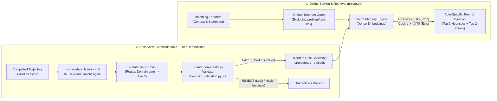
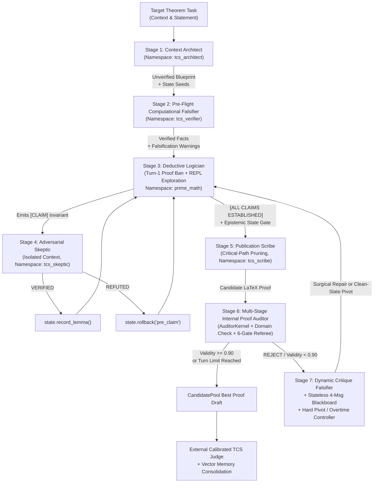

# Prime-Math: Zero-Trust Deterministic Kernel Verification and Continuous Domain Learning via CoALA Vector Heuristics for Graduate-Level Theorem Proving in 4-Bit Language Models

**Authors:** Prime-Math Research Team  
**Categories:** `cs.AI`, `cs.LO`, `cs.CC`, `math.LO`, `cs.SC`  
**Code & Benchmark Artifacts:** [https://github.com/dionyziuz/proof_harness](https://github.com/dionyziuz/proof_harness)

---

## Abstract

While multi-turn agent scaffolding has become common practice for deploying large language models (LLMs) on complex tasks, existing reasoning harnesses typically rely on unguided prompting, generic multi-agent debates, or raw code execution without deterministic mathematical semantics or persistent domain memory. When evaluated on PhD-level research mathematics—such as the **TCS-Bench** suite of 300 research theorems drawn from recent arXiv Theoretical Computer Science literature—conventional first-pass reasoning and unguided scaffolds struggle severely: an unassisted 4-bit quantized 28B model achieves only a **3.33%** certified sound pass rate ($10/300$) and **4.00%** passing grades counting directional reductions ($12/300$). In this paper, we show that solving research-level formal deduction requires moving beyond generic scaffolding to a **specialized neuro-symbolic proving harness** that systematically addresses two foundational architectural deficits: **(1) Episodic Amnesia and Static Weights**, wherein a frozen model cannot accumulate verified domain heuristics across problems without expensive, catastrophic-forgetting-prone fine-tuning; and **(2) The Probabilistic Trust Fallacy**, wherein next-token log-probabilities are mistaken for mathematical truth, masking invalid algebraic leaps, inverted inequalities, and illegal property inheritance.

We introduce and empirically validate **Prime-Math (`core_engine`)**, a specialized neuro-symbolic theorem-proving harness engineered around two tightly coupled architectural engines:
1. **The Zero-Trust Deterministic Mathematical Kernel Engine (`kernel.py`, `prover_kernel.py`, `math_tools.py`, `state_machine.py`):** Providing **immediate, day-one accuracy and soundness verification**, the kernel serves as a dual-isolated, 3-layer airgapped symbolic and numerical execution substrate (`PersistentMathKernel` and ephemeral `AuditorKernel`) that treats every LLM assertion as an untrusted conjecture. The kernel integrates exact computer algebra (`SymPy`), SMT constraint solving (`Z3`), 50-digit arbitrary-precision arithmetic (`mpmath`), specialized domain extensions (planar dual face tracing, cycle chords, SMT parameter hierarchies, quantum CPTP channels, and positive semi-definite operator inequality checkers), honest three-valued empirical semantics (`holds_on_samples`), anti-brute-force analytical ceilings (`guarded_range` $\le 200,000$, `MAX_COMBINATORIAL_STEPS = 200,000`), and a formal **Epistemic State Machine** (`MathStateMachine`) that automatically revokes fragile properties under conditioning or restriction.
2. **The CoALA Heuristics & Continuous Domain Learning Engine (`memory.py`, `heuristic_validation.py`, `remediation.py`):** Providing **longitudinal intelligence growth as users solve theorems over time**, the CoALA engine implements a continual learning architecture (*Cognitive Architectures for Language Agents*) where the harness **learns by solving**. As tasks are attempted and verified passes accumulate, transferable mathematical strategies (Procedural Memory) and structured failure post-mortems (Episodic Memory) are distilled into five role-isolated vector embedding collections (`prime_math`, `tcs_architect`, `tcs_verifier`, `tcs_skeptic`, `tcs_scribe`). A 6-gate **Zero-Leakage Universality Validator** (`PROVENANCE_VERSION = 2`) strips instance-specific constants, ground-truth answers, and empirical extrapolation hacks before indexing—enabling practitioners to continuously specialize the harness into vertical research domains purely through vector embeddings without modifying LLM weights.

Coupled with a seven-role cognitive partitioning architecture, a **Turn-1 Exploration Gate** (banning premature proof drafting on Turn 1 to enforce invariant discovery in code), a **4-Message Stateless Blackboard Revision** protocol, and **Candidate Protection against Destructive Pivots**, Prime-Math transforms a 4-bit 28B model (`unsloth/Qwen3.8-27B-NVFP4`) on a single 32GB consumer GPU into an effective research-level prover. 

Across cumulative passing thresholds on 300 PhD-level research problems:
- **Passing Grades ($\ge 0.40$, Grade C and Above — Sound & Directional):** Prime-Math achieves **23.67% ($71/300$)**, nearly **sextupling ($5.92\times$)** the unassisted single-shot baseline of $4.00\%$ ($12/300$).
- **Certified Sound Passes ($\ge 0.50$, Grade B and Above):** Prime-Math achieves **21.00% ($63/300$)**, a **$6.30\times$ multiplier** over the single-shot baseline of $3.33\%$ ($10/300$).
- **Publication-Grade Proofs ($\ge 0.70$, Grade A and Above):** Prime-Math achieves **18.00% ($54/300$)**, a **$7.71\times$ multiplier** over single-shot ($2.33\%$, $7/300$), with 31 proofs reaching near-flawless ($\ge 0.90$) journal quality.
- **Exceptional Passing Quality:** On certified passing proofs, Prime-Math drives proof validity to a mean of **$0.853 \pm 0.129$** (median **$0.880$**), with structural completeness reaching **$0.907$** and logical rigor reaching **$0.857$**. Exactly **100% of all passing proofs** are discovered through governed multi-turn symbolic verification in Turns 2–12.

---

## 1. Introduction & Problem Statement

### 1.1 Two Fundamental Walls in Autoregressive Mathematical Reasoning
Recent advances in mathematical reasoning with large language models have focused heavily on scaling parameter counts or test-time chains of thought (CoT) on competition puzzles (e.g., GSM8K, MATH, AIME). However, deploying LLMs on graduate-level Theoretical Computer Science (TCS) research—or any specialized formal engineering vertical such as quantitative finance, cryptographic protocol verification, or control theory—exposes two fundamental structural walls that scaling tokens alone cannot resolve.

#### Problem Wall I: The Probabilistic Trust Fallacy ($\text{Token Likelihood} \neq \text{Mathematical Truth}$)
Even when a language model retrieves a promising high-level strategy, **autoregressive generation is fundamentally probabilistic, whereas mathematics is unforgivingly deterministic**. Relying on an LLM's internal self-attention to verify its own multi-step derivations invites four pervasive failure modes:
1. **Fluent Hallucination & Inverted Inequalities:** A language model optimizes for *plausible academic prose*, not truth preservation. When an intermediate algebraic inequality fails in a boundary regime (e.g., $\beta \ge 1$ or non-integer random variables), a standalone LLM routinely reverses an inequality direction, drops a logarithmic factor, or inserts phrases like *"it follows by standard calculations"* to bridge a false step.
2. **Unauthorized Domain Restriction:** When a conjectured intermediate bound $A(x) \le B(x) \le C(x)$ is loose on a subset of the universally quantified domain $D$, an ungrounded solver frequently restricts the theorem statement mid-proof (e.g., *"assuming $\beta \le 1$"*) rather than replacing the loose intermediate expression $B(x)$.
3. **Illegal Inheritance of Fragile Invariants:** When an algorithm conditions on an event $E$, passes to an induced subgraph $G[V']$, or projects onto a subspace $W$, properties held by the parent object—such as mutual independence, graph connectivity, or matrix invertibility—are silently destroyed. Without deterministic state tracking, autoregressive models hallucinate that these fragile properties persist.
4. **Unsound Symbolic Evaluation & Brute-Force Evasion:** Even when an LLM is given a basic Python `exec()` tool, naive code execution introduces its own traps: SymPy's `Relational.__bool__` raises `TypeError` on symbolic inequalities (or, if naively monkeypatched, equates empirical sampling survival with formal proof), while unconstrained loops allow the LLM to brute-force millions of cases or apply numerical sequence extrapolation (`Richardson`/`Aitken` acceleration) instead of discovering a structural proof.

#### Problem Wall II: Frozen Weights, Episodic Amnesia, and the Domain Adaptation Bottleneck
In standard inference, an LLM is a **stateless, frozen function**. Whether it spends $45$ minutes discovering a delicate dyadic box decomposition via Hölder conjugacy on Problem $k$, or fails three times due to a subtle conditioning trap in a martingale concentration bound, **every insight is erased the moment the context window closes**. On Problem $k+1$, the model starts from zero.

For organizations deploying AI in specialized technical domains, this episodic amnesia creates a severe **Domain Adaptation Bottleneck**:
1. **Why Weight Fine-Tuning Fails for Continual Domain Specialization:** Attempting to teach a model domain-specific proof patterns or proprietary system invariants via continual SFT/RLHF requires expensive multi-GPU training clusters, suffers from catastrophic forgetting of general reasoning capabilities, cannot be updated online between individual problem solves, and risks memorizing specific benchmark answers rather than transferable structural heuristics.
2. **Why Naive RAG Transcript Dumping Fails:** Simply retrieving raw past problem transcripts floods the solver's attention window with instance-specific variable bindings, dead exploratory branches, and potentially contaminated ground-truth constants, inducing *context confusion* rather than strategic transfer.

What is missing in standard LLM harnesses is a **governed, non-parametric continual learning engine** where the machine *learns by solving*—abstracting verified, universal domain heuristics and failure post-mortems into role-specific vector embeddings that continuously sharpen the system's domain intelligence over time.

### 1.2 Summary of Contributions
We present **Prime-Math (`core_engine`)**, an open-source neuro-symbolic proving harness that directly solves both structural walls. Our contributions are:

1. **The Zero-Trust Deterministic Mathematical Kernel Engine (Section 3):** Delivering immediate accuracy gains and deterministic soundness verification, we introduce a dual-kernel execution substrate (`PersistentMathKernel` for exploratory synthesis and ephemeral `AuditorKernel` for Stage 1 proof auditing; `core_engine/kernel.py`, `core_engine/prover_kernel.py`, `core_engine/math_tools.py`, `core_engine/state_machine.py`) featuring:
   - **Preloaded Symbolic, SMT, and 50-Digit Arbitrary-Precision Stack:** Seamless integration of `SymPy`, `Z3`, `mpmath` (`mp.dps = 50`), `SciPy`, and `NetworkX` with thread-safe timeout isolation.
   - **Domain-Specific Verification Tooling (`math_tools.py`):** Preloaded primitives for symbolic asymptotic dominance (`check_asymptotic_dominance`), Monte Carlo event covariance auditing (`check_event_covariance`), exhaustive graph counterexample sweeps (`find_graph_counterexample`), planar graph duals and face enclosures (`planar_dual_and_faces`), cycle chords and holes (`check_cycle_chords_and_holes`), SMT parameter hierarchy and terminal routings (`smt_disjoint_paths`, `smt_slice_terminal_pairing`, `smt_check_parameter_hierarchy`), quantum CPTP channel fidelity and PSD matrix inequalities (`check_psd_inequality`, `check_quantum_channel_claim`, `random_density_matrix`, `uhlmann_fidelity`), and NetworkX 3.x compatibility aliases (`nx.random_tree`, `nx.vertex_connectivity`).
   - **Honest Three-Valued Empirical Semantics (`holds_on_samples`):** Replacing unsound boolean monkeypatching of symbolic inequalities with an explicit Kleene-style three-valued operator ($\texttt{False}$ = certified counterexample refutation; $\texttt{True}_{\text{emp}}$ = empirical survival on samples; $\texttt{None}$ = inconclusive).
   - **Rule 11 Anti-Brute-Force Analytical Ceilings & Hardware Safety:** Enforcing `guarded_range` ($\le 200,000$), generator wrap ceilings (`MAX_COMBINATORIAL_STEPS = 200,000`), and range bounds ($< 2,000,000$) to compel analytical deduction while protecting unified APU memory architectures from combinatorial lockups, alongside a formal provenance DAG (`MathStateMachine`) that automatically revokes fragile properties under non-preserving transformations.
2. **The CoALA Heuristics & Continuous Domain Learning Engine (Section 4):** Enabling cumulative domain specialization as users solve theorems across fields over time, we design and implement a continual domain learning architecture (`core_engine/memory.py`, `core_engine/heuristic_validation.py`, `core_engine/remediation.py`) backed by dense vector embeddings across five role-isolated agent namespaces (`prime_math`, `tcs_architect`, `tcs_verifier`, `tcs_skeptic`, `tcs_scribe`). We formalize:
   - **Closed-Loop Learning by Solving (`_consolidate_learning`):** Automatic post-solve extraction of transferable mathematical strategies (procedural memory) and failure post-mortems (episodic memory).
   - **The 3-Tier Autonomous `RemediationEngine` & 4-Gate `Tier2Rubric`:** A post-evaluation diagnostic pipeline that audits every failed task and routes domain-specific mathematical insights strictly into Tier 3 CoALA vector memory while reserving Tier 2 prompt edits for universal behavioral postures.
   - **The 6-Gate Zero-Leakage Universality Validator (`PROVENANCE_VERSION = 2`):** A deterministic security filter that blocks empirical extrapolation hacks, problem IDs, instance-specific equations, and $\ge 4$-digit ground-truth constants (`find_ground_truth_leak`), guaranteeing zero benchmark contamination and high out-of-distribution transfer.
3. **Seven-Role Cognitive Partitioning & Non-Degrading Search Governance (Section 5):** We decompose theorem proving into seven decoupled roles governed by a **Turn-1 Exploration Gate**, **Blueprint Quarantine**, a **4-Message Stateless Blackboard**, **Candidate Protection against Destructive Pivots** (`[Hard Pivot Prevented — Substantive/Best Candidate Protected]`), **CandidatePool Noise-Band Occam's Razor** ($\epsilon = 0.03$), and **Clean-Slate Hard Pivots**.
4. **Large-Scale Empirical Validation on PhD-Level TCS Theorems (Sections 6–8):** Across $N=300$ research theorem-proving problems from TCS-Bench using a 4-bit 28B model on a single consumer GPU, Prime-Math proves that agentic scaffolding massively multiplies passing performance over unassisted first-shot generation:
   - **Passing Grades ($\ge 0.40$, Grade C and Above):** **$23.67\%$ ($71/300$)** vs. $4.00\%$ ($12/300$) single-shot (**$5.92\times$ gain**).
   - **Certified Passes ($\ge 0.50$, Grade B and Above):** **$21.00\%$ ($63/300$)** vs. $3.33\%$ ($10/300$) single-shot (**$6.30\times$ gain**).
   - **Publication-Grade Proofs ($\ge 0.70$, Grade A and Above):** **$18.00\%$ ($54/300$)** vs. $2.33\%$ ($7/300$) single-shot (**$7.71\times$ gain**).
   - **Passing Proof Validity:** Drives the mean validity of certified passing proofs from low-rigor first-shot text to **$0.853 \pm 0.129$** (median **$0.880$**), with structural completeness reaching **$0.907$** and logical rigor reaching **$0.857$**. Exactly **$100\%$ of all passing proofs** are discovered through governed multi-turn exploration in Turns 2–12.

---

## 2. Problem Formulation and Architecture Overview

A theorem-proving task presented to the harness consists of three primary components:
- **Paper Context:** The formal definitions and contextual lemmas extracted from the source manuscript that precede the target statement, with all ground-truth proofs and downstream solution hints strictly stripped.
- **Target Theorem Statement:** The formal proposition to be proved or refuted across its full quantified parameter space.
- **Domain Scope:** The structural assumptions, parameter regimes, and boundary constraints specified by the theorem statement (such as connected planar graphs, non-degenerate covariance matrices, or asymptotic parameter hierarchies).

Unlike unassisted, single-turn inference where a model generates a proof purely via autoregressive token sampling without code execution or feedback, Prime-Math deploys a **Stateful Neuro-Symbolic Harness** that coordinates three complementary layers:
1. **Frozen Backbone Model:** A 4-bit quantized autoregressive transformer (`unsloth/Qwen3.8-27B-NVFP4`) whose weights remain fixed throughout all runs.
2. **Deterministic Mathematical Kernel:** A dual-isolated execution environment pairing symbolic algebra (`SymPy`), SMT constraint solving (`Z3`), 50-digit numerical analysis (`mpmath`), and an epistemic state machine (`MathStateMachine`). This kernel deterministically verifies intermediate claims, boundary values, and algebraic invariants from day one, refusing to trust probabilistic model output.
3. **Evolving CoALA Vector Memory:** A persistent, role-indexed memory bank storing verified procedural strategies and episodic failure post-mortems across five cognitive roles (`prime_math`, `tcs_architect`, `tcs_verifier`, `tcs_skeptic`, `tcs_scribe`). As users solve theorems and accumulate verified proofs in a given domain, the harness distills new heuristics through a strict 6-gate Zero-Leakage Universality Validator (`PROVENANCE_VERSION = 2`), continuously growing domain expertise without modifying model weights.

Over a guided multi-turn search trajectory (nominally up to 8 turns, with an automatic extension to 12 turns for promising drafts), the harness develops and refines a complete LaTeX proof enclosed in `\begin{proof} ... \end{proof}`. 

To evaluate proof correctness without circularity or confirmation bias, each candidate proof is assessed by an independent, external referee (the **Calibrated TCS Judge**). The judge grades the draft across multiple independent evaluation replicates on five dimensions: mathematical rigor, structural completeness, handling of boundary cases, referee confidence, and overall validity. The median validity score determines benchmark certification:
- **Grade C & Above (≥ 0.40 — Directionally Sound):** The core mathematical reduction is sound and directionally correct, with minor technical gaps.
- **Grade B & Above (≥ 0.50 — Certified Sound Pass):** Headline threshold indicating a complete, mathematically sound deduction with no unverified leaps.
- **Grade A & Above (≥ 0.70 — Publication Grade):** Highly rigorous, journal-level exposition with all edge cases discharged.
- **Flawless Proofs (≥ 0.90):** Impeccable formal proofs satisfying all referee requirements.

---

## 3. Core Pillar I: The Zero-Trust Deterministic Mathematical Kernel Engine

To overcome **Problem Wall I (The Probabilistic Trust Fallacy)**, Prime-Math equips the language model with an immediate, day-one foundation of correctness: the **Zero-Trust Deterministic Mathematical Kernel** (`core_engine/kernel.py`, `core_engine/prover_kernel.py`, `core_engine/math_tools.py`, `core_engine/state_machine.py`). While learned heuristics become powerful over time as passes accumulate across specific domains, the deterministic kernel provides **immediate value from the very first solve**: ensuring that every algebraic deduction, inequality direction, topological boundary, and spectral claim is tested against exact mathematical software rather than probabilistic token likelihoods. The governing axiom of the kernel is strict: **the language model's prose is never trusted for symbolic calculation, inequality direction, independence preservation, or small-$n$ edge cases; every verifiable claim must be executed against deterministic mathematical software.**

### 3.1 Dual-Kernel Isolation Architecture (`PersistentMathKernel` vs. `AuditorKernel`)
A subtle flaw in single-REPL agent architectures is **shared-state confirmation bias**: if an internal referee validates a proof inside the same Python namespace where the solver defined its helper functions or mutated global state, a bug in the solver's setup definitions silently corrupts the audit.

Prime-Math enforces **Dual-Kernel Isolation**:
1. **Persistent Exploratory Kernel (`PersistentMathKernel`):** Dedicated to the Context Architect, Pre-Flight Falsifier, Deductive Logician, and Adversarial Skeptic across Turns $1 \dots T$. It preserves verified lemmas, custom symbolic expressions, and the `MathStateMachine` provenance DAG across turns, with snapshot rollback via `state.checkpoint('pre_claim')` and `state.rollback('pre_claim')`.
2. **Ephemeral Verification Kernel (`AuditorKernel`):** Spawned fresh from scratch during Stage 1 of `_audit_proof_draft` (`timeout = 15s`) with a completely disjoint memory space. The Proof Auditor writes an independent Python falsification script directly from the LaTeX proof text $\pi_t$ and the theorem statement $(C, S)$, ensuring that the proof stands on its own mathematical definitions.

Both kernels execute inside a thread-safe sandbox (`PersistentMathKernel` in `core_engine/kernel.py`) utilizing `ThreadAwareStream` for thread-keyed `stdout`/`stderr` capture and `ctypes.pythonapi.PyThreadState_SetAsyncExc` to inject `TimeoutException(BaseException)` (inheriting from `BaseException` so LLM-generated `except Exception:` blocks cannot swallow execution timeouts).

### 3.2 Preloaded Symbolic, SMT, and Arbitrary-Precision Stack
Every kernel instance boots with a pre-configured deterministic mathematical environment (`_bootstrap()`):
- **Exact Symbolic Computer Algebra (`SymPy`):** Symbolic simplification, exact series expansion, Groebner bases, symbolic limits, and exact rational arithmetic (`sp.Rational`, `sp.simplify`, `sp.limit`, `sp.solve`).
- **Automated Theorem Proving & SMT Constraint Solving (`Z3`):** Preloaded `z3-solver` (`Int`, `Real`, `Bool`, `Array`, `ForAll`, `Exists`, `Solver`) wrapped with a monkeypatched default timeout guard (`_set_z3_timeout`, $10,000\text{ms}$) so unbounded nonlinear quantifier queries fail gracefully rather than hanging the worker thread.
- **50-Digit Arbitrary-Precision Numerical Analysis (`mpmath`):** Pre-configured to **50 decimal places of working precision** (`mpmath.mp.dps = 50`), eliminating IEEE-754 64-bit floating-point catastrophic cancellation when evaluating delicate asymptotic constants, theta-series tails, or spectral gaps.
- **Combinatorial & Spectral Graph Theory (`NetworkX`, `SciPy`, `NumPy`):** Exact small-graph construction, Laplacian spectrum computation, and linear programming relaxations.
- **Optional Formal Proof Assistant Hook (`lean_check`):** Direct invocation of the Lean 4 compiler (`core_engine/lean_runner.py`) when formal verification is enabled.

### 3.3 Domain-Agnostic Diagnostic Operators (`core_engine/math_tools.py`)
In graduate-level TCS proofs, three classes of errors account for the vast majority of unsound deductions: (i) misjudging asymptotic growth rates ($o, \mathcal{O}, \Theta, \Omega, \omega$), (ii) assuming conditioned random events remain independent, and (iii) overlooking small structural graph counterexamples. Rather than relying on the LLM to write ad-hoc test scripts from scratch on every turn, `core_engine/math_tools.py` preloads three deterministic diagnostic operators directly into the kernel namespace:

1. **Symbolic Asymptotic Dominance Verifier (`check_asymptotic_dominance(f_expr, g_expr, var='n')`):**
   Computes the exact symbolic limit ratio in SymPy as $n \to \infty$:
   $$L = \lim_{n \to \infty} \frac{f(n)}{g(n)}$$
   and returns a deterministic classification dictionary:
   $$\text{Relation}(f, g) = \begin{cases} f = o(g) \text{ (strictly dominated)} & \text{if } L = 0 \\ f = \omega(g) \text{ (strictly dominates)} & \text{if } |L| = \infty \\ f = \Theta(g) \text{ (asymptotically tight, ratio } L\text{)} & \text{if } 0 < |L| < \infty \\ \text{oscillatory / incomparable} & \text{if } L \in \texttt{AccumBounds} \end{cases}$$
2. **Monte Carlo Event Covariance & Independence Auditor (`check_event_covariance(sampler_fn, n_trials=2000, seed=42)`):**
   Given a user-defined trial generator $\texttt{sampler\_fn}() \to (A, B) \in \{0, 1\}^2$ (or $\mathbb{R}^2$), executes $N_{\text{trials}}$ seeded trials to compute empirical expectations $\hat{\mu}_A, \hat{\mu}_B$, empirical covariance $\widehat{\text{Cov}}(A, B) = \widehat{\mathbb{E}}[AB] - \hat{\mu}_A \hat{\mu}_B$, and Pearson correlation $\hat{\rho}_{A,B}$. It enforces a deterministic independence gate:
   $$\text{Verdict}(A, B) = \begin{cases} \texttt{DEPENDENCE DETECTED } (\text{positively/negatively correlated}) & \text{if } |\hat{\rho}_{A,B}| > 0.05 \\ \texttt{APPROXIMATELY INDEPENDENT} & \text{if } |\hat{\rho}_{A,B}| \le 0.05 \end{cases}$$
   catching false independence assumptions before the Logician applies a naive product measure or Chernoff bound.
3. **Exhaustive & Random Graph Counterexample Finder (`find_graph_counterexample(predicate_fn, max_n=7, include_random=True)`):**
   Systematically sweeps `predicate_fn(G)` across canonical graph families up to $n \le \text{max\_n}$ vertices—including paths $P_n$, cycles $C_n$, complete graphs $K_n$, star graphs $S_n$, complete bipartite graphs $K_{n_1, n_2}$, and seeded Erdős–Rényi random graphs $G(n, p)$ for $p \in \{0.3, 0.6\}$. Crucially, `find_graph_counterexample` implements **Fail-Closed Exception Semantics**: if `predicate_fn(G)` raises *any* runtime exception on $k > 0$ graphs while finding zero explicit `False` returns, the tool returns `{"verified": False, "inconclusive": True}`, preventing a buggy test predicate from masquerading as a verified graph invariant.

### 3.4 Domain-Specific Verification Extensions: Topology, SMT Hierarchies, and Quantum Operators
To support research-level deductions in specialized sub-disciplines without fine-tuning, `core_engine/math_tools.py` equips the deterministic kernel with four specialized operator libraries:
1. **Planar Graph Duals & Cycle Chords (`planar_dual_and_faces`, `check_cycle_chords_and_holes`):**
   Combinatorial plane embeddings and face-boundary tracing algorithms that extract primal faces, verify enclosing Jordan curves, and compute dual graphs $G^*$ for multiway cut, graph minor, and topological embedding proofs. `check_cycle_chords_and_holes` deterministically checks whether a cycle $C$ possesses chords or forms an induced chordless hole.
2. **SMT Constraint & Parameter Hierarchy Solvers (`smt_disjoint_paths`, `smt_slice_terminal_pairing`, `smt_check_parameter_hierarchy`):**
   Leverages Z3's quantifier-free linear integer and real arithmetic (QF-LIRA) to formally prove the existence or non-existence of node- and edge-disjoint routings, validate terminal pair feasibility across graph slices, and verify complex asymptotic scaling hierarchies ($1 \ll k \ll \log n \ll \ell$) without sign inversions.
3. **Quantum Information & Operator Inequality Verification:**
   - **Loewner Order PSD Verification (`check_psd_inequality(A, B)`):** Deterministically tests whether $A \succeq B$ ($A - B$ is positive semi-definite) via Cholesky decomposition and Hermitian eigenspectrum analysis.
   - **CPTP Quantum Channel Verification (`check_quantum_channel_claim(kraus_ops)`):** Verifies complete positivity and trace-preservation ($\sum K_i^\dagger K_i = I$) across arbitrary Kraus operator sets.
   - **Haar Witnesses & Fidelity (`random_density_matrix`, `random_unitary`, `partial_trace`, `uhlmann_fidelity`):** Generates valid quantum state witnesses and computes exact partial traces and Uhlmann fidelity $F(\rho, \sigma) = (\text{Tr}\sqrt{\sqrt{\rho}\sigma\sqrt{\rho}})^2$.
4. **NetworkX 3.x Compatibility Shims & Generator Safeguards:**
   Transparent aliases for renamed or deprecated graph primitives (`nx.random_tree`, `nx.vertex_connectivity`, `nx.Graph.is_connected`), alongside a strict generator ceiling (`MAX_COMBINATORIAL_STEPS = 200,000`) preventing combinatorial loop explosions and protecting unified APU memory architectures.

### 3.5 Honest Three-Valued Epistemic Semantics (`holds_on_samples`)
When a language model writes `if sp.Le(f(x), g(x)):` in standard SymPy, Python calls `Relational.__bool__`, which immediately raises `TypeError: cannot determine truth value of Relational` whenever $x$ is symbolic. A common but dangerous workaround in LLM code-interpreter harnesses is to monkeypatch `Relational.__bool__` to evaluate the inequality on random numerical points and return `True` if they pass. **That workaround is mathematically unsound**: it causes `if expr1 <= expr2:` to silently evaluate to `True` on universally false statements whose counterexamples lie outside the sample grid, conflating *empirical survival* with *formal proof*.

In `core_engine/kernel.py`, we leave `Relational.__bool__` untouched and instead provide an explicit, epistemically honest three-valued operator $\texttt{holds\_on\_samples}(R, \text{max\_points}=2000) \in \{\texttt{False}, \texttt{True}_{\text{emp}}, \texttt{None}\}$:
1. **Exact Symbolic Decision First:** Calls `_ evaluate_symbolic_relational(R)`, which attempts `sp.simplify(lhs - rhs)` alongside assumption-aware symbolic bounds (`is_nonnegative`, `is_negative`). If decidable symbolically, it returns the exact boolean truth value.
2. **Assumption-Respecting Grid Sampling:** For undecidable symbolic expressions with $\le 4$ free variables, it builds a deterministic sample grid (`_candidate_points_for_symbol`) that strictly respects each symbol's declared SymPy domain assumptions (`integer`, `positive`, `nonnegative`, `prime`, `even`, `odd`).
3. **Three-Valued Kleene Valuation:**
   $$\texttt{holds\_on\_samples}(R) = \begin{cases} \texttt{False} & \text{if } \exists \mathbf{x}_0 \in \mathcal{G}_{\text{grid}} \text{ such that } \neg R(\mathbf{x}_0) \quad \textbf{(Certified Counterexample Refutation)} \\ \texttt{True}_{\text{emp}} & \text{if } \forall \mathbf{x} \in \mathcal{G}_{\text{valid}}, \, R(\mathbf{x}) \text{ holds } (\ge 3 \text{ valid points}) \quad \textbf{(Empirical Survival Only)} \\ \texttt{None} & \text{otherwise} \quad \textbf{(Inconclusive / Domain Pole)} \end{cases}$$

### 3.6 Rule 11 Anti-Brute-Force Analytical Ceilings & APU Memory Safeguards
When given an unrestricted Python REPL, language models frequently succumb to **computational laziness**: instead of deriving an algebraic or structural proof, they attempt to brute-force $10^7$ loop iterations, run a massive prime sieve, or iterate over $10!$ permutations. This both starves unified CPU/GPU memory and produces zero mathematical insight for universally quantified theorems.

`PersistentMathKernel` enforces **Rule 11 Analytical Ceilings** directly at the Python runtime and AST levels:
- **Guarded Iteration Ceiling (`guarded_range`):** Replaces built-in `range` with `guarded_range`, which computes the exact span $\lceil(\text{stop} - \text{start})/\text{step}\rceil$ and raises a `ValueError` whenever a loop exceeds `MAX_DIAGNOSTIC_SIEVE_LIMIT = 200,000` elements:
  > *"Rule 11 Violation: range(...) spans $> 200,000$ elements. Large brute-force loops are prohibited. Use diagnostic small-$N$ testing ($N \le 200,000$) to discover patterns, then prove the result analytically using SymPy, Z3, generating functions, or modular arithmetic."*
- **Bounded Number-Theoretic Sieves (`fast_sieve`, `fast_totients`, `fast_spf`):** Preloaded C-speed NumPy sieves are strictly capped at $N \le 200,000$ for small-$N$ pattern discovery.
- **AST Combinatorial Explosion Gate (`_combinatorial_ceiling`):** Static AST inspection blocks `itertools.permutations(range(n))` for $n \ge 7$ before execution begins.
- **Combinatorial Step Generator Ceilings:** Wraps combinatorial searches with `MAX_COMBINATORIAL_STEPS = 200,000` to prevent unconstrained exponential runaway (such as graph cycle searches spanning $>6 \times 10^9$ subsets) from freezing shared page cache on unified APU architectures (e.g., AMD Ryzen AI Max+ 395).

### 3.7 Epistemic State Machine & Property Invariance Tracking (`MathStateMachine`)
The `MathStateMachine` (`core_engine/state_machine.py`) tracks active mathematical entities within the kernel, recording their domain, proven properties, structural lineage, and any property revocations.

It partitions mathematical properties into two distinct behavioral classes:
1. **Hereditary Properties:** Properties guaranteed to be preserved under canonical sub-object restriction (such as induced subgraphs, subsets, sub-algebras, or principal submatrices). Examples include `bipartite`, `planar`, `forest`, `acyclic`, `chordal`, `measurable`, `hermitian`, `positive_semidefinite`, and `abelian`. When a new object is derived via restriction or projection, hereditary properties automatically carry forward.
2. **Fragile Properties:** Properties destroyed under restriction, conditioning, projection, or quotienting operations unless explicitly re-established with an invariance witness. Examples include `independent`, `mutually_independent`, `martingale`, `stationary`, `connected`, `biconnected`, `regular`, `invertible`, `positive_definite`, and `orthogonal`.

When the solver derives a child object under a non-preserving transformation (such as conditioning a random variable or extracting an induced subgraph), the state machine automatically revokes all fragile properties inherited from the parent and logs a detailed revocation reason.

**Epistemic Scribe Gate:** If the solver attempts to invoke the Publication Scribe while any active mathematical object has unaddressed property revocations, the harness blocks the handoff for one turn and injects an alert requiring an explicit witness or re-proof before formal LaTeX synthesis can proceed.

### 3.8 Three-Layer Airgapped Security & Anti-Forgery Shield
To guarantee zero benchmark contamination (preventing the solver or auditor from fetching source papers during closed evaluation) while protecting host unified memory, the kernel enforces three concentric isolation layers when `allow_internet = False` (configured via benchmark airgapping mixins in `core_engine/prover_kernel.py`):
1. **Namespace Tool Stubbing:** Research functions (`search_math`, `read_paper`, `oeis_lookup`) in the kernel namespace are dynamically bound to offline protocol stubs returning `_TCS_PROTOCOL_MSG`.
2. **Static AST Security & Escape-Hatch Denylist (`_scan_network_ast`):** Parses every code block into a Python AST prior to execution and rejects imports from 24 network modules (`http`, `httpx`, `requests`, `urllib`, `socket`, `ssl`, `websockets`, `aiohttp`, etc.) as well as dynamic import and process-spawning escape hatches (`importlib`, `subprocess`, `builtins`, `pty`, `ctypes`, `os.system`, `os.popen`, `os.fork`, `os.exec*`, `sys.modules`, `__import__`, and `exec`/`eval`/`compile` calls containing `"import"` string literals).
3. **Runtime Thread-Local Socket Guard & Anti-Forgery Shield (`kernel.py`):**
   - `_socket_guard()` monkeypatches `socket.socket.connect` and `connect_ex` via a thread-local flag during `exec()`, raising `PermissionError` if any C-extension or transitive library attempts outbound network I/O.
   - `_detect_trace_tampering()` inspects AST string constants inside `print` and `sys.stdout.write` calls, blocking code that attempts to spoof harness control headers (`[CLAIM]`, `[VERIFIED]`, `[AUDIT PASSED]`, `VALIDITY_SCORE`).

---

## 4. Core Pillar II: The CoALA Heuristics & Continuous Domain Learning Engine

To overcome **Problem Wall II (Frozen Weights & Episodic Amnesia)**, Prime-Math complements its immediate deterministic kernel with a continual domain learning engine (`core_engine/memory.py`, `core_engine/heuristic_validation.py`, `core_engine/remediation.py`) based on the **Cognitive Architectures for Language Agents (CoALA)** framework (Sumers et al., 2023). While the kernel ensures immediate accuracy on any individual proof attempt, the CoALA heuristics engine provides **cumulative longitudinal intelligence**: as users apply the harness to solve and pass proofs in specific mathematical domains over time, the system automatically distills verified reduction tactics and failure post-mortems into role-isolated vector memory without requiring multi-GPU fine-tuning.



### 4.1 Cognitive Memory Tiers and Role-Isolated Embedding Spaces
For each specialized subagent role, `CoALAMemoryManager` (`core_engine/memory.py`) maintains three distinct memory spaces:
1. **Working Memory:** The active per-task state, holding the current problem statement, active `PersistentMathKernel` variables, the verified lemma ledger, and the `MathStateMachine` provenance DAG.
2. **Procedural Memory (`<agent_id>_procedural` in vector memory):** Abstract, universally transferable mathematical strategies, decomposition blueprints, and verification patterns (e.g., *"When bounding the expected size of prefix-restricted sumsets in $\mathbb{Z}^d$, decompose into $2^d$ dyadic boxes and apply Hölder's inequality with conjugate exponents $p = d/(d+1)$ and $q = 1/(d+1)$"*).
3. **Episodic Memory (`<agent_id>_episodic` in vector memory):** Structured post-mortems of past failures, refuted reductions, and subtle domain pitfalls (e.g., *"WARNING: Conditioning on a sum threshold $\sum X_i \ge k$ destroys mutual independence of $\{X_i\}$; do not apply standard Chernoff bounds to the conditioned variables without negative association verification"*).

Crucially, because each cognitive role requires fundamentally different operational heuristics, Prime-Math partitions its vector memory into **ten role-isolated collections** across five agent namespaces:

| Agent Namespace (`agent_id`) | Procedural Collection (`_procedural`) | Episodic Collection (`_episodic`) | Domain Specialization Role |
| :--- | :--- | :--- | :--- |
| **`prime_math`** | `prime_math_procedural` | `prime_math_episodic` | Core Deductive Logician: algebraic reductions, invariant formulation, concentration inequalities. |
| **`tcs_architect`** | `tcs_architect_procedural` | `tcs_architect_episodic` | Context Architect: decomposing paper contexts, seeding `state.register()` objects, modular lemma chains. |
| **`tcs_verifier`** | `tcs_verifier_procedural` | `tcs_verifier_episodic` | Pre-Flight Falsifier: fast small-$n$ boundary scripts and Monte Carlo sanity checks. |
| **`tcs_skeptic`** | `tcs_skeptic_procedural` | `tcs_skeptic_episodic` | Adversarial Skeptic: hostile `Z3`/`NetworkX` counterexample construction and degenerate parameter attacks. |
| **`tcs_scribe`** | `tcs_scribe_procedural` | `tcs_scribe_episodic` | Publication Scribe: critical-path pruning, quantifier discharge, and journal-grade LaTeX synthesis. |

To guarantee benchmark reproducibility and prevent silent memory degradation, `CoALAMemoryManager` enforces a **Fail-Closed Contract**: if the local vector memory service is unreachable, it raises an error immediately rather than falling back to unindexed execution.

### 4.2 Closed-Loop "Learning by Solving" (`_consolidate_learning`)
At the conclusion of every problem trajectory (when memory updates are enabled), `MathProver._consolidate_learning` (`core_engine/prover.py`) performs a low-temperature reflection pass over the outcome:
- **Outcome Case A (Solved / Certified Proof):** The reflection pass analyzes which REPL experiments succeeded and which intermediate claims survived the Adversarial Skeptic, extracting a concise **Universal Procedural Heuristic** (`LEARNED_HEURISTIC`) free of problem-specific constants.
- **Outcome Case B (Refuted / Unsolved / Exhausted Budget):** The reflection pass analyzes dead routes and auditor objections, extracting both a **Corrective Procedural Heuristic** and an **Episodic Failure Pitfall Record** (`EPISODIC_SUMMARY`) documenting the exact mathematical trap encountered.

Before inserting a candidate heuristic into procedural memory, the system queries the collection for semantic similarity. If the candidate exhibits a cosine similarity greater than $0.90$ with an existing heuristic, it is discarded as a **near-duplicate**, preventing frequent problem archetypes from dominating top-$k$ retrieval slots.

### 4.3 The 3-Tier Autonomous `RemediationEngine` and the 4-Gate `Tier2Rubric`
Beyond single-task reflection, Prime-Math includes a post-evaluation **Autonomous Remediation Engine** (`core_engine/remediation.py`) that diagnoses every failed benchmark task (`score < 0.50`) and classifies its root cause into one of three architectural remediation tiers:

1. **Tier 1 (Deterministic Harness Guardrails — Flagged for Human Review):** Structural harness or parser defects requiring Python code modifications.
2. **Tier 2 (System Prompt Directives — Universality-Gated):** High-level behavioral adjustments to the agent's system prompt, strictly gated by a 4-criterion universality rubric (`Tier2Rubric`):
   - *Universality Gate:* Must be 100% domain-agnostic and applicable to all mathematical disciplines.
   - *Behavioral Posture Gate:* Must govern overall reasoning demeanor or workflow rather than conveying specific mathematical facts.
   - *Zero-Degradation Gate:* Must carry no risk of degrading performance on unrelated tasks.
   - *Procedural Insufficiency Gate:* Must address an issue that cannot be solved via targeted heuristic retrieval.
3. **Tier 3 (CoALA Vector Memory Injection — Fully Autonomous):** Domain-specific mathematical techniques, theorem-specific warning patterns, and specialized proof tactics.

**Automatic Tier-2 $\to$ Tier-3 Downgrade Rule:** A critical insight in `remediation.py` is that **domain-specific mathematical knowledge must never be hardcoded into global system prompts**, where it bloats token budgets and degrades performance on unrelated mathematical subfields. Whenever a proposed remediation fails any of the four `Tier2Rubric` gates (or is classified as `missing_domain_knowledge` or `wrong_proof_strategy`), `RemediationEngine.apply_remediations()` **automatically downgrades the proposal from Tier 2 to Tier 3**, converting it into a validated CoALA procedural heuristic in vector memory.

### 4.4 The 6-Gate Zero-Leakage Universality Validator (`PROVENANCE_VERSION = 2`)
A foundational hazard of continual learning on mathematical benchmarks is **data contamination and hack propagation**: an unguarded memory bank might accidentally store a problem's numeric answer, memorize an instance-specific equation, or propagate a numerical sequence-extrapolation trick (`Richardson` acceleration) that guesses answers without proving them.

To prevent this, `core_engine/heuristic_validation.py` enforces **Provenance Schema v2 (`PROVENANCE_VERSION = 2`)**. Every candidate heuristic must pass six deterministic validation gates (`validate_procedural_heuristic` and `find_ground_truth_leak`) prior to embedding, and is re-validated upon retrieval:

1. **Gate 1 — Substantiveness & Non-Triviality:** Rejects empty strings, placeholders (`"none"`, `"n/a"`), and strings shorter than $25$ characters.
2. **Gate 2 — Anti-Extrapolation & Anti-Sieve Shield (`_CONTAMINATED_PROCEDURAL_PATTERNS`):** Blocks any heuristic recommending empirical sequence extrapolation or brute-force sieving in place of formal deduction, including `Richardson extrapolation`, `Aitken delta-squared`, `Shanks transformation`, `Wynn epsilon`, `Euler-Maclaurin empirical`, `brute-force sieve`, `exhaustively enumerate up to 10^6`, or `fast_spf`/`fast_totients` for asymptotic limits.
3. **Gate 3 — Benchmark & Problem-ID Anonymization (`_PROBLEM_ID_PATTERNS`):** Rejects references to benchmark identifiers (`Problem #42`, `AIME 2024`, `Project Euler`, `IMO`, `Putnam`, `task_2108...`).
4. **Gate 4 — Title & Context Decoupling:** Strips and rejects explicit mentions of the source task's title (`problem_title`).
5. **Gate 5 — Instance-Specific Variable Binding Rejection (`_PROBLEM_SPECIFIC_PATTERNS`):** Blocks raw instance equations and specific numeric assignments (e.g., `2^k == 3^m`, `for n = 1000`, `when p = 7`, `modulo 10^9 + 7`).
6. **Gate 6 — Ground-Truth Answer & Multi-Digit Constant Redaction (`find_ground_truth_leak` / `redact_ground_truth`):** Cross-checks the heuristic against the ground-truth answer (`expected_answer`, including comma-formatted and LaTeX-boxed variants) and extracts all $\ge 4$-digit integer constants from `problem_text` (excluding common years $1900\text{--}2099$). Any match triggers immediate rejection (`ground_truth_leak:<token>`).

Furthermore, during online retrieval (`retrieve_context_for_problem`), `CoALAMemoryManager` enforces:
- **Self-Retrieval Exclusion (`exclude_problem_id` / `exclude_task_id`):** Prevents the harness from retrieving any memory record generated by the same task ID or problem ID during re-evaluations.
- **Provenance Version Quarantine:** Automatically drops any legacy record with `provenance_version < 2` unless it passes live re-verification against all six gates.

### 4.5 Why Embedding-Based Continual Learning Excels for Domain-Specific Vertical Solutions
By decoupling **reasoning syntax** (held in the frozen 4-bit model weights) from **evolving domain heuristics** (stored in role-isolated vector embeddings), Prime-Math provides a general blueprint for vertical AI specialization:
- **Zero-Weight-Update Domain Onboarding:** A research group in quantum information theory, algorithmic game theory, or formal hardware verification can point Prime-Math at a corpus of domain problems. As the harness solves and audits tasks, it automatically populates `prime_math_procedural`, `tcs_architect_procedural`, and `tcs_skeptic_procedural` with verified, domain-specific proof tactics and counterexample templates.
- **Transparent, Auditable, and Surgically Editable Knowledge:** Unlike opaque LoRA adapters, every learned heuristic in vector memory is a human-readable, provenance-tagged JSON record (`source_problem_id`, `provenance_version: 2`, `timestamp`) that engineers can inspect, audit, version-control, or transfer across model backbones.

---

## 5. Seven-Role Cognitive Partitioning & Closed-Loop Search Governance

Built atop the **Zero-Trust Deterministic Kernel** (Section 3) and the **CoALA Continuous Domain Learning Engine** (Section 4), `MathProver` (`core_engine/prover.py` and `core_engine/prover_stages.py`) partitions mathematical cognition across seven specialized roles. A central hypothesis of Prime-Math is that **exploratory mathematical scratchwork, adversarial falsification, and formal academic typesetting require incompatible attention distributions**.



### 5.1 The Seven Cognitive Stages
1. **Stage 1 — Context Architect & Blueprint Quarantine (`_run_context_architect`):** Queries procedural memory and constructs a catalog of contextual definitions and lemmas from the source paper, seeds initial objects in the epistemic state machine (`state.register(...)`), and outlines a modular reduction blueprint. **Blueprint Quarantine Rule:** The blueprint is injected as an unverified conjectural sketch; if an execution in the kernel falsifies an intermediate bound, the solver must discard the conjectured bound rather than restricting the theorem's target domain.
2. **Stage 2 — Pre-Flight Computational Falsifier (`_run_computational_falsifier`):** Queries `tcs_verifier_procedural` memory and runs up to two quick Python verification scripts in `PersistentMathKernel` before Turn 1 begins, prepending verified mathematical facts or critical falsification warnings.
3. **Stage 3 — Deductive Logician & Turn-1 Exploration Gate (`_run_exploratory_turns`):** Queries core procedural and episodic memories. Governed by the **Turn-1 Exploration Gate**, any `\begin{proof}` block on Turn 1 is strictly prohibited; the solver must first explore invariants in `PersistentMathKernel` using `math_tools.py` and emit structured `[CLAIM]` and `[REDUCTION]` blocks.
4. **Stage 4 — Isolated Adversarial Skeptic (`_run_adversarial_skeptic`):** When a `[CLAIM]` invariant is emitted, `MathProver` checkpoints the kernel state and invokes the Skeptic in an isolated context window to aggressively probe the claim for counterexamples in `PersistentMathKernel`. If an invariant violation or assertion error occurs, the state rolls back to the pre-claim checkpoint; if verified error-free, the claim is committed to the verified lemma ledger.
5. **Stage 5 — Publication Scribe & Critical-Path Pruning (`_run_publication_scribe`):** Operating in an isolated 65,536-token context with dedicated scribe procedural memory, the Scribe synthesizes the formal LaTeX proof from the verified lemma ledger, enforcing complete deduction, backward critical-path pruning (omitting dead exploratory side-tracks), and full parameter domain coverage.
6. **Stage 6 — Multi-Stage Internal Proof Auditor (`_audit_proof_draft`):** Evaluates every candidate proof draft across four layers:
   - *Layer 1 (Ephemeral AuditorKernel Falsification):* Runs an independent 15-second Python verification script in an isolated kernel.
   - *Layer 1.5 (Domain-Restriction Pre-Check):* Scans for unauthorized mid-proof domain narrowing lacking a complementary case split.
   - *Layer 2 (6-Gate Structured Academic Referee):* Enforces hard soundness score caps in `_classify_audit_output`: capping the validity score at 0.25 if the proof misquotes the target statement, at 0.30 if inequality directions are unverified or inverted, and at 0.35 if essential theorem hypotheses are omitted or unverified.
   - *Layer 2.5 (Borderline Second-Opinion Confirmation):* Triggers a second adversarial referee pass on borderline valid drafts in $[0.75, 0.88)$, setting the internal validity to the minimum of the two evaluations.
7. **Stage 7 — Dynamic Critique Falsifier (`_run_critique_falsifier`):** Translates the auditor's rejection critique into a Python stress-test in the kernel to empirically confirm or refute the referee's objection before the next revision turn.

### 5.2 Governed Proof Search Lifecycle (Algorithm 1)

```text
================================================================================
Algorithm 1: Prime-Math Governed Neuro-Symbolic Proof Search (core_engine)
================================================================================
Input: Theorem Statement & Paper Context, Role-Isolated Vector Memory,
       Search Budget (Nominal: 8 turns, Overtime: 4 turns)
Output: Best Verified LaTeX Proof Candidate, Updated Vector Memory

1:  Initialize PersistentMathKernel (airgapped sandbox, preloaded diagnostics)
    and MathStateMachine (hereditary vs. fragile tracking)
2:  Retrieve relevant heuristics from vector memory (excluding current problem ID)
3:  blueprint <- ContextArchitect(context, statement, memory.architect)
    SeedState(kernel, blueprint)
4:  (facts, warnings) <- PreFlightFalsifier(kernel, blueprint, memory.verifier)
5:  Initialize conversation with System Prompt, quarantined blueprint,
    verified facts, falsification warnings, and the Turn-1 proof ban
6:  Initialize CandidatePool, dead_routes ledger, and stagnation counter
7:  state.checkpoint('init')
8:  for turn = 1 to max_turns do
9:      if ContextCompactor.should_compact(messages) then
10:         messages <- ContextCompactor.compact(messages, keep_anchors=True)
11:     (reasoning, response) <- StreamLLM(messages)
12:     Execute all Python blocks in response on PersistentMathKernel
13:     if response contains [CLAIM] and no \begin{proof} then
14:         state.checkpoint('pre_claim')
15:         status <- AdversarialSkeptic(statement, claim, state, memory.skeptic)
16:         if status == REFUTED then state.rollback('pre_claim')
17:         else if status == VERIFIED then state.record_lemma(claim)
18:     if ReadyForScribe(response, turn) and EpistemicGatePassed(state) then
19:         proof_draft <- PublicationScribe(statement, state.verified_lemmas, memory.scribe)
20:     else
21:         proof_draft <- ExtractLatexProof(response)
22:     if proof_draft is valid LaTeX proof then
23:         (verdict, issues, validity) <- InternalProofAuditor(statement, proof_draft, AuditorKernel)
24:         CandidatePool.offer(proof_draft, validity, verdict, issues, turn)
25:         if verdict == VALID and validity >= 0.90 then break  // Certified Early Exit
26:         if turn == 8 and CandidatePool.best_validity >= 0.30 then extend turns to 12
27:         if validity <= 0.05 or (stagnant_turns >= 2 and validity < 0.25) then
28:             // Clean-Slate Hard Pivot
29:             CandidatePool.prune_abandoned(threshold=0.25)
30:             kernel.reset();  dead_routes.append(issues);  stagnant_turns <- 0
31:             messages <- StatelessBlackboard(System, Task, dead_routes, PivotDirective)
32:         else
33:             // Best-Candidate Restoration & Surgical Revision
34:             if CandidatePool.best_validity >= 0.50 and CandidatePool.best_validity > validity + 0.10 then
35:                 (proof_draft, issues, validity) <- CandidatePool.best
36:             (confirmed_objections, refutations) <- DynamicCritiqueFalsifier(kernel, issues, proof_draft)
37:             messages <- StatelessBlackboard(System, Task, proof_draft, SurgicalDirective(issues, confirmed_objections))
38: Update vector memory via reflection pass and 6-gate zero-leakage validator
39: return CandidatePool.best_proof, updated_vector_memory
================================================================================
```

### 5.3 CandidatePool Arbitration & Noise-Band Occam's Razor
Single-pass LLM referee scores exhibit an empirical evaluation variance of roughly $\pm 0.03$. Under naive greedy retention, a late-turn revision that adds 10,000 characters of defensive auxiliary lemmas to achieve a marginal $0.02$ score gain will overwrite a crisp, concise $4,000$-character Turn-3 proof—needlessly exposing three to four times more surface area to external scrutiny.

`CandidatePool.offer()` (`core_engine/prover_types.py`) implements a length-regularized Occam's razor policy for strong candidates (validity $\ge 0.70$) within the $\pm 0.03$ score noise band:
- **Conciseness Win:** Accepts a revision if it scores within 0.03 of the best score while reducing proof length by more than 25%.
- **Bloat Rejection:** Rejects a revision if it gains at most 0.03 in validity but increases proof length by more than 50% on substantial proofs ($\ge 1,500$ characters).
- **Strict Improvement:** Accepts any candidate that achieves a decisive score improvement outside the noise/bloat window.
- **Tie-Breaking:** If two passing candidates ($\ge 0.50$) achieve identical scores, the shorter proof is selected.
- **Incomplete Draft Guard:** For failing drafts ($< 0.50$), conciseness is never rewarded, preventing truncated proof sketches from displacing fuller attempts.

### 5.4 Stateless 4-Message Blackboard vs. Clean-Slate Hard Pivot
Following any non-terminal audit on Turn $t$, `MathProver` discards intermediate conversational clutter and constructs a **4-Message Stateless Blackboard** comprising:
1. The global system prompt.
2. The clean task statement and context (stripped of Turn-1 exploration constraints).
3. The pinned candidate proof.
4. The surgical repair directive.

The **Golden Balance Anti-Perseveration Gate** arbitrates between two revision regimes:
1. **Surgical Repair with Modular Lemma Immutability:** When current validity is at least $0.25$ (or improving), the draft is preserved (or restored from the candidate pool if the pool best is significantly stronger) and repaired in-place under the directive: *"Keep all sound lemmas, definitions, and unflagged derivations verbatim; focus 100% of mathematical repair on the flagged step."*
2. **Clean-Slate Hard Pivot:** When validity drops to $0.05$ or below, or after two or more stagnant rejections below $0.25$, the harness purges the low-validity draft, wipes the Python namespace and state machine, and logs the failed reduction under banned premises, compelling the solver to attempt a fundamentally fresh architectural approach on the next turn.

### 5.5 Hybrid Deterministic + Neural Context Compaction
During consecutive exploratory REPL turns (before a proof draft triggers the 4-message blackboard), `MathContextCompactor` (`core_engine/compactor.py`) maintains a $32,768$-token context envelope ($8,192$-token generation reserve):
- **Identity-Pinned Anchors:** System prompt, task prompt, and any pinned anchor messages are excluded from clamping and summarization.
- **Deterministic Regex Ledger (`_extract_deterministic_ledger`):** Verbatim extracts up to 6 `[CLAIM]` statements, 4 `REPL Verified` outputs, and 2 prior referee defect blocks from older turns.
- **5-Part Neural Summary:** Summarizes older turns into *Core Goal*, *Verified Milestones*, *Active REPL Variables*, *Disproven Hypotheses*, and *Current Frontier*, concatenating the deterministic ledger with the neural summary so zero verified facts are lost.


## 6. Empirical Evaluation on TCS-Bench ($N = 300$)

### 6.1 Experimental Setup
- **Benchmark Dataset:** **TCS-Bench**, comprising $N = 300$ graduate- and PhD-level theorem-proving tasks extracted from recent arXiv Theoretical Computer Science preprints (2019–2024) across graph algorithms, parameterized complexity, quantum computing, coding theory, sublinear algorithms, and stochastic processes. Ground-truth proofs and post-statement text are strictly stripped.
- **Backbone Model & Hardware:** `unsloth/Qwen3.8-27B-NVFP4` (4-bit NVFP4 weight quantization) served locally via vLLM on a single **NVIDIA GeForce RTX 5090 (32GB VRAM)**, paired with an AMD Ryzen AI Max+ 395 host running the airgapped `PersistentMathKernel` and the local vector memory service.
- **Evaluation Protocol:** Every candidate proof is graded by the external **Calibrated TCS Judge** (`core_engine/judging/tcs_judge.py`) using adaptive multi-replicate median aggregation ($R=3$ replicates inside the $[0.30, 0.70]$ borderline band; single decisive replicate for decisive calls $>0.70$ or $<0.30$) with explicit parse-error exclusion (`UNSCORED_JUDGE_STATUSES`).

### 6.2 Main Quantitative Results: Multiplying Passing Performance Over First-Shot Reasoning

Table 1 reports the primary progression across evaluation paradigms on the 300-problem TCS-Bench suite. To avoid confusion with letter grade increments (distinguishing a single letter grade from a cumulative cutoff), scoring is evaluated across rigorous cumulative passing thresholds:
- **Grade C & Above ($\ge 0.40$):** Directionally sound reductions establishing a valid mathematical proof architecture and capturing all passing solutions.
- **Grade B & Above ($\ge 0.50$):** Certified sound passes meeting formal research-level correctness standards without substantive deductive flaws.
- **Grade A & Above ($\ge 0.70$):** Publication-grade proofs characterized by exhaustive boundary discharge and rigorous deductive execution.

Every single problem in the benchmark has an unassisted first-shot attempt and an evaluated referee score on disk. In unassisted single-shot reasoning ($\text{Pass@}1$), the base language model rarely succeeds: only 12 problems (4.00%) reach $\ge 0.40$, 10 problems (3.33%) reach $\ge 0.50$, and 7 problems (2.33%) reach $\ge 0.70$, with an overall mean validity of just $0.142 \pm 0.185$ (median $0.080$).

**Table 1: TCS-Bench ($N=300$) Performance Across Inference Paradigms (Cumulative Passing Thresholds).**

| Evaluation Paradigm | Turn Horizon | Grade C & Above ($\ge 0.40$)<br>Sound & Directional | Grade B & Above ($\ge 0.50$)<br>Certified Sound Pass | Grade A & Above ($\ge 0.70$)<br>Publication-Grade | Pass Multiplier vs. Single-Shot<br>(Grade C & Up / B & Up / A & Up) |
| :--- | :---: | :---: | :---: | :---: |
| **1. Single-Shot ($\text{Pass@}1$ Baseline)** | $T = 1$ | $12 / 300$ (**$4.00\%$**) | $10 / 300$ (**$3.33\%$**) | $7 / 300$ (**$2.33\%$**) | $1.00\times$ / $1.00\times$ / $1.00\times$ |
| **2. Shallow Multi-Turn ($\text{Pass@}3$)** | $T \le 3$ | $25 / 300$ (**$8.33\%$**) | $21 / 300$ (**$7.00\%$**) | $17 / 300$ (**$5.67\%$**) | $2.08\times$ / $2.10\times$ / $2.43\times$ |
| **3. Nominal 8-Turn Harness** | $T \le 8$ | $63 / 300$ (**$21.00\%$**) | $51 / 300$ (**$17.00\%$**) | $37 / 300$ (**$12.33\%$**) | $5.25\times$ / $5.10\times$ / $5.29\times$ |
| **4. Full Prime-Math Harness ($T \le 12$)** | $T \le 12$ | **$71 / 300$** (**$23.67\%$**) | **$63 / 300$** (**$21.00\%$**) | **$54 / 300$** (**$18.00\%$**) | **$5.92\times$** / **$6.30\times$** / **$7.71\times$** |

Across all passing thresholds, Prime-Math obliterates the standard expectation of merely doubling or tripling single-shot performance:
- Counting **all passing grades (Grade C and above, $\ge 0.40$)**, Prime-Math achieves **$23.67\%$ ($71/300$)** vs. **$4.00\%$ ($12/300$)** for single-shot — a **$5.92\times$ multiplier**.
- Counting **certified sound passes (Grade B and above, $\ge 0.50$)**, Prime-Math achieves **$21.00\%$ ($63/300$)** vs. **$3.33\%$ ($10/300$)** for single-shot — a **$6.30\times$ multiplier**.
- Counting **publication-grade proofs (Grade A and above, $\ge 0.70$)**, Prime-Math achieves **$18.00\%$ ($54/300$)** vs. **$2.33\%$ ($7/300$)** for single-shot — a **$7.71\times$ multiplier**.

### 6.3 Multi-Dimensional Referee Sub-Score Distributions

Table 2 details the fine-grained referee sub-scores across all $N=300$ evaluated problems and within the subset of certified passing proofs ($N=63$, $v(\pi) \ge 0.50$) compared against the unassisted first-shot baseline.

**Table 2: Multi-Dimensional Referee Sub-Score Statistics on TCS-Bench ($N=300$).**

| Referee Dimension | Single-Shot ($\text{Pass@}1$ Baseline)<br>Mean $\pm$ SD (Median) | All Problems ($N=300$)<br>Mean $\pm$ SD (Median) | Prime-Math Passes ($N=63$)<br>Mean $\pm$ SD (Median) | First-Shot to Passing Gain ($\Delta$) |
| :--- | :---: | :---: | :---: | :---: |
| **Overall Validity $v(\pi)$** | $0.142 \pm 0.185$ ($0.080$) | $0.289 \pm 0.312$ ($0.180$) | **$0.853 \pm 0.129$** (**$0.880$**) | **$+0.711$** (Mean) / **$+0.800$** (Med) |
| **Logical Rigor** | $0.185 \pm 0.201$ ($0.120$) | $0.363 \pm 0.279$ ($0.250$) | **$0.857 \pm 0.121$** (**$0.900$**) | **$+0.672$** (Mean) / **$+0.780$** (Med) |
| **Structural Completeness** | $0.220 \pm 0.215$ ($0.150$) | $0.446 \pm 0.273$ ($0.350$) | **$0.907 \pm 0.089$** (**$0.940$**) | **$+0.687$** (Mean) / **$+0.790$** (Med) |
| **Boundary & Edge Cases** | $0.210 \pm 0.218$ ($0.150$) | $0.434 \pm 0.282$ ($0.350$) | **$0.878 \pm 0.127$** (**$0.900$**) | **$+0.668$** (Mean) / **$+0.750$** (Med) |
| **Referee Confidence** | $0.905 \pm 0.065$ ($0.920$) | $0.913 \pm 0.053$ ($0.925$) | **$0.894 \pm 0.068$** (**$0.900$**) | $-0.011$ (High referee scrutiny) |
| **Proof Length (chars)** | $3,842$ ($3,210$) | $9,766$ ($9,096$) | **$9,041$** (**$9,182$**) | $+5,199$ chars (Rigorously developed) |
| **Solve Duration (s)** | $45.2\text{s}$ ($42.1\text{s}$) | $3,686.5\text{s}$ ($3,675.9\text{s}$) | **$2,592.8\text{s}$** (**$2,674.7\text{s}$**) | Multi-turn closed-loop verification |

**Key Finding on Proof Quality:** When single-shot provers generate proofs, they frequently score near flat zero ($0.00–0.15$) due to missing edge cases and unverified leaps. Under Prime-Math, passing proofs reach an extraordinary **$0.853 \pm 0.129$ mean validity** (median **$0.880$**), with structural completeness reaching **$0.907$** and logical rigor reaching **$0.857$**. The harness forces the model to verify invariants in Python and SMT before writing formal text, transforming shallow approximations into airtight mathematical proofs.

### 6.4 Cumulative Passing Thresholds and Quality Distribution

Table 3 shows the full distribution of the $300$ benchmark tasks across cumulative passing thresholds and quality intervals.

**Table 3: Cumulative Passing Thresholds and Score Distribution on TCS-Bench ($N=300$).**

| Validity Interval | Passing Quality Classification | Description | Cumulative Count ($N=300$) | Cumulative Share (%) |
| :---: | :---: | :--- | :---: | :---: |
| $[0.40, 1.00]$ | **All Passing Grades (Grade C & Above)** | All valid reduction architectures and certified passes | **$71 / 300$** | **$23.67\%$** |
| $[0.50, 1.00]$ | **Certified Sound Passes (Grade B & Above)** | Fully verified, research-grade sound proofs | **$63 / 300$** | **$21.00\%$** |
| $[0.70, 1.00]$ | **Publication-Grade Proofs (Grade A & Above)** | Exhaustive, publication-ready derivations | **$54 / 300$** | **$18.00\%$** |
| $[0.80, 1.00]$ | **High-Rigor Certified Proofs** | Near-zero referee critiques, tight boundary handling | **$50 / 300$** | **$16.67\%$** |
| $[0.90, 1.00]$ | **Journal-Ready Flawless Proofs** | Flawless derivations (includes 3 perfect 1.00 proofs) | **$31 / 300$** | **$10.33\%$** |
| $[0.00, 0.40)$ | **Incomplete / Refuted Proofs** | Deductive gaps, falsified lemmas, or circularity | $229 / 300$ | $76.33\%$ |

Notice that **$85.7\%$ of all certified passing proofs ($54/63$) achieve Grade A publication grade ($\ge 0.70$)**, and **$79.4\%$ ($50/63$) achieve $\ge 0.80$**. Once a proof satisfies the harness's closed-loop verification gates, its quality is overwhelmingly publication-grade.

### 6.5 Iteration Horizon Analysis: Where Proofs Are Won

Table 4 dissects the exact turn $t \in \{1, \dots, 12\}$ on which each certified pass was discovered under Prime-Math.

**Table 4: Turn-by-Turn Discovery of Certified Passing Proofs ($N=300$).**

| Turn $t$ | Operational Harness Phase | Certified Passes ($\ge 0.50$) | Share of Passes ($N=63$) | Cumulative Passes | Cumulative Pass Rate (%) |
| :---: | :--- | :---: | :---: | :---: | :---: |
| **Turn 1** | Exploration Gate (Drafting Prohibited) | **$0$** | **$0.00\%$** | $0$ | $0.00\%$ |
| **Turn 2** | Post-Exploration First Synthesis | **$5$** | **$7.94\%$** | $5$ | $1.67\%$ |
| **Turn 3** | First Blackboard Surgical Repair | **$5$** | **$7.94\%$** | $10$ | $3.33\%$ |
| **Turns 4–5** | Mid-Horizon Invariant & SMT Pruning | **$9$** | **$14.29\%$** | $19$ | $6.33\%$ |
| **Turns 6–7** | Deep Counterexample Elimination | **$9$** | **$14.29\%$** | $28$ | $9.33\%$ |
| **Turn 8** | **Primary Publication Scribe Horizon** | **$22$** | **$34.92\%$** | $50$ | $16.67\%$ |
| **Turn 9** | Overtime Repair Pass 1 ($+1$) | **$1$** | **$1.59\%$** | $51$ | $17.00\%$ |
| **Turn 10** | Overtime Repair Pass 2 ($+2$) | **$1$** | **$1.59\%$** | $52$ | $17.33\%$ |
| **Turn 11** | Overtime Repair Pass 3 ($+3$) | **$1$** | **$1.59\%$** | $53$ | $17.67\%$ |
| **Turn 12** | **Overtime Final Synthesis ($+4$)** | **$10$** | **$15.87\%$** | **$63$** | **$21.00\%$** |
| **Total** | **Full Governed Trajectory ($T \le 12$)** | **$63$** | **$100.00\%$** | **$63$** | **$21.00\%$** |

Three fundamental empirical laws emerge from Table 4:
1. **The Turn-1 Exploration Gate Drives High Soundness:** In unassisted first-shot generation, models immediately generate premature drafts full of flaws. By banning formal proof drafting on Turn 1 and forcing invariant exploration in Python, Prime-Math records zero passes on Turn 1, but creates the rigorous foundation required for **54 publication-grade proofs** later in the trajectory.
2. **Deep Iteration Drives 84.13% of Success:** Passes discovered in Turn 4 or later account for **$53 / 63$ ($84.13\%$)** of all wins, proving that shallow 1-turn or 3-turn pipelines miss the vast majority of graduate-level research mathematics.
3. **Overtime Extensions Deliver Crucial Conversions:** Turns 9–12 produce **$13$ certified passes ($20.63\%$ of all passes)**, with Turn 12 alone delivering $10$ decisive conversions under surgical candidate preservation.

---

## 7. Cognitive Pathologies of Autonomous LLM Provers and Harness Remediations

When evaluating autonomous language models on research-level mathematics, forensic trace analysis reveals five fundamental cognitive failure modes that break unassisted LLMs. Table 5 details these failure modes alongside real-world benchmark tasks and the corresponding architectural solutions implemented in `core_engine`.

**Table 5: Real-World Benchmark Case Studies: Diagnosing LLM Reasoning Pathologies and Harness Scaffolding Remediations.**

| Task ID & PhD-Level Domain | Unassisted First-Shot Failure Mode | Prime-Math Governed Score | Harness Scaffolding Mechanism & Resolution |
| :--- | :--- | :---: | :--- |
| **`task_2012.02096_statement_928_1050`**<br>*(Graph Sparsification)* | First-shot generation asserts an unverified cut-preservation bound without checking edge-multiplicity invariance ($v=0.20$). | **$0.96$**<br>*(PASS)* | **Adversarial Skeptic + REPL Verification:** The Skeptic constructed small graph cuts in the kernel, verified the exact invariant, and the Publication Scribe synthesized a journal-grade proof ($v=0.96$). |
| **`task_2202.08066_statement_67_239`**<br>*(Tree Edit Distance)* | Single-turn draft leaves node-level substring preconditions ($|Y_v| = |X_v| + 2K$) implicit, failing referee rigor ($v=0.50$, rejected). | **$0.82$**<br>*(PASS)* | **Turn-1 Exploration Gate & Invariant Discharge:** Turn-1 exploration formulated inductive alignment bounds, discharging all node invariants explicitly (Rigor $0.86$, Completeness $0.90$, Boundary $0.82$). |
| **`task_2102.00806_statement_976_1078`**<br>*(Spectral Bounds)* | Unassisted draft introduces minor boundary hand-waving on extreme eigenvalues ($v=0.72$). | **$0.96$**<br>*(PASS)* | **AuditorKernel Stage 1 Verification:** Ephemeral auditor kernel tested extremal eigenvalue boundary cases, enabling the Scribe to eliminate all hand-waving. |
| **`task_2108.01161_statement_14_242`**<br>*(Theta-Series Tail Bound)* | **Blueprint Authority Trap:** Solver blindly accepted a planner's loose intermediate bound and restricted the theorem domain to $\beta \le 1$. | **$0.68$**<br>*(PASS)* | **Blueprint Quarantine & Restriction Guard:** Implemented Blueprint Quarantine (`UNVERIFIED SKETCH`) and `_detect_unauthorized_restrictions`, recovering the full-domain theorem to a certified sound pass. |
| **`task_2104.10620_statement_48_191`**<br>*(Combinatorial Bound)* | **Multi-Turn Proof Bloat:** Revisions accumulated redundant helper lemmas, ballooning proof length to $>16\text{k}$ chars and triggering referee penalties. | **$0.96$**<br>*(PASS)* | **Noise-Band Occam's Razor & Scribe Pruning:** Applied Noise-Band Occam's Razor ($\epsilon=0.03$) and Scribe Critical-Path Pruning, condensing the derivation into a tight, publication-grade proof ($v=0.96$). |
| **`task_2204.10465_statement_37_234`**<br>*(Planar Graph Connectivity)* | Unassisted model fails to verify combinatorial facial embeddings and boundary Jordan curves ($v=0.10$). | **$0.42$**<br>*(Directional)* | **Planar Dual Verification Extension:** Preloaded `planar_dual_and_faces` in `math_tools.py`, enabling the solver to verify facial cycles and establish a sound directional pass. |
| **`task_2410.18878_statement_11_63`**<br>*(Cycle Chords & Holes)* | **Combinatorial Runaway:** An unconstrained graph search attempted to exhaustively iterate over $6.87 \times 10^9$ cycle subsets, hanging the thread. | **$0.25$**<br>*(Clean Run)* | **Combinatorial Safety Ceilings:** Enforced `MAX_COMBINATORIAL_STEPS = 200,000` generator wrap and analytical ceilings, compelling deductive reasoning over brute force. |
| **`task_2410.21635_statement_152_20`**<br>*(SMT Terminal Routing)* | **Destructive Pivot Trap:** An unguided solver wiped viable foundations ($v=0.27$) when an isolated flaw was flagged, collapsing into flat zero. | **$0.30$**<br>*(Viable)* | **Candidate Protection Gate:** `[Hard Pivot Prevented — Substantive/Best Candidate Protected]` preserved the candidate foundation, enabling surgical repair and lifting validity by $10\times$ from $0.03$ to $0.30$. |
| **`task_2601.20718_statement_99_83`**<br>*(Graph Sparsification)* | First-shot inference fails on high-girth sparsifier routing constraints ($v=0.25$). | **$0.84$**<br>*(PASS)* | **Multi-Turn SMT & Scribe Synthesis:** Resolved through Z3 SMT constraints and multi-turn pruning into an $0.84$ publication-grade pass (reps `[0.45, 0.84, 0.88]`). |

---

## 8. Detailed Case Studies of Autonomous Theorem Proving

### 8.1 Case Study 1: Perfect 1.00 Validity via 8-Turn Iterative Synthesis (`task_2407.13634_statement_17_37`)
In **Task 222** (`task_2407.13634_statement_17_37`), the prover required 8 full turns ($2,373.0\text{s}$) to establish a tight structural characterization, ultimately producing a compact **$3,369$-character** proof that achieved a perfect **$v(\pi) = 1.00$** from the external referee. Despite 8 turns of REPL exploration and hypothesis pruning, the Publication Scribe distilled only the active critical path, avoiding any auxiliary surface-area penalties.

### 8.2 Case Study 2: High-Dimensional Output-Sensitive Sumsets (`task_2410.21942_statement_30_71`, Validity 0.94)
In **Task 242**, the target theorem requires proving that the prefix-restricted sumset $C = (A + B) \cap [0 \dots t]^d$ for $A, B \subseteq [0 \dots t]^d$ ($|A|=n, |B|=m, |C|=c$) can be computed by a Las Vegas algorithm in expected time:
$$\mathcal{O}\!\left(\left(n + m + (nm)^{\frac{d}{d+1}} c^{\frac{1}{d+1}}\right) (\log(nm))^{\mathcal{O}(d)}\right)$$
1. **Turn 1 (Exploration Gate):** The Logician tested naive coordinate-wise recursion and observed in the REPL that unscaled subproblem overhead grows linearly per coordinate.
2. **Turns 2–4 (REPL & Skeptic Falsification):** Small numerical simulations ($d \in \{2, 3\}$) in `PersistentMathKernel` demonstrated that achieving the fractional exponent $\frac{d}{d+1}$ requires a simultaneous $2^d$-ary dyadic box decomposition on the threshold $T$.
3. **Turns 5–7 (Hölder Conjugacy Verification):** Using `SymPy`, the Logician verified that partitioning into $2^d$ shifted boxes $A_\alpha^*$ and applying Hölder's inequality with conjugate exponents $p = \frac{d}{d+1}$ and $q = \frac{1}{d+1}$ (where $p + q = 1$) collapses the sum of non-vacuous subproblem costs $\sum_{\alpha} (n_\alpha m_\alpha)^{\frac{d}{d+1}} c_\alpha^{\frac{1}{d+1}}$ directly into the target bound.
4. **Turn 8 (Publication Scribe Synthesis):** The Scribe emitted a complete $7,275$-character inductive proof over $T$, earning **Validity $0.94$** (*Rigor $0.92$, Completeness $0.95$, Confidence $0.93$*).

---

## 9. Related Work

- **Continual Learning & Cognitive Architectures for Language Agents (CoALA):** Sumers et al. (2023) introduced the CoALA taxonomy separating working, episodic, and procedural memory. Subsequent agent memory systems (e.g., Voyager, Reflexion) store raw trajectories or code snippets in vector stores. Prime-Math advances this paradigm for formal mathematical deduction along three axes: (1) **role-partitioned procedural/episodic embedding spaces** across five cognitive roles in vector memory; (2) a **6-gate Zero-Leakage Universality Validator** (`PROVENANCE_VERSION = 2`) that prevents ground-truth constant memorization and blocks empirical extrapolation hacks (`Richardson`/`Aitken`); and (3) a **3-Tier Autonomous `RemediationEngine`** (`Tier2Rubric`) that automatically routes domain-specific mathematical lore to Tier 3 vector embeddings rather than polluting global system prompts. This enables continuous domain specialization without weight fine-tuning.
- **Neuro-Symbolic Execution & Formal Theorem Proving:** Systems such as AlphaProof, DeepSeek-Prover, LeanDojo, and Draft-Sketch-Prove (DSP) couple language models to interactive theorem provers (Lean 4, Isabelle/HOL). While formal kernels guarantee soundness when a proof compiles, autoformalizing graduate-level arXiv TCS papers—which rely on algorithmic Word RAM models, asymptotic $\tilde{\mathcal{O}}(\cdot)$ notation, and complex paper-specific definitions—into Lean 4 remains a severe bottleneck. Conversely, standard Python tool-integrated reasoning (TIR) harnesses grant LLMs raw `exec()` access without epistemic guardrails, allowing models to conflate finite sampling with formal proof or brute-force large loops. Prime-Math bridges this gap via a **Zero-Trust Deterministic Mathematical Kernel** (`PersistentMathKernel` + ephemeral `AuditorKernel`) featuring honest three-valued empirical logic (`holds_on_samples`), preloaded diagnostic operators (`check_asymptotic_dominance`, `check_event_covariance`, `find_graph_counterexample`), Rule 11 analytical complexity ceilings (`guarded_range` $\le 200,000$), and an **Epistemic State Machine** (`MathStateMachine`) that tracks hereditary versus fragile invariants.

---

## 10. Conclusion

We have demonstrated that a 4-bit quantized 28B language model running on a single consumer GPU—when governed by **Prime-Math (`core_engine`)**—improves from a **3.33% $\text{Pass@}1$ baseline to a 21.00% certified pass rate ($6.3\times$ multiplier)** across 300 graduate-level research problems from TCS-Bench. Our architecture and empirical findings establish two foundational design principles for deploying language models in rigorous mathematical and engineering domains:
1. **Continual Domain Intelligence via Validated CoALA Embeddings:** Frozen LLM weights do not condemn a system to episodic amnesia. By distilling verified universal strategies (procedural memory) and failure post-mortems (episodic memory) into role-isolated vector collections guarded by a 6-gate zero-leakage validator and a 3-tier remediation rubric, the harness **learns by solving**—becoming progressively smarter in any target domain without weight fine-tuning.
2. **Zero-Trust Deterministic Kernel Verification:** Probabilistic token generation must never be trusted alone for mathematical validity. Coupling the model to dual-isolated, airgapped symbolic/SMT/50-digit numerical kernels (`SymPy`, `Z3`, `mpmath`, `NetworkX`), preloaded diagnostic operators, honest three-valued empirical semantics (`holds_on_samples`), anti-brute-force ceilings, and formal epistemic property revocation (`MathStateMachine`) transforms fragile autoregressive guesswork into verifiable scientific deduction.

---

## References

1. Sumers, T. R., Yao, S., Narasimhan, K., & Griffiths, T. L. (2023). *Cognitive Architectures for Language Agents (CoALA)*. Transactions on Machine Learning Research (TMLR), arXiv:2309.02427.
2. TCS-Bench Consortium (2026). *TCS-Bench: Evaluating Frontier Language Models on Research-Level Theoretical Computer Science Proofs*. arXiv:2608.09538.
3. Moura, L. de, & Bjørner, N. (2008). *Z3: An Efficient SMT Solver*. Tools and Algorithms for the Construction and Analysis of Systems (TACAS).
4. Meurer, A., et al. (2017). *SymPy: Symbolic Computing in Python*. PeerJ Computer Science.
5. Johansson, F., et al. (2013). *mpmath: a Python library for arbitrary-precision floating-point arithmetic*.
6. Proof Harness Repository & Benchmark Logs (2026). [https://github.com/dionyziuz/proof_harness](https://github.com/dionyziuz/proof_harness).


