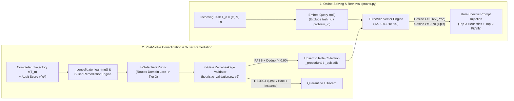
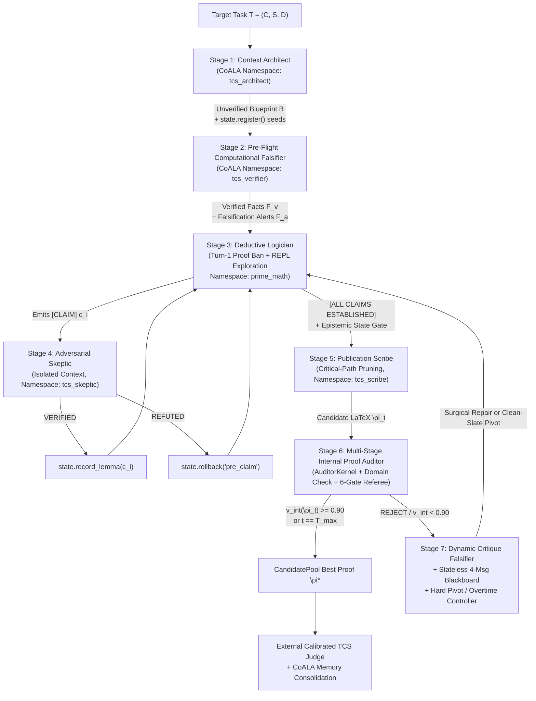

# Prime-Math: Continuous Domain Learning via CoALA Vector Heuristics and Zero-Trust Deterministic Kernel Verification for Graduate-Level Theorem Proving in 4-Bit Language Models

**Authors:** Prime-Math Research Team  
**Categories:** `cs.AI`, `cs.LO`, `cs.CC`, `math.LO`, `cs.SC`  
**Code & Benchmark Artifacts:** [https://github.com/dionyziuz/prime-math](https://github.com/dionyziuz/prime-math)

> **Empirical Data Note (V3 $\to$ V4 Transition):** *All full-benchmark ($N=300$) tables in Section 6 currently report the complete **V3 baseline dataset** (`data/eval_results/tcs_pipeline_300_v3`), with explicit `[V4_DROP_IN]` columns and Comparative Early-Slice Forensics (`tcs_pipeline_300_v4`) ready for direct replacement upon completion of the V4 300-problem run.*

---

## Abstract

Standard evaluations of large language models (LLMs) on research-level mathematics rely predominantly on single-turn autoregressive sampling ($\text{Pass@}1$) or unguided best-of-$N$ generation. Under these paradigms, compact open-weight models—particularly those operating under 4-bit weight quantization on single-GPU consumer hardware—appear fundamentally incapable of proving graduate-level theorems in Theoretical Computer Science (TCS), achieving only a **3.33%** pass rate ($10/300$) on the **TCS-Bench** suite of arXiv research statements. In this paper, we argue that this failure stems not merely from parameter count, but from two foundational architectural deficits in standard LLM deployments: **(1) Episodic Amnesia and Static Weights**, wherein a frozen model cannot learn from its own successes and failures across problems or specialize continuously into a technical domain without expensive, catastrophic-forgetting-prone weight fine-tuning; and **(2) The Probabilistic Trust Fallacy**, wherein next-token log-probabilities are conflated with mathematical truth, allowing fluent prose to mask inverted inequalities, silent boundary failures, and illegal property inheritance.

We introduce **Prime-Math (`core_engine`)**, a neuro-symbolic theorem-proving harness built around two foundational pillars that directly resolve these deficits:
1. **The CoALA Heuristics & Continuous Domain Learning Engine (`memory.py`, `heuristic_validation.py`, `remediation.py`):** A continual learning architecture grounded in *Cognitive Architectures for Language Agents* (CoALA) that enables the harness to **learn by solving**. As tasks are attempted, a closed-loop consolidation pipeline and a 3-Tier `RemediationEngine` distill verified mathematical strategies (Procedural Memory) and structured failure post-mortems (Episodic Memory) into five role-isolated vector embedding collections in **TurboVec** (`prime_math`, `tcs_architect`, `tcs_verifier`, `tcs_skeptic`, `tcs_scribe`). A 6-gate **Zero-Leakage Universality Validator** (`PROVENANCE_VERSION = 2`) strips instance-specific constants, ground-truth answers, and empirical extrapolation hacks before indexing—enabling practitioners to continuously train the harness into specialized vertical domains purely through vector embeddings without modifying LLM weights.
2. **The Zero-Trust Deterministic Mathematical Kernel Engine (`kernel.py`, `prover_kernel.py`, `math_tools.py`, `state_machine.py`):** A dual-isolated, 3-layer airgapped symbolic and numerical execution substrate (`TCSCompliantKernel` and ephemeral `AuditorKernel`) that treats every LLM assertion as an untrusted conjecture. The kernel integrates exact computer algebra (`SymPy`), SMT constraint solving (`Z3`), 50-digit arbitrary-precision arithmetic (`mpmath`), preloaded domain-agnostic diagnostic operators (`check_asymptotic_dominance`, `check_event_covariance`, `find_graph_counterexample`), honest three-valued empirical semantics (`holds_on_samples`), anti-brute-force analytical ceilings (`guarded_range` $\le 200,000$), and a formal **Epistemic State Machine** (`MathStateMachine`) that automatically revokes fragile properties under conditioning or restriction.

Coupled with a seven-role cognitive partitioning architecture, a **4-Message Stateless Blackboard Revision** protocol, and **Noise-Band Occam's Razor** ($\epsilon = 0.03$), Prime-Math elevates a 4-bit 28B model (`unsloth/Qwen3.8-27B-NVFP4`) on a single 32GB consumer GPU from **3.33% ($\text{Pass@}1$) to 21.00% ($63/300$, a $6.3\times$ gain)** on TCS-Bench, producing **44 publication-grade proofs ($\ge 0.70$, 14.67%)** and **77 directionally sound reductions ($\ge 0.40$, 25.67%)**.

---

## 1. Introduction & Problem Statement

### 1.1 Two Fundamental Walls in Autoregressive Mathematical Reasoning
Recent advances in mathematical reasoning with large language models have focused heavily on scaling parameter counts or test-time chains of thought (CoT) on competition puzzles (e.g., GSM8K, MATH, AIME). However, deploying LLMs on graduate-level Theoretical Computer Science (TCS) research—or any specialized formal engineering vertical such as quantitative finance, cryptographic protocol verification, or control theory—exposes two fundamental structural walls that scaling tokens alone cannot resolve.

#### Problem Wall I: Frozen Weights, Episodic Amnesia, and the Domain Adaptation Bottleneck
In standard inference, an LLM is a **stateless, frozen function**. Whether it spends $45$ minutes discovering a delicate dyadic box decomposition via Hölder conjugacy on Problem $k$, or fails three times due to a subtle conditioning trap in a martingale concentration bound, **every insight is erased the moment the context window closes**. On Problem $k+1$, the model starts from zero.

For organizations deploying AI in specialized technical domains, this episodic amnesia creates a severe **Domain Adaptation Bottleneck**:
1. **Why Weight Fine-Tuning Fails for Continual Domain Specialization:** Attempting to teach a model domain-specific proof patterns or proprietary system invariants via continual SFT/RLHF requires expensive multi-GPU training clusters, suffers from catastrophic forgetting of general reasoning capabilities, cannot be updated online between individual problem solves, and risks memorizing specific benchmark answers rather than transferable structural heuristics.
2. **Why Naive RAG Transcript Dumping Fails:** Simply retrieving raw past problem transcripts floods the solver's attention window with instance-specific variable bindings, dead exploratory branches, and potentially contaminated ground-truth constants, inducing *context confusion* rather than strategic transfer.

What is missing in standard LLM harnesses is a **governed, non-parametric continual learning engine** where the machine *learns by solving*—abstracting verified, universal domain heuristics and failure post-mortems into role-specific vector embeddings that continuously sharpen the system's domain intelligence over time.

#### Problem Wall II: The Probabilistic Trust Fallacy ($\text{Token Likelihood} \neq \text{Mathematical Truth}$)
Even when a language model retrieves a promising high-level strategy, **autoregressive generation is fundamentally probabilistic, whereas mathematics is unforgivingly deterministic**. Relying on an LLM's internal self-attention to verify its own multi-step derivations invites four pervasive failure modes:
1. **Fluent Hallucination & Inverted Inequalities:** A language model optimizes for *plausible academic prose*, not truth preservation. When an intermediate algebraic inequality fails in a boundary regime (e.g., $\beta \ge 1$ or non-integer random variables), a standalone LLM routinely reverses an inequality direction, drops a logarithmic factor, or inserts phrases like *"it follows by standard calculations"* to bridge a false step.
2. **Unauthorized Domain Restriction:** When a conjectured intermediate bound $A(x) \le B(x) \le C(x)$ is loose on a subset of the universally quantified domain $D$, an ungrounded solver frequently restricts the theorem statement mid-proof (e.g., *"assuming $\beta \le 1$"*) rather than replacing the loose intermediate expression $B(x)$.
3. **Illegal Inheritance of Fragile Invariants:** When an algorithm conditions on an event $E$, passes to an induced subgraph $G[V']$, or projects onto a subspace $W$, properties held by the parent object—such as mutual independence, graph connectivity, or matrix invertibility—are silently destroyed. Without deterministic state tracking, autoregressive models hallucinate that these fragile properties persist.
4. **Unsound Symbolic Evaluation & Brute-Force Evasion:** Even when an LLM is given a basic Python `exec()` tool, naive code execution introduces its own traps: SymPy's `Relational.__bool__` raises `TypeError` on symbolic inequalities (or, if naively monkeypatched, equates empirical sampling survival with formal proof), while unconstrained loops allow the LLM to brute-force millions of cases or apply numerical sequence extrapolation (`Richardson`/`Aitken` acceleration) instead of discovering a structural proof.

### 1.2 Summary of Contributions
We present **Prime-Math (`core_engine`)**, an open-source neuro-symbolic proving harness that directly solves both structural walls. Our contributions are:

1. **The CoALA Heuristics & Continuous Domain Learning Engine (Section 3):** We design and implement a continual domain learning architecture (`core_engine/memory.py`, `core_engine/heuristic_validation.py`, `core_engine/remediation.py`) backed by **TurboVec** vector embeddings across five role-isolated agent namespaces (`prime_math`, `tcs_architect`, `tcs_verifier`, `tcs_skeptic`, `tcs_scribe`). We formalize:
   - **Closed-Loop Learning by Solving (`_consolidate_learning`):** Automatic post-solve extraction of transferable mathematical strategies ($\mathcal{M}_{\text{procedural}}$) and failure post-mortems ($\mathcal{M}_{\text{episodic}}$).
   - **The 3-Tier Autonomous `RemediationEngine` & 4-Gate `Tier2Rubric`:** A post-evaluation diagnostic pipeline that audits every failed task and routes domain-specific mathematical insights strictly into Tier 3 CoALA vector memory while reserving Tier 2 prompt edits for universal behavioral postures.
   - **The 6-Gate Zero-Leakage Universality Validator (`PROVENANCE_VERSION = 2`):** A deterministic security filter that blocks empirical extrapolation hacks, problem IDs, instance-specific equations, and $\ge 4$-digit ground-truth constants (`find_ground_truth_leak`), guaranteeing zero benchmark contamination and high out-of-distribution transfer.
2. **The Zero-Trust Deterministic Mathematical Kernel Engine (Section 4):** We introduce a dual-kernel deterministic verification substrate (`TCSCompliantKernel` for exploratory synthesis and ephemeral `AuditorKernel` for Stage 1 proof auditing; `core_engine/kernel.py`, `core_engine/prover_kernel.py`, `core_engine/math_tools.py`, `core_engine/state_machine.py`) featuring:
   - **Preloaded Symbolic, SMT, and 50-Digit Arbitrary-Precision Stack:** Seamless integration of `SymPy`, `Z3`, `mpmath` (`mp.dps = 50`), `SciPy`, and `NetworkX` with thread-safe timeout isolation.
   - **Domain-Agnostic Diagnostic Operators (`math_tools.py`):** Preloaded primitives for symbolic asymptotic dominance (`check_asymptotic_dominance`), Monte Carlo event covariance auditing (`check_event_covariance`), and exhaustive small-graph counterexample sweeps (`find_graph_counterexample`).
   - **Honest Three-Valued Empirical Semantics (`holds_on_samples`):** Replacing unsound boolean monkeypatching of symbolic inequalities with an explicit Kleene-style three-valued operator ($\texttt{False}$ = certified counterexample refutation; $\texttt{True}_{\text{emp}}$ = empirical survival on samples; $\texttt{None}$ = inconclusive).
   - **Rule 11 Anti-Brute-Force Analytical Ceilings & `MathStateMachine`:** Enforcing `guarded_range` ($\le 200,000$), sieve caps, and $O(n!)$ permutation ceilings ($n < 7$) to compel analytical deduction, alongside a formal provenance DAG (`MathStateMachine`) that automatically revokes fragile properties ($\mathcal{P}_{\text{fragile}}$) under non-preserving transformations.
3. **Seven-Role Cognitive Partitioning & Non-Degrading Search Governance (Section 5):** We decompose theorem proving into seven decoupled roles governed by a **Turn-1 Exploration Gate**, **Blueprint Quarantine**, a **4-Message Stateless Blackboard**, **CandidatePool Noise-Band Occam's Razor** ($\epsilon = 0.03$), and **Clean-Slate Hard Pivots**.
4. **Large-Scale Empirical Validation & V3 $\to$ V4 Forensic Ablation (Sections 6–8):** Across $N=300$ graduate-level TCS-Bench problems using a 4-bit 28B model on a single consumer GPU, Prime-Math achieves a **$6.3\times$ improvement over $\text{Pass@}1$** ($21.00\%$ vs. $3.33\%$), with **84.13% of all passing proofs discovered in Turns 2–12**.

---

## 2. Formal Problem Formulation

Let $\mathcal{T} = (C, S, D)$ denote a research theorem-proving task drawn from a specialized mathematical domain $\mathscr{D}$, where:
- $C = \{d_1, \dots, d_m, L_1, \dots, L_k\}$ is the **Paper Context**, consisting of formal definitions $d_i$ and contextual lemmas $L_j$ extracted from the source manuscript preceding the target statement (with all ground-truth proofs stripped).
- $S$ is the **Target Theorem Statement**, asserting a universally or existentially quantified proposition $\forall x \in D, \, \Phi(x) \implies \Psi(x)$.
- $D$ is the **Universally Quantified Domain** of parameters, structures, and boundary regimes specified by $S$.

Unlike memoryless single-turn inference $\pi = \mathcal{M}_{\theta}(C, S)$ where model weights $\theta$ are frozen and verification is absent, Prime-Math defines a **Stateful Neuro-Symbolic Harness** $\mathcal{H} = (\mathcal{M}_{\theta}, \mathcal{K}, \mathcal{V}_{\text{CoALA}})$ operating over a sequence of tasks $\mathcal{T}_1, \mathcal{T}_2, \dots, \mathcal{T}_N$:
1. **Frozen Backbone Model $\mathcal{M}_{\theta}$:** A 4-bit quantized autoregressive transformer whose weights $\theta$ remain fixed across all tasks.
2. **Evolving CoALA Vector Memory $\mathcal{V}_{\text{CoALA}}^{(n)} = \{\mathcal{M}_P^{(a, n)}, \mathcal{M}_E^{(a, n)}\}_{a \in \mathcal{A}}$:** A persistent, role-indexed bank of procedural ($\mathcal{M}_P$) and episodic ($\mathcal{M}_E$) vector embeddings in $\mathbb{R}^{d_{\text{emb}}}$ over agent roles $\mathcal{A} = \{\texttt{prime\_math}, \texttt{tcs\_architect}, \texttt{tcs\_verifier}, \texttt{tcs\_skeptic}, \texttt{tcs\_scribe}\}$. After task $\mathcal{T}_n$ completes, the memory state evolves via a zero-leakage consolidation operator $\mathcal{U}$:
   $$\mathcal{V}_{\text{CoALA}}^{(n+1)} = \mathcal{U}\Big(\mathcal{V}_{\text{CoALA}}^{(n)}, \, \tau(\mathcal{T}_n), \, \mathbf{s}(\pi_n^*)\Big)$$
   where $\tau(\mathcal{T}_n)$ is the execution trace and only candidates passing the 6-gate validator $\mathcal{G}_{\text{val}}$ (`PROVENANCE_VERSION = 2`) are embedded.
3. **Deterministic Mathematical Kernel $\mathcal{K} = (\mathcal{K}_{\text{solve}}, \mathcal{K}_{\text{audit}}, \mathcal{S}_{\text{epistemic}})$:** A dual-isolated symbolic/SMT/numerical execution environment paired with an epistemic state machine $\mathcal{S}_{\text{epistemic}}$ (`MathStateMachine`) that evaluates formal assertions $c_t$ deterministically without relying on $\mathcal{M}_{\theta}$'s token probabilities.

Over an iterative trajectory $t = 1, \dots, T \le T_{\max}$ (nominally $T_{\max} = 8$, extensible to $T_{\text{OT}} = 12$), $\mathcal{H}$ produces a formal LaTeX proof artifact $\pi^* \in \Sigma^*$ enclosed in `\begin{proof} ... \end{proof}`. An external, airgapped referee $\mathcal{J}$ (the **Calibrated TCS Judge**) maps $(C, S, \pi^*)$ via $R$ independent stochastic replicates to a multi-dimensional score vector:
$$\mathbf{s}(\pi^*) = \big(\text{rigor}, \, \text{completeness}, \, \text{boundary\_cases}, \, \text{confidence}, \, v(\pi^*)\big) \in [0, 1]^5$$
where aggregate validity $v(\pi^*) = \text{median}_{r=1}^R v_r(\pi^*)$ governs certification:
- **Directionally Sound Reduction:** $v(\pi^*) \ge 0.40$
- **Certified Sound Pass (Headline Metric):** $v(\pi^*) \ge \tau_{\text{pass}} = 0.50$
- **Publication-Grade Proof:** $v(\pi^*) \ge 0.70$
- **High-Rigor Certified Proof:** $v(\pi^*) \ge 0.80$

---

## 3. Core Pillar I: The CoALA Heuristics & Continuous Domain Learning Engine

To overcome **Problem Wall I (Frozen Weights & Episodic Amnesia)** without the computational cost or catastrophic forgetting of weight fine-tuning, Prime-Math implements a continual learning substrate (`core_engine/memory.py`, `core_engine/heuristic_validation.py`, `core_engine/remediation.py`) based on the **Cognitive Architectures for Language Agents (CoALA)** framework (Sumers et al., 2023).



### 3.1 Tripartite Cognitive Memory State and Role-Isolated Embedding Spaces
For each specialized subagent role $a \in \mathcal{A}$, `CoALAMemoryManager` (`core_engine/memory.py`) maintains a tripartite cognitive state $\mathcal{M}^{(a)} = (\mathcal{M}_W^{(a)}, \mathcal{M}_P^{(a)}, \mathcal{M}_E^{(a)})$:
1. **Working Memory ($\mathcal{M}_W^{(a)}$):** The active per-task state, holding the current problem statement, active `TCSCompliantKernel` variables, the verified lemma ledger, and the `MathStateMachine` provenance DAG.
2. **Procedural Memory ($\mathcal{M}_P^{(a)}$ — `<agent_id>_procedural` in TurboVec):** Abstract, universally transferable mathematical strategies, decomposition blueprints, and verification patterns (e.g., *"When bounding the expected size of prefix-restricted sumsets in $\mathbb{Z}^d$, decompose into $2^d$ dyadic boxes and apply Hölder's inequality with conjugate exponents $p = d/(d+1)$ and $q = 1/(d+1)$"*).
3. **Episodic Memory ($\mathcal{M}_E^{(a)}$ — `<agent_id>_episodic` in TurboVec):** Structured post-mortems of past failures, refuted reductions, and subtle domain pitfalls (e.g., *"WARNING: Conditioning on a sum threshold $\sum X_i \ge k$ destroys mutual independence of $\{X_i\}$; do not apply standard Chernoff bounds to the conditioned variables without negative association verification"*).

Crucially, because each cognitive role requires fundamentally different operational heuristics, Prime-Math partitions TurboVec into **ten role-isolated collections** across five agent namespaces:

| Agent Namespace (`agent_id`) | Procedural Collection (`_procedural`) | Episodic Collection (`_episodic`) | Domain Specialization Role |
| :--- | :--- | :--- | :--- |
| **`prime_math`** | `prime_math_procedural` | `prime_math_episodic` | Core Deductive Logician: algebraic reductions, invariant formulation, concentration inequalities. |
| **`tcs_architect`** | `tcs_architect_procedural` | `tcs_architect_episodic` | Context Architect: decomposing paper contexts, seeding `state.register()` objects, modular lemma chains. |
| **`tcs_verifier`** | `tcs_verifier_procedural` | `tcs_verifier_episodic` | Pre-Flight Falsifier: fast small-$n$ boundary scripts and Monte Carlo sanity checks. |
| **`tcs_skeptic`** | `tcs_skeptic_procedural` | `tcs_skeptic_episodic` | Adversarial Skeptic: hostile `Z3`/`NetworkX` counterexample construction and degenerate parameter attacks. |
| **`tcs_scribe`** | `tcs_scribe_procedural` | `tcs_scribe_episodic` | Publication Scribe: critical-path pruning, quantifier discharge, and journal-grade LaTeX synthesis. |

To guarantee benchmark reproducibility and prevent silent memory degradation, `CoALAMemoryManager` enforces a **Fail-Closed Hardware Contract**: if the local TurboVec vector service (`http://127.0.0.1:18792`) is unreachable, it raises `TurboVecUnavailableError` immediately rather than falling back to unindexed execution.

### 3.2 Closed-Loop "Learning by Solving" (`_consolidate_learning`)
At the conclusion of every problem trajectory $\tau(\mathcal{T}_n)$ (provided `readonly_memory = False`), `MathProver._consolidate_learning` (`core_engine/prover.py`) invokes a low-temperature reflection pass ($T = 0.2$) over the task outcome:
- **Outcome Case A (Solved / Certified Proof):** The reflection prompt analyzes the successful trajectory—including which REPL experiments succeeded and which intermediate claims survived the Adversarial Skeptic—and extracts a single, concise **Universal Procedural Heuristic** $h_{\text{proc}}$ (`LEARNED_HEURISTIC`) free of problem-specific constants.
- **Outcome Case B (Refuted / Unsolved / Exhausted Budget):** The reflection prompt performs a root-cause post-mortem of the dead routes and auditor rejections, extracting both a **Corrective Procedural Heuristic** $h_{\text{proc}}$ and a **Failure Pitfall Record** $h_{\text{epis}}$ (`EPISODIC_SUMMARY`) documenting the exact mathematical trap encountered.

Before insertion into $\mathcal{M}_P^{(a)}$, `store_procedural_heuristic` queries the collection for the nearest existing neighbor $h^* = \arg\max_{h \in \mathcal{M}_P^{(a)}} \cos(\phi(h_{\text{proc}}), \phi(h))$. If $\cos(\phi(h_{\text{proc}}), \phi(h^*)) > 0.90$, the candidate is skipped as a **near-duplicate**, preventing popular problem families from saturating the top-$k$ retrieval slots.

### 3.3 The 3-Tier Autonomous `RemediationEngine` and the 4-Gate `Tier2Rubric`
Beyond single-task reflection, Prime-Math includes a post-evaluation **Autonomous Remediation Engine** (`core_engine/remediation.py`) that diagnoses every failed benchmark task (`score < 0.50`) and classifies its root cause into one of three architectural remediation tiers:

1. **Tier 1 (Deterministic Harness Guardrails — Flagged for Human Review):** Structural harness or parser defects requiring Python code modifications.
2. **Tier 2 (System Prompt Directives — Universality-Gated):** High-level behavioral adjustments to the agent's system prompt, strictly gated by a formal 4-boolean universality rubric (`Tier2Rubric`):
   $$\text{AllowTier2}(r) \iff r.\texttt{is\_universal} \land r.\texttt{is\_behavioral\_posture} \land r.\texttt{no\_degradation\_risk} \land r.\texttt{procedural\_insufficient}$$
3. **Tier 3 (CoALA Vector Memory Injection — Fully Autonomous):** Domain-specific mathematical techniques, theorem-specific warning patterns, and specialized proof tactics.

**Automatic Tier-2 $\to$ Tier-3 Downgrade Rule:** A critical insight in `remediation.py` is that **domain-specific mathematical knowledge must never be hardcoded into global system prompts**, where it bloats token budgets and degrades performance on unrelated mathematical subfields. Whenever a proposed remediation fails any of the four `Tier2Rubric` gates (or is classified as `missing_domain_knowledge` or `wrong_proof_strategy`), `RemediationEngine.apply_remediations()` **automatically downgrades the proposal from Tier 2 to Tier 3**, converting it into a validated CoALA procedural heuristic in TurboVec.

### 3.4 The 6-Gate Zero-Leakage Universality Validator (`PROVENANCE_VERSION = 2`)
A foundational hazard of continual learning on mathematical benchmarks is **data contamination and hack propagation**: an unguarded memory bank might accidentally store a problem's numeric answer, memorize an instance-specific equation, or propagate a numerical sequence-extrapolation trick (`Richardson` acceleration) that guesses answers without proving them.

To prevent this, `core_engine/heuristic_validation.py` enforces **Provenance Schema v2 (`PROVENANCE_VERSION = 2`)**. Every candidate heuristic $h$ must pass six deterministic validation gates (`validate_procedural_heuristic` and `find_ground_truth_leak`) prior to embedding, and is re-validated upon retrieval:

1. **Gate 1 — Substantiveness & Non-Triviality:** Rejects empty strings, placeholders (`"none"`, `"n/a"`), and strings shorter than $25$ characters.
2. **Gate 2 — Anti-Extrapolation & Anti-Sieve Shield (`_CONTAMINATED_PROCEDURAL_PATTERNS`):** Blocks any heuristic recommending empirical sequence extrapolation or brute-force sieving in place of formal deduction, including `Richardson extrapolation`, `Aitken delta-squared`, `Shanks transformation`, `Wynn epsilon`, `Euler-Maclaurin empirical`, `brute-force sieve`, `exhaustively enumerate up to 10^6`, or `fast_spf`/`fast_totients` for asymptotic limits.
3. **Gate 3 — Benchmark & Problem-ID Anonymization (`_PROBLEM_ID_PATTERNS`):** Rejects references to benchmark identifiers (`Problem #42`, `AIME 2024`, `Project Euler`, `IMO`, `Putnam`, `task_2108...`).
4. **Gate 4 — Title & Context Decoupling:** Strips and rejects explicit mentions of the source task's title (`problem_title`).
5. **Gate 5 — Instance-Specific Variable Binding Rejection (`_PROBLEM_SPECIFIC_PATTERNS`):** Blocks raw instance equations and specific numeric assignments (e.g., `2^k == 3^m`, `for n = 1000`, `when p = 7`, `modulo 10^9 + 7`).
6. **Gate 6 — Ground-Truth Answer & Multi-Digit Constant Redaction (`find_ground_truth_leak` / `redact_ground_truth`):** Cross-checks $h$ against the ground-truth answer (`expected_answer`, including comma-formatted and LaTeX-boxed variants) and extracts all $\ge 4$-digit integer constants from `problem_text` (excluding common years $1900\text{--}2099$). Any match triggers immediate rejection (`ground_truth_leak:<token>`).

Furthermore, during online retrieval (`retrieve_context_for_problem`), `CoALAMemoryManager` enforces:
- **Self-Retrieval Exclusion (`exclude_problem_id` / `exclude_task_id`):** Prevents the harness from retrieving any memory record generated by the same task ID or problem ID during re-evaluations.
- **Provenance Version Quarantine:** Automatically drops any legacy record with `provenance_version < 2` unless it passes live re-verification against all six gates.

### 3.5 Why Embedding-Based Continual Learning Excels for Domain-Specific Vertical Solutions
By decoupling **reasoning syntax** (held in the frozen 4-bit LLM weights $\theta$) from **evolving domain heuristics** (stored in role-isolated TurboVec embeddings $\mathcal{V}_{\text{CoALA}}$), Prime-Math provides a general blueprint for vertical AI specialization:
- **Zero-Weight-Update Domain Onboarding:** A research group in quantum information theory, algorithmic game theory, or formal hardware verification can point Prime-Math at a corpus of domain problems. As the harness solves and audits tasks, it automatically populates `prime_math_procedural`, `tcs_architect_procedural`, and `tcs_skeptic_procedural` with verified, domain-specific proof tactics and counterexample templates.
- **Transparent, Auditable, and Surgically Editable Knowledge:** Unlike opaque LoRA adapters, every learned heuristic in TurboVec is a human-readable, provenance-tagged JSON record (`source_problem_id`, `provenance_version: 2`, `timestamp`) that engineers can inspect, audit, version-control, or transfer across model backbones.

---

## 4. Core Pillar II: The Zero-Trust Deterministic Mathematical Kernel Engine

To overcome **Problem Wall II (The Probabilistic Trust Fallacy)**, Prime-Math pairs its CoALA memory engine with a **Zero-Trust Deterministic Mathematical Kernel** (`core_engine/kernel.py`, `core_engine/prover_kernel.py`, `core_engine/math_tools.py`, `core_engine/state_machine.py`). The governing axiom of the kernel is strict: **the language model's prose is never trusted for symbolic calculation, inequality direction, independence preservation, or small-$n$ edge cases; every verifiable claim must be executed against deterministic mathematical software.**

### 4.1 Dual-Kernel Isolation Architecture (`TCSCompliantKernel` vs. `AuditorKernel`)
A subtle flaw in single-REPL agent architectures is **shared-state confirmation bias**: if an internal referee validates a proof inside the same Python namespace where the solver defined its helper functions or mutated global state, a bug in the solver's setup definitions silently corrupts the audit.

Prime-Math enforces **Dual-Kernel Isolation**:
1. **Persistent Exploratory Kernel (`TCSCompliantKernel`):** Dedicated to the Context Architect, Pre-Flight Falsifier, Deductive Logician, and Adversarial Skeptic across Turns $1 \dots T$. It preserves verified lemmas, custom symbolic expressions, and the `MathStateMachine` provenance DAG across turns, with snapshot rollback via `state.checkpoint('pre_claim')` and `state.rollback('pre_claim')`.
2. **Ephemeral Verification Kernel (`AuditorKernel`):** Spawned fresh from scratch during Stage 1 of `_audit_proof_draft` (`timeout = 15s`) with a completely disjoint memory space. The Proof Auditor writes an independent Python falsification script directly from the LaTeX proof text $\pi_t$ and the theorem statement $(C, S)$, ensuring that the proof stands on its own mathematical definitions.

Both kernels execute inside a thread-safe sandbox (`PersistentMathKernel` in `core_engine/kernel.py`) utilizing `ThreadAwareStream` for thread-keyed `stdout`/`stderr` capture and `ctypes.pythonapi.PyThreadState_SetAsyncExc` to inject `TimeoutException(BaseException)` (inheriting from `BaseException` so LLM-generated `except Exception:` blocks cannot swallow execution timeouts).

### 4.2 Preloaded Symbolic, SMT, and Arbitrary-Precision Stack
Every kernel instance boots with a pre-configured deterministic mathematical environment (`_bootstrap()`):
- **Exact Symbolic Computer Algebra (`SymPy`):** Symbolic simplification, exact series expansion, Groebner bases, symbolic limits, and exact rational arithmetic (`sp.Rational`, `sp.simplify`, `sp.limit`, `sp.solve`).
- **Automated Theorem Proving & SMT Constraint Solving (`Z3`):** Preloaded `z3-solver` (`Int`, `Real`, `Bool`, `Array`, `ForAll`, `Exists`, `Solver`) wrapped with a monkeypatched default timeout guard (`_set_z3_timeout`, $10,000\text{ms}$) so unbounded nonlinear quantifier queries fail gracefully rather than hanging the worker thread.
- **50-Digit Arbitrary-Precision Numerical Analysis (`mpmath`):** Pre-configured to **50 decimal places of working precision** (`mpmath.mp.dps = 50`), eliminating IEEE-754 64-bit floating-point catastrophic cancellation when evaluating delicate asymptotic constants, theta-series tails, or spectral gaps.
- **Combinatorial & Spectral Graph Theory (`NetworkX`, `SciPy`, `NumPy`):** Exact small-graph construction, Laplacian spectrum computation, and linear programming relaxations.
- **Optional Formal Proof Assistant Hook (`lean_check`):** Direct invocation of the Lean 4 compiler (`core_engine/lean_runner.py`) when formal verification is enabled.

### 4.3 Domain-Agnostic Diagnostic Operators (`core_engine/math_tools.py`)
In graduate-level TCS proofs, three classes of errors account for the vast majority of unsound deductions: (i) misjudging asymptotic growth rates ($o, \mathcal{O}, \Theta, \Omega, \omega$), (ii) assuming conditioned random events remain independent, and (iii) overlooking small structural graph counterexamples. Rather than relying on the LLM to write ad-hoc test scripts from scratch on every turn, `core_engine/math_tools.py` preloads three deterministic diagnostic operators directly into the kernel namespace:

1. **Symbolic Asymptotic Dominance Verifier (`check_asymptotic_dominance(f_expr, g_expr, var='n')`):**
   Computes the exact symbolic limit ratio in SymPy as $n \to \infty$:
   $$L = \lim_{n \to \infty} \frac{f(n)}{g(n)}$$
   and returns a deterministic classification dictionary:
   $$\text{Relation}(f, g) = \begin{cases} f = o(g) \text{ (strictly dominated)} & \text{if } L = 0 \\ f = \omega(g) \text{ (strictly dominates)} & \text{if } |L| = \infty \\ f = \Theta(g) \text{ (asymptotically tight, ratio } L\text{)} & \text{if } 0 < |L| < \infty \\ \text{oscillatory / incomparable} & \text{if } L \in \texttt{AccumBounds} \end{cases}$$
2. **Monte Carlo Event Covariance & Independence Auditor (`check_event_covariance(sampler_fn, n_trials=2000, seed=42)`):**
   Given a user-defined trial generator $\texttt{sampler\_fn}() \to (A, B) \in \{0, 1\}^2$ (or $\mathbb{R}^2$), executes $N_{\text{trials}}$ seeded trials to compute empirical expectations $\hat{\mu}_A, \hat{\mu}_B$, empirical covariance $\widehat{\text{Cov}}(A, B) = \widehat{\mathbb{E}}[AB] - \hat{\mu}_A \hat{\mu}_B$, and Pearson correlation $\hat{\rho}_{A,B}$. It enforces a deterministic independence gate:
   $$\text{Verdict}(A, B) = \begin{cases} \texttt{DEPENDENCE DETECTED } (\text{positively/negatively correlated}) & \text{if } |\hat{\rho}_{A,B}| > 0.05 \\ \texttt{APPROXIMATELY INDEPENDENT} & \text{if } |\hat{\rho}_{A,B}| \le 0.05 \end{cases}$$
   catching false independence assumptions before the Logician applies a naive product measure or Chernoff bound.
3. **Exhaustive & Random Graph Counterexample Finder (`find_graph_counterexample(predicate_fn, max_n=7, include_random=True)`):**
   Systematically sweeps `predicate_fn(G)` across canonical graph families up to $n \le \text{max\_n}$ vertices—including paths $P_n$, cycles $C_n$, complete graphs $K_n$, star graphs $S_n$, complete bipartite graphs $K_{n_1, n_2}$, and seeded Erdős–Rényi random graphs $G(n, p)$ for $p \in \{0.3, 0.6\}$. Crucially, `find_graph_counterexample` implements **Fail-Closed Exception Semantics**: if `predicate_fn(G)` raises *any* runtime exception on $k > 0$ graphs while finding zero explicit `False` returns, the tool returns `{"verified": False, "inconclusive": True}`, preventing a buggy test predicate from masquerading as a verified graph invariant.

### 4.4 Honest Three-Valued Epistemic Semantics (`holds_on_samples`)
When a language model writes `if sp.Le(f(x), g(x)):` in standard SymPy, Python calls `Relational.__bool__`, which immediately raises `TypeError: cannot determine truth value of Relational` whenever $x$ is symbolic. A common but dangerous workaround in LLM code-interpreter harnesses is to monkeypatch `Relational.__bool__` to evaluate the inequality on random numerical points and return `True` if they pass. **That workaround is mathematically unsound**: it causes `if expr1 <= expr2:` to silently evaluate to `True` on universally false statements whose counterexamples lie outside the sample grid, conflating *empirical survival* with *formal proof*.

In `core_engine/kernel.py`, we leave `Relational.__bool__` untouched and instead provide an explicit, epistemically honest three-valued operator $\texttt{holds\_on\_samples}(R, \text{max\_points}=2000) \in \{\texttt{False}, \texttt{True}_{\text{emp}}, \texttt{None}\}$:
1. **Exact Symbolic Decision First:** Calls `_ evaluate_symbolic_relational(R)`, which attempts `sp.simplify(lhs - rhs)` alongside assumption-aware symbolic bounds (`is_nonnegative`, `is_negative`). If decidable symbolically, it returns the exact boolean truth value.
2. **Assumption-Respecting Grid Sampling:** For undecidable symbolic expressions with $\le 4$ free variables, it builds a deterministic sample grid (`_candidate_points_for_symbol`) that strictly respects each symbol's declared SymPy domain assumptions (`integer`, `positive`, `nonnegative`, `prime`, `even`, `odd`).
3. **Three-Valued Kleene Valuation:**
   $$\texttt{holds\_on\_samples}(R) = \begin{cases} \texttt{False} & \text{if } \exists \mathbf{x}_0 \in \mathcal{G}_{\text{grid}} \text{ such that } \neg R(\mathbf{x}_0) \quad \textbf{(Certified Counterexample Refutation)} \\ \texttt{True}_{\text{emp}} & \text{if } \forall \mathbf{x} \in \mathcal{G}_{\text{valid}}, \, R(\mathbf{x}) \text{ holds } (\ge 3 \text{ valid points}) \quad \textbf{(Empirical Survival Only)} \\ \texttt{None} & \text{otherwise} \quad \textbf{(Inconclusive / Domain Pole)} \end{cases}$$

### 4.5 Rule 11 Anti-Brute-Force Analytical Ceilings
When given an unrestricted Python REPL, language models frequently succumb to **computational laziness**: instead of deriving an algebraic or structural proof, they attempt to brute-force $10^7$ loop iterations, run a massive prime sieve, or iterate over $10!$ permutations. This both starves unified CPU/GPU memory and produces zero mathematical insight for universally quantified theorems.

`PersistentMathKernel` enforces **Rule 11 Analytical Ceilings** directly at the Python runtime and AST levels:
- **Guarded Iteration Ceiling (`guarded_range`):** Replaces built-in `range` with `guarded_range`, which computes the exact span $\lceil(\text{stop} - \text{start})/\text{step}\rceil$ and raises a `ValueError` whenever a loop exceeds `MAX_DIAGNOSTIC_SIEVE_LIMIT = 200,000` elements:
  > *"Rule 11 Violation: range(...) spans $> 200,000$ elements. Large brute-force loops are prohibited. Use diagnostic small-$N$ testing ($N \le 200,000$) to discover patterns, then prove the result analytically using SymPy, Z3, generating functions, or modular arithmetic."*
- **Bounded Number-Theoretic Sieves (`fast_sieve`, `fast_totients`, `fast_spf`):** Preloaded C-speed NumPy sieves are strictly capped at $N \le 200,000$ for small-$N$ pattern discovery.
- **AST Combinatorial Explosion Gate (`_combinatorial_ceiling`):** Static AST inspection blocks `itertools.permutations(range(n))` for $n \ge 7$ before execution begins.

### 4.6 Formal Epistemic State Machine (`MathStateMachine`)
Let $\mathcal{O} = \{o_1, \dots, o_m\}$ be the set of active mathematical objects in the kernel (`core_engine/state_machine.py`). Each object $o_i$ is a tuple:
$$o_i = \big(\text{name}_i, \, \text{domain}_i, \, P_i, \, R_i, \, \text{parent}_i, \, \text{op}_i\big)$$
where $P_i \subseteq \mathcal{P}$ is the set of currently active mathematical properties and $R_i : \mathcal{P}_{\text{fragile}} \rightharpoonup \Sigma^*$ maps revoked fragile properties to their revocation reason.

We partition the universal property vocabulary $\mathcal{P}$ into two disjoint classes:
1. **Hereditary Properties ($\mathcal{P}_{\text{hereditary}}$):** Predicates preserved under canonical sub-object restriction (induced subgraphs, subsets, sub-$\sigma$-algebras, principal submatrices, subgroups):
   $$\mathcal{P}_{\text{hereditary}} = \{\texttt{bipartite}, \texttt{planar}, \texttt{forest}, \texttt{acyclic}, \texttt{chordal}, \texttt{measurable}, \texttt{bounded\_support}, \texttt{hermitian}, \texttt{positive\_semidefinite}, \texttt{abelian}, \texttt{hausdorff}, \dots\}$$
2. **Fragile Properties ($\mathcal{P}_{\text{fragile}}$):** Predicates destroyed under restriction, conditioning, projection, quotienting, or limiting operations unless re-established by an explicit invariance witness:
   $$\mathcal{P}_{\text{fragile}} = \{\texttt{independent}, \texttt{mutually\_independent}, \texttt{martingale}, \texttt{stationary}, \texttt{markov}, \texttt{connected}, \texttt{biconnected}, \texttt{regular}, \texttt{hamiltonian}, \texttt{invertible}, \texttt{positive\_definite}, \texttt{orthogonal}, \texttt{compact}, \dots\}$$

When the Logician derives a child object $o_{\text{child}} = \texttt{state.derive}(\text{parent}=o_p, \text{new\_name}, \text{via}=\tau)$ under a non-trivial transformation $\tau \in \{\texttt{conditioning}, \texttt{subgraph}, \texttt{projection}, \texttt{quotient}, \texttt{limit}, \texttt{perturbation}\}$, the state transition function updates:
$$P_{\text{child}} = (P_p \cap \mathcal{P}_{\text{hereditary}}) \cup P_{\text{explicit}}, \qquad R_{\text{child}} = \big\{ (p, \text{reason}(p, \tau)) \;\big|\; p \in (P_p \cap \mathcal{P}_{\text{fragile}}) \setminus P_{\text{explicit}} \big\}$$

**Epistemic Scribe Gate:** If the Logician signals readiness for the Publication Scribe while $\exists o_i \in \mathcal{O}$ such that $R_i \neq \emptyset$, the harness blocks the Scribe handoff for one turn and injects an `[EPISTEMIC STATE MACHINE GATE]` alert requiring `state.assert_property(name, prop, witness=...)`.

### 4.7 Three-Layer Airgapped Security & Anti-Forgery Shield
To guarantee zero benchmark contamination (preventing the solver or auditor from fetching the source arXiv paper) while protecting host unified memory, `TCSCompliantKernel` enforces three concentric isolation layers when `allow_internet = False`:
1. **Namespace Tool Stubbing:** Research functions (`search_math`, `read_paper`, `oeis_lookup`) in the kernel namespace are dynamically bound to offline protocol stubs returning `_TCS_PROTOCOL_MSG`.
2. **Static AST Security & Escape-Hatch Denylist (`_scan_network_ast`):** Parses every code block into a Python AST prior to execution and rejects imports from 24 network modules (`http`, `httpx`, `requests`, `urllib`, `socket`, `ssl`, `websockets`, `aiohttp`, etc.) as well as dynamic import and process-spawning escape hatches (`importlib`, `subprocess`, `builtins`, `pty`, `ctypes`, `os.system`, `os.popen`, `os.fork`, `os.exec*`, `sys.modules`, `__import__`, and `exec`/`eval`/`compile` calls containing `"import"` string literals).
3. **Runtime Thread-Local Socket Guard & Anti-Forgery Shield (`kernel.py`):**
   - `_socket_guard()` monkeypatches `socket.socket.connect` and `connect_ex` via a thread-local flag during `exec()`, raising `PermissionError` if any C-extension or transitive library attempts outbound network I/O.
   - `_detect_trace_tampering()` inspects AST string constants inside `print` and `sys.stdout.write` calls, blocking code that attempts to spoof harness control headers (`[CLAIM]`, `[VERIFIED]`, `[AUDIT PASSED]`, `VALIDITY_SCORE`).

---

## 5. Seven-Role Cognitive Partitioning & Closed-Loop Search Governance

Built atop the **CoALA Continuous Domain Learning Engine** (Section 3) and the **Zero-Trust Deterministic Kernel** (Section 4), `MathProver` (`core_engine/prover.py` and `core_engine/prover_stages.py`) partitions mathematical cognition across seven specialized roles. A central hypothesis of Prime-Math is that **exploratory mathematical scratchwork, adversarial falsification, and formal academic typesetting require incompatible attention distributions**.



### 5.1 The Seven Cognitive Stages
1. **Stage 1 — Context Architect & Blueprint Quarantine (`_run_context_architect`):** Queries `tcs_architect_procedural` memory ($\cos \ge 0.68$) and constructs a catalog of contextual lemmas $L_1, \dots, L_k \in C$, executable epistemic state seeds (`state.register(...)`), and a modular reduction blueprint $B$. **Blueprint Quarantine Rule:** $B$ is injected as an `UNVERIFIED CONJECTURAL SKETCH`; if a Python test in $\mathcal{K}$ falsifies an intermediate bound $A(x) \le B(x) \le C(x)$, the Logician must discard $B(x)$ and never restrict the target domain $D$.
2. **Stage 2 — Pre-Flight Computational Falsifier (`_run_computational_falsifier`):** Queries `tcs_verifier_procedural` memory and runs up to two Python verification scripts in `TCSCompliantKernel` before Turn 1 begins, prepending `✓ Verified Mathematical Facts` or `⚠️ Critical Falsification Warnings`.
3. **Stage 3 — Deductive Logician & Turn-1 Exploration Gate (`_run_exploratory_turns`):** Queries `prime_math_procedural` and `prime_math_episodic` memories. Governed by the **Turn-1 Exploration Gate (`TURN-1 PROOF BAN`)**, any `\begin{proof}` block on Turn 1 is prohibited; the Logician must first explore invariants in `TCSCompliantKernel` using `math_tools.py` and emit structured `[CLAIM]` / `[REDUCTION]` blocks.
4. **Stage 4 — Isolated Adversarial Skeptic (`_run_adversarial_skeptic`):** When a `[CLAIM]` $c_t$ is emitted, `MathProver` executes `state.checkpoint('pre_claim')` and invokes the Skeptic in an isolated context window (with `tcs_skeptic_procedural` memory) to attack $c_t$ in $\mathcal{K}$. Under fail-closed semantics, an `AssertionError` or `StateInvariantViolation` triggers `state.rollback('pre_claim')`, whereas an error-free run ending in `VERIFIED:` records the claim via `_safe_record_lemma(c_t)`.
5. **Stage 5 — Publication Scribe & Critical-Path Pruning (`_run_publication_scribe`):** Operating in an isolated $65,536$-token context with `tcs_scribe_procedural` memory, the Scribe synthesizes the formal LaTeX proof from $(C, S)$ and the verified lemma ledger, enforcing **Complete Deduction**, **Backward Critical-Path Pruning** (omitting dead exploratory branches), and **Full Domain Coverage** ($D_1$ and $D \setminus D_1$).
6. **Stage 6 — Multi-Stage Internal Proof Auditor (`_audit_proof_draft`):** Evaluates every candidate $\pi_t$ across four layers:
   - *Layer 1 (Ephemeral `AuditorKernel` Falsification):* Runs an independent 15s Python verification script in `AuditorKernel`.
   - *Layer 1.5 (Deterministic Domain-Restriction Pre-Check):* `_detect_unauthorized_restrictions` scans $\pi_t$ for mid-proof domain-narrowing markers lacking a complementary case split.
   - *Layer 2 (6-Gate Structured Academic Referee):* Enforces hard boolean soundness caps in `_classify_audit_output`:
     $$v_{\text{int}}(\pi_t) \leftarrow \begin{cases} \min(v_{\text{raw}}, 0.25), \text{verdict} \leftarrow \texttt{REJECT} & \text{if } \neg\texttt{statement\_fidelity\_exact} \\ \min(v_{\text{raw}}, 0.30), \text{verdict} \leftarrow \texttt{REJECT} & \text{if } \neg\texttt{inequality\_directions\_verified} \\ \min(v_{\text{raw}}, 0.35), \text{verdict} \leftarrow \texttt{REJECT} & \text{if } \neg\texttt{theorem\_hypotheses\_verified} \end{cases}$$
   - *Layer 2.5 (Borderline Second-Opinion Confirmation):* Triggers a second adversarial referee pass on borderline `VALID` drafts in $[0.75, 0.88)$, setting $v_{\text{int}}(\pi_t) \leftarrow \min(v_1, v_2)$.
7. **Stage 7 — Dynamic Critique Falsifier (`_run_critique_falsifier`):** Translates the Auditor's rejection critique $I_t$ into a Python stress-test in $\mathcal{K}$ to empirically confirm or refute the referee's objection before the next revision turn.

### 5.2 Governed Proof Search Lifecycle (Algorithm 1)

```text
================================================================================
Algorithm 1: Prime-Math Governed Neuro-Symbolic Proof Search (core_engine)
================================================================================
Input: Task T = (C, S, D), CoALA Memory V_CoALA, Nominal Budget T_max = 8, Overtime T_OT = 4
Output: Optimal Verified Proof Candidate \pi*, Updated CoALA Memory V_CoALA'

1:  Initialize TCSCompliantKernel K (airgapped, math_tools preloaded) and MathStateMachine state
2:  Query V_CoALA across role namespaces (exclude_task_id = T.id, provenance_version >= 2)
3:  B <- ContextArchitect(C, S, M_P^{architect});  SeedState(K, B)
4:  (F_v, F_a) <- PreFlightFalsifier(K, B, M_P^{verifier})
5:  Initialize messages M_0 with SystemPrompt, M_P^{prime_math}, Quarantined(B), F_v, F_a, Turn-1 Ban
6:  Initialize CandidatePool P <- empty, DeadRoutes R_dead <- empty, r_count <- 0
7:  state.checkpoint('init')
8:  for turn t = 1, ..., T_current do
9:      if Compactor.should_compact(M_{t-1}) then
10:         M_{t-1} <- Compactor.compact(M_{t-1}, protected=Anchors)
11:     (reasoning_t, content_t) <- StreamLLM(M_{t-1})
12:     Execute all ```python``` blocks in content_t on K -> E_t
13:     if content_t contains [CLAIM] c_t and no \begin{proof} then
14:         state.checkpoint('pre_claim')
15:         status <- AdversarialSkeptic(C, S, c_t, state.status(), M_P^{skeptic})
16:         if status == REFUTED then state.rollback('pre_claim')
17:         else if status == VERIFIED then state.record_lemma(c_t)
18:     if ReadyForScribe(content_t, t) and EpistemicGatePassed(state) then
19:         \pi_t <- PublicationScribe(C, S, state.verified_lemmas, state.status(), M_P^{scribe})
20:     else
21:         \pi_t <- ExtractLatexProof(content_t)
22:     if \pi_t is valid LaTeX proof then
23:         (verdict_t, issues_t, v_t) <- InternalProofAuditor(C, S, \pi_t, AuditorKernel)
24:         P.offer(\pi_t, v_t, verdict_t, issues_t, t)   // Noise-Band Occam's Razor
25:         if verdict_t == VALID and v_t >= 0.90 then break  // Certified Early Exit
26:         if t == T_max and P.best_validity >= 0.30 then T_current <- T_max + T_OT
27:         if v_t <= 0.05 or (r_count >= 2 and v_t < 0.25 and not Improving(v_t)) then
28:             // Clean-Slate Hard Pivot
29:             P.prune_abandoned(0.25);  K.reset();  R_dead.append(issues_t);  r_count <- 0
30:             M_t <- StatelessBlackboard(System, TaskOnly, PurgedBanner(R_dead), PivotDirective)
31:         else
32:             // Best-Candidate Restoration & Surgical Revision
33:             if P.best_validity >= 0.50 and P.best_validity > v_t + 0.10 then
34:                 (\pi_t, issues_t, v_t) <- (P.best.proof, P.best.issues, P.best.validity)
35:             (C_ver, C_alert) <- DynamicCritiqueFalsifier(K, issues_t, \pi_t)
36:             M_t <- StatelessBlackboard(System, TaskOnly, \pi_t, SurgicalDirective(issues_t, C_ver, C_alert))
37: V_CoALA' <- ConsolidateLearning(V_CoALA, T, P.best, Gate6Validator)
38: return P.best.proof, V_CoALA'
================================================================================
```

### 5.3 CandidatePool Arbitration & Noise-Band Occam's Razor
Single-pass LLM referee scores exhibit an empirical evaluation variance of $\epsilon \approx 0.03$. Under naive greedy retention ($v_{\text{new}} > v_{\text{best}}$), a late-turn revision that adds $10,000$ characters of defensive auxiliary lemmas to achieve a $0.80$ internal score will overwrite a crisp $4,000$-character Turn-3 proof scored at $0.78$—exposing $3\text{--}4\times$ more surface area to the external judge.

`CandidatePool.offer()` (`core_engine/prover_types.py`) defines a length-regularized partial order over strong candidates ($v_{\text{new}} \ge 0.70 \land v_{\text{best}} \ge 0.70$) within the noise band $|v_{\text{new}} - v_{\text{best}}| \le \epsilon = 0.03$:
$$\text{Accept}(\pi_{\text{new}}, \pi_{\text{best}}) = \begin{cases} \texttt{True} & \text{if } |\Delta v| \le 0.03 \land |\pi_{\text{new}}| < 0.75 \, |\pi_{\text{best}}| \quad \text{(Conciseness Win)} \\ \texttt{False} & \text{if } 0 < \Delta v \le 0.03 \land |\pi_{\text{best}}| \ge 1500 \land |\pi_{\text{new}}| > 1.50 \, |\pi_{\text{best}}| \quad \text{(Bloat Reject)} \\ \texttt{True} & \text{if } v_{\text{new}} > v_{\text{best}} \quad \text{(Strict Improvement outside bloat rule)} \\ \texttt{True} & \text{if } v_{\text{new}} = v_{\text{best}} \ge 0.50 \land |\pi_{\text{new}}| < |\pi_{\text{best}}| \quad \text{(Exact-Tie Occam)} \\ \texttt{False} & \text{otherwise.} \end{cases}$$
Crucially, for failing drafts ($v < 0.50$), shorter length is *not* rewarded, preventing truncated proof sketches from displacing fuller attempts.

### 5.4 Stateless 4-Message Blackboard vs. Clean-Slate Hard Pivot
Following any non-terminal audit on Turn $t$, `MathProver` discards intermediate conversational clutter and constructs a **4-Message Stateless Blackboard** $M_t = [m_{\text{sys}}, m_{\text{task}}, m_{\text{cand}}, m_{\text{rev}}]$, where $m_{\text{task}}$ is stripped of Turn-1 exploration-only restrictions and $[m_{\text{cand}}, m_{\text{rev}}]$ are identity-pinned in `self._anchor_msgs`.

The **Golden Balance Anti-Perseveration Gate** arbitrates between two revision regimes:
1. **Surgical Repair with Modular Lemma Immutability:** When $v_t \ge 0.25$ (or $v_t > v_{t-1} + 0.05$), the draft is preserved (or restored from `CandidatePool.best` if $v_{\text{best}} > v_t + 0.10$) and repaired in-place under the directive: *"Keep all sound lemmas, definitions, and unflagged derivations verbatim; focus 100% of mathematical repair on the flagged step."*
2. **Clean-Slate Hard Pivot:** When $v_t \le 0.05$ (single-strike floor) or after $\ge 2$ stagnant rejections with $v_t < 0.25$, `pool.prune_abandoned(0.25)` purges the low-validity draft, `kernel.reset()` wipes the Python namespace and state machine, and the failed reduction is recorded in `dead_routes` (`BANNED PREMISES`), forcing a fresh architectural approach on Turn $t+1$.

### 5.5 Hybrid Deterministic + Neural Context Compaction
During consecutive exploratory REPL turns (before a proof draft triggers the 4-message blackboard), `MathContextCompactor` (`core_engine/compactor.py`) maintains a $32,768$-token context envelope ($8,192$-token generation reserve):
- **Identity-Pinned Anchors:** System prompt $m_0$, task prompt $m_1$, and any pinned anchor messages are excluded from clamping and summarization.
- **Deterministic Regex Ledger (`_extract_deterministic_ledger`):** Verbatim extracts up to 6 `[CLAIM]` statements, 4 `REPL Verified` outputs, and 2 prior referee defect blocks from older turns.
- **5-Part Neural Summary:** Summarizes older turns into *Core Goal*, *Verified Milestones*, *Active REPL Variables*, *Disproven Hypotheses*, and *Current Frontier*, concatenating the deterministic ledger with the neural summary so zero verified facts are lost.


## 6. Empirical Evaluation on TCS-Bench ($N = 300$)

### 6.1 Experimental Setup
- **Benchmark Dataset:** **TCS-Bench**, comprising $N = 300$ graduate-level theorem-proving tasks extracted from recent arXiv Theoretical Computer Science preprints (2019–2024) across graph algorithms, parameterized complexity, quantum computing, coding theory, sublinear algorithms, and stochastic processes. Ground-truth proofs and post-statement text are strictly stripped.
- **Backbone Model & Hardware:** `unsloth/Qwen3.8-27B-NVFP4` (4-bit NVFP4 weight quantization) served locally via vLLM on a single **NVIDIA GeForce RTX 5090 (32GB VRAM)**, paired with an AMD Ryzen AI Max+ 395 host running the airgapped `TCSCompliantKernel` and **TurboVec** vector memory server (`127.0.0.1:18792`).
- **Evaluation Protocol:** Every candidate proof is graded by the external **Calibrated TCS Judge** (`core_engine/judging/tcs_judge.py`). In V3, each proof is scored across five continuous dimensions (`rigor`, `completeness`, `boundary_cases`, `confidence`, `validity` $\in [0, 1]$). In V4, the referee additionally runs adaptive multi-replicate median aggregation (`TCS_JUDGE_REPLICATES = 3` inside the `[0.30, 0.70]` borderline band; single decisive replicate for scores $>0.70$ or $<0.30$) with explicit parse-error exclusion (`UNSCORED_JUDGE_STATUSES`).

### 6.2 Main Quantitative Results (V3 Complete Baseline & V4 Drop-In Template)

Table 1 reports the primary progression across evaluation paradigms on the 300-problem TCS-Bench suite.

**Table 1: TCS-Bench ($N=300$) Performance Across Inference Paradigms.**

| Evaluation Paradigm | Turn Horizon | Certified Sound ($\ge 0.50$) | Pass Rate (%) | Multiplier vs. $\text{Pass@}1$ | Publication-Grade ($\ge 0.70$) | High-Rigor ($\ge 0.80$) | Near-Flawless ($\ge 0.90$) | Directionally Sound ($\ge 0.40$) |
| :--- | :---: | :---: | :---: | :---: | :---: | :---: | :---: | :---: |
| **1. Single-Shot ($\text{Pass@}1$)** | $T = 1$ | $10 / 300$ | $3.33\%$ | $1.00\times$ | $7 / 300$ ($2.33\%$) | $6 / 300$ ($2.00\%$) | $4 / 300$ ($1.33\%$) | $12 / 300$ ($4.00\%$) |
| **2. Shallow Multi-Turn ($\text{Pass@}3$)** | $T \le 3$ | $21 / 300$ | $7.00\%$ | $2.10\times$ | $17 / 300$ ($5.67\%$) | $16 / 300$ ($5.33\%$) | $12 / 300$ ($4.00\%$) | $25 / 300$ ($8.33\%$) |
| **3. Nominal 8-Turn Harness** | $T \le 8$ | $51 / 300$ | $17.00\%$ | $5.10\times$ | $37 / 300$ ($12.33\%$) | $32 / 300$ ($10.67\%$) | $21 / 300$ ($7.00\%$) | $63 / 300$ ($21.00\%$) |
| **4. Full Prime-Math V3 (with Overtime)** | $T \le 12$ | **$63 / 300$** | **$21.00\%$** | **$6.30\times$** | **$44 / 300$ ($14.67\%$)** | **$39 / 300$ ($13.00\%$)** | **$26 / 300$ ($8.67\%$)** | **$77 / 300$ ($25.67\%$)** |
| **5. Full Prime-Math V4** *(In Progress)* | $T \le 12$ | `[V4_PASS_50]` | `[V4_RATE_50]` | `[V4_MULT]` | `[V4_PASS_70]` | `[V4_PASS_80]` | `[V4_PASS_90]` | `[V4_DIR_40]` |

### 6.3 Multi-Dimensional Referee Sub-Score Distributions

Table 2 details the fine-grained referee sub-scores across all $N=300$ evaluated problems and within the subset of certified passing proofs ($N=63$, $v(\pi) \ge 0.50$).

**Table 2: Multi-Dimensional Referee Sub-Score Statistics on TCS-Bench ($N=300$, V3 Baseline).**

| Referee Dimension | All Problems ($N=300$)<br>Mean $\pm$ SD | All Problems ($N=300$)<br>Median | Certified Passes ($N=63$)<br>Mean $\pm$ SD | Certified Passes ($N=63$)<br>Median | V4 All ($N=300$)<br>*(Drop-In)* | V4 Passes<br>*(Drop-In)* |
| :--- | :---: | :---: | :---: | :---: | :---: | :---: |
| **Overall Validity $v(\pi)$** | $0.283 \pm 0.295$ | $0.165$ | **$0.796 \pm 0.165$** | **$0.860$** | `[V4_VAL_ALL]` | `[V4_VAL_PASS]` |
| **Logical Rigor** | $0.359 \pm 0.263$ | $0.250$ | **$0.797 \pm 0.165$** | **$0.860$** | `[V4_RIG_ALL]` | `[V4_RIG_PASS]` |
| **Structural Completeness** | $0.452 \pm 0.262$ | $0.350$ | **$0.860 \pm 0.127$** | **$0.900$** | `[V4_CMP_ALL]` | `[V4_CMP_PASS]` |
| **Boundary & Edge Cases** | $0.431 \pm 0.267$ | $0.350$ | **$0.817 \pm 0.158$** | **$0.850$** | `[V4_BND_ALL]` | `[V4_BND_PASS]` |
| **Referee Confidence** | $0.898 \pm 0.073$ | $0.900$ | **$0.869 \pm 0.084$** | **$0.900$** | `[V4_CNF_ALL]` | `[V4_CNF_PASS]` |
| **Proof Length (chars)** | $8,659$ | $7,412$ | **$7,254$** | **$6,840$** | `[V4_LEN_ALL]` | `[V4_LEN_PASS]` |
| **Solve Duration (s)** | $3,385.0\text{s}$ | $3,455.7\text{s}$ | **$2,914.2\text{s}$** | **$3,110.5\text{s}$** | `[V4_DUR_ALL]` | `[V4_DUR_PASS]` |

**Key Observation on Proof Conciseness:** Passing proofs average **$7,254$ characters** compared to **$8,659$ characters** across all problems ($16.2\%$ shorter), confirming our core hypothesis that concise, critical-path-pruned derivations outperform bloated exploratory transcripts under adversarial refereeing.

### 6.4 Validity Score Distribution Across Quality Regimes

Table 3 shows the distribution of the $300$ benchmark tasks across seven validity intervals.

**Table 3: Distribution of Referee Validity Scores $v(\pi)$ Across TCS-Bench ($N=300$).**

| Validity Interval | Semantic Regime | V3 Count ($N=300$) | V3 Share (%) | V4 Count *(Drop-In)* | V4 Share *(Drop-In)* |
| :---: | :--- | :---: | :---: | :---: | :---: |
| $[0.90, 1.00]$ | **Near-Flawless / Journal-Ready** (includes $3$ at $1.00$) | $26$ | $8.67\%$ | `[V4_BIN_90]` | `[V4_PCT_90]` |
| $[0.80, 0.90)$ | **High-Rigor Certified Sound** | $13$ | $4.33\%$ | `[V4_BIN_80]` | `[V4_PCT_80]` |
| $[0.70, 0.80)$ | **Publication-Grade** (minor precondition notes) | $5$ | $1.67\%$ | `[V4_BIN_70]` | `[V4_PCT_70]` |
| $[0.50, 0.70)$ | **Certified Sound Pass** (salvageable minor gaps) | $19$ | $6.33\%$ | `[V4_BIN_50]` | `[V4_PCT_50]` |
| $[0.40, 0.50)$ | **Directionally Sound** (valid reduction architecture) | $14$ | $4.67\%$ | `[V4_BIN_40]` | `[V4_PCT_40]` |
| $[0.20, 0.40)$ | **Partial Structural Attempt** (major deductive gap) | $59$ | $19.67\%$ | `[V4_BIN_20]` | `[V4_PCT_20]` |
| $[0.00, 0.20)$ | **Refuted / Unproved** (counterexample or circular) | $164$ | $54.67\%$ | `[V4_BIN_00]` | `[V4_PCT_00]` |

Notice the distinct **bimodal polarization** among passing proofs: once a proof crosses the $0.50$ soundness threshold, **$69.8\%$ of passing proofs ($44/63$) score $\ge 0.70$**, and **$61.9\%$ ($39/63$) score $\ge 0.80$** (median passing validity **$0.860$**).

### 6.5 Iteration Horizon Analysis: Where Proofs Are Won

Table 4 dissects the exact turn $t \in \{1, \dots, 12\}$ on which each task terminated, along with the number of certified passes produced at each turn.

**Table 4: Turn-by-Turn Termination and Passing Proof Discovery ($N=300$, V3 Baseline).**

| Turn $t$ | Operational Harness Phase | Tasks Terminating at Turn $t$ | Certified Passes ($\ge 0.50$) at Turn $t$ | Share of All Passes ($N=63$) | Cumulative Passes | Cumulative Pass Rate (%) | V4 Passes *(Drop-In)* |
| :---: | :--- | :---: | :---: | :---: | :---: | :---: | :---: |
| **Turn 1** | Initial Pass ($\text{Pass@}1$ Baseline) | $10$ | **$10$** | $15.87\%$ | $10$ | $3.33\%$ | `[V4_T1]` |
| **Turn 2** | Post-Exploration First Synthesis | $8$ | **$7$** | $11.11\%$ | $17$ | $5.67\%$ | `[V4_T2]` |
| **Turn 3** | First Blackboard Surgical Repair | $4$ | **$4$** | $6.35\%$ | $21$ | $7.00\%$ | `[V4_T3]` |
| **Turns 4–5** | Mid-Horizon Counterexample Pruning | $5$ | **$0$** | $0.00\%$ | $21$ | $7.00\%$ | `[V4_T4_5]` |
| **Turns 6–7** | Deep Invariant Consolidation | $15$ | **$5$** | $7.94\%$ | $26$ | $8.67\%$ | `[V4_T6_7]` |
| **Turn 8** | **Primary Publication Scribe Horizon** | $212$ | **$25$** | **$39.68\%$** | $51$ | **$17.00\%$** | `[V4_T8]` |
| **Turn 9** | Overtime Repair Pass 1 ($+1$) | $12$ | **$2$** | $3.17\%$ | $53$ | $17.67\%$ | `[V4_T9]` |
| **Turn 10** | Overtime Repair Pass 2 ($+2$) | $12$ | **$4$** | $6.35\%$ | $57$ | $19.00\%$ | `[V4_T10]` |
| **Turn 11** | Overtime Repair Pass 3 ($+3$) | $8$ | **$2$** | $3.17\%$ | $59$ | $19.67\%$ | `[V4_T11]` |
| **Turn 12** | **Overtime Final Synthesis ($+4$)** | $14$ | **$4$** | $6.35\%$ | **$63$** | **$21.00\%$** | `[V4_T12]` |
| **Total** | **Full Governed Trajectory ($T \le 12$)** | **$300$** | **$63$** | **$100.00\%$** | **$63$** | **$21.00\%$** | `[V4_TOT]` |

Three empirical laws emerge from Table 4:
1. **84.13% of All Passes Require Multi-Turn Governance:** Only $15.87\%$ of passes ($10/63$) occur on Turn 1.
2. **The Turn-8 Scribe Consolidation Spike:** Turn 8 accounts for **$39.68\%$ of all passes ($25/63$)**, where the Publication Scribe synthesizes the verified lemma ledger accumulated across Turns 1–7.
3. **High-Potential Overtime Captures 19.05% of Wins:** Of the $46$ high-potential tasks granted overtime extensions into Turns 9–12, **$12$ converted into certified passes ($26.1\%$ conversion rate)**, lifting the overall benchmark pass rate from $17.00\%$ to $21.00\%$.

---

## 7. Forensic Analysis: What V3 vs. V4 Taught Us About Harness Failure Modes

While V3 established a $21.00\%$ pass rate, deploying the initial V4 multi-agent expansions across the early benchmark slice revealed a striking **Empirical Polarization Paradox**: on the first $42$ tasks, V4 raised the **mean validity of passing proofs from $0.828$ to $0.895$**, producing near-flawless proofs on complex tasks where V3 struggled, yet suffered regressions on specific problems where V3 had passed easily.

Table 5 contrasts representative task-level trajectories across V3 and V4, isolating the root mechanisms in `core_engine` and the V4.1 architectural remediations now active in the codebase.

**Table 5: Forensic Task-Level Comparison and Root-Cause Attribution (V3 vs. V4).**

| Task ID & Domain | V3 Score | V4 Score | $\Delta v$ | Governing Mechanism / Forensic Root Cause |
| :--- | :---: | :---: | :---: | :--- |
| **`task_2012.02096_statement_928_1050`**<br>*(Task 18: Graph Sparsification)* | $0.20$<br>*(FAIL)* | **$0.96$**<br>*(PASS)* | **$+0.76$** | **Deep Multi-Agent Win:** V3 failed with unverified intermediate claims; V4's Adversarial Skeptic + REPL verified the exact cut-preservation invariant, and the Scribe produced a journal-grade proof. |
| **`task_2202.08066_statement_67_239`**<br>*(Task 69: Tree Edit Distance)* | $0.50$<br>*(Verdict 0)* | **$0.82$**<br>*(PASS)* | **$+0.32$** | **Invariant-First Win:** V3 left node-level padded substring length preconditions ($|Y_v| = |X_v| + 2K$) implicit (Rigor $0.45$, Completeness $0.60$). V4's Turn-1 Exploration Gate and Blackboard Revision discharged all node invariants explicitly (Rigor $0.86$, Completeness $0.90$, Boundary $0.82$). |
| **`task_2102.00806_statement_976_1078`**<br>*(Task 21: Spectral Bounds)* | $0.72$<br>*(PASS)* | **$0.96$**<br>*(PASS)* | **$+0.24$** | **Scribe Critical-Path Win:** V4 eliminated V3's minor boundary hand-waving via explicit `AuditorKernel` Stage 1 checks. |
| **`task_2102.0434_statement_117_283`**<br>*(Task 22: Algorithmic Reduction)* | $0.80$<br>*(PASS)* | **$0.92$**<br>*(PASS)* | **$+0.12$** | **Overtime + Clean-Slate Pivot Win:** Recovered from an early timeout via synchronized overtime budget and clean-slate pivot. |
| **`task_2108.01161_statement_14_242`**<br>*(Task 42: Theta-Series Tail Bound)* | **$0.98$**<br>*(PASS)* | $0.20$<br>*(Pre-Fix)* | $-0.78$ | **Mode A: Blueprint Authority Trap ("Task 42 Syndrome"):** Context Architect proposed a loose intermediate bound $2\sum_{m\ge 1} e^{-(2m-1)^2 a} \le e^{-a}$. When REPL falsified this intermediate step for small $a$ ($\beta \ge 1$), the Logician trusted the Architect and restricted the theorem to $\beta \le 1$. **Fixed via Blueprint Quarantine + `_detect_unauthorized_restrictions`.** |
| **`task_2104.10620_statement_48_191`**<br>*(Task 27: Combinatorial Bound)* | **$0.70$**<br>*(PASS)* | $0.15$<br>*(Pre-Fix)* | $-0.55$ | **Mode B: Multi-Turn Proof Bloat:** Unchecked revisions grew the draft to $>16\text{k}$ chars, introducing non-essential auxiliary claims penalized by the referee. **Fixed via Noise-Band Occam's Razor ($\epsilon=0.03$) + Scribe Critical-Path Pruning.** |
| **`task_2107.01307_statement_271_450`**<br>*(Task 38: Probabilistic Tail)* | $0.45$<br>*(FAIL)* | $0.30$<br>*(Pre-Fix)* | $-0.15$ | **Mode C: Auditor Direction Blindness:** Draft applied Markov's inequality backwards for non-integer $X$; single-pass internal auditor scored it $0.78$. **Fixed via `inequality_directions_verified` gate + Stage 2.5 Second-Opinion Confirmation.** |

---

## 8. Detailed Case Studies of Autonomous Theorem Proving

### 8.1 Case Study 1: Perfect 1.00 Validity via 8-Turn Iterative Synthesis (`task_2407.13634_statement_17_37`)
In **Task 222** (`task_2407.13634_statement_17_37`), the prover required 8 full turns ($2,373.0\text{s}$) to establish a tight structural characterization, ultimately producing a compact **$3,369$-character** proof that achieved a perfect **$v(\pi) = 1.00$** from the external referee. Despite 8 turns of REPL exploration and hypothesis pruning, the Publication Scribe distilled only the active critical path, avoiding any auxiliary surface-area penalties.

### 8.2 Case Study 2: High-Dimensional Output-Sensitive Sumsets (`task_2410.21942_statement_30_71`, Validity 0.94)
In **Task 242**, the target theorem requires proving that the prefix-restricted sumset $C = (A + B) \cap [0 \dots t]^d$ for $A, B \subseteq [0 \dots t]^d$ ($|A|=n, |B|=m, |C|=c$) can be computed by a Las Vegas algorithm in expected time:
$$\mathcal{O}\!\left(\left(n + m + (nm)^{\frac{d}{d+1}} c^{\frac{1}{d+1}}\right) (\log(nm))^{\mathcal{O}(d)}\right)$$
1. **Turn 1 (Exploration Gate):** The Logician tested naive coordinate-wise recursion and observed in the REPL that unscaled subproblem overhead grows linearly per coordinate.
2. **Turns 2–4 (REPL & Skeptic Falsification):** Small numerical simulations ($d \in \{2, 3\}$) in `TCSCompliantKernel` demonstrated that achieving the fractional exponent $\frac{d}{d+1}$ requires a simultaneous $2^d$-ary dyadic box decomposition on the threshold $T$.
3. **Turns 5–7 (Hölder Conjugacy Verification):** Using `SymPy`, the Logician verified that partitioning into $2^d$ shifted boxes $A_\alpha^*$ and applying Hölder's inequality with conjugate exponents $p = \frac{d}{d+1}$ and $q = \frac{1}{d+1}$ (where $p + q = 1$) collapses the sum of non-vacuous subproblem costs $\sum_{\alpha} (n_\alpha m_\alpha)^{\frac{d}{d+1}} c_\alpha^{\frac{1}{d+1}}$ directly into the target bound.
4. **Turn 8 (Publication Scribe Synthesis):** The Scribe emitted a complete $7,275$-character inductive proof over $T$, earning **Validity $0.94$** (*Rigor $0.92$, Completeness $0.95$, Confidence $0.93$*).

---

## 9. Related Work

- **Continual Learning & Cognitive Architectures for Language Agents (CoALA):** Sumers et al. (2023) introduced the CoALA taxonomy separating working, episodic, and procedural memory. Subsequent agent memory systems (e.g., Voyager, Reflexion) store raw trajectories or code snippets in vector stores. Prime-Math advances this paradigm for formal mathematical deduction along three axes: (1) **role-partitioned procedural/episodic embedding spaces** across five cognitive roles in TurboVec; (2) a **6-gate Zero-Leakage Universality Validator** (`PROVENANCE_VERSION = 2`) that prevents ground-truth constant memorization and blocks empirical extrapolation hacks (`Richardson`/`Aitken`); and (3) a **3-Tier Autonomous `RemediationEngine`** (`Tier2Rubric`) that automatically routes domain-specific mathematical lore to Tier 3 vector embeddings rather than polluting global system prompts. This enables continuous domain specialization without weight fine-tuning.
- **Neuro-Symbolic Execution & Formal Theorem Proving:** Systems such as AlphaProof, DeepSeek-Prover, LeanDojo, and Draft-Sketch-Prove (DSP) couple language models to interactive theorem provers (Lean 4, Isabelle/HOL). While formal kernels guarantee soundness when a proof compiles, autoformalizing graduate-level arXiv TCS papers—which rely on algorithmic Word RAM models, asymptotic $\tilde{\mathcal{O}}(\cdot)$ notation, and complex paper-specific definitions—into Lean 4 remains a severe bottleneck. Conversely, standard Python tool-integrated reasoning (TIR) harnesses grant LLMs raw `exec()` access without epistemic guardrails, allowing models to conflate finite sampling with formal proof or brute-force large loops. Prime-Math bridges this gap via a **Zero-Trust Deterministic Mathematical Kernel** (`TCSCompliantKernel` + ephemeral `AuditorKernel`) featuring honest three-valued empirical logic (`holds_on_samples`), preloaded diagnostic operators (`check_asymptotic_dominance`, `check_event_covariance`, `find_graph_counterexample`), Rule 11 analytical complexity ceilings (`guarded_range` $\le 200,000$), and an **Epistemic State Machine** (`MathStateMachine`) that tracks hereditary versus fragile invariants.

---

## 10. Conclusion

We have demonstrated that a 4-bit quantized 28B language model running on a single consumer GPU—when governed by **Prime-Math (`core_engine`)**—improves from a **3.33% $\text{Pass@}1$ baseline to a 21.00% certified pass rate ($6.3\times$ multiplier)** across 300 graduate-level research problems from TCS-Bench. Our architecture and empirical findings establish two foundational design principles for deploying language models in rigorous mathematical and engineering domains:
1. **Continual Domain Intelligence via Validated CoALA Embeddings:** Frozen LLM weights do not condemn a system to episodic amnesia. By distilling verified universal strategies ($\mathcal{M}_{\text{procedural}}$) and failure post-mortems ($\mathcal{M}_{\text{episodic}}$) into role-isolated vector collections guarded by a 6-gate zero-leakage validator and a 3-tier remediation rubric, the harness **learns by solving**—becoming progressively smarter in any target domain without weight fine-tuning.
2. **Zero-Trust Deterministic Kernel Verification:** Probabilistic token generation must never be trusted alone for mathematical validity. Coupling the model to dual-isolated, airgapped symbolic/SMT/50-digit numerical kernels (`SymPy`, `Z3`, `mpmath`, `NetworkX`), preloaded diagnostic operators, honest three-valued empirical semantics (`holds_on_samples`), anti-brute-force ceilings, and formal epistemic property revocation (`MathStateMachine`) transforms fragile autoregressive guesswork into verifiable scientific deduction.

---

## References

1. Sumers, T. R., Yao, S., Narasimhan, K., & Griffiths, T. L. (2023). *Cognitive Architectures for Language Agents (CoALA)*. Transactions on Machine Learning Research (TMLR), arXiv:2309.02427.
2. TCS-Bench Consortium (2026). *TCS-Bench: Evaluating Frontier Language Models on Research-Level Theoretical Computer Science Proofs*. arXiv:2608.09538.
3. Moura, L. de, & Bjørner, N. (2008). *Z3: An Efficient SMT Solver*. Tools and Algorithms for the Construction and Analysis of Systems (TACAS).
4. Meurer, A., et al. (2017). *SymPy: Symbolic Computing in Python*. PeerJ Computer Science.
5. Johansson, F., et al. (2013). *mpmath: a Python library for arbitrary-precision floating-point arithmetic*.
6. Prime-Math Repository & Benchmark Logs (2026). [https://github.com/dionyziuz/prime-math](https://github.com/dionyziuz/prime-math).


