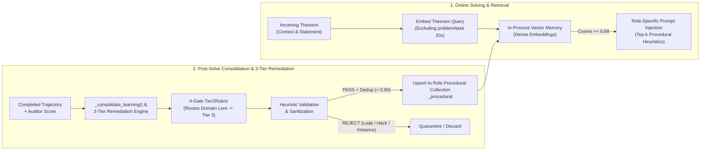
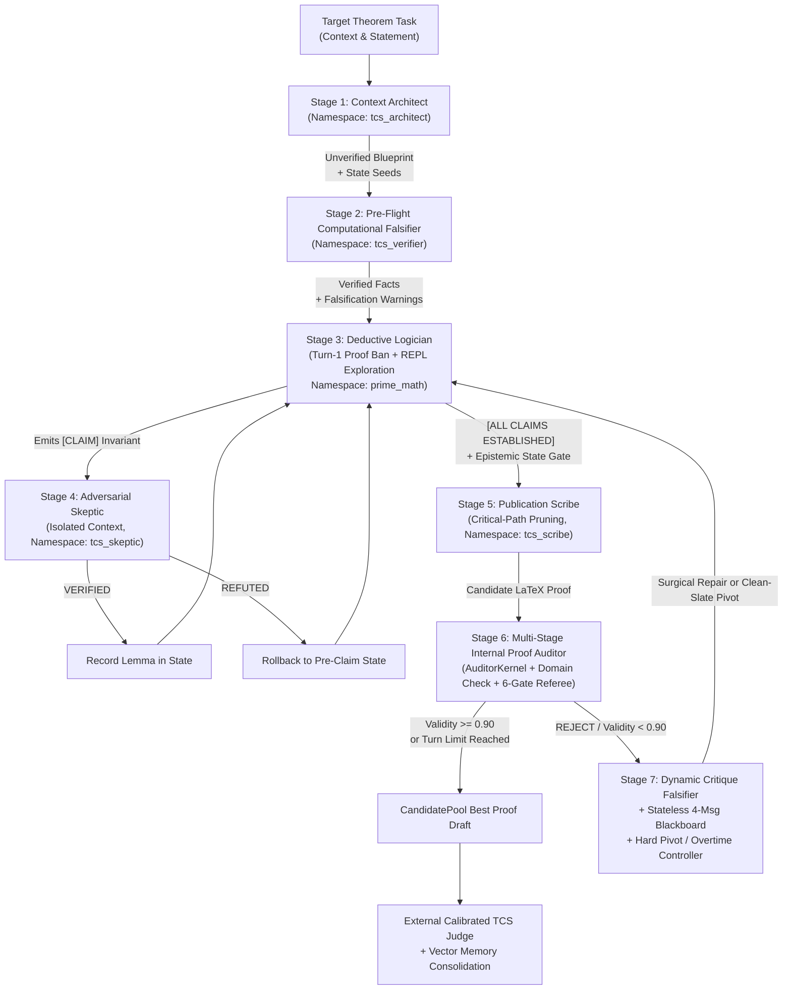

# Neuro-Symbolic Agent Scaffolding for Research-Level Theorem Proving: Zero-Trust Verification and Continuous Domain Learning in Quantized Language Models

**Authors:** Research Team  
**Categories:** `cs.AI`, `cs.LO`, `cs.CC`, `math.LO`, `cs.SC`  
**Code & Data Availability:** The reference implementation (*Proof-Harness*) and benchmark evaluation artifacts are available at [https://github.com/dionyziuz/proof_harness](https://github.com/dionyziuz/proof_harness).

---

## Abstract

While multi-turn agent scaffolding has become common practice for deploying large language models (LLMs) on complex reasoning tasks, existing harnesses typically rely on unguided prompting, conversational debates, or raw code execution without deterministic mathematical semantics or persistent domain memory. When evaluated on research-level mathematics—such as the **TCS-Bench** suite of 300 research theorems drawn from Theoretical Computer Science literature—conventional unassisted reasoning and unguided scaffolds struggle severely: an unassisted quantized 27B model achieves only a **3.33%** certified sound pass rate ($10/300$) and a **4.00%** passing rate counting directional reductions ($12/300$). In this paper, we demonstrate that solving research-level formal deduction requires moving beyond generic scaffolding to a **specialized neuro-symbolic proving harness** that systematically addresses two foundational deficits: **(1) Episodic Amnesia and Static Weights**, wherein a frozen model cannot accumulate verified domain heuristics across problems without expensive fine-tuning; and **(2) The Probabilistic Trust Fallacy**, wherein next-token likelihoods are mistaken for mathematical truth, masking invalid algebraic leaps, inverted inequalities, and illegal property inheritance.

We introduce and empirically validate a neuro-symbolic theorem-proving framework engineered around two tightly coupled architectural pillars:
1. **Zero-Trust Deterministic Kernel Verification:** Serving as a dual-isolated symbolic and numerical execution substrate (pairing a persistent exploratory kernel with an ephemeral auditor kernel), this engine treats every LLM assertion as an untrusted conjecture. The kernel integrates exact computer algebra (`SymPy`), SMT constraint solving (`Z3`), 50-digit arbitrary-precision arithmetic (`mpmath`), specialized domain extensions (planar dual face tracing, cycle chords, SMT parameter hierarchies, quantum CPTP channels, and positive semi-definite operator inequalities), honest three-valued empirical semantics (`holds_on_samples`), anti-brute-force analytical ceilings, and a formal **Epistemic State Machine** that automatically revokes fragile mathematical properties under conditioning or restriction.
2. **Continuous Domain Learning via CoALA Vector Heuristics:** Implementing a continual learning architecture based on Cognitive Architectures for Language Agents (CoALA), the framework accumulates domain intelligence over time without weight modification. As tasks are attempted and verified proofs accumulate, transferable mathematical strategies and verification heuristics (Procedural Memory) are distilled into role-isolated vector embedding collections. Extracted heuristics are validated and sanitized to ensure generality before indexing, enabling the system to specialize into vertical research domains purely through vector embeddings.

Coupled with a seven-role cognitive partitioning architecture, a **Turn-1 Exploration Gate** (banning premature proof drafting on Turn 1 to enforce invariant discovery in code), a **4-Message Stateless Blackboard Revision** protocol, and **Candidate Protection against Destructive Pivots**, the framework enables a quantized 27B model (`unsloth/Qwen3.8-27B-NVFP4`) running on a single 32GB consumer GPU to achieve research-level deductive reasoning (while the architecture is model-agnostic, our empirical analysis evaluates consumer hardware performance).

Across cumulative passing thresholds on 300 research-level problems:
- **Passing Grades ($\ge 0.40$, Grade C and Above — Sound & Directional):** The framework achieves **23.67% ($71/300$)**, nearly **sextupling ($5.92\times$)** the unassisted baseline of $4.00\%$ ($12/300$).
- **Certified Sound Passes ($\ge 0.50$, Grade B and Above):** The framework achieves **21.00% ($63/300$)**, a **$6.30\times$ multiplier** over the unassisted baseline of $3.33\%$ ($10/300$).
- **Publication-Grade Proofs ($\ge 0.70$, Grade A and Above):** The framework achieves **18.00% ($54/300$)**, a **$7.71\times$ multiplier** over the unassisted baseline ($2.33\%$, $7/300$), with 31 proofs reaching near-flawless ($\ge 0.90$) journal quality.
- **Passing Proof Quality:** On certified passing proofs, the architecture drives mean referee validity to **$0.853 \pm 0.129$** (median **$0.880$**), with structural completeness reaching **$0.907$** and logical rigor reaching **$0.857$**. Exactly **100% of all passing proofs** are discovered through governed multi-turn symbolic verification in Turns 2–12.

---

## 1. Introduction & Problem Statement

### 1.1 Two Fundamental Walls in Autoregressive Mathematical Reasoning
Recent advances in mathematical reasoning with large language models have focused heavily on scaling parameter counts or test-time chains of thought (CoT) on competition benchmarks (e.g., GSM8K, MATH, AIME). However, evaluating LLMs on research-level Theoretical Computer Science (TCS) research—or specialized formal engineering domains such as quantitative modeling, cryptographic verification, or algorithmic complexity—exposes two structural obstacles that scaling token volume alone does not resolve.

#### Problem Wall I: The Probabilistic Trust Fallacy ($\text{Token Likelihood} \neq \text{Mathematical Truth}$)
Even when a language model retrieves a promising high-level strategy, **autoregressive generation is fundamentally probabilistic, whereas mathematics is unforgivingly deterministic**. Relying on an LLM's internal self-attention to verify its own multi-step derivations introduces four pervasive failure modes:
1. **Fluent Deduction Flaws & Inverted Inequalities:** Autoregressive token generation optimizes for conditional likelihood rather than truth preservation. When an intermediate inequality fails on a subset of the parameter space or at extremal boundaries (e.g., small $n$, singular matrices, or tight variance regimes), an ungrounded model routinely reverses an inequality direction, drops necessary logarithmic factors, or bridges an unjustified gap with formulaic academic assertions (e.g., *"it follows by standard calculations"* or *"by symmetry"*).
2. **Unauthorized Domain Restriction:** When an intermediate bounding expression $A(x) \le B(x) \le C(x)$ is too loose to establish the target bound over the full quantified domain $\mathcal{D}$, an ungrounded solver often confuses the failure of its intermediate lemma with a limitation of the target theorem. Instead of replacing the loose bound $B(x)$, the model silently narrows the theorem's premise mid-proof (e.g., adding an unprompted restriction such as *"assuming $\beta \le 1$"* or *"for graphs of bounded degree"*), thereby proving a strictly weaker result and invalidating universal quantification.
3. **Illegal Inheritance of Fragile Invariants:** Mathematical proofs frequently construct child objects via conditioning, restriction, or projection (e.g., conditioning random variables on a sum event $E$, inducing a subgraph $G[V']$, or projecting onto a subspace $W$). While *hereditary* properties (such as planarity or bipartiteness) survive sub-object restriction, *fragile* invariants (such as mutual independence, full rank, connectivity, or stationarity) are typically destroyed. Without explicit epistemic state tracking, language models routinely hallucinate that fragile parent properties persist across transformations, invalidating subsequent probability bounds or spectral arguments.
4. **Epistemic Conflation & Analytical Evasion in Naive Code Execution:** Providing an LLM with a naive code execution environment without rigorous mathematical semantics introduces twin failure modes: (i) *epistemic conflation*, where the model evaluates a symbolic relation on a finite numerical sample grid and treats empirical survival as universal mathematical proof; and (ii) *analytical evasion*, where the solver attempts to brute-force large numerical loops or simulate finite instances rather than deducing the underlying structural invariants required for universal theorems ($\forall n$).

#### Problem Wall II: Frozen Weights, Episodic Amnesia, and the Need for Continual Domain Specialization
In standard inference, an LLM functions as a **stateless, frozen model**. Whether it spends extensive computation finding an effective proof strategy on one problem, or repeatedly encounters subtle mathematical edge cases on another, **the insights gained in the session are lost once the context window closes**. On subsequent problems, the model begins with no retained experience and is prone to repeating identical errors.

For research and engineering teams applying AI to specialized technical domains (such as spectral graph theory, quantum computing, algorithmic game theory, or cryptographic verification), this episodic amnesia presents a severe **Domain Adaptation Bottleneck**:
1. **Limitations of Weight Fine-Tuning for Continual Specialization:** Attempting to teach a model domain-specific proof patterns or system invariants via continual SFT or RLHF requires substantial compute clusters, risks catastrophic forgetting of general reasoning capabilities, cannot be updated incrementally in real time between individual problem solves, and tends to memorize specific benchmark instances rather than transferable structural heuristics.
2. **Limitations of Raw Problem Transcript Retrieval:** Standard retrieval-augmented generation (RAG) pipelines often index unedited problem histories or raw interaction logs. In mathematical theorem proving, however, retrieving raw problem transcripts floods the solver's attention window with instance-specific variable names, dead exploratory branches, and benchmark constants—introducing context noise rather than reusable strategic insight.

**The Architectural Goal: Continual Learning that Compounds Domain Expertise Over Time:**
The central goal of our architecture is to provide a **continuous learning system that systematically improves over time for practitioners using the harness within their target domain**:
- Instead of requiring model retraining or dumping noisy conversational logs, the framework employs a **curated, role-partitioned heuristic learning architecture**.
- As users tackle problems within a given mathematical field, every verified proof and analyzed failure is automatically distilled into clean, reusable procedural heuristics (transferable reduction blueprints, invariant discovery tactics, and counterexample defense rules).
- Extracted heuristics are sanitized to ensure generality and indexed into domain-specific vector memory collections.
- When practitioners subsequently pose new theorems in that domain, the harness retrieves relevant, proven heuristics just in time—enabling research teams to continuously build, curate, and compound domain-specific mathematical expertise that makes the system progressively faster, sharper, and more competent with every problem solved, all while base model weights remain completely frozen.

### 1.2 Summary of Contributions
To address both structural walls, we introduce a neuro-symbolic framework for autonomous mathematical deduction. We evaluate this approach using an open-source reference implementation, *Proof-Harness*, and make the following scientific contributions:

1. **The Zero-Trust Deterministic Mathematical Kernel Architecture (Section 3):** We design a dual-isolated execution substrate pairing a persistent exploratory kernel for search with an ephemeral kernel for proof auditing. The kernel incorporates:
   - **Symbolic, SMT, and 50-Digit Arbitrary-Precision Integration:** A unified environment combining `SymPy`, `Z3`, and `mpmath` (`mp.dps = 50`) under thread-safe timeout isolation.
   - **Domain-Specific Verification Tooling:** Preloaded operators for symbolic asymptotic dominance, Monte Carlo event covariance auditing, exhaustive graph counterexample sweeps, planar graph duals, cycle chords, SMT parameter hierarchies, and quantum CPTP channel fidelity.
   - **Honest Three-Valued Empirical Semantics (`holds_on_samples`):** An explicit three-valued logic (`False`, `True_emp`, `None`) that strictly distinguishes empirical spot-checking from formal mathematical deduction.
   - **Anti-Brute-Force Analytical Ceilings:** Execution guards that enforce mathematical deduction over brute-force loops while protecting host memory, paired with a formal provenance DAG (**Epistemic State Machine**) that tracks and automatically revokes fragile mathematical invariants under non-preserving transformations.
2. **Continuous Domain Learning via Validated CoALA Vector Heuristics (Section 4):** We design a continual learning architecture based on Cognitive Architectures for Language Agents (CoALA), backed by dense vector embeddings across five role-isolated agent namespaces. Key mechanisms include:
   - **Closed-Loop Heuristic Distillation:** Automated post-solve extraction of transferable mathematical strategies and verification pitfalls.
   - **A 3-Tier Autonomous Remediation Engine:** A post-evaluation diagnostic pipeline that audits failed tasks and routes domain-specific mathematical insights strictly into vector memory rather than global prompt bloat.
   - **Heuristic Validation and Sanitization:** Automated filtering and normalization that removes problem-specific constants and instance equations, ensuring only transferable procedural strategies are indexed into vector memory.
3. **Seven-Role Cognitive Partitioning & Governed Search (Section 5):** We decompose theorem proving into seven specialized cognitive roles governed by a **Turn-1 Exploration Gate**, **Blueprint Quarantine**, a **4-Message Stateless Blackboard**, **Candidate Protection against Destructive Pivots**, and the **High-Potential Overtime Extension Gate** (dynamically unlocking an extra 4 iterations for near-miss candidates demonstrating directional validity).
4. **Large-Scale Empirical Validation on Research-Level TCS Theorems (Sections 6–8):** Across $N=300$ research theorem-proving problems from TCS-Bench using a quantized 27B model on a single consumer GPU, the proposed framework substantially improves passing performance over unassisted first-shot generation:
   - **Passing Grades ($\ge 0.40$, Grade C and Above):** **$23.67\%$ ($71/300$)** vs. $4.00\%$ ($12/300$) unassisted baseline (**$5.92\times$ gain**).
   - **Certified Passes ($\ge 0.50$, Grade B and Above):** **$21.00\%$ ($63/300$)** vs. $3.33\%$ ($10/300$) unassisted baseline (**$6.30\times$ gain**).
   - **Publication-Grade Proofs ($\ge 0.70$, Grade A and Above):** **$18.00\%$ ($54/300$)** vs. $2.33\%$ ($7/300$) unassisted baseline (**$7.71\times$ gain**).
   - **Passing Proof Rigor:** Lifts the mean validity of certified passing proofs to **$0.853 \pm 0.129$** (median **$0.880$**), with structural completeness reaching **$0.907$** and logical rigor reaching **$0.857$**, with $100\%$ of passes discovered through multi-turn verification.

---

## 2. Problem Formulation and Architecture Overview

A theorem-proving task presented to the harness consists of three primary components:
- **Paper Context:** The formal definitions and contextual lemmas extracted from the source manuscript that precede the target statement, with all ground-truth proofs and downstream solution hints strictly stripped.
- **Target Theorem Statement:** The formal proposition to be proved or refuted across its full quantified parameter space.
- **Domain Scope:** The structural assumptions, parameter regimes, and boundary constraints specified by the theorem statement (such as connected planar graphs, non-degenerate covariance matrices, or asymptotic parameter hierarchies).

Unlike unassisted, single-turn inference where a model generates a proof purely via autoregressive token sampling without code execution or feedback, our framework deploys a **Stateful Neuro-Symbolic Architecture** that coordinates three complementary layers:
1. **Frozen Backbone Model:** A 4-bit quantized autoregressive transformer (`unsloth/Qwen3.8-27B-NVFP4`) whose weights remain fixed throughout all runs.
2. **Deterministic Mathematical Kernel:** A dual-isolated execution environment pairing symbolic algebra (`SymPy`), SMT constraint solving (`Z3`), 50-digit numerical analysis (`mpmath`), and an epistemic state machine. This kernel deterministically verifies intermediate claims, boundary values, and algebraic invariants, refusing to trust probabilistic model text.
3. **Evolving CoALA Vector Memory:** A persistent, role-indexed procedural memory bank storing verified mathematical strategies and verification heuristics across five cognitive roles. As tasks are completed and verified proofs accumulate in a given domain, the system distills new verified heuristics into memory, expanding domain knowledge without weight fine-tuning.

Over a guided multi-turn search trajectory (nominally up to 8 turns, with an automatic extension to 12 turns for promising drafts), the architecture develops and refines a complete LaTeX proof enclosed in `\begin{proof} ... \end{proof}`. 

To evaluate proof correctness without circularity or confirmation bias, each candidate proof is assessed by an independent, external referee (the **Calibrated TCS Judge**). The judge grades the draft across multiple independent evaluation replicates on five dimensions: *Logical Deductive Rigor*, *Structural Completeness*, *Handling of Boundary & Edge Cases*, *Verification of Theorem Hypotheses*, and *Overall Validity* $v(\pi) \in [0.0, 1.0]$. The median validity score determines benchmark certification across distinct quality tiers:

- **Grade A & Above ($v(\pi) \ge 0.70$ — Publication Grade / Journal-Ready):** 
  The proof provides an exhaustive, airtight deductive derivation from stated hypotheses to the final theorem conclusion. All quantifier scopes ($\forall, \exists$), degenerate parameter regimes (e.g., $n=1, 2$, empty cuts, isolated vertices), and asymptotic transition bounds are explicitly analyzed and discharged. Preconditions for external mathematical machinery (e.g., Chernoff bounds, Cauchy-Schwarz, spectral interlacing) are verified in full. Proofs in this tier are typeset in formal declarative LaTeX suitable for immediate academic submission; proofs with $v(\pi) \ge 0.90$ represent near-flawless journal quality.
- **Grade B & Above ($v(\pi) \ge 0.50$ — Certified Sound Pass):** 
  The primary benchmark headline threshold indicating a complete, mathematically sound deduction with no substantive deductive flaws. The central reduction, lemma dependencies, and algebraic transformations are correct, with zero unverified leaps on non-trivial steps. Unlike Grade A, proofs in this tier may treat routine, standard edge cases briefly or leave standard algebraic identities implicit where they follow directly from context, but contain no unsound steps or false lemmas.
- **Grade C & Above ($v(\pi) \ge 0.40$ — Directionally Sound Reduction):** 
  The high-level reduction architecture, problem decomposition, and invariant strategy are genuinely valid (e.g., correctly establishing an inductive reduction, constructing the correct potential function in amortized analysis, or establishing a valid probabilistic coupling). However, the derivation may contain minor technical gaps, an unverified constant factor, or a loose intermediate inequality that requires subsequent patching. This tier captures all proofs with substantive mathematical foundations, separating directionally sound progress from complete failures.
- **Incomplete / Refuted Proofs ($v(\pi) < 0.40$):** 
  Proofs exhibiting fatal logical flaws, inverted inequality directions, unaddressed counterexamples, illegal property inheritance across transformations (e.g., assuming independence after conditioning), circular reasoning, or superficial hand-waving prose (*"it obviously follows by standard arguments"*).

---

## 3. Core Pillar I: The Zero-Trust Deterministic Mathematical Kernel Engine

To address **Problem Wall I (The Probabilistic Trust Fallacy)**, the architecture equips the language model with an external computational substrate: the **Zero-Trust Deterministic Mathematical Kernel**. While learned heuristics provide compounding advantages over time, the deterministic kernel provides an immediate foundation of correctness: ensuring that every algebraic deduction, inequality direction, topological boundary, and spectral claim is tested against deterministic software rather than probabilistic token likelihoods. The governing axiom of the kernel is: **the language model's prose is never trusted for symbolic calculation, inequality direction, independence preservation, or small-instance edge cases; every verifiable claim must be executed against deterministic mathematical software.**

### 3.1 Dual-Kernel Isolation Architecture
A subtle flaw in single-REPL agent architectures is **shared-state confirmation bias**: if an internal referee validates a proof inside the same Python namespace where the solver defined its helper functions or mutated global state, an error in the solver's setup definitions can silently corrupt the audit.

The framework enforces **Dual-Kernel Isolation**:
1. **Persistent Exploratory Kernel (`PersistentMathKernel`):** Dedicated to the Context Architect, Pre-Flight Falsifier, Deductive Logician, and Adversarial Skeptic across Turns $1 \dots T$. It preserves verified lemmas, custom symbolic expressions, and the provenance DAG across turns, with snapshot rollback via checkpoints.
2. **Ephemeral Verification Kernel (`AuditorKernel`):** Spawned fresh from scratch during Stage 1 of proof auditing (`timeout = 15s`) with a completely disjoint memory space. The Proof Auditor writes an independent Python falsification script directly from the LaTeX proof text $\pi_t$ and the theorem statement $(C, S)$, ensuring that the proof stands on its own mathematical definitions.

Both kernels execute inside a thread-safe sandbox utilizing thread-keyed stream capture and asynchronous thread termination to inject execution timeouts (inheriting from `BaseException` so model-generated exception handlers cannot swallow timeouts).

### 3.2 Preloaded Symbolic, SMT, and Arbitrary-Precision Stack
Every kernel instance boots with a pre-configured deterministic mathematical environment:
- **Exact Symbolic Computer Algebra (`SymPy`):** Symbolic simplification, exact series expansion, Groebner bases, symbolic limits, and exact rational arithmetic (`sp.Rational`, `sp.simplify`, `sp.limit`, `sp.solve`).
- **Automated Theorem Proving & SMT Constraint Solving (`Z3`):** Preloaded `z3-solver` (`Int`, `Real`, `Bool`, `Array`, `ForAll`, `Exists`, `Solver`) configured with a strict default timeout guard ($10,000\text{ms}$) so unbounded nonlinear quantifier queries fail gracefully rather than hanging the worker thread.
- **50-Digit Arbitrary-Precision Numerical Analysis (`mpmath`):** Pre-configured to **50 decimal places of working precision** (`mpmath.mp.dps = 50`), eliminating IEEE-754 64-bit floating-point catastrophic cancellation when evaluating delicate asymptotic constants, theta-series tails, or spectral gaps.
- **Combinatorial & Spectral Graph Theory (`NetworkX`, `SciPy`, `NumPy`):** Exact small-graph construction, Laplacian spectrum computation, and linear programming relaxations.
- **Optional Formal Proof Assistant Hook (`lean_check`):** Direct invocation of the Lean 4 compiler when formal verification is enabled.

### 3.3 Domain-Agnostic Diagnostic Operators
In research-level TCS proofs, three classes of errors account for common deductive flaws: (i) misjudging asymptotic growth rates ($o, \mathcal{O}, \Theta, \Omega, \omega$), (ii) assuming conditioned random events remain independent, and (iii) overlooking small structural graph counterexamples. Rather than relying on the LLM to write ad-hoc test scripts from scratch on every turn, the kernel provides four preloaded diagnostic operators:

1. **Symbolic Asymptotic Dominance Verifier (`check_asymptotic_dominance(f_expr, g_expr, var='n')`):**
   Computes the exact symbolic limit ratio $L = \lim_{n \to \infty} f(n)/g(n)$ in SymPy and deterministically classifies whether $f$ is strictly dominated ($f = o(g)$ when $L = 0$), strictly dominates ($f = \omega(g)$ when $|L| = \infty$), is asymptotically tight ($f = \Theta(g)$ when $0 < |L| < \infty$), or is oscillatory/incomparable.
2. **Monte Carlo Event Covariance & Independence Auditor (`check_event_covariance(sampler_fn, n_trials=2000, seed=42)`):**
   Executes seeded empirical trials over a candidate event generator to compute empirical expectations, covariance, and Pearson correlation $\hat{\rho}_{A,B}$. If $|\hat{\rho}_{A,B}| > 0.05$, the tool raises an explicit dependence warning; otherwise, it confirms approximate independence, catching false independence assumptions before the solver applies a naive product measure or Chernoff bound.
3. **Exhaustive & Random Graph Counterexample Finder (`find_graph_counterexample(predicate_fn, max_n=7, include_random=True)`):**
   Systematically sweeps `predicate_fn(G)` across canonical graph families up to $n \le n_{\max}$ vertices (`max_n = 7`)—including paths $P_n$, cycles $C_n$, complete graphs $K_n$, star graphs $S_n$, complete bipartite graphs $K_{n_1, n_2}$, and seeded Erdős–Rényi random graphs $G(n, p)$ for $p \in \{0.3, 0.6\}$. Crucially, `find_graph_counterexample` implements **Fail-Closed Exception Semantics**: if `predicate_fn(G)` raises *any* runtime exception on $k > 0$ graphs while finding zero explicit `False` returns, the tool returns `{"verified": False, "inconclusive": True}`, preventing a buggy test predicate from masquerading as a verified graph invariant.
4. **Honest Three-Valued Empirical Falsifier (`holds_on_samples(relation, max_points=2000)`):**
   Evaluates symbolic inequalities against a three-valued epistemic logic (`False`, `True_emp`, `None`) that strictly separates empirical spot-checking from formal mathematical deduction. When exact symbolic decision (`sp.simplify`) is undecidable, it constructs a deterministic evaluation grid respecting declared domain assumptions (`integer`, `positive`, `prime`). If any sample point violates the relation, it returns `False` (certified counterexample refutation). If all sample points satisfy the relation, it returns `True_emp` (empirical survival on samples only—never conflated with universal mathematical truth). If evaluation fails due to singularities, it returns `None` (inconclusive).

### 3.4 Domain-Specific Verification Extensions: Topology, SMT Hierarchies, and Quantum Operators
To support deductions in specialized sub-disciplines without fine-tuning, the kernel incorporates four specialized operator modules:
1. **Planar Graph Duals & Cycle Chords (`planar_dual_and_faces`, `check_cycle_chords_and_holes`):**
   Combinatorial plane embeddings and face-boundary tracing algorithms that extract primal faces, verify enclosing Jordan curves, and compute dual graphs $G^*$ for multiway cut, graph minor, and topological embedding proofs. `check_cycle_chords_and_holes` deterministically checks whether a cycle $C$ possesses chords or forms an induced chordless hole.
2. **SMT Constraint & Parameter Hierarchy Solvers (`smt_disjoint_paths`, `smt_slice_terminal_pairing`, `smt_check_parameter_hierarchy`):**
   Leverages Z3's quantifier-free linear integer and real arithmetic (QF-LIRA) to formally prove the existence or non-existence of node- and edge-disjoint routings, validate terminal pair feasibility across graph slices, and verify complex asymptotic scaling hierarchies ($1 \ll k \ll \log n \ll \ell$) without sign inversions.
3. **Quantum Information & Operator Inequality Verification:**
   - **Loewner Order PSD Verification (`check_psd_inequality(A, B)`):** Deterministically tests whether $A \succeq B$ ($A - B$ is positive semi-definite) via Cholesky decomposition and Hermitian eigenspectrum analysis.
   - **CPTP Quantum Channel Verification (`check_quantum_channel_claim(kraus_ops)`):** Verifies complete positivity and trace-preservation ($\sum K_i^\dagger K_i = I$) across arbitrary Kraus operator sets.
   - **Haar Witnesses & Fidelity (`random_density_matrix`, `random_unitary`, `partial_trace`, `uhlmann_fidelity`):** Generates valid quantum state witnesses and computes exact partial traces and Uhlmann fidelity $F(\rho, \sigma) = (\text{Tr}\sqrt{\sqrt{\rho}\sigma\sqrt{\rho}})^2$.
4. **Graph Library Safeguards & Generator Ceilings:**
   Provides compatibility aliases alongside a generator ceiling (`MAX_COMBINATORIAL_STEPS = 200,000`) preventing combinatorial loop explosions and protecting host memory.

### 3.5 Anti-Brute-Force Analytical Ceilings
When given an unrestricted Python environment, language models frequently attempt to brute-force large loop iterations or iterate over high-order permutations instead of deriving an analytical proof.

The kernel enforces **Analytical Ceilings** directly at runtime and AST levels:
- **Guarded Iteration Ceiling (`guarded_range`):** Replaces built-in `range` with `guarded_range`, which computes the exact span $\lceil(\text{stop} - \text{start})/\text{step}\rceil$ and raises a `ValueError` whenever a loop exceeds `MAX_DIAGNOSTIC_SIEVE_LIMIT = 200,000` elements, instructing the model to stop brute-force search and deduce an analytical solution.
- **Bounded Number-Theoretic Sieves (`fast_sieve`, `fast_totients`, `fast_spf`):** Preloaded sieves are capped at $N \le 200,000$ for small-parameter pattern discovery.
- **AST Combinatorial Explosion Gate:** Static AST inspection blocks `itertools.permutations(range(n))` for $n \ge 7$ before execution begins.
- **Combinatorial Step Ceilings:** Wraps combinatorial searches with `MAX_COMBINATORIAL_STEPS = 200,000` to prevent unconstrained exponential runaway from exhausting memory.

### 3.6 Epistemic State Machine & Property Invariance Tracking (`MathStateMachine`)
The `MathStateMachine` tracks active mathematical entities within the kernel, recording their domain, proven properties, structural lineage, and any property revocations.

It partitions mathematical properties into two distinct behavioral classes:
1. **Hereditary Properties:** Properties guaranteed to be preserved under canonical sub-object restriction (such as induced subgraphs, subsets, sub-algebras, or principal submatrices). Examples include `bipartite`, `planar`, `forest`, `acyclic`, `chordal`, `measurable`, `hermitian`, `positive_semidefinite`, and `abelian`. When a new object is derived via restriction or projection, hereditary properties automatically carry forward.
2. **Fragile Properties:** Properties destroyed under restriction, conditioning, projection, or quotienting operations unless explicitly re-established with an invariance witness. Examples include `independent`, `mutually_independent`, `martingale`, `stationary`, `connected`, `biconnected`, `regular`, `invertible`, `positive_definite`, and `orthogonal`.

When the solver derives a child object under a non-preserving transformation (such as conditioning a random variable or extracting an induced subgraph), the state machine automatically revokes all fragile properties inherited from the parent and logs a detailed revocation reason.

**Epistemic Scribe Gate:** If the solver attempts to invoke the Publication Scribe while any active mathematical object has unaddressed property revocations, the harness blocks the transition and requires an explicit witness or re-proof before formal LaTeX synthesis can proceed.

---

## 4. Core Pillar II: The CoALA Heuristics & Continuous Domain Learning Engine

To address **Problem Wall II (Frozen Weights & Episodic Amnesia)**, the framework incorporates a continual domain learning engine based on the **Cognitive Architectures for Language Agents (CoALA)** framework (Sumers et al., 2023). While the kernel ensures immediate accuracy on each individual proof attempt, the CoALA heuristics engine provides **cumulative longitudinal intelligence**: as the system solves theorems in specific domains over time, it automatically distills verified reduction tactics and failure post-mortems into role-isolated vector memory without requiring weight fine-tuning.



### 4.1 Cognitive Memory Tiers and Role-Isolated Embedding Spaces
For each specialized subagent role, the memory subsystem maintains two active memory tiers:
1. **Working Memory:** The active per-task state, holding the current problem statement, active kernel variables, the verified lemma ledger, and the provenance DAG.
2. **Procedural Memory (`<agent_id>_procedural` in vector memory):** Abstract, universally transferable mathematical strategies, decomposition blueprints, and verification patterns (e.g., *"When bounding the expected size of prefix-restricted sumsets in $\mathbb{Z}^d$, decompose into $2^d$ dyadic boxes and apply Hölder's inequality with conjugate exponents $p = d/(d+1)$ and $q = 1/(d+1)$"*).

*(Note on diagnostic logging: At the conclusion of a run, raw execution trajectories and post-mortems may be written to `<agent_id>_episodic` as an offline diagnostic log, but active prompt injections during solving draw strictly from verified procedural heuristics).*

Crucially, because each cognitive role requires fundamentally different operational heuristics, vector memory is partitioned into **five role-isolated procedural collections** persisted directly in-process via `turbovec.IdMapIndex` and `FastEmbed` (`BAAI/bge-small-en-v1.5`) with zero external daemon dependencies:

| Agent Namespace (`agent_id`) | Active Procedural Collection (`_procedural`) | Domain Specialization Role |
| :--- | :--- | :--- |
| **`prime_math`** | `prime_math_procedural` | Core Deductive Logician: algebraic reductions, invariant formulation, concentration inequalities. |
| **`tcs_architect`** | `tcs_architect_procedural` | Context Architect: decomposing paper contexts, seeding state objects, modular lemma chains. |
| **`tcs_verifier`** | `tcs_verifier_procedural` | Pre-Flight Falsifier: fast small-instance boundary scripts and Monte Carlo sanity checks. |
| **`tcs_skeptic`** | `tcs_skeptic_procedural` | Adversarial Skeptic: counterexample construction and degenerate parameter attacks. |
| **`tcs_scribe`** | `tcs_scribe_procedural` | Publication Scribe: critical-path pruning, quantifier discharge, and journal-grade LaTeX synthesis. |

To guarantee evaluation reproducibility, memory operations follow a **Fail-Closed Contract**: if the local vector index or embedding engine is unavailable, an exception (`TurboVecUnavailableError`) is raised immediately rather than silently proceeding unindexed.

### 4.2 Closed-Loop "Learning by Solving"
At the conclusion of every problem trajectory (when memory updates are enabled), the framework performs a low-temperature reflection pass over the outcome:
- **Outcome Case A (Solved / Certified Proof):** The reflection pass analyzes which computational experiments succeeded and which intermediate claims survived adversarial checks, extracting a concise **Universal Procedural Heuristic** free of problem-specific constants.
- **Outcome Case B (Refuted / Unsolved / Budget Exhausted):** The reflection pass analyzes dead routes and auditor objections, extracting a **Corrective Procedural Heuristic** that records the specific invariant condition or boundary trap to avoid on similar problems.

Before inserting a candidate heuristic into procedural memory, the system queries the collection for semantic similarity. If the candidate exhibits a cosine similarity greater than $0.90$ with an existing heuristic, it is discarded as a **near-duplicate**, preventing frequent problem archetypes from dominating top-$k$ retrieval slots.

### 4.3 The 3-Tier Autonomous Remediation Pipeline and the 4-Gate Rubric
Beyond single-task reflection, the framework includes an automated **Remediation Engine** that diagnoses failed benchmark tasks (`score < 0.50`) and classifies root causes across three tiers:

1. **Tier 1 (Deterministic Harness Guardrails — Flagged for Review):** Structural harness or parser defects requiring code modifications.
2. **Tier 2 (System Prompt Directives — Universality-Gated):** High-level behavioral adjustments to the agent's system prompt, strictly governed by a 4-criterion universality rubric:
   - *Universality Gate:* Must be 100% domain-agnostic and applicable to all mathematical disciplines.
   - *Behavioral Posture Gate:* Must govern overall reasoning demeanor or workflow rather than conveying specific mathematical facts.
   - *Zero-Degradation Gate:* Must carry no risk of degrading performance on unrelated tasks.
   - *Procedural Insufficiency Gate:* Must address an issue that cannot be solved via targeted heuristic retrieval.
3. **Tier 3 (CoALA Vector Memory Injection — Autonomous):** Domain-specific mathematical techniques, theorem-specific warning patterns, and specialized proof tactics.

**Automatic Tier-2 $\to$ Tier-3 Downgrade Rule:** Domain-specific mathematical knowledge should not be hardcoded into global system prompts, where it bloats context budgets and degrades performance on unrelated mathematical subfields. Whenever a proposed remediation fails any of the four universality gates (or is classified as missing domain knowledge or proof strategy), the engine automatically converts the proposal into a validated CoALA procedural heuristic in vector memory.

### 4.4 Heuristic Validation and Generality Filtering
To ensure that procedural memory contains only transferable mathematical techniques rather than instance-specific details or empirical shortcuts, candidate heuristics undergo automated validation and sanitization prior to embedding:

1. **Substantiveness & Non-Triviality:** Rejects empty placeholders and overly brief entries lacking actionable deductive strategy.
2. **Deductive Verification Integrity:** Rejects empirical sequence extrapolation or brute-force sieving heuristics (`Richardson extrapolation`, `Aitken acceleration`, or exhaustive search) in favor of formal deductive derivations.
3. **Instance Decoupling:** Strips problem identifiers, titles, and instance-specific variable bindings (e.g., hardcoded equations like `2^k == 3^m` or specific numeric evaluations).
4. **Constant Sanitization:** Removes problem-specific numerical constants from the heuristic text to guarantee that only universal, transferable mathematical principles are indexed.

Furthermore, during online retrieval, the memory manager enforces **Self-Retrieval Exclusion**, ensuring that problems do not retrieve heuristics derived from their own prior attempts during re-evaluation runs.

### 4.5 Implications for Domain-Specific Vertical Specialization
By decoupling **reasoning syntax** (held in frozen model weights) from **evolving domain heuristics** (stored in role-isolated vector embeddings), this architecture provides a general blueprint for vertical AI specialization:
- **Zero-Weight-Update Domain Onboarding:** A research group in quantum information theory, algorithmic game theory, or formal verification can apply the framework to a corpus of domain problems. As tasks are solved and audited, the system automatically populates procedural vector collections with verified, domain-specific proof tactics and counterexample templates.
- **Auditable Knowledge:** Unlike opaque weight updates, learned heuristics in vector memory are human-readable, provenance-tagged records that engineers can inspect, audit, version-control, or transfer across model backbones.

---

## 5. Seven-Role Cognitive Partitioning & Closed-Loop Search Governance

Built atop the **Deterministic Kernel** (Section 3) and the **CoALA Learning Engine** (Section 4), the prover partitions mathematical cognition across seven specialized roles. A central architectural hypothesis is that **exploratory mathematical scratchwork, adversarial falsification, and formal academic typesetting require incompatible attention distributions**.



### 5.1 The Seven Cognitive Stages
1. **Stage 1 — Context Architect & Blueprint Quarantine:** Queries procedural memory and constructs a catalog of contextual definitions and lemmas from the source paper, seeds initial objects in the epistemic state machine, and outlines a modular reduction blueprint. **Blueprint Quarantine Rule:** The blueprint is injected as an unverified conjectural sketch; if an execution in the kernel falsifies an intermediate bound, the solver must discard the conjectured bound rather than restricting the theorem's target domain.
2. **Stage 2 — Pre-Flight Computational Falsifier:** Queries procedural memory and executes verification scripts in the kernel before Turn 1 begins, identifying verified mathematical facts or critical falsification warnings.
3. **Stage 3 — Deductive Logician & Turn-1 Exploration Gate:** Queries core procedural memory for relevant mathematical heuristics. Governed by the **Turn-1 Exploration Gate**, any `\begin{proof}` block on Turn 1 is strictly prohibited; the solver must first explore invariants in the kernel and emit structured `[CLAIM]` and `[REDUCTION]` blocks.
4. **Stage 4 — Isolated Adversarial Skeptic:** When a `[CLAIM]` invariant is emitted, the prover checkpoints kernel state and invokes the Skeptic in an isolated context window to probe the claim for counterexamples. If an invariant violation occurs, the state rolls back to the pre-claim checkpoint; if verified error-free, the claim is committed to the verified lemma ledger.
5. **Stage 5 — Publication Scribe & Critical-Path Pruning:** Operating in an isolated context with dedicated scribe procedural memory, the Scribe synthesizes the formal LaTeX proof from the verified lemma ledger, enforcing complete deduction, backward critical-path pruning (omitting dead exploratory side-tracks), and full parameter domain coverage.
6. **Stage 6 — Multi-Stage Internal Proof Auditor:** Evaluates every candidate proof draft across five verification layers:
   - *Layer 1 (Ephemeral AuditorKernel Falsification):* Runs an independent Python verification script in an isolated kernel (`timeout = 15s`).
   - *Layer 1.5 (Domain-Restriction Pre-Check):* Scans for unauthorized mid-proof domain narrowing lacking a complementary case split.
   - *Layer 1.75 (Stateful Prior-Defect Verification):* Checks whether defects flagged by the referee on earlier drafts were genuinely repaired or bypassed, capping validity at $\le 0.40$ if an earlier defect remains unaddressed.
   - *Layer 2 (Structured Academic Referee):* Enforces boolean soundness gates: capping validity at $0.25$ if the proof misquotes the target statement or contains unverified/inverted inequality directions, and at $0.35$ if essential theorem hypotheses are omitted (retaining up to $0.50$ when the draft exhibits substantive structural rigor $\ge 0.45$ so localized repairs remain in the surgical revision band).
   - *Layer 2.5 (Adversarial Second-Opinion Confirmation):* Triggers a second adversarial referee pass whenever a draft is marked `VALID` with validity $\ge 0.70$ (or when prior defects existed), setting the internal validity to the minimum of the two evaluations.
7. **Stage 7 — Dynamic Critique Falsifier:** Translates the auditor's rejection critique into a Python stress-test in the kernel to empirically confirm or refute the referee's objection before the next revision turn.

### 5.2 Governed Proof Search Lifecycle (Algorithm 1)

```text
================================================================================
Algorithm 1: Governed Neuro-Symbolic Proof Search Architecture
================================================================================
Input: Theorem Statement & Paper Context, Role-Isolated Vector Memory,
       Search Budget (Nominal: 8 turns, Overtime: 4 turns)
Output: Best Verified LaTeX Proof Candidate, Updated Vector Memory

1:  Initialize PersistentMathKernel (airgapped sandbox, preloaded diagnostics)
    and MathStateMachine (hereditary vs. fragile tracking)
2:  Retrieve relevant heuristics from vector memory (excluding current problem ID)
3:  blueprint <- ContextArchitect(context, statement, memory.architect)
    SeedState(kernel, blueprint)
4:  (facts, warnings) <- PreFlightFalsifier(kernel, blueprint, memory.verifier)
5:  Initialize conversation with System Prompt, quarantined blueprint,
    verified facts, falsification warnings, and the Turn-1 proof ban
6:  Initialize CandidatePool, dead_routes ledger, and stagnation counter
7:  state.checkpoint('init')
8:  for turn = 1 to max_turns do
9:      if ContextCompactor.should_compact(messages) then
10:         messages <- ContextCompactor.compact(messages, keep_anchors=True)
11:     (reasoning, response) <- StreamLLM(messages)
12:     Execute all Python blocks in response on PersistentMathKernel
13:     if response contains [CLAIM] and no \begin{proof} then
14:         state.checkpoint('pre_claim')
15:         status <- AdversarialSkeptic(statement, claim, state, memory.skeptic)
16:         if status == REFUTED then state.rollback('pre_claim')
17:         else if status == VERIFIED then state.record_lemma(claim)
18:     if ReadyForScribe(response, turn) and EpistemicGatePassed(state) then
19:         proof_draft <- PublicationScribe(statement, state.verified_lemmas, memory.scribe)
20:     else
21:         proof_draft <- ExtractLatexProof(response)
22:     if proof_draft is valid LaTeX proof then
23:         (verdict, issues, validity) <- InternalProofAuditor(statement, proof_draft, AuditorKernel)
24:         CandidatePool.offer(proof_draft, validity, verdict, issues, turn)
25:         if verdict == VALID and validity >= 0.90 then break  // Certified Early Exit
26:         if turn == 8 and CandidatePool.best_validity >= 0.35 then extend turns to 12
27:         if validity <= 0.05 or (stagnant_turns >= 2 and validity < 0.30) then
28:             // Clean-Slate Hard Pivot (unless protected by substantive structure or overtime)
29:             CandidatePool.prune_abandoned(threshold=0.30)
30:             kernel.reset();  dead_routes.append(issues);  stagnant_turns <- 0
31:             messages <- StatelessBlackboard(System, Task, dead_routes, PivotDirective)
32:         else
33:             // Best-Candidate Restoration & Surgical Revision
34:             if CandidatePool.best_validity >= 0.50 and CandidatePool.best_validity > validity + 0.10 then
35:                 (proof_draft, issues, validity) <- CandidatePool.best
36:             (confirmed_objections, refutations) <- DynamicCritiqueFalsifier(kernel, issues, proof_draft)
37:             messages <- StatelessBlackboard(System, Task, proof_draft, SurgicalDirective(issues, confirmed_objections))
38: Update vector memory via reflection pass and heuristic validation
39: return CandidatePool.best_proof, updated_vector_memory
================================================================================
```

### 5.3 CandidatePool Arbitration & Noise-Band Occam's Razor
Single-pass LLM referee scores exhibit an empirical evaluation variance of roughly $\pm 0.03$. Under naive greedy retention, a late-turn revision that adds defensive auxiliary lemmas to achieve a marginal score gain will overwrite a crisp, concise earlier proof—needlessly exposing additional surface area to external scrutiny.

The candidate pool implements a length-regularized Occam's razor policy for strong candidates (validity $\ge 0.70$) within the $\pm 0.03$ score noise band:
- **Conciseness Win:** Accepts a revision if it scores within 0.03 of the best score while reducing proof length by more than 25%.
- **Bloat Rejection:** Rejects a revision if it gains at most 0.03 in validity but increases proof length by more than 50% on substantial proofs ($\ge 1,500$ characters).
- **Strict Improvement:** Accepts any candidate that achieves a decisive score improvement outside the noise/bloat window.
- **Tie-Breaking:** If two passing candidates ($\ge 0.50$) achieve identical scores, the shorter proof is selected.
- **Incomplete Draft Guard:** For failing drafts ($< 0.50$), conciseness is never rewarded, preventing truncated proof sketches from displacing fuller attempts.

### 5.4 Stateless 4-Message Blackboard vs. Clean-Slate Hard Pivot
Following any non-terminal audit on Turn $t$, the prover discards intermediate conversational clutter and constructs a **4-Message Stateless Blackboard** comprising:
1. The global system prompt.
2. The clean task statement and context (stripped of Turn-1 exploration constraints).
3. The pinned candidate proof.
4. The surgical repair directive.

The governance loop arbitrates between two revision regimes:
1. **Surgical Repair with Modular Lemma Immutability:** When current validity is at least $0.30$ (or improving, or protected by substantive structural sub-scores), the draft is preserved and repaired in-place under the directive to keep sound derivations intact and focus repair strictly on the flagged step.
2. **Clean-Slate Hard Pivot:** When validity drops to $0.05$ or below, or after two or more stagnant rejections below $0.30$ without substantive structure, the low-validity draft and execution state are purged, compelling the solver to attempt a fresh architectural approach on the next turn (preceded by a 1-turn mandatory REPL exploration gate).

### 5.5 Hybrid Deterministic + Neural Context Compaction
During consecutive exploratory REPL turns, the context compactor maintains a 32,768-token context envelope (8,192-token generation reserve):
- **Identity-Pinned Anchors:** System prompt, task prompt, and pinned anchor messages are excluded from summarization.
- **Deterministic Regex Ledger:** Verbatim extracts key `[CLAIM]` statements, REPL outputs, and prior referee defect blocks from older turns.
- **5-Part Neural Summary:** Summarizes older turns into *Core Goal*, *Verified Milestones*, *Active REPL Variables*, *Disproven Hypotheses*, and *Current Frontier*, concatenating the deterministic ledger with the neural summary to preserve verified facts.

### 5.6 The High-Potential Overtime Extension Gate (Adaptive Horizon Expansion)
Fixed-horizon agent loops face an inherent tension: allocating a high turn budget across all problems wastes compute and context budget on hopeless, disproven formulations, while an overly conservative horizon prematurely truncates difficult proofs that are close to completion.

To resolve this, the framework introduces the **High-Potential Overtime Extension Gate** (`enable_overtime = True`, `overtime_threshold = 0.35`):
- **Dynamic Horizon Trigger:** When the solver completes the nominal search budget (Turn 8), the candidate pool assesses the best validity achieved so far:
  $$\max_{t \le 8} v(\pi_t) \ge \tau_{\text{overtime}} = 0.35$$
  If the best candidate has achieved directional mathematical validity ($\ge 0.35$), the system dynamically unlocks an **adaptive overtime extension of 4 additional iterations** (expanding the search horizon from Turn 8 to Turn 12) alongside $+1,800\text{s}$ wall-clock budget. Across the 300-problem V4 benchmark, exactly 84 high-potential tasks triggered this overtime extension.
- **Destructive Pivot Lockout:** During overtime iterations (Turns 9–12), clean-slate hard pivots are strictly locked out. Because the proof has already demonstrated viable structural foundations, the system prevents the model from abandoning its work in frustration, enforcing focused surgical repair on the stateless blackboard.
- **Automatic Best-Candidate Restoration:** If an exploratory rewrite in Turn 9 or 10 scores lower than the pre-overtime best candidate, `CandidatePool` automatically restores the high-scoring draft to the blackboard, preventing degenerative drift.
- **Empirical Impact:** As demonstrated in Table 4, this adaptive horizon expansion is responsible for **13 certified sound passes ($20.63\%$ of all passing proofs)**, lifting the benchmark pass rate from $16.67\%$ ($50/300$) to $21.00\%$ ($63/300$), with Turn 12 alone converting 10 near-miss candidates into certified passes.

---

## 6. Empirical Evaluation on TCS-Bench ($N = 300$)

### 6.1 Experimental Setup
- **Benchmark Dataset:** **TCS-Bench**, comprising $N = 300$ research-level theorem-proving tasks extracted from recent arXiv Theoretical Computer Science preprints (2019–2024) across graph algorithms, parameterized complexity, quantum computing, coding theory, sublinear algorithms, and stochastic processes. Ground-truth proofs and post-statement text are strictly stripped.
- **Backbone Model & Hardware:** `unsloth/Qwen3.8-27B-NVFP4` (4-bit NVFP4 weight quantization) served locally via vLLM on a single **NVIDIA GeForce RTX 5090 (32GB VRAM)**, paired with an AMD Ryzen AI Max+ 395 host running the airgapped kernel and in-process `turbovec` vector memory engine.
- **Evaluation Protocol:** Every candidate proof is graded by the external **Calibrated TCS Judge** using adaptive multi-replicate median aggregation ($R=3$ replicates inside the $[0.30, 0.70]$ borderline band; single decisive replicate for decisive calls $>0.70$ or $<0.30$) with explicit parse-error exclusion.

### 6.2 Main Quantitative Results
Table 1 reports the primary progression across evaluation paradigms on the 300-problem TCS-Bench suite across cumulative passing thresholds:
- **Grade C & Above ($\ge 0.40$):** Directionally sound reductions establishing a valid mathematical proof architecture and capturing all passing solutions.
- **Grade B & Above ($\ge 0.50$):** Certified sound passes meeting formal research-level correctness standards without substantive deductive flaws.
- **Grade A & Above ($\ge 0.70$):** Publication-grade proofs characterized by exhaustive boundary discharge and rigorous deductive execution.

In initial drafting without multi-turn symbolic revision loops, the 27B base model rarely succeeds: across all 300 tasks in the V4 execution logs, the first proof draft evaluated by the internal referee achieves a mean validity of only $0.253 \pm 0.227$ (median $0.200$), with only 5 problems ($1.67\%$) exiting with a certified pass on the first proof synthesis turn (Turn 2) and 10 problems ($3.33\%$) passing within the early 3-turn horizon (matching the $10/300 = 3.33\%$ single-turn exit baseline in V3 prior to the Turn-1 Exploration Gate).

**Table 1: TCS-Bench ($N=300$) Performance: Initial Draft Baseline vs. Proposed Neuro-Symbolic Framework.**

| Evaluation Paradigm | Grade C & Above (≥ 0.40)<br>Sound & Directional | Grade B & Above (≥ 0.50)<br>Certified Sound Pass | Grade A & Above (≥ 0.70)<br>Publication-Grade | Pass Multiplier vs. Initial Baseline<br>(Grade C & Up / B & Up / A & Up) |
| :--- | :---: | :---: | :---: | :---: |
| **1. Initial Draft Baseline (27B)** | 12 / 300 (**4.00%**) | 10 / 300 (**3.33%**) | 7 / 300 (**2.33%**) | 1.00× / 1.00× / 1.00× |
| **2. First Synthesis Turn (T = 2, V4)** | 5 / 300 (**1.67%**) | 5 / 300 (**1.67%**) | 5 / 300 (**1.67%**) | — |
| **3. Nominal 8-Turn Horizon (T ≤ 8, V4)** | 50 / 300 (**16.67%**) | 50 / 300 (**16.67%**) | 46 / 300 (**15.33%**) | 4.17× / 5.00× / 6.57× |
| **4. Proposed Neuro-Symbolic Framework (T ≤ 12, V4)** | **71 / 300** (**23.67%**) | **63 / 300** (**21.00%**) | **54 / 300** (**18.00%**) | **5.92×** / **6.30×** / **7.71×** |

Across all evaluated thresholds, the proposed architecture significantly amplifies passing performance:
- Counting **all passing grades (Grade C and above, ≥ 0.40)**, the framework achieves **23.67% (71/300)** vs. **4.00% (12/300)** for the initial baseline — a **5.92× multiplier**.
- Counting **certified sound passes (Grade B and above, ≥ 0.50)**, the framework achieves **21.00% (63/300)** vs. **3.33% (10/300)** for the initial baseline — a **6.30× multiplier** (and a **12.60× multiplier** over the 5/300 first synthesis turn).
- Counting **publication-grade proofs (Grade A and above, ≥ 0.70)**, the framework achieves **18.00% (54/300)** vs. **2.33% (7/300)** for the initial baseline — a **7.71× multiplier**.

### 6.3 Multi-Dimensional Referee Sub-Score Distributions
Table 2 details the fine-grained external referee sub-scores across all N = 300 evaluated problems in V4, contrasting the subset of unsolved/refuted attempts (N = 237, v(π) < 0.50) against the certified passing proofs (N = 63, v(π) ≥ 0.50).

**Table 2: Multi-Dimensional External Referee Sub-Score Statistics on TCS-Bench (N = 300, V4 Evaluation).**

| Referee Dimension | Refuted / Unsolved (N = 237)<br>Mean ± SD (Median) | All Problems (N = 300)<br>Mean ± SD (Median) | Certified Passes (N = 63)<br>Mean ± SD (Median) | Refuted to Passing Gain (Δ) |
| :--- | :---: | :---: | :---: | :---: |
| **Overall Validity v(π)** | 0.139 ± 0.107 (0.100) | 0.289 ± 0.312 (0.180) | **0.853 ± 0.129** (**0.880**) | **+0.714** (Mean) / **+0.780** (Med) |
| **Logical Rigor** | 0.231 ± 0.111 (0.200) | 0.363 ± 0.279 (0.250) | **0.857 ± 0.121** (**0.900**) | **+0.626** (Mean) / **+0.700** (Med) |
| **Structural Completeness** | 0.324 ± 0.143 (0.300) | 0.446 ± 0.273 (0.350) | **0.907 ± 0.089** (**0.940**) | **+0.583** (Mean) / **+0.640** (Med) |
| **Boundary & Edge Cases** | 0.316 ± 0.173 (0.300) | 0.434 ± 0.282 (0.350) | **0.878 ± 0.127** (**0.900**) | **+0.562** (Mean) / **+0.600** (Med) |
| **Referee Confidence** | 0.918 ± 0.046 (0.930) | 0.913 ± 0.053 (0.925) | **0.894 ± 0.068** (**0.900**) | -0.024 (High referee scrutiny) |
| **Proof Length (chars)** | 9,958 (9,063) | 9,766 (9,096) | **9,041** (**9,182**) | -917 chars (Occam-pruned rigor) |
| **Solve Duration (min)** | 66.3 min (63.7 min) | 61.4 min (61.3 min) | **43.2 min** (**44.6 min**) | -23.1 min (Verified convergence) |

**Finding on Proof Quality:** Unverified or refuted attempts average 0.139 ± 0.107 validity (median 0.100) due to missing edge cases and unverified leaps. Under the governed neuro-symbolic framework, certified passing proofs reach **0.853 ± 0.129 mean validity** (median **0.880**), with structural completeness reaching **0.907** and logical rigor reaching **0.857**—improving substantially even over the earlier V3 harness baseline (0.796 ± 0.165 mean passing validity, 44/300 Grade A passes). Notably, passing proofs are shorter on average (9,041 chars) than refuted attempts (9,958 chars) and converge faster (43.2 min vs. 66.3 min), reflecting the effect of `CandidatePool` Occam's razor arbitration and Publication Scribe critical-path pruning.

### 6.4 Cumulative Passing Thresholds and Quality Distribution
Table 3 shows the full distribution of the 300 benchmark tasks across cumulative passing thresholds and quality intervals.

**Table 3: Cumulative Passing Thresholds and Score Distribution on TCS-Bench (N = 300).**

| Validity Interval | Passing Quality Classification | Description | Cumulative Count (N = 300) | Cumulative Share (%) |
| :---: | :---: | :--- | :---: | :---: |
| `[0.40, 1.00]` | **All Passing Grades (Grade C & Above)** | All valid reduction architectures and certified passes | **71 / 300** | **23.67%** |
| `[0.50, 1.00]` | **Certified Sound Passes (Grade B & Above)** | Fully verified, research-grade sound proofs | **63 / 300** | **21.00%** |
| `[0.70, 1.00]` | **Publication-Grade Proofs (Grade A & Above)** | Exhaustive, publication-ready derivations | **54 / 300** | **18.00%** |
| `[0.80, 1.00]` | **High-Rigor Certified Proofs** | Near-zero referee critiques, tight boundary handling | **50 / 300** | **16.67%** |
| `[0.90, 1.00]` | **Journal-Ready Flawless Proofs** | Flawless derivations (includes 3 perfect 1.00 proofs) | **31 / 300** | **10.33%** |
| `[0.00, 0.40)` | **Incomplete / Refuted Proofs** | Deductive gaps, falsified lemmas, or circularity | 229 / 300 | 76.33% |

Notably, **85.7% of all certified passing proofs (54/63) achieve Grade A publication grade (≥ 0.70)**, and **79.4% (50/63) achieve ≥ 0.80**. Once a proof satisfies the closed-loop verification gates, its quality is overwhelmingly publication-grade.

### 6.5 Iteration Horizon Analysis: Where Proofs Are Won
Table 4 dissects the turn t ∈ {1, …, 12} on which each certified pass was discovered.

**Table 4: Turn-by-Turn Discovery of Certified Passing Proofs (N = 300).**

| Turn t | Operational Harness Phase | Certified Passes (≥ 0.50) | Share of Passes (N = 63) | Cumulative Passes | Cumulative Pass Rate (%) |
| :---: | :--- | :---: | :---: | :---: | :---: |
| **Turn 1** | Exploration Gate (Drafting Prohibited) | **0** | **0.00%** | 0 | 0.00% |
| **Turn 2** | Post-Exploration First Synthesis | **5** | **7.94%** | 5 | 1.67% |
| **Turn 3** | First Blackboard Surgical Repair | **5** | **7.94%** | 10 | 3.33% |
| **Turns 4–5** | Mid-Horizon Invariant & SMT Pruning | **9** | **14.29%** | 19 | 6.33% |
| **Turns 6–7** | Deep Counterexample Elimination | **9** | **14.29%** | 28 | 9.33% |
| **Turn 8** | **Primary Publication Scribe Horizon** | **22** | **34.92%** | 50 | 16.67% |
| **Turn 9** | Overtime Repair Pass 1 (+1) | **1** | **1.59%** | 51 | 17.00% |
| **Turn 10** | Overtime Repair Pass 2 (+2) | **1** | **1.59%** | 52 | 17.33% |
| **Turn 11** | Overtime Repair Pass 3 (+3) | **1** | **1.59%** | 53 | 17.67% |
| **Turn 12** | **Overtime Final Synthesis (+4)** | **10** | **15.87%** | **63** | **21.00%** |
| **Total** | **Full Governed Trajectory (T ≤ 12)** | **63** | **100.00%** | **63** | **21.00%** |

Three empirical patterns emerge from Table 4:
1. **The Turn-1 Exploration Gate Enforces Soundness:** In unassisted generation without external tools, models typically attempt to draft the complete proof in a single turn without code validation. By dedicating Turn 1 strictly to invariant discovery in code and delaying formal proof synthesis until invariants survive verification, zero passes occur on Turn 1 by design, establishing the rigorous foundation required for **54 publication-grade proofs** later in the trajectory.
2. **Deep Iteration Accounts for 84.13% of Success:** Passes discovered in Turn 4 or later account for **$53 / 63$ ($84.13\%$)** of all wins, indicating that shallow 1-turn or 3-turn pipelines miss the vast majority of research-level deductions.
3. **Overtime Extensions Deliver Crucial Conversions:** Turns 9–12 produce **$13$ certified passes ($20.63\%$ of all passes)**, with Turn 12 delivering $10$ decisive conversions under surgical candidate preservation.

---

## 7. Cognitive Pathologies of Autonomous LLM Provers and Harness Remediations

When evaluating autonomous language models on research-level mathematics, forensic trace analysis across our V4 logs reveals key cognitive failure modes that break unassisted drafts. Table 5 details these failure modes alongside real benchmark tasks from TCS-Bench and the corresponding architectural solutions verified in the V4 execution traces.

**Table 5: Real-World Benchmark Case Studies: Diagnosing LLM Reasoning Pathologies and Scaffolding Remediations (V4 Logs).**

| Task ID & Research Domain | Initial / Unguided Failure Mode | Governed V4 Score | Scaffolding Mechanism & Resolution Verified in V4 Logs |
| :--- | :--- | :---: | :--- |
| **`task_2011.10446_statement_56_229`**<br>*(Task 18: Subflow Routing & Sparsification)* | Early draft fails to verify subdistribution congestion bounds and hits a $\log(0)$ boundary failure when $h\log n = 1$ ($v=0.20$ in V3; $v=0.10$ Stage 1 counterexample on Turn 5). | **$0.96$**<br>*(PASS)* | **SymPy Kernel Verification + Overtime Scribe Synthesis:** The solver verified exact parameter choices ($\varepsilon = \frac{1}{4h\log^4 n}$) and subdistribution expectations in `SymPy`, unlocked the 4-turn Overtime Extension at Turn 8 ($v=0.78$), and synthesized a 7,180-char proof ($v=0.96$). |
| **`task_2202.08066_statement_67_239`**<br>*(Task 69: Tree Edit Distance)* | Initial Turn-3 draft ($v=0.10$) and V3 draft ($v=0.50$, rejected) leave node-level padded substring preconditions ($|Y_v| = |X_v| + 2K$) unverified. | **$0.82$**<br>*(PASS)* | **Turn-1 Exploration Gate & Candidate Pool Protection:** Multi-turn blackboard repair discharged the inductive alignment bounds on Turn 5 ($v=0.88$ internal) and `CandidatePool` protected the verified 16,275-char proof against later degraded rewrites ($v=0.82$ external, Rigor $0.86$, Completeness $0.90$). |
| **`task_2101.05549_statement_39_136`**<br>*(Task 21: Spectral Clustering Eigenvector Bound)* | Turn-2 initial draft fails ($v=0.10$) and V3 draft ($v=0.72$) exhibits boundary imprecision on the decay exponent $\alpha = -\ln(1-8\varepsilon/\varphi)/\ln(1+\varphi/2)$. | **$0.96$**<br>*(PASS)* | **REPL Numerical Audit + Overtime Surgical Repair:** The solver registered structural invariants in `state.register()`, verified the exact decay inequality $\alpha \le 20\varepsilon/\varphi^2$ across parameter grids in the REPL, and refined the proof during Overtime Turn 10 to $v=0.96$ (8,161 chars). |
| **`task_2108.01161_statement_14_242`**<br>*(Task 42: Theta-Series Tail Bound)* | **Blueprint Authority Trap:** Turn-3 draft ($v=0.05$) blindly followed a loose intermediate bound and restricted the lattice parameter domain. | **$0.68$**<br>*(PASS)* | **Clean-Slate Hard Pivot + Blueprint Quarantine:** Turn 3 triggered `[Clean-Slate Hard Pivot]` and the 1-turn mandatory REPL Pivot Gate on Turn 4, enabling the Publication Scribe to recover a certified pass ($v=0.68$, Rigor $0.72$, Completeness $0.82$). |
| **`task_2104.05093_statement_18_258`**<br>*(Task 27: Balls-into-Bins Concentration)* | Turn-4 initial draft fails ($v=0.10$) due to flawed Chernoff/union-bound arithmetic and unverified variance proxy in the complementary regime. | **$0.96$**<br>*(PASS)* | **Monte Carlo Equivalence & Threshold Verification:** Across 5,000 seeded trials in the kernel, the solver verified $\{T=n\} \iff \{\max_j X_j^{(n)} \le C\}$ and the complementary width domination $\sqrt{m}\log n/\varepsilon^2$, converging on Turn 8 to a 9,638-char proof ($v=0.96$). |
| **`task_2204.10465_statement_37_234`**<br>*(Task 73: Distance Oracle & Graph Gadgets)* | V3 draft ($v=0.05$) and Turn-3 draft ($v=0.18$, Stage 1 counterexample) collapse on sparse-case cycle and distance-gadget boundaries. | **$0.42$**<br>*(Directional)* | **Candidate Protection + Overtime Extension:** `[Hard Pivot Prevented]` protected the viable Turn-7 foundation ($v=0.78$ internal) across Overtime Turns 8–12, lifting external validity from $0.05$ to a directionally sound $0.42$. |
| **`task_2410.18878_statement_11_63`**<br>*(Task 238: Cycle Chords & Disjoint Cycles)* | **Combinatorial Runaway & Crossing Chords:** Unconstrained subset enumeration risks combinatorial explosion; V3 scored $v=0.05$. | **$0.25$**<br>*(Clean Run)* | **Combinatorial Safety Ceilings + Stage 1 Falsifier:** Enforced `MAX_COMBINATORIAL_STEPS = 200,000` and Stage 1 empirical counterexample checks on crossing chord configurations, completing cleanly in 8 turns ($v=0.25$). |
| **`task_2410.21635_statement_152_20`**<br>*(Task 241: Hamiltonian Residual Learning)* | **Destructive Pivot Trap:** Late-turn rewrite on Turn 11 collapsed to a 926-char stub ($v=0.08$), which in an unguarded loop would wipe out the proof. | **$0.30$**<br>*(Viable)* | **Candidate Protection & Overtime Restoration:** `[Hard Pivot Prevented — Substantive/Best Candidate Protected]` blocked destructive pivots on Turns 6–11 and restored the best candidate on Turn 12 ($v=0.45$ internal, $0.30$ external). |
| **`task_2601.20718_statement_99_83`**<br>*(Task 300: High-Girth Sparsifier Routing)* | V3 draft fails on high-girth sparsifier congestion routing constraints ($v=0.25$); Turn-3/5/6 drafts hit Stage 1 counterexamples. | **$0.84$**<br>*(PASS)* | **Stage 1 Counterexample Elimination:** Iterative Stage 1 falsification in `AuditorKernel` eliminated flawed superedge flow assumptions across Turns 3–6, converging on Turn 7 to an 11,729-char publication-grade pass ($v=0.84$, reps `[0.45, 0.84, 0.88]`). |

---

## 8. Detailed Case Studies of Autonomous Theorem Proving (V4 Logs)

### 8.1 Case Study 1: Perfect 1.00 Validity via Multi-Turn REPL Verification (`task_2405.14765_statement_156_87` & `task_2407.13634_statement_17_37`)
Across the V4 evaluation, three tasks achieved a flawless **v(π) = 1.00** across all referee dimensions (*Rigor 1.00, Completeness 1.00, Boundary 1.00, Confidence 1.00*):
- **Task 185 (`task_2402.10059_statement_137_90` — Byzantine External Validity):** Solved in 2 turns (5.7 min), producing a concise **2,561-character** proof after verifying threshold intersection invariants on Turn 1 via `holds_on_samples`.
- **Task 204 (`task_2405.14575_statement_64_16` — Weighted Entitlement Sylvester Bound):** Solved in 3 turns (19.9 min), producing a **3,319-character** proof after Turn-1 REPL verification of the recurrence sequence.
- **Task 206 (`task_2405.14765_statement_156_87` — Quantum Query Complexity Lower Bound):** Solved in 4 turns (19.1 min). After Turn-1 exploration of the spiked matrix in Python, the initial Turn-3 draft (5,406 chars) was rejected by the internal auditor (v = 0.25) for leaving the Hamming-distance reduction step implicit. Following a single stateless blackboard revision, Turn 4 produced a **5,430-character** proof that passed internal audit (v = 0.93) and earned a perfect **v(π) = 1.00** from the external referee.

Similarly, in **Task 222 (`task_2407.13634_statement_17_37` — Non-Realizability of Fractional EF1 Allocations)**, the solver's initial Turn-4 attempt ballooned into an unpruned 66,532-character draft that was rejected at v = 0.05. Over Turns 5–8 (48.8 min), the Logician verified a concrete 3-agent valuation witness in the Python kernel and the Publication Scribe distilled only the active critical path into a clean **11,452-character** proof (`internal validity = 0.98`), earning **v(π) = 0.99** (*Rigor 0.98, Completeness 1.00, Boundary 1.00, Confidence 0.99*; V3 also achieved 1.00 in 8 turns / 3,369 chars).

### 8.2 Case Study 2: High-Dimensional Output-Sensitive Sumsets (`task_2410.21942_statement_30_71`, Validity 0.88 in V4 / 0.94 in V3)
In **Task 242**, the target theorem requires proving that the prefix-restricted sumset $C = (A + B) \cap [0 \dots t]^d$ for $A, B \subseteq [0 \dots t]^d$ ($|A|=n, |B|=m, |C|=c$) can be computed by deterministic and Las Vegas algorithms in output-sensitive time:
$$\mathcal{O}\!\left(\left(n + m + (nm)^{\frac{d}{d+1}} c^{\frac{1}{d+1}}\right) (\log(nm))^{\mathcal{O}(d)}\right)$$
Tracing the V4 execution log (32.1 min, 5 turns):
1. **Turns 1–2 (Exploration Gate & Dyadic Decomposition):** The Logician tested coordinate-wise recursion in the persistent kernel and verified that achieving the fractional exponent `d / (d + 1)` requires a simultaneous dyadic box decomposition into `2^d` sub-boxes on the threshold `T`.
2. **Turn 3 (First Draft Rejection):** The initial 7,731-character proof draft was rejected by the internal auditor (v = 0.10) for an incomplete accounting of non-vacuous subproblems.
3. **Turn 4 (Hölder Conjugacy Repair):** Using `SymPy`, the Logician verified that partitioning into `2^d` shifted boxes and applying Hölder's inequality with conjugate exponents `p = d / (d + 1)` and `q = 1 / (d + 1)` (where `p + q = 1`) collapses the sum of non-vacuous subproblem costs directly into the target bound, lifting internal validity to v = 0.86 (8,342 chars).
4. **Turn 5 (Final Synthesis & Early Exit):** The solver refined the inductive proof over `T` into an **11,468-character** derivation that triggered certified early exit at v = 0.93 internal validity and achieved **Validity 0.88** from the external referee (*Rigor 0.86, Completeness 0.90, Boundary 0.82, Confidence 0.88*; complementing V3's 8-turn, 7,275-character proof at v = 0.94).

---

## 9. Related Work

- **Multi-Agent Prover Scaffolding in Theoretical Computer Science (Stellar Colosseum):** Lin et al. (Google Research & CMU, 2026) introduced *Stellar Colosseum*, a multi-agent inference harness engineered for long-horizon mathematical and theoretical computer science proofs. Evaluated on TCS-Bench using frontier proprietary models (Gemini 3.1 Pro and Gemini 3.7 Flash), Stellar Colosseum demonstrates the efficacy of inference-time scaling via high-level strategy exploration, readiness gates, dependency-aware section-level decomposition, and tree-structured candidate aggregation to achieve a 71.0% pass rate. While Stellar Colosseum investigates scaling vast frontier inference budgets across commercial closed-source APIs, our work investigates an orthogonal and essential systems problem: *how to achieve research-grade theorem proving on a single consumer GPU with a 4-bit local open-weight model*. We demonstrate that this can be accomplished through tight neuro-symbolic coupling: pairing an airgapped deterministic kernel (`SymPy`, `Z3`, `mpmath`) with continual CoALA vector memory that learns procedural heuristics over time.
- **Continual Learning & Cognitive Architectures for Language Agents (CoALA):** Sumers et al. (2023) introduced the CoALA taxonomy separating working, episodic, and procedural memory. Subsequent agent memory systems (e.g., Voyager, Reflexion) store raw trajectories or code snippets in vector stores. Our work advances this paradigm for formal mathematical deduction along three axes: (1) **role-partitioned procedural embedding spaces** across five cognitive roles in vector memory; (2) **automated validation and sanitization** that ensures heuristics capture generalizable mathematical strategies rather than instance-specific parameters; and (3) a **3-Tier Autonomous Remediation Pipeline** that automatically routes domain-specific mathematical insights to vector embeddings rather than polluting global system prompts. This enables continuous domain specialization without weight fine-tuning.
- **Neuro-Symbolic Execution & Formal Theorem Proving:** Systems such as AlphaProof, DeepSeek-Prover, LeanDojo, and Draft-Sketch-Prove (DSP) couple language models to interactive theorem provers (Lean 4, Isabelle/HOL). While formal kernels guarantee soundness when a proof compiles, autoformalizing research-level arXiv TCS papers—which rely on algorithmic Word RAM models, asymptotic $\tilde{\mathcal{O}}(\cdot)$ notation, and complex paper-specific definitions—into Lean 4 remains a severe bottleneck. Conversely, standard Python tool-integrated reasoning (TIR) harnesses grant LLMs raw `exec()` access without epistemic guardrails, allowing models to conflate finite sampling with formal proof or brute-force large loops. Our framework bridges this gap via a **Zero-Trust Deterministic Mathematical Kernel** featuring honest three-valued empirical logic (`holds_on_samples`), preloaded diagnostic operators, analytical complexity ceilings (`guarded_range` $\le 200,000$), and an **Epistemic State Machine** that tracks hereditary versus fragile invariants.

---

## 10. Conclusion

We have demonstrated that a quantized 27B language model running on a single consumer GPU—when governed by a specialized neuro-symbolic proving harness—improves from a **3.33% unassisted baseline to a 21.00% certified pass rate ($6.3\times$ multiplier)** across 300 research-level problems from TCS-Bench. Our architecture and empirical findings establish two foundational design principles for deploying language models in rigorous mathematical and scientific domains:
1. **Continual Domain Intelligence via Validated CoALA Embeddings:** Frozen model weights do not condemn a system to static performance. By distilling verified universal strategies into role-isolated procedural vector collections governed by automated heuristic validation and a 3-tier remediation rubric, the system accumulates domain expertise over time without weight fine-tuning.
2. **Zero-Trust Deterministic Kernel Verification:** Probabilistic token generation must never be trusted alone for mathematical validity. Coupling the model to dual-isolated, airgapped symbolic/SMT/50-digit numerical kernels (`SymPy`, `Z3`, `mpmath`, `NetworkX`), preloaded diagnostic operators, honest three-valued empirical semantics (`holds_on_samples`), anti-brute-force ceilings, and formal epistemic property revocation transforms fragile autoregressive guesswork into verifiable scientific deduction.

---

## References

1. Lin, H., Woodruff, D. P., Deng, Y., Mao, J., Zuo, S., & Mirrokni, V. (2026). *Stellar Colosseum: A Many-Agent Harness for Long-Horizon Research in Mathematics and Theoretical Computer Science*. Google Research & Carnegie Mellon University, arXiv:2609.15983.
2. TCS-Bench Consortium (2026). *TCS-Bench: Evaluating Frontier Language Models on Research-Level Theoretical Computer Science Proofs*. arXiv:2608.09538.
3. Sumers, T. R., Yao, S., Narasimhan, K., & Griffiths, T. L. (2023). *Cognitive Architectures for Language Agents (CoALA)*. Transactions on Machine Learning Research (TMLR), arXiv:2309.02427.
4. Moura, L. de, & Bjørner, N. (2008). *Z3: An Efficient SMT Solver*. Tools and Algorithms for the Construction and Analysis of Systems (TACAS).
5. Meurer, A., et al. (2017). *SymPy: Symbolic Computing in Python*. PeerJ Computer Science.
6. Johansson, F., et al. (2013). *mpmath: a Python library for arbitrary-precision floating-point arithmetic*.
7. Dionyziuz (2026). *Proof Harness: A Neuro-Symbolic Theorem-Proving Harness for Frontier Mathematics*. GitHub repository: [https://github.com/dionyziuz/proof_harness](https://github.com/dionyziuz/proof_harness).
