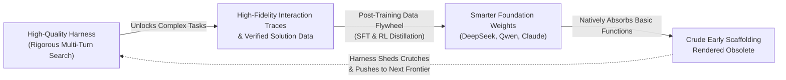
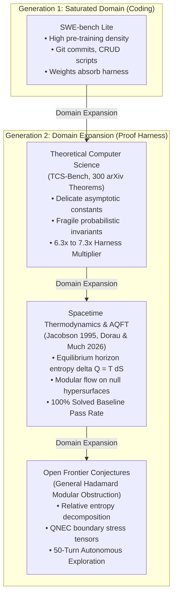
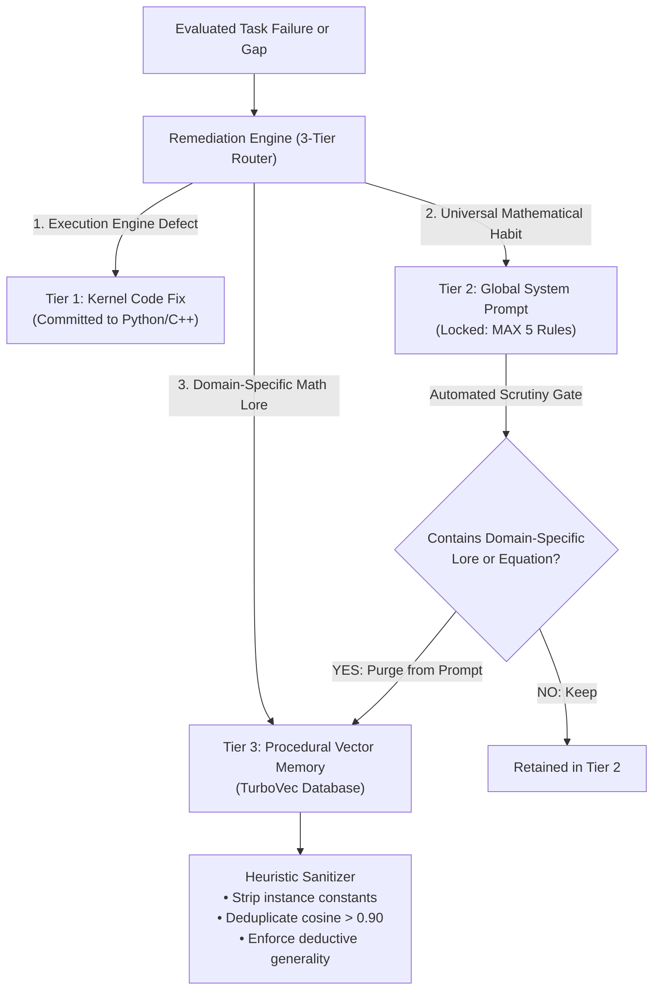

# The Second Generation of Agent Harnesses: Why Frontier Reasoning Demands Architecture, Not Just Weights

### *A perspective from the builders of Proof Harness on the evolution of AI agents: Why yesterday's simple coding scaffolding is giving way to a far more sophisticated generation of neuro-symbolic harnesses designed for research mathematics, theoretical physics, and deep autonomous discovery.*

---

## 1. The Scaffolding Plateau & The Data Flywheel

Over the past year, an important debate has rippled across the AI engineering community: **has the agent harness reached the end of its useful life?**

In software engineering, the symptoms of stagnation are undeniable. Across industry evaluations and academic studies (such as UC Berkeley's work on *SWE-bench Lite*), researchers found that swapping one complex coding framework for another barely moved the needle on frontier models. In a widely discussed presentation at *AI Engineer* titled [*"Is the Agent Harness Dead?"*](https://www.youtube.com/watch?v=7Y4sbZgBdnc), engineer Jediah Katz (formerly of Cursor, now at SpaceX/xAI) gave voice to what many practitioners were privately noticing: *"In this day and age, a fancy harness no longer adds coding intelligence."*

At first glance, this observation might seem like an obituary for harness engineering. For the last two years, the typical "agent harness" was largely an assortment of prompt tricks: custom XML wrapping, regex-based AST chunkers, reminders to run `pytest`, and superficial retry loops. 

The reason this scaffolding died is captured by a core dynamic: **The Data Flywheel.**



High-quality harnesses generate better interaction data, which frontier labs feed into post-training reinforcement learning loops. This improves the foundation models, which in turn makes the old, crude parts of the harness obsolete. The prompt that reminded a model to format a git patch or import a standard library in 2024 was natively absorbed into the neural weights of 2026.

When an agent harness restricts itself to basic web development and boilerplate scripting—where hundreds of millions of public git commits provide virtually infinite pre-training signal—**the weights inevitably eat the harness**. If an engineering team's sole moat is a collection of prompt-level crutches, their product will inevitably be obsoleted by next quarter's foundational checkpoint.

**We strongly align with this diagnosis, but we arrive at a fundamentally different conclusion.**

The demise of superficial coding scaffolding is not the death of the agent harness. It is simply the end of **Generation 1**. 

While yesterday's simple harnesses are becoming obsolete because base models are absorbing their basic functions, **a new, far more sophisticated generation of harnesses is emerging to handle increasingly difficult frontiers.**

Our experience building and evaluating **Proof Harness**—a neuro-symbolic reasoning engine evaluated across hundreds of research-level problems in theoretical computer science and mathematical physics—proves that when you move beyond commodity coding, the agent harness is not an optional crutch; it is an indispensable cognitive architecture.

---

## 2. The Persistent Limits: Why Neural Weights Still Demand Heavy-Duty Harnesses

Even as foundation models grow in scale, context capacity, and reasoning tokens, they run headfirst into **three persistent operational walls** that neural weights alone cannot solve:

```
+==================================================================================================+
|                        THE THREE PERSISTENT ARCHITECTURAL LIMITS                                 |
+==================================================================================================+
|  1. INFRASTRUCTURE & RUNTIME                                                                     |
|     • Autonomous tasks expand from 30 seconds to multiple hours or days.                         |
|     • Cannot survive on transient laptops; requires persistent server execution, durable on-disk  |
|       state checkpointing (.ckpt.json), and decoupled worker orchestration.                      |
|                                                                                                  |
|  2. TRUST, SECURITY, COMPLIANCE & SOUNDNESS                                                      |
|     • Models cannot self-police. Statistical token prediction cannot guarantee deductive truth.   |
|     • Requires zero-trust execution kernels (SymPy, Z3, 50-digit mpmath) and epistemic state     |
|       machines that physically revoke fragile invariants upon conditioning.                      |
|     • Hardware safeguards: strict combinatorial ceilings (Rule 11 guarded_range <= 200,000)      |
|       to prevent out-of-memory kernel panics on unified APU architectures.                       |
|                                                                                                  |
|  3. EFFICIENCY & TOKEN ECONOMICS                                                                 |
|     • Unchecked 12-turn exploration explodes context windows (>100k tokens), triggering          |
|       "lost-in-the-middle" attention degradation.                                                |
|     • Requires active compaction, stateless blackboards, CandidatePool Occam's razor penalties, |
|       and high-potential overtime gates to prevent wasted compute.                               |
+==================================================================================================+
```

These three areas represent the enduring moat of **Generation 2 Harnesses**. Here is how we engineered Proof Harness to conquer them:

### A. Infrastructure & The Persistent Server Runtime
Generation 1 coding agents were built around transient interactions: a developer typing in an IDE chat box on a MacBook, expecting an answer in 45 seconds. If the laptop lid closed or the network dropped, the session vanished.

True autonomous reasoning does not work on laptop battery schedules. In Proof Harness, our research tasks run across decoupled worker pools on dedicated server hardware and APUs:
- **Winning Tasks**: Average **2,037.2 seconds (34.0 minutes)** across 4 to 8 turns of exploratory computing, invariant validation, and referee revisions.
- **Exhaustive Refutations**: Average **8,102.9 seconds (2.25 hours)** across 12 turns of adversarial skeptic attacks, SMT counterexample sweeps, and clean-slate hard pivots.
- **Open Problem Deep Exploration**: Up to **50–100 turns** running across hours of continuous discovery.

```text
+==================================================================================================+
|                        PERSISTENT SERVER RUNTIME (PROOF HARNESS)                                 |
+==================================================================================================+
| Worker 1: [Turn 1 Exploration] -> REPL Invariants -> On-Disk Checkpoint t=1 (.ckpt.json)        |
| Worker 2: [Turn 8 Overtime]    -> Z3 SMT Counterexamples -> Checkpoint t=8 (.ckpt.json)         |
| Worker 3: [Synthesis Stage]    -> Academic Referee Multi-Pass Audit -> Final Proof \pi*          |
|                                                                                                  |
| [Fault-Tolerant Catchment Layer]                                                                 |
|   • Upstream HTTP stream stall? -> Caught by 5-attempt exponential backoff                       |
|   • Host network interface blip? -> Checkpointed state resumes seamlessly with zero token loss   |
|   • Interactive Pager Escape? -> Strict non-interactive TTY proxy overrides (PAGER="cat")    |
+==================================================================================================+
```

An agent running for 2 hours cannot exist as an ephemeral process in a browser tab. It requires an operating-system-level harness with durable on-disk checkpoints (`.ckpt.json`), decoupled worker orchestration, and automated fault recovery.

### B. Trust, Security, and Mathematical Soundness
In software engineering, a model can often "hallucinate" its way to a functional result. Code has high redundancy, compilers give descriptive tracebacks, and unit tests act as broad safety nets. 

In research-level mathematics and theoretical physics, **statistical next-token prediction experiences a hard cognitive breakdown.**

We call this **The Probabilistic Trust Fallacy**: an autoregressive model predicts the most likely token sequence, not deductive truth. If you ask an unassisted model to prove an advanced theorem from arXiv Theoretical Computer Science preprints (TCS-Bench), it will write 10,000 characters of brilliant-sounding prose. 

Then you inspect line 4. 

Somewhere in the derivation, an inequality quietly reversed direction. Or two random variables were assumed to stay independent after being conditioned on their sum. Or a boundary condition on a null hypersurface was brushed away with hand-waving prose (*"it obviously follows"*).

When an unassisted 27B model attempts TCS-Bench theorems in a single pass, it passes only **4.0%** of problems. 

No amount of scaling will fix this. Training a model on more tokens does not change the mathematical reality that autoregression is probabilistic. To achieve scientific validity, the model requires an **external, zero-trust ontological substrate**:

1. **The Zero-Trust Deterministic Execution Kernel (`core_engine/kernel.py`)**:
   Instead of trusting the model's prose, every intermediate `[CLAIM]` must be tested in code. We equip the agent with symbolic computer algebra (`SymPy`), SMT constraint solvers (`Z3`), 50-digit arbitrary precision (`mpmath`), and planar graph topological solvers (`NetworkX`).
   - If an intermediate lemma fails on a 4-vertex cycle, the conjecture is killed in milliseconds on Turn 1 before wasting thousands of tokens drafting a flawed proof.
   - SMT solvers verify asymptotic parameter hierarchies ($k \ll \ell \ll n$) deterministically.
2. **The Epistemic State Machine (`core_engine/state_machine.py`)**:
   One of the most persistent failure modes of language models is *invariant amnesia*. If an object is defined as independent and bipartite, and the model restricts it to a conditioned subgraph, the model continues to assume independence holds. Our state machine maintains an explicit mathematical provenance DAG:
   - **Hereditary properties** (bipartiteness, planarity) are automatically preserved.
   - **Fragile properties** (independence, martingale property, regularity) are **instantly revoked** upon conditioning or projection.
   - If undischarged revoked properties remain, the Epistemic Scribe Gate physically blocks the generation of the final proof.
3. **Hardware Safeguards & Anti-Brute-Force Ceilings**:
   When models cannot find an analytical reduction, they often attempt brute-force loops (`for n in range(10**8):`). On unified memory architectures (like our AMD Ryzen AI Max+ 395 with 64GB UMA), uncontrolled combinatorial searches balloon the page cache and threaten hard system lockups. The harness enforces strict ceilings (Rule 11 `guarded_range` $\le 200,000$ and static AST inspection blocking permutations for $n \ge 7$), forcing the model to stop looping and derive the exact analytical formula.

### C. Efficiency and Token Economics
Left unconstrained, multi-turn reasoning agents quickly self-destruct due to context window bloat:
- **Stateless 4-Message Blackboard**: Instead of letting conversation history balloon past 40,000 tokens (which triggers catastrophic "lost-in-the-middle" attention degradation), the harness collapses revision turns to `[System, Clean Task Prompt, Pinned Candidate Proof, Surgical Repair Directive]`. Active context stays under 24,000 tokens indefinitely.
- **CandidatePool Noise-Band Occam's Razor ($\epsilon = 0.03$)**: Language models love to fix minor referee critiques by adding pages of verbose filler. The harness penalizes revisions that bloat proof length by $>50\%$ for a $\le 0.03$ score bump, rejecting word salad in favor of concise, publication-grade mathematics.
- **High-Potential Overtime Gating**: Overtime turns (Turns 9–12) are granted if and only if the Turn-8 draft achieved directional mathematical validity ($\ge 0.35$), preventing the agent from burning expensive tokens on hopeless trajectories.

---

## 3. The Resolution: Domain Expansion

This brings us to the core thesis highlighted in Katz's analysis of persistent colleague systems like Grokbot:

> **"The harness stays valuable only as long as it keeps finding tasks the model has not yet absorbed — which makes domain expansion the ultimate resolution."**

Why did coding harnesses plateau? Because SWE-bench Lite lives in the center of the pretraining distribution. The model absorbs the domain, rendering simple scaffolding redundant.

To build a durable moat, the harness must execute **aggressive domain expansion** into territories where the model's native weights are completely unequipped to navigate alone:



### Domain Expansion in Action: Empirical Evidence from Proof Harness

When we expanded Proof Harness beyond basic math into research-level computer science and mathematical physics, the results were unequivocal:

#### 1. TCS-Bench (N = 300 Research Theorems)
Evaluating across 300 research-level problems from TCS-Bench (spanning spectral graph theory, circuit complexity, and randomized algorithms):

| Architecture / Model | Unassisted Initial Draft | Full Proof Harness | Multiplier |
| :--- | :---: | :---: | :---: |
| **Qwen 3.8 27B (Local Consumer Hardware)** | 3.3% (10 / 300) | **21.0% (63 / 300)** | **6.30× Gain** |
| **Meta Muse (Continuous Prover Pipeline)** | 4.0% (baseline) | **29.2% (7 / 24 evaluated)** | **7.30× Gain** |
| **Passing Proof Referee Rigor** | 0.139 ± 0.107 | **0.853 ± 0.129** | **6.14× Rigor Multiplier** |

In coding, harnesses gave diminishing returns. In research-level mathematics, **the harness delivered a 6x to 7x multiplier on certified sound proofs**, with over 85% of passing proofs reaching publication-grade referee validity ($\ge 0.70$).

#### 2. Spacetime Thermodynamics (Jacobson 1995)
We expanded the harness into general relativity: deriving the Einstein Field Equations $G_{ab} + \Lambda g_{ab} = \frac{8\pi G}{c^4} T_{ab}$ from the Clausius relation $\delta Q = T dS$ across local Rindler horizons. 
- **Result**: Passed on **Turn 3 (1,204.6s)** with a referee validity score of **`0.86 / 1.00`** (Publication Grade).

#### 3. Modular Flows in Algebraic Quantum Field Theory (Dorau & Much 2026)
Proving that the Tomita–Takesaki modular Hamiltonian on a null Cauchy surface generates local translations $K_V = 2\pi \int H_V(x) T_{uu}(x) d\Sigma$ for vacuum states on local von Neumann algebras.
- **Result**: Passed on **Turn 8 (2,816.8s)** with a referee validity score of **`0.76 / 1.00`** (Certified Sound).
- **Physics Baseline Pass Rate**: **2 / 2 (100.0%)** recorded in `data/eval_results/physics_qwen_solved_v1/`.

#### 4. The 50-Turn Open Problem Exploration
We then directed the harness at an unsolved frontier conjecture: *Does the Dorau–Much geometric translation theorem extend to arbitrary Hadamard states?*

When unguided LLMs attempt this problem, they immediately hallucinate that the standard theorem holds. In contrast, Proof Harness’s adversarial falsifier and kernel caught the exact non-local obstruction:
$$S(\omega \| \omega_0) = \Delta \langle K_0 \rangle - \Delta S_{\mathrm{ent}}$$

Within two turns of deep exploration, the harness derived that the geometric translation holds if and only if the horizon projection is **strictly iso-entropic ($\Delta S_{\mathrm{ent}} = 0$)**, or must otherwise incorporate the Quantum Null Energy Condition (QNEC) boundary tensor correction:
$$\langle T_{kk}(x) \rangle \ge \frac{\hbar}{2\pi} S_{\mathrm{ent}}''(x)$$

A shallow coding harness could never attempt this. The domain expanded, and the harness became the cognitive scaffold that prevented the model from wandering into mathematical delusion.

---

## 4. The Self-Pruning Memory Architecture: Our "Shim-Cleanup" Engine

As base models improve through the data flywheel, what happens to the heuristics inside the harness?

In legacy agent design, whenever an engineer found a bug, they appended a prompt rule: *"Always remember to check for zero-division!"* Over time, the prompt swelled into an unmaintainable 30-page monster—**Harness Rot**.

Katz described the antidote as a "shim-cleanup bot": an automated mechanism that observes which guardrails are actively firing, and files a pull request to delete obsolete shims once base models become smart enough to handle them natively.

In Proof Harness, we built this self-pruning principle directly into our **Autonomous Remediation & Memory Substrate** ([`core_engine/remediation.py`](core_engine/remediation.py), [`core_engine/heuristic_validation.py`](core_engine/heuristic_validation.py)):



We enforce strict **three-tier routing**:
1. **Tier 1 (Kernel Engine Fixes)**: Tool gaps or execution bugs are fixed in Python code—never patched via prompt prose.
2. **Tier 2 (Global System Prompts)**: Strictly locked to a maximum of 5 foundational reasoning principles. If an engineer tries to add a domain-specific hint (e.g. *"remember that planar graphs have faces"*), the remediation engine automatically intercepts it, purges it from the global prompt, and demotes it to Tier 3.
3. **Tier 3 (Role-Isolated Vector Memory)**: All domain intelligence is stored in TurboVec as vector embeddings. As newer models natively absorb basic algebraic steps, our clustering engine deduplicates rules ($> 0.90$ cosine similarity) and archives low-utility heuristics.

### Domain Partitioning: Eliminating Cross-Domain Hallucination
As an agent harness expands across multiple complex disciplines, a second memory failure emerges: **cross-domain contamination.**

If an agent learning from quantum field theory stores heuristics about modular operators and Rindler horizons into a single flat vector database, what happens when it tries to prove a theorem about planar graph coloring? The model retrieves horizon thermodynamics heuristics for graph theory problems, producing pseudo-intellectual hallucinations where graph vertices are assigned "Unruh temperatures."

Proof Harness solves this via **Domain-Specific Procedural Memory Partitioning** (`--domain`):

```text
TurboVec Vector Store (Role-Isolated & Domain-Partitioned)
├── [Domain: tcs / prime_math]
│   ├── prime_math_procedural        (Concentration bounds, matrix rank reductions)
│   ├── tcs_architect_procedural     (Lemma chain blueprints, topological cuts)
│   └── tcs_skeptic_procedural       (Planar dual counterexamples, SMT bounds)
│
└── [Domain: physics]
    └── physics_procedural           (Tomita-Takesaki KMS condition, Raychaudhuri expansion,
                                      Unruh horizon thermal flux, QNEC boundary stress tensors)
```

When proving discrete algorithms, the agent operates in `--domain tcs`. When evaluating general relativity, it switches to `--domain physics`, retrieving verified strategies from Casini (2008), Wall (2012), Faulkner et al. (2014), and Bousso et al. (2014).

Domain expansion scales cleanly without cognitive interference.

---

## 5. Conclusion: The Real Future of Agent Engineering

The debate over the death of the agent harness asked a necessary question, but drew the line in the wrong place.

- **Yes, Generation 1 coding scaffolding is obsolete.** If your harness is a collection of prompt-engineering hacks designed to help an LLM write Python boilerplate, the model absorbency flywheel will inevitably make your product redundant.
- **No, the agent harness is not dead.** It has evolved into **Generation 2: persistent, neuro-symbolic cognitive architectures.**

When an autonomous system operates on dedicated server infrastructure, purges its own obsolete shims, grounds every deduction in an airgapped zero-trust execution kernel, and compounds domain intelligence through partitioned vector memory, it creates an enduring architectural moat that probabilistic neural weights can never displace.

The future of AI engineering is not about waiting passively for next year's model checkpoint to solve everything. It is about building the rigorous, long-horizon harnesses that empower today's models to conquer humanity's hardest intellectual frontiers.

---

### *References & Further Reading*
- **The Core Talk**: Jediah Katz, [*"Is the Agent Harness Dead?"* (AI Engineer Presentation on YouTube)](https://www.youtube.com/watch?v=7Y4sbZgBdnc).
- **Proof Harness Architecture Deep Dive**: [`docs/articles/how-an-agent-harness-unlocks-llm-math-reasoning.md`](how-an-agent-harness-unlocks-llm-math-reasoning.md)
- **Spacetime Thermodynamics & AQFT Open Problems**: [`docs/articles/from-spacetime-thermodynamics-to-open-quantum-horizons.md`](from-spacetime-thermodynamics-to-open-quantum-horizons.md)
- **Formal Academic Report**: [`docs/articles/arxiv-prime-math-neuro-symbolic-prover-harness.md`](arxiv-prime-math-neuro-symbolic-prover-harness.md)
- **TCS-Bench Benchmark Suite**: *TCS-Bench: Benchmarking Large Language Models on Research-Level Theoretical Computer Science* ([arXiv:2608.09538](https://arxiv.org/abs/2608.09538))
