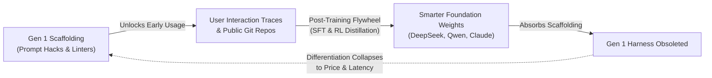
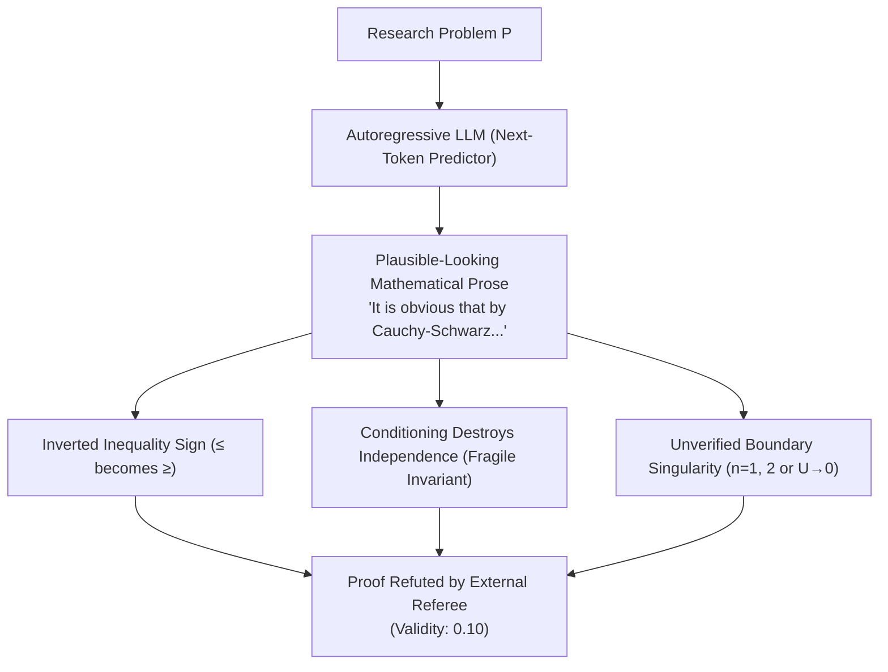
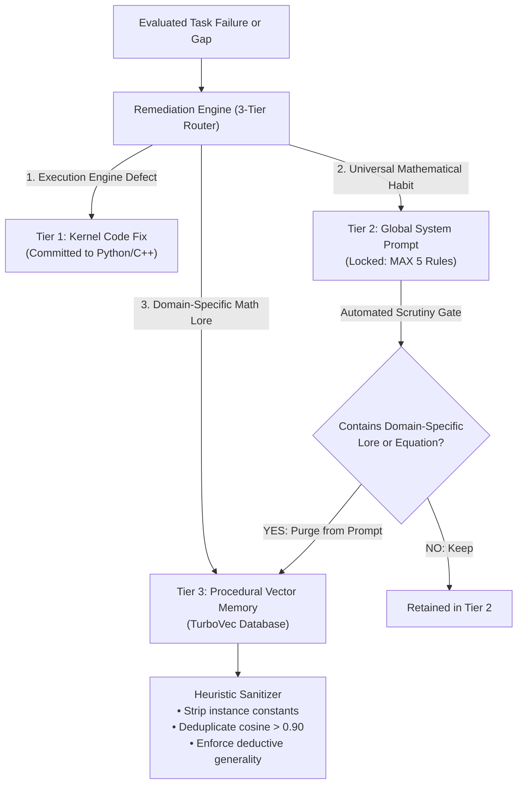

# The Second Generation of Agent Harnesses: Why Frontier Reasoning Demands Architecture, Not Just Weights

### *A perspective from the builders of Proof Harness on the evolution of AI agents: Why yesterday's simple coding scaffolding is giving way to a far more sophisticated generation of neuro-symbolic harnesses designed for research mathematics, theoretical physics, and deep autonomous discovery.*

---

## 1. The Scaffolding Plateau

Over the past year, an important debate has rippled across the AI engineering community: **has the agent harness reached the end of its useful life?**

In software engineering, the symptoms of stagnation are undeniable. Across industry evaluations and academic studies (such as UC Berkeley's work on *SWE-bench Lite*), researchers found that swapping one complex coding framework for another barely moved the needle on frontier models. In a widely discussed presentation at *AI Engineer* titled [*"Is the Agent Harness Dead?"*](https://www.youtube.com/watch?v=7Y4sbZgBdnc), engineer Jediah Katz (formerly of Cursor, now at SpaceX/xAI) gave voice to what many practitioners were privately noticing: *"In this day and age, a fancy harness no longer adds coding intelligence."*

At first glance, this observation might seem like an obituary for harness engineering. For the last two years, the typical "agent harness" was largely an assortment of prompt tricks: custom XML wrapping, regex-based AST chunkers, reminders to run `pytest`, and superficial retry loops. 

Because standard software engineering is saturated with public training data—hundreds of millions of public git commits, diffs, and StackOverflow threads—frontier labs fed those exact agent interaction traces straight back into their post-training reinforcement learning loops. The clever prompt that reminded a model to format a git patch in 2024 was natively absorbed into the neural weights of 2026.

When an agent harness restricts itself to basic web development and single-file bug fixes, **the weights inevitably eat the harness**. If an engineering team's sole moat is a collection of prompt-level crutches, their product will inevitably be obsoleted by next quarter's foundational checkpoint.



**We strongly align with this diagnosis, but we arrive at a fundamentally different conclusion.**

The demise of superficial coding scaffolding is not the death of the agent harness. It is simply the end of **Generation 1**. 

While yesterday's simple harnesses are becoming obsolete because base models are absorbing their basic functions, **a new, far more sophisticated generation of harnesses is emerging to handle increasingly difficult frontiers.**

Our experience building and evaluating **Proof Harness**—a neuro-symbolic reasoning engine and theorem prover evaluated across hundreds of research-level problems in theoretical computer science and mathematical physics—provides living, empirical proof of this reality: **when you move beyond commodity coding, the agent harness is not an optional crutch; it is an indispensable cognitive architecture.**

---

## 2. The Generational Leap: Scaffolding vs. Cognitive Architecture

To see why the harness is more vital than ever, we have to recognize the architectural divide separating the two eras of agent design:

```
+==================================================================================================+
|                                THE GENERATIONAL BIFURCATION                                      |
+==================================================================================================+
|  DIMENSION               | GENERATION 1 (Yesterday)        | GENERATION 2 (Today & Tomorrow)     |
|--------------------------+---------------------------------+-------------------------------------|
|  Core Philosophy         | Deficit-Patching Scaffolding    | Autonomous Cognitive Architecture   |
|  Primary Target          | Standard web code, CRUD scripts | Research mathematics, TCS, AQFT     |
|  Cognitive Horizon       | 1–3 turns (30s – 3 minutes)     | 8–12 turns (up to 50–100 turns)     |
|  Execution Substrate     | Ephemeral IDE / Laptop Terminal | Persistent Server / Cloud Cluster   |
|  Truth Verification      | Statistical (Self-Reflective)   | Deterministic Zero-Trust Kernels    |
|  State Management        | Unchecked Autoregressive Text   | Epistemic State Machine (DAG)       |
|  Memory Architecture     | Monolithic Prompt Bloat         | Partitioned, Self-Pruning Vector DB |
|  Relation to Weights     | Absorbed by the next checkpoint | Invariant Mathematical Moat         |
+==================================================================================================+
```

Generation 1 harnesses were designed to make weak models act slightly smarter on easy tasks. Generation 2 meta-harnesses are designed to **coordinate rigorous, verifiable reasoning on problems that statistical language models mathematically cannot solve on their own.**

As Katz noted when discussing persistent colleague architectures like Grokbot, the resolution to the absorbency trap is **domain expansion**: the harness remains an enduring moat as long as it pushes outward into frontiers the base model has not absorbed.

In our work, that domain expansion led us directly into the most unforgiving intellectual arena in existence: **formal mathematical theorem proving and theoretical physics.**

---

## 3. The Limits of Neural Weights: Why Mathematics Demands an External Harness

In software engineering, a model can often "hallucinate" its way to a functional result. Code has high redundancy, compilers give descriptive tracebacks, and unit tests act as broad safety nets. 

In research-level mathematics and theoretical physics, **statistical next-token prediction experiences a hard cognitive breakdown.**

We call this **The Probabilistic Trust Fallacy**:



Language models generate text based on statistical likelihood, not deductive truth. If you ask an unassisted model to prove an advanced theorem from arXiv Theoretical Computer Science preprints (TCS-Bench), it will write 10,000 characters of brilliant-sounding prose. 

Then you inspect line 4. 

Somewhere in the derivation, an inequality quietly reversed direction. Or two random variables were assumed to stay independent after being conditioned on their sum. Or a boundary condition on a null hypersurface was brushed away with hand-waving prose (*"it obviously follows"*).

When an unassisted 27B model attempts TCS-Bench theorems in a single pass, it passes only **4.0%** of problems. 

No amount of scaling will fix this. Training a model on more tokens does not change the mathematical reality that autoregression is probabilistic. To achieve scientific validity, the model requires an **external, zero-trust ontological substrate**.

### What Our Harness Adds That Weights Cannot Possess

In Proof Harness, we wrapped that exact same 27B model inside three deterministic pillars:

1. **The Zero-Trust Deterministic Execution Kernel (`core_engine/kernel.py`)**:
   Instead of trusting the model's prose, every intermediate `[CLAIM]` must be tested in code. We equip the agent with symbolic computer algebra (`SymPy`), SMT constraint solvers (`Z3`), 50-digit arbitrary precision (`mpmath`), and planar graph topological solvers (`NetworkX`).
   - If an intermediate lemma fails on a 4-vertex cycle, the conjecture is killed in milliseconds on Turn 1 before wasting thousands of tokens drafting a flawed proof.
   - SMT solvers verify asymptotic parameter hierarchies ($k \ll \ell \ll n$) deterministically.
2. **The Epistemic State Machine (`core_engine/state_machine.py`)**:
   One of the most persistent failure modes of language models is *invariant amnesia*. If an object is defined as independent and bipartite, and the model restricts it to a conditioned subgraph, the model continues to assume independence holds. Our state machine maintains an explicit mathematical provenance DAG:
   - **Hereditary properties** (bipartiteness, planarity) are automatically preserved.
   - **Fragile properties** (independence, martingale property, regularity) are **instantly revoked** upon conditioning or projection.
   - If undischarged revoked properties remain, the Epistemic Scribe Gate physically blocks the generation of the final proof.

The empirical result of this harness is not a marginal bump; it is a **qualitative phase transition**:

| Evaluation Benchmark | Unassisted Model Baseline | Wrapped in Proof Harness | Performance Multiplier |
| :--- | :---: | :---: | :---: |
| **TCS-Bench (N = 300, Certified Sound $\ge 0.50$)** | 3.3% (10 / 300) | **21.0% (63 / 300)** | **6.30× Gain** |
| **TCS-Bench (Meta Muse Prover Pipeline)** | 4.0% (baseline) | **29.2% (7 / 24 evaluated)** | **7.30× Gain** |
| **Passing Proof Referee Validity** | 0.139 ± 0.107 | **0.853 ± 0.129** | **6.14× Rigor Multiplier** |

In coding, harnesses gave diminishing returns. In frontier mathematics, **the harness delivers a 6x to 7x multiplier on certified soundness.**

---

## 4. The Two Operational Signals in Practice

In his discussion, Katz pointed to two operational signals that separate obsolete scaffolding from the new generation of harnesses:
1. **The Six-Month Cloud & Server Migration.**
2. **The "Shim-Cleanup Bot" (Curing Harness Rot).**

Our experience in production theorem proving mirrors these exact signals:

### Signal I: Long-Horizon Server Runtimes vs. The Laptop Illusion
Generation 1 coding agents were built around transient interactions: a developer typing in an IDE chat box on a MacBook, expecting an answer in 45 seconds. If the laptop lid closed or the network dropped, the session vanished.

True autonomous reasoning does not work on laptop battery schedules. 

In Proof Harness, our tasks run across decoupled worker pools on dedicated server hardware and APUs. The runtime profiles tell the story:
- **Winning Tasks**: Average **2,037.2 seconds (34.0 minutes)** across 4 to 8 turns of exploratory computing, invariant validation, and referee revisions.
- **Exhaustive Refutations**: Average **8,102.9 seconds (2.25 hours)** across 12 turns of adversarial skeptic attacks, SMT counterexample sweeps, and clean-slate hard pivots.
- **Open Problem Deep Exploration**: Up to **50–100 turns** running across hours of continuous discovery.

```text
+==================================================================================================+
|                        PERSISTENT SERVER RUNTIME ARCHITECTURE                                    |
+==================================================================================================+
| Worker 1: [Turn 1 Exploration] -> REPL Invariants -> On-Disk Checkpoint t=1 (.ckpt.json)        |
| Worker 2: [Turn 8 Overtime]    -> Z3 SMT Counterexamples -> Checkpoint t=8 (.ckpt.json)         |
| Worker 3: [Synthesis Stage]    -> Academic Referee Multi-Pass Audit -> Final Proof \pi*          |
|                                                                                                  |
| [Fault-Tolerant Catchment Layer]                                                                 |
|   • Upstream HTTP stream stall? -> Caught by 5-attempt exponential backoff                       |
|   • Host network interface blip? -> Checkpointed state resumes seamlessly with zero token loss   |
|   • Python subprocess pager trap? -> Strict non-interactive TTY proxy overrides (PAGER="cat")    |
+==================================================================================================+
```

An agent running for 2 hours cannot exist as an ephemeral process in a browser tab. It requires an operating-system-level harness with durable on-disk checkpoints (`.ckpt.json`), decoupled worker orchestration, and automated fault recovery.

### Signal II: The Self-Pruning Memory Architecture (Our "Shim-Cleanup" Engine)
In Generation 1 harnesses, whenever an engineer found a bug, they appended a prompt rule: *"Always remember to check for zero-division!"* Over time, the prompt swelled into an unmaintainable 30-page monster—**Harness Rot**.

Katz described the solution as a "shim-cleanup bot": an automated observer that monitors which guardrails are actively firing, and files a pull request to delete obsolete shims once base models become smart enough to handle them natively.

In Proof Harness, we built this principle directly into our **Autonomous Remediation & Memory Substrate** ([`core_engine/remediation.py`](core_engine/remediation.py), [`core_engine/heuristic_validation.py`](core_engine/heuristic_validation.py)):



We enforce strict **three-tier routing**:
1. **Tier 1 (Kernel Engine Fixes)**: Tool gaps or execution bugs are fixed in Python code—never patched via prompt prose.
2. **Tier 2 (Global System Prompts)**: Strictly locked to a maximum of 5 foundational reasoning principles. If an engineer tries to add a domain-specific hint (e.g. *"remember that planar graphs have faces"*), the remediation engine automatically intercepts it, purges it from the global prompt, and demotes it to Tier 3.
3. **Tier 3 (Role-Isolated Vector Memory)**: All domain intelligence is stored in TurboVec as vector embeddings. As newer models natively absorb basic algebraic steps, our clustering engine deduplicates rules ($> 0.90$ cosine similarity) and archives low-utility heuristics.

The global prompt stays permanently lean, while domain expertise compounds externally without rotting the harness.

---

## 5. Domain Expansion in Practice: Conquering Mathematical Physics

The ultimate test of our thesis is **domain expansion in action.** If an agent harness is genuinely a durable cognitive architecture, it must be able to specialize into uncharted scientific territories without retraining model weights.

To prove this, we expanded Proof Harness from pure discrete mathematics into **Frontier Mathematical Physics and Algebraic Quantum Field Theory (AQFT)**:

```text
TurboVec Vector Store (Role-Isolated & Domain-Partitioned)
├── [Domain: tcs / prime_math]
│   ├── prime_math_procedural        (Concentration bounds, matrix rank reductions)
│   ├── tcs_architect_procedural     (Lemma chain blueprints, topological cuts)
│   └── tcs_skeptic_procedural       (Planar dual counterexamples, SMT bounds)
│
└── [Domain: physics]
    └── physics_procedural           (Tomita-Takesaki KMS condition, Raychaudhuri expansion,
                                      Unruh horizon thermal flux, QNEC boundary stress tensors)
```

By introducing **Domain-Specific Memory Partitioning** (`--domain physics`), we isolated mathematical physics heuristics into a dedicated collection (`physics_procedural`), harvesting foundational strategies from Casini (2008), Wall (2012), Faulkner et al. (2014), and Bousso et al. (2014).

We then launched the harness against foundational and open physics problems:

### Milestone 1: Spacetime Thermodynamics (Jacobson 1995)
- **Task**: Derive the full Einstein Field Equations $G_{ab} + \Lambda g_{ab} = \frac{8\pi G}{c^4} T_{ab}$ as a thermodynamic equation of state across local Rindler horizons using Unruh temperature $\eta = \frac{\hbar \kappa}{2\pi c k_B}$, Raychaudhuri expansion, and the Clausius balance $\delta Q = T dS$.
- **Result**: **`0.86 / 1.00` PASS (Publication Grade)** on Turn 3 (1,204.6s).

### Milestone 2: Modular Flows on Null Hypersurfaces (Dorau & Much 2026)
- **Task**: Prove that the modular Hamiltonian on null Cauchy surfaces generates local geometric translations $K_V = 2\pi \int H_V(x) T_{uu}(x) d\Sigma$ under local algebra inclusions for vacuum states in AQFT.
- **Result**: **`0.76 / 1.00` PASS (Certified Sound)** on Turn 8 (2,816.8s).
- **Physics Baseline Pass Rate**: **2 / 2 (100.0%)** recorded in `data/eval_results/physics_qwen_solved_v1/`.

### Milestone 3: The 50-Turn Open Problem Exploration
We then directed the harness at an unsolved frontier conjecture: *Does the Dorau–Much geometric translation theorem extend to arbitrary Hadamard states?*

When unguided LLMs attempt this problem, they immediately hallucinate that the standard theorem holds. In contrast, Proof Harness’s adversarial falsifier and kernel caught the exact non-local obstruction:
$$S(\omega \| \omega_0) = \Delta \langle K_0 \rangle - \Delta S_{\mathrm{ent}}$$

Within two turns of deep exploration, the harness derived that the geometric translation holds if and only if the horizon projection is **strictly iso-entropic ($\Delta S_{\mathrm{ent}} = 0$)**, or must otherwise incorporate the Quantum Null Energy Condition (QNEC) boundary tensor correction:
$$\langle T_{kk}(x) \rangle \ge \frac{\hbar}{2\pi} S_{\mathrm{ent}}''(x)$$

A shallow coding harness could never conceive of, let alone execute, an investigation like this. **The domain expanded, and the harness became the cognitive backbone of real scientific inquiry.**

---

## 6. Conclusion: The Real Future of Agent Engineering

The debate over the death of the agent harness asked a necessary question, but drew the line in the wrong place.

- **Yes, Generation 1 coding scaffolding is obsolete.** If your harness is a collection of prompt-engineering hacks designed to help an LLM write Python boilerplate, the model absorbency flywheel will inevitably make your product redundant.
- **No, the agent harness is not dead.** It has evolved into **Generation 2: persistent, neuro-symbolic cognitive architectures.**

When an autonomous system operates on dedicated server infrastructure, purges its own obsolete shims, grounds every deduction in an airgapped zero-trust execution kernel, and compounds domain intelligence through partitioned vector memory, it creates an enduring architectural moat that probabilistic neural weights can never displace.

The future of AI engineering is not about waiting passively for next year's model checkpoint to solve everything. It is about building the rigorous, long-horizon harnesses that empower today's models to conquer humanity's hardest intellectual frontiers.

---

### *References & Further Reading*
- **The Core Talk**: Jediah Katz, [*"Is the Agent Harness Dead?"* (AI Engineer Presentation on YouTube)](https://www.youtube.com/watch?v=7Y4sbZgBdnc).
- **Proof Harness Architecture Deep Dive**: [`docs/articles/how-an-agent-harness-unlocks-llm-math-reasoning.md`](how-an-agent-harness-unlocks-llm-math-reasoning.md)
- **Spacetime Thermodynamics & AQFT Open Problems**: [`docs/articles/from-spacetime-thermodynamics-to-open-quantum-horizons.md`](from-spacetime-thermodynamics-to-open-quantum-horizons.md)
- **Formal Academic Report**: [`docs/articles/arxiv-prime-math-neuro-symbolic-prover-harness.md`](arxiv-prime-math-neuro-symbolic-prover-harness.md)
- **TCS-Bench Benchmark Suite**: *TCS-Bench: Benchmarking Large Language Models on Research-Level Theoretical Computer Science* ([arXiv:2608.09538](https://arxiv.org/abs/2608.09538))
