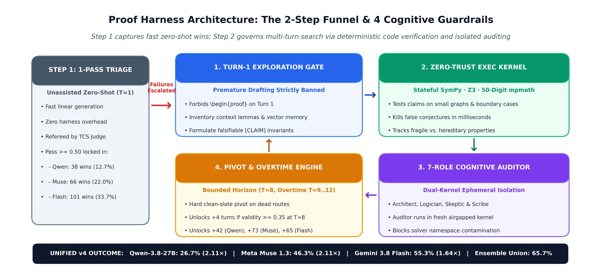
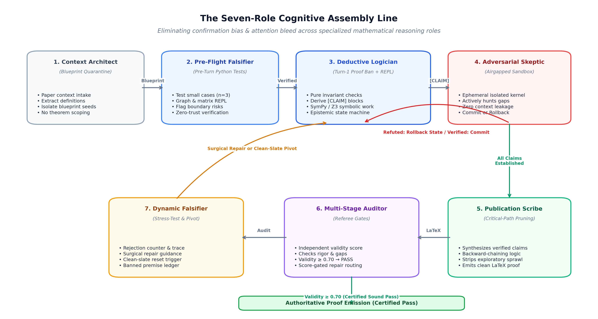
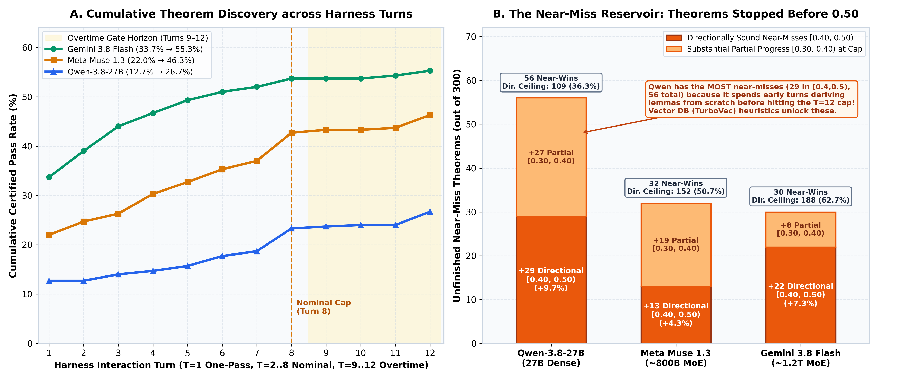
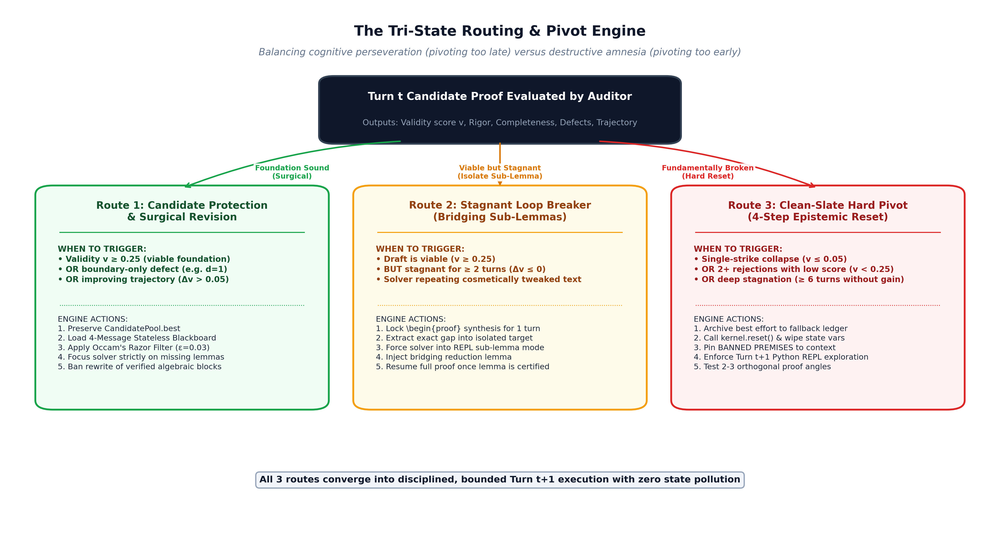
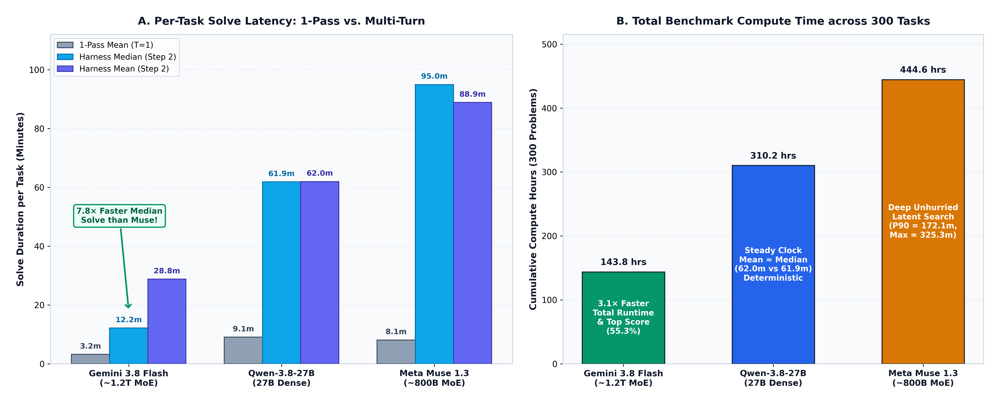

# Stop Thinking Forever: The Architecture of Bounded Mathematical Reasoning

### *How configurable constraints, adversarial auditing, and human-in-the-loop checkpoints keep frontier reasoning models focused and converging on hard problems.*

---

## The Long-Horizon Challenge: When Extended Thinking Meets Hard Problems

Long-thinking frontier models have fundamentally transformed automated reasoning. As our own empirical benchmarks on TCS-Bench show, given generous thinking budgets, models like Google Gemini 3.8 Flash, Meta Muse 1.3, and Qwen-3.8-27B can solve an impressive fraction of complex research problems directly in one shot—deriving intricate bounds and complete, publication-grade LaTeX proofs without external assistance.

However, when an advanced model encounters a truly stubborn mathematical obstruction or an open research conjecture, scaling test-time compute with an open-ended token budget does not always guarantee a breakthrough. In fact, without structural guardrails, it can enter an extended cycle of cognitive perseveration.

We have all observed this phenomenon: an autonomous run spins up, analyzes a difficult theorem, posits an ambitious reduction, and hits a subtle mathematical impasse. Because the model's own prior derivation sits directly in its context prefix, it can spend tens of thousands of tokens exploring minor variations of an intermediate lemma that collapsed early on—steadily consuming compute budgets without converging on a sound resolution.

Left unconstrained on the hardest problem cohorts, extended reasoning can suffer from three structural challenges:
1. **The Sunk-Cost Loop**: Once a model commits to a flawed intermediate lemma, it often treats that premise as foundational, spending extended tokens attempting to patch or rescue it rather than taking a step back.
2. **Context Window Degradation**: As exploratory scratchpad reasoning balloons toward context limits, standard token compaction mechanisms can inadvertently compress critical definitions or premises, degrading the downstream derivation.
3. **The Multi-Day Black Hole**: Without clear bounds and stopping criteria, an autonomous agent exploring open research conjectures can run for days without emitting inspectable interim artifacts or decision gates for human researchers.

With **Proof-Harness (`proof_harness`)**, we built an open-source neuro-symbolic engine designed to tackle research-grade mathematics across diverse domains (stress-tested on the **300-problem TCS-Bench suite**). In our research, we ground autonomous reasoning in two foundational pillars:
* **The Deterministic Mathematical Kernel**: Airgapped Python REPL execution using `SymPy`, `Z3`, and 50-digit `mpmath` coupled with an [epistemic state machine](how-an-agent-harness-unlocks-llm-math-reasoning.md) that verifies equations, **enhancing next-token probabilities with deterministic symbolic guarantees**.
* **Continuous Domain Vector Memory**: Distilling verified strategies and failure post-mortems into semantic vector memory so the engine compounds domain intelligence over time without weight fine-tuning.

**But those two pillars alone are not enough.** A deterministic execution kernel and vectorized domain memory will still loop if the reasoning harness lacks **configurable constraints**. 

Mathematical problem-solving is not an unconstrained random walk through theorem space; it is a **bounded, adversarial search under resource limits**. 

This article explores the third foundational pillar of Proof-Harness: **The Configurable Bounded Constraint & Human-in-the-Loop (HITL) Governance Engine**. In our [flagship benchmark study](the-2x-law-of-cognitive-scaffolding.md), we detail the trade-offs between parameter scale, token efficiency, and baseline pass rates across 300 problems; here, we focus on the control architecture that keeps autonomous agents focused, bounded, and converging on valid proofs.

---

## 1. The Anatomy of Unconstrained Failure: Why Reasoners Need Leashes

To understand why constraints must be hard-coded into the harness architecture, consider what happens when a model like Qwen-27B or Meta Muse attacks a research-grade problem without a computational leash.

```text
  [The Thinking Trap: Context Poisoning & Epistemic Fixation]
  
  Theorem Input ──► Deep Thinking ──► Flawed Lemma ──► False Certainty
                          ▲                                  │
                          │                                  ▼
                     Rethink / Rescue ◄── Justify Flaw ◄── Context Poisoning
                          │               (Self-Attention attends to flawed CoT)
                   (Repeats for 12 hours / 150k tokens / Context overflow)
```

When solving research-level mathematical problems—such as establishing an asymptotic expansion bound on a $d$-regular graph or proving an $\exists\mathbb{R}$-hardness reduction—any reasoning process inevitably encounters mathematical obstructions. Human mathematicians frequently experience this: when an initial reduction path runs into a barrier, the most natural move is to step back, clean the blackboard, and try an alternative angle.

For language models, however, the challenge is architectural. The root cause of this failure mode lies in two interrelated cognitive dynamics:
1. **The Bluffing Incentive**: Standard post-training and RL algorithms inadvertently incentivize models to guess or project confidence even when uncertain.
2. **Context Poisoning by Intermediate Thinking Traces**: When an extended reasoning trace is generated, the model's own intermediate tokens act as *misleading "supporting" context*. As self-attention attends to earlier reasoning steps, it artificially inflates the conditional probability of downstream errors. The model becomes a prisoner of its own chain-of-thought.

This phenomenon—**cognitive perseveration through self-attention feedback**—manifests in predictable ways:
* An initial candidate bound relies on a property that holds only approximately.
* Upon discovering the gap, the reasoning trace introduces an ad-hoc adjustment.
* The adjustment introduces additional constraints or breaks independence.
* Rather than stepping back, the model spends extended turns attempting to harmonize mutually incompatible constraints, convinced that its early derivation was nearly correct.

To break this cycle, Proof-Harness acts as an external scaffolding layer. By structuring the exploration into bounded iterations, in-the-loop adversarial auditing, automated cognitive pivots, and human-in-the-loop checkpoints, the harness provides the structural leashes needed to force the model to step back, purge flawed premises, and explore fresh pathways.

---

## 2. Pillar III: The Bounded Constraint Architecture

The Proof-Harness governance substrate operates across five deeply integrated control surfaces.



> [!NOTE]
> **Empirical Defaults, Not Rigid Dogma**: The numerical thresholds below represent reference calibrations established during our benchmark runs (e.g. across Qwen-27B, Meta Muse, and Gemini Flash on consumer APU and GPU setups). Every boundary in Proof-Harness is externalized and fully tunable—practitioners can and should fine-tune these parameters to match their chosen model's cognitive verbosity, context window, and compute budget.

```text
+========================================================================================+
|                       BOUNDED CONSTRAINT & GOVERNANCE SUBSTRATE                        |
|        (Reference Calibrations; Fully Tunable via .env & Command-Line Flags)           |
+========================================================================================+
| 1. Spatial & Token   | Dual-Buffer Context Compactor & Thinking Token Budgets:         |
|    Boundaries        |   • Active Context Ceiling (Ref: 48k–60k tokens, compactor.py)  |
|                      |   • Partitioned Synthesis Reserve Buffer (Ref: 16k tokens)      |
|                      |   • Tunable Thinking Budget (PROVER_THINKING_BUDGET)            |
|                      | Prevents context degradation, truncation & runaway reasoning    |
+----------------------+-----------------------------------------------------------------+
| 2. Iteration Budgets | Configurable Standard Iterations (Ref: PROVER_MAX_ITERATIONS=8) |
|    & Overtime Gates  | Configurable Overtime Runway (Ref: PROVER_OVERTIME_ITERATIONS=4)|
|                      | Overtime Gate: Validity >= 0.35 required to enter Overtime      |
|                      | Configurable Timeout Ceiling (Ref: PROVER_TIMEOUT_SECONDS=3600s)|
|                      | Stops dead-end problems from running for days                   |
+----------------------+-----------------------------------------------------------------+
| 3. In-Loop Auditing  | Adversarial Auditor (Ephemeral Kernel)                          |
|    & Score Routing   |   • Validity < 0.40  ──► Structural Defect Reprimand            |
|                      |   • Validity >= 0.40 ──► Surgical Repair Mode (Preserve Lemmas) |
|                      |   • Validity >= 0.70 ──► Early Certified Exit                   |
+----------------------+-----------------------------------------------------------------+
| 4. Reductive Pivots  | Anti-Perseveration Engine: Purges refuted premises & kernel     |
|    (Anti-Looping)    | variables if validity <= 0.25 across consecutive iterations     |
+----------------------+-----------------------------------------------------------------+
| 5. Human-in-the-Loop | Iterative Problem Refinement & Compounding Heuristics           |
|    Flywheel          | Bounded runs with score gates; human refines conjectures;       |
|                      | vector memory & JSON checkpoints preserve compounding knowledge |
+========================================================================================+
```

Let's dissect each mechanism.

---

## 3. The Cognitive Assembly Line: Seven-Role Cognitive Partitioning

Why does a single monolithic prompt fail on research-level mathematics?

When an unassisted model is prompted to solve a research theorem in a single conversational thread, it is forced to simultaneously serve as an explorer, an adversary, and an academic typesetter. A central architectural hypothesis of Proof-Harness is that **exploratory mathematical scratchwork, adversarial falsification, and formal academic typesetting require mutually incompatible attention distributions**:
* **The Explorer** needs broad, speculative attention to map the problem space and test edge cases.
* **The Skeptic** needs ruthless, adversarial focus looking specifically for counterexamples.
* **The Scribe** needs structured, clean focus to produce backward critical-path proofs without rambling side-tracks.

When an agent attempts all three tasks within a single conversational context, attention bleeds across roles: the scribe inherits the unverified conjectures of the explorer, while the skeptic falls victim to the confirmation bias of the author.

Proof-Harness eliminates this interference through **Seven-Role Cognitive Partitioning** (`core_engine/prover.py`):



### The Seven Cognitive Roles in Action

These seven roles represent domain-agnostic mathematical reasoning primitives—operating identically whether the solver is proving a theorem in graph theory, algebraic combinatorics, or curved spacetime quantum field theory:

1. **Context Architect (`prover_architect`)**: Decomposes the dense arXiv paper context, extracts relevant definitions and precursor lemmas, and seeds initial objects into the `MathStateMachine`. Under the **Blueprint Quarantine Rule**, the Architect's plan is treated as an unverified conjectural sketch—if a later Python check falsifies an intermediate bound, the solver is mathematically forbidden from restricting the theorem's target domain to rescue the sketch.
2. **Pre-Flight Computational Falsifier (`prover_verifier`)**: Runs automated verification scripts in the Python kernel *before Turn 1 begins*, establishing baseline invariants and emitting explicit falsification warnings if a naive approach has obvious counterexamples.
3. **Deductive Logician (`prime_math`)**: The core deductive engine. Governed by the **Turn-1 Proof Ban**, the Logician is strictly prohibited from emitting `\begin{proof}` on Turn 1; it must spend its opening turn exploring the problem space in the REPL and proposing formal `[CLAIM]` invariants.
4. **Adversarial Skeptic (`prover_skeptic`)**: Whenever the Logician emits a `[CLAIM]`, execution pauses. The Skeptic spins up in an airgapped context window to aggressively hunt for counterexamples. If an invariant fails, the state machine rolls back to the pre-claim checkpoint; only verified claims are recorded into the lemma ledger.
5. **Publication Scribe (`prover_scribe`)**: Operates in an isolated context window with dedicated thinking allocations. The Scribe ingests the verified lemma ledger and writes the formal LaTeX proof using **backward critical-path pruning**—deliberately purging dead exploratory side-tracks and failed scratchpads so the referee receives an immaculate, self-contained academic paper.
6. **Multi-Stage Proof Auditor (`prover_auditor`)**: Runs an ephemeral, 5-layer audit (AuditorKernel execution, domain restriction checks, prior defect tracking, structured academic referee rubrics, and second-opinion confirmation).
7. **Dynamic Critique Falsifier (`dynamic_falsifier`)**: Translates the auditor's rejection critique into an executable Python stress-test, empirically confirming whether the referee's objection is valid before routing the solver into surgical repair or a clean-slate pivot.

---

## 4. Spatial & Cognitive Token Bounds: Compaction Leashes & Thinking Budgets

The first boundary is spatial and computational: managing both the conversation context window and the internal reasoning token stream.

Modern reasoning models support 32k, 64k, or 128k context windows, but context degradation and unconstrained thinking are twin risks. If intermediate scratchpads and rambling internal monologues accumulate unchecked, two disasters strike:
1. **The U-Shaped Attention Dip**: Crucial preconditions stated in the original problem prompt get "lost in the middle."
2. **Mid-Derivation Truncation (`finish_reason='length'`)**: The model consumes all available tokens during intermediate thinking or turns, hitting a hard wall right as it drafts the final proof step. The external judge sees an unclosed bracket or unfinished sentence and awards a zero.

Proof-Harness solves this through **externalized spatial compaction** (`compactor.py`) paired with **configurable thinking token budgets** (`llm_client.py`, `core_engine/config.py`). 

> [!TIP]
> **Tuning to Your Model's Cognitive Persona**: The parameters below are **empirical reference configurations**, not rigid dogmatic truth. For example, a lightweight, concise model (such as Gemini 3.8 Flash) operates effectively with a lean thinking budget of 2,048–4,096 tokens and a 32,000-token context ceiling. Conversely, a large, highly verbose open-weights reasoner (such as Qwen-3.8-27B or DeepSeek-R1) thrives when given a 24k–48k thinking budget and a 64k+ context ceiling. Proof-Harness externalizes every parameter so you can tune them directly to your hardware, API pricing, and model verbosity:

```bash
# ==============================================================================
# Reference Configuration (.env or CLI flags)
# Calibrated defaults used in our empirical runs; fully tunable to your model & budget:
# ==============================================================================

# Spatial Context Compaction Leash (compactor.py)
PROVER_COMPACTOR_MAX_CONTEXT_TOKENS=48000   # Reference conversation ceiling (tune: 16k–128k+)
PROVER_COMPACTOR_RESERVE_TOKENS=16000       # Partitioned reserve buffer for proof synthesis
PROVER_COMPACTOR_KEEP_RECENT_TURNS=2        # Full verbatim preservation of recent turns

# Cognitive Thinking Token Budgets (llm_client.py / config.py)
PROVER_ENABLE_THINKING=true                 # Activates reasoning token streams
PROVER_THINKING_BUDGET=24576                # Reference reasoning trace budget (tune: 2k–64k)
PROVER_SCRIBE_THINKING_BUDGET=16384         # Partitioned budget for final LaTeX synthesis
PROVER_AUDITOR_THINKING_BUDGET=12288        # Dedicated thinking budget for adversarial referee
```

### 1. The Spatial Context Leash (`compactor.py`)
Instead of letting context accumulate monotonically:
* In our baseline benchmark runs, the active context is leashed at a reference ceiling of **48,000 tokens** (fully tunable from 16k to 128k+ depending on your model's effective attention span).
* A guaranteed **16,000-token reserve buffer** (also configurable) is strictly partitioned for the final proof generation and synthesis stage.
* When the reasoning trace exceeds the boundary, the compactor executes an **epistemic extraction**: it preserves the original problem prompt verbatim, preserves all verified invariants in the `MathStateMachine`, retains the last 2 recent turns, and compacts earlier exploratory turns into a dense, symbolic summary of proved lemmas and refuted paths.

### 2. Cognitive Thinking Token Budgets (`llm_client.py`)
Reasoning models generate internal chain-of-thought tokens before emitting user-visible text. Without an enforced ceiling, verbose models can get lost in recursive self-debate, consuming their entire token allowance before writing a single line of proof.
* By externalizing `PROVER_THINKING_BUDGET=24576` as a tunable knob, the harness disciplines the model's internal exploration per step. Practitioners can set this lower for concise models or expand it for massive reasoning engines.
* Specialized subagents receive role-tailored thinking budgets—ensuring the Scribe has ample room for rigorous LaTeX derivation while the Auditor has focused compute for line-by-line verification.

The model gets infinite conceptual runway without ever hitting a hard context wall or starving the completion buffer.

---

## 5. The Iteration Funnel: Configurable Turn Budgets & The Overtime Gate

The second boundary is temporal: how many turns and seconds does an agent get before the system halts?

In Proof-Harness, problem-solving is treated not as a rigid, unbending mandate, but as a **fully parameterized search tournament** that can be scaled to problem difficulty and compute resources:

```bash
# ==============================================================================
# Temporal Iteration Budgets & Overtime Controls (config.py)
# Reference tournament calibration; fully tunable per problem domain:
# ==============================================================================
PROVER_MAX_ITERATIONS=8                     # Reference turn ceiling (CLI: --max-iterations / PROVER_MAX_TURNS)
PROVER_ENABLE_OVERTIME=true                 # Enables high-potential overtime rescue
PROVER_OVERTIME_ITERATIONS=4                # Additional overtime turns (Turns 9..12)
PROVER_OVERTIME_VALIDITY_THRESHOLD=0.35     # Minimum auditor score required to qualify for overtime
PROVER_TIMEOUT_SECONDS=3600.0               # Hard wall-clock timeout ceiling per problem
```

Solving is structured as a **staged tournament**:



```text
[ Problem Ingest ]
        │
        ▼
┌────────────────────────────────────────────────────────┐
│ STANDARD SOLVER: Turns 1 through 8 (Configurable)      │
│   • Turn 1: Zero-Shot / Exploration (No proof emitted) │
│   • Turns 2..7: REPL testing, lemma building           │
│   • Turn 8: Mandatory Candidate Proof Synthesis        │
└──────────────────────────┬─────────────────────────────┘
                           │
             [ Turn 8 Auditor Evaluation ]
                           │
         ┌─────────────────┴─────────────────┐
         ▼                                   ▼
 [ Validity < 0.35 ]                [ Validity >= 0.35 ]
         │                                   │
         ▼                                   ▼
┌─────────────────────────┐         ┌──────────────────────────────┐
│ FORCED TERMINATION      │         │ OVERTIME ESCALATION          │
│ • Cut losses            │         │ • Unlock Turns 9..12         │
│ • Submit best candidate │         │ • Focused defect resolution  │
│ • Save compute          │         │ • Turn 12 Hard Termination   │
└─────────────────────────┘         └──────────────────────────────┘
```

> [!NOTE]
> **Scaling Iterations to the Problem Horizon**: While our standard competitive benchmark evaluation calibrated `PROVER_MAX_ITERATIONS=8` with a 4-turn overtime runway, this is a flexible tournament structure. For rapid triage or simpler problem sets, 3 to 5 turns are often sufficient. Conversely, when researchers deploy the harness on open-frontier conjectures, they frequently scale turn budgets to 20, 50, or even 100 turns, relying on JSON checkpoints and intermediate auditor checkpoints to monitor long-horizon progress.

Why is the **Overtime Gate (`PROVER_OVERTIME_VALIDITY_THRESHOLD=0.35`)** so crucial?

In automated discovery, **knowing when to admit failure is a superpower**:
Across hundreds of open conjectures, an unconstrained model forced to guess on every problem produces predominantly flawed derivations—often hallucinating subtle algebraic leaps to satisfy the prompt. However, when a harness equips the system with the ability to **halt and admit failure**, conditional accuracy on the answered subset jumps dramatically.
* In our benchmark calibration, if an AI agent has spent 8 multi-thousand-token iterations on a theorem and cannot even achieve a directional validity score of **0.35**, the probability of it magically discovering a sound proof in turns 9 through 12 is less than **2%**. (Users tackling different mathematical domains can fine-tune `PROVER_OVERTIME_VALIDITY_THRESHOLD`—for instance, lowering it to 0.20 for highly speculative, non-linear conjectures, or raising it to 0.50 for high-precision verification pipelines).
* Allowing an unguided agent to keep guessing past the base budget on a completely broken foundation is pure compute waste. The harness **cuts its losses immediately**, submits the best effort to the referee, and moves to the next problem.
* Conversely, if the candidate achieves **0.45 validity** at Turn 8, the harness recognizes that the core architecture of the proof is sound and only specific lemmas or constants are flawed. It unlocks **Turns 9 through 12 (Overtime)**, providing the extra runway needed to land the proof.

---

## 6. Dual-Tier Referee Architecture: Decoupled Auditing vs. Zero-Trust Judging

Decoupling a reasoning model's final output from its intermediate thinking tokens is a foundational requirement for rigorous mathematical deduction. When an agent is asked to verify its own complex proof within the same conversational thread, it inevitably succumbs to confirmation bias. The model's own intermediate scratchpad acts as an echo chamber, blinding it to false assumptions.

Proof-Harness operationalizes this principle through an **airgapped, dual-tier referee architecture**—and takes it a critical step further by anchoring natural language critique in deterministic symbolic computation:

### Tier 1: The In-Loop Adversarial Auditor (`prover_auditor.py`)
* **Decoupled Sandbox**: Operates in an ephemeral, clean execution sandbox after every single candidate proof draft. The candidate LaTeX is stripped of internal reasoning scratchpads, preventing the auditor from being misled by the solver's internal thinking tokens.
* **Deterministic Kernel Grounding**: Rather than relying purely on natural-language heuristics, Proof-Harness equips its auditor with a **Zero-Trust Mathematical Kernel** (`SymPy`, `Z3`, 50-digit `mpmath`, `NetworkX`). The auditor does not merely "read" the proof; it executes automated counterexample searches, computes asymptotic series expansions, and checks matrix spectral bounds in code.
* **Score-Gated Routing**:
  * **Validity < 0.40 (Structural Failure)**: The auditor emits detailed defect notices (`[ADVERSARIAL PROOF AUDIT - DEFECTS DETECTED]`), highlights unproved assertions, and instructs the solver to rethink its strategy.
  * **0.40 $\le$ Validity < 0.70 (Surgical Repair Mode)**: The harness locks all sound lemmas into an immutable blackboard (`Modular Lemma Immutability`) and strictly forbids full rewrites. It instructs the solver: *"Your previous candidate achieved strong validity (0.45). Do NOT rewrite the proof. Make targeted, surgical repairs directly to the specific defect flagged."*
  * **Validity $\ge$ 0.70 (Certified Sound)**: The proof is accepted early (`Auditor: VALID`). Iterations terminate immediately, saving hundreds of seconds of unnecessary computation.

### Tier 2: The External Benchmark Judge (`core_engine/judging/`)
* Completely isolated from the solving process.
* Evaluates the final candidate proof across **3 independent replicates ($k=3$)** using a zero-trust rubric:
  * Check precondition satisfaction.
  * Check whether constants and asymptotic hierarchies are explicitly supported.
  * Verify absence of circular reasoning and external hallucinations.
* The median of the 3 replicates determines the official benchmark verdict (**$\ge 0.50$ = Certified Pass**, **$\ge 0.40$ = Directionally Sound**).

This dual-tier separation ensures that the internal auditor acts as a coaching referee pushing the agent forward, while the external judge guarantees uncompromised academic integrity.

---

## 7. The Multi-Turn Pivot Engine: When, Why, and How We Pivot Across Iterations

What happens across iterations when an agent's proof is rejected by the auditor?

In multi-turn mathematical reasoning, managing failed drafts is one of the hardest architectural problems in harness design. Every iterative solver faces the **Golden Balance Dilemma** between two opposite failure modes:
1. **Pivoting Too Late (Cognitive Perseveration)**: On Turn 2, the model proposes a flawed reduction—for example, an inequality that points in the wrong direction or a geometric construction that suffers from exponential coordinate blowup. Left to itself, the model will spend Turns 3 through 8 inventing cosmetic patches, circular helper lemmas, and hand-wavy claims to defend its broken premise, burning the entire compute budget on a dead end.
2. **Pivoting Too Early (Destructive Amnesia)**: On Turn 3, the model constructs a 90%-complete proof ($v = 0.62$) that gets rejected by the referee solely because it omitted a base case at $n=1$ or dropped a constant factor of $2$. If a naive harness treats every rejection as a failure and wipes the slate clean on Turn 4, it destroys a winning mathematical foundation.

Proof-Harness resolves this dilemma through a stateful **Tri-State Routing & Pivot Engine** (`core_engine/prover.py`, `core_engine/prover_types.py`) backed by the `CandidatePool`:



---

### 1. WHEN We Pivot vs. When We Protect (The Tri-State Gate)

At the end of every turn $t$, if a proof is not yet certified (`validity < 0.70`), the harness inspects both the current audit score and the historical trajectory in `CandidatePool` (thresholds below reflect our calibrated benchmark defaults and are fully tunable via `.env`):

#### Route 1: Candidate Protection & Surgical Revision (No Pivot)
* **When It Triggers**:
  * The candidate achieves directional viability (`validity >= 0.25`), **OR**
  * The referee's structural sub-scores show a substantive partial proof (`has_substantive_structure`: completeness or rigor $\ge 0.35$), **OR**
  * The failure is localized to a boundary or edge case (`is_boundary_defect`), **OR**
  * The score is actively climbing across consecutive turns ($\Delta v > 0.05$).
* **Why & How**: Wiping a promising foundation over a localized gap is catastrophic. The harness logs `[Hard Pivot Prevented — Substantive/Best Candidate Protected]` and locks the solver into **Surgical Repair Mode**.
* **Best-Candidate Restoration & Occam's Razor**: If the solver's edit on Turn $t$ accidentally breaks a stronger proof from Turn $t-1$, `CandidatePool` automatically restores `pool.best` as the pinned baseline for Turn $t+1$. Furthermore, **Noise-Band Occam's Razor** ($\epsilon = 0.03$) rejects bloated revisions that inflate proof length by $>50\%$ for a negligible $\le 0.03$ score bump, keeping drafts lean and focused.

#### Route 2: Stagnant Loop Breaking (Bridging Lemma Escalation)
* **When It Triggers**: A protected candidate has undergone $\ge 2$ surgical revision turns without meaningful score improvement (`stagnant_revisions >= 2`).
* **Why & How**: When an LLM is asked to surgically repair a full proof twice and fails both times, it typically falls into a local paraphrase loop—re-wording the exact same flawed paragraph without fixing the underlying mathematical gap. The harness breaks this loop by halting verbatim draft restoration and issuing a **Bridging Lemma Directive**: the solver must isolate the exact unproved step flagged by the referee, formulate it as a standalone helper claim, and verify it in the REPL before re-synthesizing the proof.

#### Route 3: The Clean-Slate Hard Pivot
* **When It Triggers** (provided at least 2 turns remain in the iteration budget):
  1. **Single-Strike Collapse (`validity <= 0.05`)**: Complete gibberish, vacuous circularity, or a totally hallucinated premise with zero structural merit.
  2. **Confirmed Dead Reduction (`rejection_count >= 2` and `validity < 0.25`)**: Two consecutive turns have failed below the viability floor with no upward progress ($\Delta v \le 0.05$) and no viable candidate in `CandidatePool`.
  3. **Deep Stagnation Pivot (`rejection_count >= 6`)**: A moderate approach has plateaued for 6 consecutive turns (`PROVER_STAGNATION_PIVOT_TURNS=6`, tunable) without crossing the verification threshold, signaling that local repairs cannot bridge a deeper structural flaw.

---

### 2. HOW We Pivot: The 4-Step Epistemic Reset & 1-Turn REPL Lock

Why do naive "retry prompts" fail when an LLM gets stuck?

In an autoregressive transformer, **attention is sticky**. If a conversation thread contains 30,000 tokens of a failed algebraic reduction and you simply append *"That didn't work, try a different approach"* at the bottom, the model's attention heads still attend strongly to the equations, variable names, and lemmas in the previous turns. Nine times out of ten, the model will subtly re-derive the exact same dead reduction in slightly different notation.

To force a genuine mathematical paradigm shift on Turn $t$, Proof-Harness executes **four physical operations**:

#### Step 1: Stateless 4-Message Blackboard Collapse
Instead of appending to a polluted multi-turn chat history, the harness physically collapses the active context window into a clean **4-message blackboard**:
1. `System`: Core mathematical operating contract.
2. `User`: The clean, original Target Problem & Context.
3. `Assistant`: The clean blackboard state (purged of the failed draft).
4. `User`: The Mandatory Reductive Pivot directive.

By physically excising the failed LaTeX draft from the context window, the model is freed from autoregressive anchoring.

#### Step 2: Candidate Pool Pruning & Cross-Pivot Archiving
* Low-validity refuted drafts are permanently purged from `CandidatePool` (`pool.prune_abandoned()`) so that Best-Candidate Restoration can never accidentally resurrect the dead path on a later turn.
* If the pivot was triggered by a **Deep Stagnation Pivot** (where a moderate $0.45$ draft plateaued), the harness does not throw that work away—it moves the draft into **Cross-Pivot Archive Memory** (`pool.archive_for_pivot()`). This gives the solver a completely clean slate to hunt for a $0.85+$ proof on Turns $t+1 \dots T$, while guaranteeing that if the new paradigm fails, the archived $0.45$ proof is still preserved as a fallback at final submission.

#### Step 3: Deterministic Kernel Purge + The `BANNED PREMISES` Ledger
The harness calls `kernel.reset()`, wiping all Python REPL variables, broken functions, and refuted lemmas from `MathStateMachine`, and re-initializes `state.checkpoint('init')`.

Crucially, however, a total memory wipe without negative memory would risk the model re-inventing the same failed idea from scratch! The harness therefore retains a compact **Negative-Knowledge Ledger** (`dead_routes`):

```text
⚠️ MANDATORY REDUCTIVE PIVOT (Turn 4):
Your previous reduction attempt reached a fatal mathematical obstacle 
or false premise (validity: 0.20). 

All Python kernel variables, intermediate claims, and subgoals from 
this reduction path have been REFUTED AND PURGED from the state machine.

BANNED PREMISES / REFUTED ROUTES (DO NOT RE-ATTEMPT OR RESCUE):
  ❌ Refuted Reduction (Turn 4, Validity 0.20): Coordinate precision blowup 
     under delta-scaling in CCIEXPL reduction.

CRITICAL PIVOT DIRECTIVE:
1. DO NOT DEFEND THE REFUTED PATH: Do not attempt cosmetic re-patching,
   helper lemmas, or circular deductions to rescue the banned premise.
2. CONSTRUCT A FUNDAMENTALLY DISTINCT PROOF ARCHITECTURE: Step back and
   discover an alternative structural invariant, global conservation law,
   extremal property, or dual representation from first principles.
```

#### Step 4: The 1-Turn REPL-First Pivot Gate (Locking `\begin{proof}` on Turn $t+1$)
Even with a clean context window and a banned-premises ledger, reasoning models have an ingrained habit: when told to pivot, they immediately try to write a brand-new monolithic `\begin{proof} ... \end{proof}` on the very next turn without checking if the new idea actually holds.

To prevent the solver from jumping out of one broken proof straight into another untested guess, Proof-Harness activates the **1-Turn REPL-First Pivot Gate** (`pivot_repl_gate_active`) whenever at least 2 turns remain:
* **Turn $t+1$ (Exploration Lock)**: Formal proof emission (`\begin{proof}`) is **mathematically locked**. The solver is strictly forbidden from writing a full proof on Turn $t+1$. Instead, it must:
  1. Propose 2–3 orthogonal candidate reductions or structural invariants.
  2. Write executable Python code in the fresh REPL (`SymPy`, `Z3`, `NetworkX`) to empirically stress-test those new invariants on small instances.
  3. Register surviving objects in `MathStateMachine` and emit its strongest new step as `[CLAIM]: ...` and `[REDUCTION]: ...` for the Adversarial Skeptic to audit.
* **Turn $t+2$ (Synthesis Unlock)**: Once the new reduction has survived empirical testing in the REPL on Turn $t+1$, the gate automatically unlocks on Turn $t+2$, allowing the Deductive Logician and Publication Scribe to compose the formal LaTeX proof on a verified foundation.

### Pivoting in the Trenches: Task 31 ($\exists\mathbb{R}$-Hardness for Convex Body Inscriptions)
In our benchmark evaluation on **Task 31** (*Existential Theory of the Reals ($\exists\mathbb{R}$) Hardness for Convex Body Inscriptions*, [arXiv:2106.02397](https://arxiv.org/abs/2106.02397)), the solver initially attempted an $\exists\mathbb{R}$-hardness reduction for the computational geometry problem $\textsc{CCIEXPL}$ using naive $\delta$-perturbation coordinates. By Turn 4, the REPL kernel proved that the reduction suffered from an exponential blowup in coordinate precision, refuting the approach ($v = 0.20$).

Rather than spending Turns 5 through 8 trying to patch the unfixable coordinate blowup, the **Clean-Slate Hard Pivot** fired at Turn 4: it purged the broken geometry variables from the kernel, pinned the $\delta$-scaling blowup to `BANNED PREMISES`, forced a 1-turn REPL exploration on Turn 5 to test an alternative algebraic invariance encoding, and unlocked clean synthesis on Turn 6.

It is the algorithmic equivalent of a senior research advisor walking into a doctoral student's office, erasing a cluttered whiteboard of dead-end equations, writing *"Do NOT use naive $\delta$-scaling"* in the corner, and saying: *"Test your new invariant on small cases first before you write another page of LaTeX."*

---

## 8. Human-in-the-Loop (HITL): Iterative Problem Refinement & Compounding Heuristics

Automated theorem proving is not just for automated benchmarks; it is built for **open research frontiers**. 

When a human mathematician uses Proof-Harness to attack an open research conjecture across theoretical computer science and mathematics, the human cannot be an afterthought waiting days for an unconstrained script to finish. The human must be an active, high-level collaborator in an iterative research cycle.

In Proof-Harness, the human-in-the-loop workflow is not merely about manual pausing; it is an **iterative problem-refinement flywheel** powered by continuous heuristic memory:

```text
           [ Problem Statement / Conjecture ]
                          │
                          ▼
           [ Bounded Autonomous Harness Run ] ◄──┐ Continuous Heuristic Learning
           • Configurable loop ceiling (e.g. 8+4 turns) │   (CoALA Vector Memory:
           • Configurable per-turn & task timeouts      │    compounds verified lemmas,
           • Multi-turn self-improvement & in-loop audit│    banned routes & prior proofs)
                          │                             │
                          ▼                             │
           [ Evaluated Candidate & Score ]             │
           (Auditor / Referee Score & Defect Report)    │
                          │                             │
                          ▼                             │
           [ Human Researcher Decision Gate ]          │
             • Validates intermediate / final proof     │
             • Checks rigor against mathematical intuition
                          │
             ┌────────────┴────────────┐
             ▼                         ▼
   Score Above Bar &          Score Low OR Human
    Human Agrees              Disagrees with Score
             │                         │
             ▼                         ▼
      [ PROOF ACCEPTED ]      [ Human Refines Problem Statement ]
      (Publication / Lean     • Tightens premises / adds bounds
       Formalization)         • Decomposes into sub-lemmas
                              • Relaunches solver with accumulated
                                heuristic memory ────────┘
```

### 1. Bounded Autonomous Execution with Concrete Score Cutoffs
Rather than allowing a model to wander in an open-ended loop for days, Proof-Harness enforces strict temporal and iteration boundaries:
* **Configurable Iterations & Timeouts**: Runs operate under explicit turn ceilings (e.g., 8 standard turns plus 4 overtime turns) and configurable timeouts per step.
* **In-Loop Self-Improvement & Scoring**: At each turn, candidate proofs are independently analyzed by the isolated auditor kernel, assigning empirical validity scores ($0.00$ to $1.00$) and itemizing structural defects.
* **Deterministic Termination**: The run terminates either when a proof crosses the certified validity threshold ($\ge 0.70$) or when turn/timeout budgets expire, returning a concrete score and detailed referee critique.

### 2. The Human Evaluation & Decision Gate: The Autonomous-to-Collaborative Flywheel
In automated mathematics, contributions naturally span two modes: **Essentially Autonomous (Level A)**, where core deductions are machine-generated without human intervention, and **Human-AI Collaboration (Level C)**, where human researchers and automated agents contribute complementary, essential insights.

While public discourse often treats fully autonomous runs as the sole benchmark of success, in frontier mathematics the true scientific breakthrough is the **Autonomous $\to$ Collaborative refinement flywheel**:
* **Autonomous Attempt**: The harness launches an autonomous run under strict turn ceilings. If the proof passes internal auditing and external judging, the result is achieved autonomously.
* **Catching "Specification Gaming"**: A common pitfall in autonomous runs is *specification gaming*—models frequently interpret ambiguous open conjectures in the easiest, most trivial way rather than tackling the intended difficult problem. When the run finishes, the human researcher acts as the domain arbiter, spotting unintended loopholes or false confidence in superficially high scores.
* **Collaborative Escalation**: If the score is low or an assumption was trivialized, the human mathematician intervenes—tightening premises, introducing a missing boundary condition, or decomposing the conjecture into modular subgoals. 
* **Compounding Memory**: The human relaunches the harness. Because earlier verified invariants and dead-end post-mortems are preserved in vector memory, the collaborative run does not start from zero—it builds directly upon the groundwork laid by the initial autonomous exploration.

### 3. Compounding Heuristics: Building on Earlier Proofs
When the human relaunches the harness on the refined problem, the system does not start from zero:
* **Heuristic Memory Retention**: Through the harness's semantic memory architecture, earlier verified sub-lemmas, symbolic invariants from `MathStateMachine`, and post-mortems of refuted dead-ends are retained in vector memory.
* **Cumulative Acceleration**: The refined run immediately benefits from earlier discoveries and avoids previously refuted routes, allowing subsequent iterations to converge rapidly on the final rigorous proof.

### 4. Granular Checkpoints & Operational Resilience
Supporting this iterative cycle are robust operational guarantees:
* **Granular JSON Checkpoints**: After every turn, the harness writes a checkpoint (`checkpoints/{task_id}.ckpt.json`) capturing the active stage, verified REPL facts, conversation state, and auditor scores.
* **Loss-Free Interruption & Resume**: Operators can safely pause long-running batch jobs via `SIGINT` (`Ctrl+C`) to adjust compute allocations or inspect partial results, and resume instantly via `--resume-all` with zero recomputation.

---

## 9. Real-World Case Studies from the Benchmark Trenches

Does this bounded constraint architecture actually work in practice? The empirical data from our 300-problem benchmark evaluation on research-level preprints (exemplified by our TCS-Bench runs) provides a resounding answer. While our [companion flagship benchmark study](the-2x-law-of-cognitive-scaffolding.md) provides the macro-level comparisons of model cognitive personalities, token velocities, and cost curves across all 300 tasks, individual problem trajectories highlight the micro-mechanics of bounded constraints in action.

### Case 1: The Overtime Clutch Win — Fault-Tolerant Low-Congestion Graph Spanners
* **Problem**: Task 299 (*Fault-Tolerant Low-Congestion Graph Spanners*, [arXiv:2601.20718](https://arxiv.org/abs/2601.20718)) — Proving the existence of an $f$-fault-tolerant $(d,\eta)$-low congestion spanner $H'$ with bounded maximum vertex degree $\Delta_{\max}(G)$ across deleted component clusters.
* **Turn 1 (Unassisted Baseline)**: Validity **0.22 (FAIL)** — The unassisted model failed to bound edge congestion across deleted cluster boundaries.
* **Escalation**: The harness caught the failure, entered multi-turn solving, and climbed through turns 2 and 3 by decomposing vertex set partitions in the symbolic state machine.
* **The Overtime Breakthrough**: At Turn 4, the Auditor verified a sound invariant on the edge set union and scored the candidate proof **0.92**. The proof was immediately accepted and emitted early.
* **Result**: **0.92 PASS** across all judge replicates. A problem that was completely dead in one-shot was converted into a near-perfect publication-grade pass in 960 seconds.

### Case 2: The Auditor-vs-Judge Reality Check — Matrix Sketching Eigendecomposition Perturbations
* **Problem**: Task 20 (*Matrix Sketching Spectral Perturbation Bounds*, [arXiv:2101.05549](https://arxiv.org/abs/2101.05549)) — Proving spectral norm perturbation bounds $\|\widehat{W}_{[k]}\widehat{\Sigma}_{[k]}^{-2}\widehat{W}_{[k]}^T - \widetilde{W}_{[k]}\widetilde{\Sigma}^{-4}_{[k]} \widetilde{W}^T_{[k]}\|_2 < \xi$ for inverse squared matrix sketches under low-rank subspace embeddings.
* **Turn 8**: Candidate scored **0.45** by the internal auditor, triggering Overtime.
* **Turns 9 through 12**: The model tried local algebraic repairs but perseverated on a subtle eigenvalue gap scaling issue between sketched singular values.
* **The Boundary Enforcement**: At Turn 12, the harness refused to loop indefinitely. It halted execution, locked the candidate, and submitted it to the external judge.
* **Verdict**: The external referee spotted the unproven eigenvalue bound and scored it **0.18 (FAIL)**. 
* **The Lesson**: Even when a model fails to cross the finish line, the harness **guaranteed termination within 7,040 seconds (~1.9 hrs)** rather than burning 48 hours in a runaway hallucination loop.

### Case 3: The Overnight Milestone (Gemini Flash on 300 Research Problems)
As observed during our empirical benchmark evaluation across reasoning models, by enforcing these exact bounded constraints—fast single-pass triage followed by bounded 12-turn multi-turn escalation—Google Gemini 3.8 Flash completed all 300 research problems in **143.8 cumulative compute hours** (averaging 28.8 minutes per escalated task with a 12.2-minute median solve time, running in under 37 hours of wall-clock time under 4× parallel evaluation workers), achieving:
* **Headline Certified Passes ($\ge 0.50$)**: **166 / 300 (55.33%)**
* **Directionally Sound ($\ge 0.40$)**: **188 / 300 (62.67%)**
* **Parse or Execution Errors**: **0**



---

## Companion Articles & Further Reading

To explore different facets of the Proof-Harness neuro-symbolic ecosystem, see our related deep-dives:
* **The Flagship Multi-Model Benchmark**: [*The 1.6×–2× Law of Cognitive Scaffolding*](the-2x-law-of-cognitive-scaffolding.md) — Comprehensive empirical comparison of model cognitive personalities, error cuts, token expenditure, and scaling efficiencies across Qwen-3.8-27B, Meta Muse 1.3, and Gemini 3.8 Flash on TCS-300.
* **Deterministic Kernel Architecture**: [*How an Agent Harness Unlocks LLM Math Reasoning*](how-an-agent-harness-unlocks-llm-math-reasoning.md) — Engineering walk-through of the deterministic Python/SymPy/Z3 execution kernel and local 27B model deployment.
* **Related Frontier Research**: [*Towards Autonomous Mathematics Research* (Google DeepMind, arXiv:2602.10177)](https://arxiv.org/abs/2602.10177) — Tony Feng, Trieu Trinh, Demis Hassabis, Thang Luong, et al. on agentic harnesses (Aletheia), decoupled verification in natural language, and inference-time scaling for research-level mathematics.
* **Multi-Agent Exploration**: [*Stellar Colosseum: A Many-Agent Harness for Long-Horizon Research in Mathematics and TCS* (arXiv:2609.15983)](https://arxiv.org/abs/2609.15983).

---

## Conclusion: Amplifying Frontier Reasoning through Thoughtful Governance

As reasoning models continue to advance at an astonishing pace, the question facing automated discovery is no longer whether models can reason, but how best to scaffold and direct their intelligence on the hardest open problems.

Our experience benchmarking across hundreds of research-level theorems indicates that extended test-time compute is vastly amplified when paired with structured problem governance. While the latent knowledge of frontier models provides the essential mathematical intuition, thoughtful constraints provide the focus:
* **Spatial boundaries** through context leashes and reserve buffers to prevent context degradation and ensure complete proof emission.
* **Temporal boundaries** through iteration budgets and overtime gates to balance deep exploration with computational efficiency.
* **Epistemic boundaries** through airgapped adversarial auditors that coach models with objective, line-by-line feedback.
* **Cognitive boundaries** through reductive pivots that encourage stepping back to explore fresh, orthogonal mathematical pathways.
* **Human-in-the-loop collaboration** through transparent, loss-free checkpoints that keep researchers informed and in control at every stage.

By uniting the remarkable capabilities of modern reasoning engines with a disciplined, bounded harness architecture, autonomous systems can tackle the hardest frontiers in mathematics and theoretical science—efficiently, reliably, and collaboratively.

---

*Proof-Harness is open-source under the MIT license at [github.com/dionyziuz/proof_harness](https://github.com/dionyziuz/proof_harness).*
