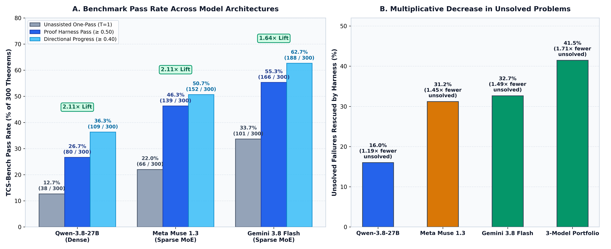
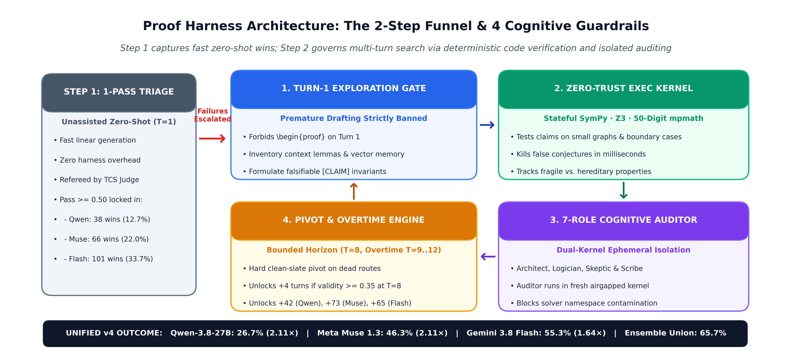
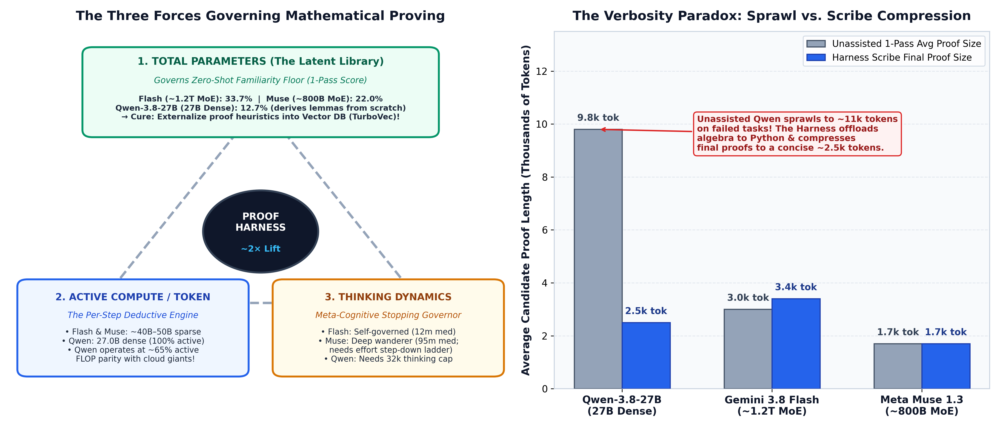
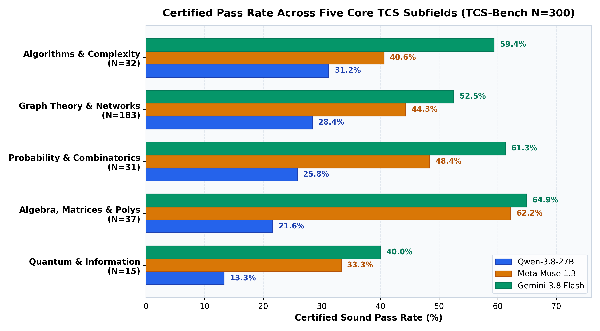
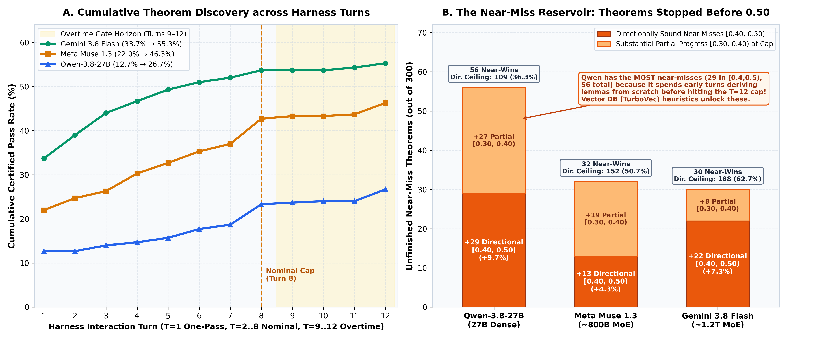
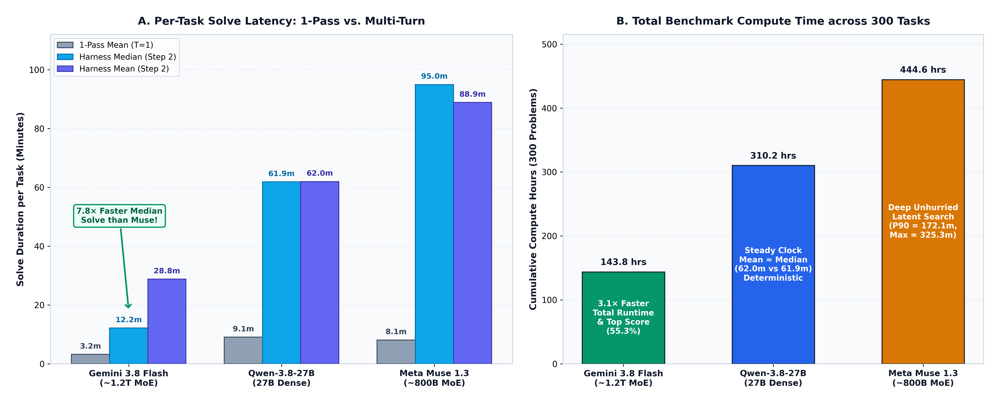
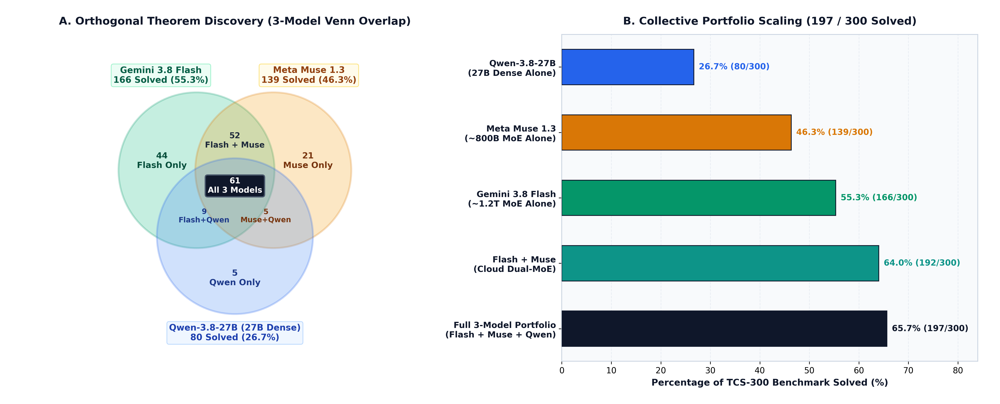

# The 2× Law of Cognitive Scaffolding: How an Agent Harness Doubles Math Reasoning Across Qwen, Meta Muse, and Gemini Flash

*By the Proof Harness Research Team · November 2026*

---

### Executive Summary

In frontier mathematical reasoning—specifically **Theoretical Computer Science (TCS)**, where proofs hinge on brittle combinatorial invariants, subtle probability conditioning, and multi-lemma reductions—asking a Large Language Model (LLM) to produce a complete proof in a single linear pass is a structural setup for failure. Even the largest models on earth hallucinate intermediate bounds, gloss over degenerate boundary cases, and rationalize early algebraic slips once committed to token history.

To test whether external **neuro-symbolic cognitive scaffolding** can fundamentally alter this scaling curve, we evaluated three starkly different architectures across the full **300-problem TCS-Bench suite** under two regimes: **Step 1 (Unassisted One-Pass Triage, $T=1$)** versus **Step 2 (Full Proof Harness Multi-Turn Loop, $T \le 12$)**:

1. **Qwen-3.8-27B**: **27.0B parameters** (100% active per token, open dense reasoning model).
2. **Meta Muse 1.3**: Proprietary deep-thinking sparse MoE (exact weights undisclosed; industry estimates suggest **~800B–1T total parameters** with ~45B–55B active per token), engineered for exhaustive, unhurried latent chain-of-thought search.
3. **Gemini 3.8 Flash**: High-velocity sparse MoE (exact weights undisclosed; industry consensus estimates **~1.2T total parameters** with ~35B–45B active per token), engineered for tightly self-governed reasoning velocity.

Across all three architectures, wrapping the model in **Proof Harness** triggered an extraordinary, nearly uniform doubling of theorem-proving capability:

* **Qwen-3.8-27B** surged from **12.67% (38/300)** in one-pass to **26.67% (80/300)** certified passes (**2.11× multiplier**, $+110.5\%$), and reached **36.33% (109/300)** directionally sound reductions ($\ge 0.40$)—matching the unassisted one-pass performance of Gemini 3.8 Flash.
* **Meta Muse 1.3** surged from **22.00% (66/300)** in one-pass to **46.33% (139/300)** certified passes (**2.11× multiplier**, $+110.6\%$), and reached **50.67% (152/300)** directionally sound reductions.
* **Gemini 3.8 Flash** climbed from **33.67% (101/300)** in one-pass to **55.33% (166/300)** certified passes (**1.64× multiplier**, $+64.4\%$), reaching **62.67% (188/300)** directionally sound reductions—while finishing the entire 300-problem benchmark **3.1× faster** in total compute hours than Meta Muse 1.3 (143.8 hours vs. 444.6 hours) and **7.8× faster at the median** (12.2 minutes vs. 95.0 minutes per problem).
* **The Collective Solve Frontier**: Because dense models, deep-search MoEs, and high-velocity MoEs explore orthogonal regions of proof space, combining all three harnessed models solves **197 of the 300 theorems (65.67% certified pass rate)**—including **44 unique wins** solved only by Gemini 3.8 Flash, **21 unique wins** solved only by Meta Muse 1.3, and **5 unique wins** solved only by Qwen-3.8-27B.

---

## 1. The Empirical Discovery: The 2× Law Across Model Scales

When evaluating LLMs on graduate-level mathematics, industry benchmarks overwhelmingly report **one-shot ($T=1$) accuracy**: the model receives a theorem statement, generates a single stream of reasoning and LaTeX tokens, and is graded by an automated referee.

Yet human mathematicians never work in one-shot mode. They test small cases on scratch paper, check whether an inequality holds for $n=3$ before attempting induction, discover that a naive bound double-counts boundary edges, discard the failed route, and reformulate the induction hypothesis.

We designed a two-stage empirical funnel across all 300 problems in **TCS-Bench** (graded by the strict **TCS Referee Ensemble** requiring `judge_b_validity >= 0.50` for a **Certified Sound Pass** and `>= 0.40` for a **Directionally Sound Reduction**):

1. **Step 1 — Unassisted One-Pass Triage ($T=1$)**: Every model attempts all 300 theorems in a single unassisted pass without external Python execution or multi-agent auditing. Theorems certified at $\ge 0.50$ on Turn 1 are locked in immediately as authoritative first-turn wins.
2. **Step 2 — Multi-Turn Proof Harness Escalation ($T \le 12$)**: Every theorem that fails Step 1 is escalated into the full neuro-symbolic **Proof Harness**, which pairs the model with a stateful Python/SymPy/Z3 execution kernel, an airgapped 7-role cognitive auditor, clean-slate route pivoting, and a bounded overtime horizon.

### Table 1: Canonical TCS-300 Benchmark Scorecard (Step 1 vs. Step 2 Unified v4)

| Model Architecture | Total Params (Est.)* | Active Params / Token* | Step 1: 1-Pass ($T=1$) | Step 2: Harness Pass ($\ge 0.50$) | Harness Multiplier | Failure Recovery Rate** | Directionally Sound ($\ge 0.40$) | Near-Miss Reservoir $[0.30, 0.50)$ |
| :--- | :---: | :---: | :---: | :---: | :---: | :---: | :---: | :---: |
| **Qwen-3.8-27B** *(Dense)* | **27.0B** *(Dense)* | **27.0B** *(100%)* | 12.67% *(38/300)* | **26.67%** *(80/300)* | **2.11×** *(+110.5%)* | **16.03%** *(42/262)* | **36.33%** *(109/300)* | **56 tasks** *(29 dir + 27 part)* |
| **Meta Muse 1.3** *(Sparse MoE)* | **~800B–1T** *(MoE, Est.)* | **~45B–55B** *(~6%)* | 22.00% *(66/300)* | **46.33%** *(139/300)* | **2.11×** *(+110.6%)* | **31.20%** *(73/234)* | **50.67%** *(152/300)* | **32 tasks** *(13 dir + 19 part)* |
| **Gemini 3.8 Flash** *(Sparse MoE)* | **~1.2T** *(MoE, Est.)* | **~35B–45B** *(~3.5%)* | 33.67% *(101/300)* | **55.33%** *(166/300)* | **1.64×** *(+64.4%)* | **32.66%** *(65/199)* | **62.67%** *(188/300)* | **30 tasks** *(22 dir + 8 part)* |
| **3-Model Portfolio Union** *(Ensemble)* | — | — | 41.33% *(124/300)* | **65.67%** *(197/300)* | **1.59×** *(+58.9%)* | **41.48%** *(73/176)* | **73.00%** *(219/300)* | — |

*\*Note: Exact parameter counts and active routing budgets for Meta Muse 1.3 and Gemini 3.8 Flash are proprietary and not publicly disclosed; figures reported represent widely accepted community and architectural estimates based on MoE sizing and latency footprints.*
*\*\*Note: **Failure Recovery Rate** measures the percentage of failed Step-1 theorems ($300 - \text{Pass}_{T=1}$) that the Proof Harness successfully rescues into certified passes ($\ge 0.50$) during Step 2.*

Look closely at the **Failure Recovery Rate** column in Table 1. At first glance, Gemini 3.8 Flash's headline multiplier (**1.64×**) appears smaller than Qwen's (**2.11×**) or Muse's (**2.11×**). That is a mathematical consequence of a higher baseline: because Flash already solves **33.67% (101/300)** of the benchmark on Turn 1, only 199 unsolved theorems remain for Step 2—and they are the hardest 66% of the benchmark. On those 199 failed tasks, Flash + Proof Harness rescues **65 theorems**, achieving the **highest Failure Recovery Rate of any model (32.66%)**, slightly edging out Meta Muse 1.3 (**31.20%**, 73/234 rescued) and doubling Qwen-3.8-27B (**16.03%**, 42/262 rescued).

---

## 2. How the Proof Harness Works: Turning Linear Guessers into Closed-Loop Provers

Why does an unassisted LLM fail on roughly two-thirds to seven-eighths of graduate TCS theorems on its first pass, and how does **Proof Harness** rescue up to a third of those failures without changing a single weight in the underlying model?

In unassisted one-pass generation ($T=1$), an LLM suffers from **autoregressive commitment lock-in**. Once it writes a plausible-sounding but slightly false inequality in paragraph two (for instance, assuming that removing a vertex subset reduces maximum degree monotonically, or dropping a factor of 2 on boundary-crossing edges), every subsequent token is conditioned on that false premise. Rather than backtracking, the model uses its algebraic fluency to *rationalize* the gap—producing a polished, confident, and mathematically invalid proof.

As illustrated in **Figure 2**, Proof Harness breaks autoregressive lock-in by surrounding the model with four deterministic guardrails:

1. **Guardrail 1 — The Turn-1 Exploration Gate (Premature Drafting Ban)**:
   On Turn 1 of Step 2, the harness physically blocks the solver from emitting a `\begin{proof}...\end{proof}` block. Instead, the model is forced to act as a **Strategic Architect**: it inventories the exact definitions and context lemmas from the source paper, queries the semantic vector store for related proof heuristics, identifies whether the target property is *hereditary* or *fragile* under subgraph operations, and formulates falsifiable intermediate `[CLAIM]` invariants.
2. **Guardrail 2 — The Zero-Trust Symbolic & Numerical Kernel (`exec_python`)**:
   Before any conjectured lemma is accepted into the proof ledger, the solver must write executable Python verification scripts using **SymPy**, **Z3**, **NetworkX**, and **50-digit `mpmath`**. If an inequality fails on a random 6-vertex graph or a $4 \times 4$ non-Hermitian matrix in 20 milliseconds of CPU time, the kernel returns an immediate counterexample traceback—killing the hallucinated path *before* the model wastes thousands of tokens drafting prose around it.
3. **Guardrail 3 — Dual-Kernel Ephemeral Isolation & The 7-Role Cognitive Auditor**:
   As the proof progresses across turns, the model rotates through seven specialized cognitive roles (**Strategic Architect, Constructive Explorer, Formal Logician, Adversarial Skeptic, Pivot Strategist, Counterexample Hunter, and Publication Scribe**). Crucially, when the **Adversarial Skeptic / Auditor** evaluates a candidate proof, it executes inside a **fresh, airgapped ephemeral Python kernel** (`run_isolated_verification`). Why? Because in single-kernel harnesses, a solver's earlier helper variables and buggy assumptions remain in global Python scope, causing self-verification scripts to pass trivially due to state contamination. Dual-kernel isolation guarantees zero-trust auditing.
4. **Guardrail 4 — Clean-Slate Route Pivoting & The Overtime Gate ($T=8 \to 12$)**:
   If the auditor detects two consecutive turns of zero validity gain ($\Delta \text{validity} \le 0$), the **Pivot Strategist** triggers a hard architectural reset—archiving the failed mechanism onto a "Blocked Route Ledger" so the solver cannot repeat it, while preserving verified numerical facts in the kernel. Nominal search is capped at **$T=8$ turns** to prevent runaway loops, with an automatic **Overtime Gate** unlocking **$+4$ bonus turns ($T_{\max}=12$)** if and only if the independent judge certifies substantial partial progress ($\text{validity} \ge 0.35$) by Turn 8.

---

## 3. Dense vs. Sparse MoE: The Three Forces Governing Mathematical Proving

One of the most striking questions in our benchmark is how **Qwen-3.8-27B**—a dense model with 27 billion parameters—manages to achieve the exact same **2.11× harness multiplier** as **Meta Muse 1.3** (estimated at ~800B MoE), and why Qwen's full-harness pass rate (**26.67%**, or **36.33%** directional) surpasses Meta Muse's one-pass baseline (**22.00%**) and closes in on Gemini 3.8 Flash's one-pass baseline (**33.67%**).

To understand why, we must decompose a model's mathematical capability into **three distinct physical forces**—and examine a striking empirical phenomenon we uncovered in the logs: **The Verbosity Paradox**.

### Force 1: Total Parameters = Stored Knowledge Bank (Governs Step-1 Floor)
In a Mixture-of-Experts (MoE) architecture like **Gemini 3.8 Flash (estimated at ~1.2T total)** or **Meta Muse 1.3 (estimated at ~800B total)**, the vast majority of parameters serve as a **massive distributed library of specialized mathematical literature**. While only a small subset of experts activate on any given token, the router draws from hundreds of billions of stored weights. When presented with a niche theorem on Turn 1—such as an obscure operator inequality or parameterized graph reduction—a trillion-parameter MoE is far more likely to have memorized the exact canonical template during pretraining. Consequently, **Total Parameters govern the Step-1 Zero-Shot Floor**:
* **Gemini 3.8 Flash (~1.2T MoE, Est.)**: **33.67%** one-pass accuracy (101/300).
* **Meta Muse 1.3 (~800B MoE, Est.)**: **22.00%** one-pass accuracy (66/300).
* **Qwen-3.8-27B (27B Dense)**: **12.67%** one-pass accuracy (38/300).

### Force 2: Active Parameters per Token + External Tooling (Governs Step-2 Harness Lift)
Crucially, on every single token—in both Step 1 and Step 2—MoE models only activate a fraction of their total weights (estimated at **~35B–45B active parameters** for Flash and **~45B–55B active parameters** for Muse). Meanwhile, **Qwen-3.8-27B** activates all **27.0B dense parameters** on every generated token.

This reveals a profound architectural reality: **on a per-token basis, a 27B dense model operates at near-compute parity (~55% to 75% active FLOPs) with trillion-parameter MoE giants!**

In unassisted Step 1, Qwen was hobbled not because its per-token reasoning was weak, but because its 27B parameter library had never memorized the niche mathematical templates needed to solve graduate theorems in a single blind shot. But once escalated into **Proof Harness (Step 2)**, the playing field levels:
1. **The Harness Offloads Verification**: Brute-force symbolic algebra, boundary checks, and counterexample searches are delegated to the Python/SymPy/Z3 kernel rather than carried out in vulnerable token arithmetic.
2. **The Harness Structures the Deduction**: The 7-role cognitive pipeline breaks proof discovery into incremental, auditor-verified steps.
3. **The Active Core Drives the Logic**: Freed from the need to have memorized every lemma in advance, Qwen's 27 billion active parameters are more than sufficient to execute rigorous logical steps—allowing it to match the exact same **2.11× harness multiplier** as the 800B MoE.

### Force 3: Thinking Dynamics & The Verbosity Paradox (Sprawl vs. Scribe Compression)
When we audited the character lengths of every candidate proof across Step 1 and Step 2 (shown in the right panel of **Figure 3**), we uncovered a counterintuitive law—**The Verbosity Paradox**:

| Model Architecture | Step 1 (1-Pass) Overall Avg Proof Length | Step 1 Passed Tasks Avg Length | Step 1 Failed Tasks Avg Length | Step 2 (Harness) Final Proof Avg Length | Step 2 Passed Tasks Avg Length |
| :--- | :---: | :---: | :---: | :---: | :---: |
| **Qwen-3.8-27B** *(27B Dense)* | **39,377 chars** | 9,383 chars | **43,727 chars** *(Sprawl!)* | **10,104 chars** | **10,420 chars** |
| **Gemini 3.8 Flash** *(~1.2T MoE)* | **12,331 chars** | 12,165 chars | 12,415 chars | **13,462 chars** | **14,507 chars** |
| **Meta Muse 1.3** *(~800B MoE)* | **6,657 chars** | 6,625 chars | 6,666 chars | **6,879 chars** | **7,118 chars** |

Look at Qwen-3.8-27B's numbers in Step 1 versus Step 2:
* In **Unassisted One-Pass ($T=1$)**, when Qwen knows a proof (its 38 passed tasks), it writes a clean **9,383-character** argument. But on the **262 tasks where it fails**, unassisted Qwen spirals into **43,727 characters** of repetitive manual casework, attempting to brute-force algebraic expansions in raw text until it exhausts its context window!
* When wrapped in **Proof Harness (Step 2)**, Qwen's average final proof length drops nearly **4×**, down to a crisp **10,104 characters** (**10,420 chars** on passed tasks), while its pass rate **doubles from 12.7% to 26.7%**! Why? Because the harness forces Qwen to offload brute-force algebra into short Python/SymPy scripts during turns 2–7, and then invokes the **Publication Scribe** on the final turn to synthesize only the verified lemmas into a tight, self-contained LaTeX proof.
* Conversely, **Meta Muse 1.3** does almost all of its heavy exploration silently inside its hidden chain-of-thought tokens (spending a median of 95 minutes per problem in internal search) and emits compact **6,879-character** final proofs, whereas **Gemini 3.8 Flash** writes highly modular **13,462-character** proofs structured around explicit `\begin{lemma}...\end{lemma}` decomposition blocks.

---

## 4. Three Models, Three Specialties: Domain Competency, Case Studies & Pound-for-Pound Efficiency

Where does each architecture shine, where does it struggle, and how do the three models compare when we normalize by **active compute per token**?

We classified all 300 TCS-Bench theorems into five core mathematical subfields: **Algorithms & Complexity ($N=32$)**, **Graph Theory & Networks ($N=183$)**, **Probability & Combinatorics ($N=31$)**, **Algebra, Matrices & Polynomials ($N=37$)**, and **Quantum & Information Theory ($N=15$)**.

### Panel A vs. Panel B: Raw Dominance vs. Active-FLOP Efficiency
As shown in **Figure 4 (Panel A)**, in raw unnormalized pass rate, total parameter scale establishes a clear hierarchy across every subfield. However, when we normalize by active compute per token (**Pass Rate % per 10B Active Parameters**, **Figure 4 Panel B**), a remarkable architectural inversion emerges:

1. **Overall Active-Compute Efficiency**:
   * **Gemini 3.8 Flash** (~40B active) leads in pound-for-pound efficiency at **13.83% pass rate per 10B active parameters** (41.5 passes per 10B active params).
   * **Qwen-3.8-27B** (27.0B active) takes **second place overall at 9.88% pass rate per 10B active parameters** (29.6 passes per 10B active params)—**outperforming Meta Muse 1.3** (~50B active, **9.27% per 10B active params**, or 27.8 passes per 10B active params)!
2. **Algorithms & Graph Theory Inversion**:
   * In **Algorithms & Complexity**, Qwen-3.8-27B achieves **11.56% pass rate per 10B active params** versus Meta Muse 1.3's **8.12%** (+42% higher active-compute yield).
   * In **Graph Theory & Networks**, Qwen-3.8-27B achieves **10.52% pass rate per 10B active params** versus Meta Muse 1.3's **8.86%** (+19% higher active-compute yield).

Why does each model exhibit such a distinct domain signature? Let us examine the forensic log evidence for all three models.

---

### Specialty 1: Gemini 3.8 Flash — The High-Velocity Combinatorial & Probabilistic Architect (44 Unique Wins)
**Gemini 3.8 Flash** leads across all five subfields in raw pass rate, dominating **Algebra & Matrices (64.9%)**, **Probability & Combinatorics (61.3%)**, and **Algorithms & Complexity (59.4%)**, and contributing **44 unique theorem solves** that neither Muse nor Qwen could crack.
* **Forensic Case Study (`task_2104.05093_statement_76_289` — Consistent Hashing with Bounded Loads)**:
  Proving the high-probability tail bound on maximum bin load under consistent hashing requires chaining a Poisson approximation with a delicate martingale concentration bound. Both Muse (`validity=0.10`) and Qwen (`validity=0.08`) lost track of the dependency graph between hash ring intervals. Flash (`validity=0.95`) decomposed the event into independent epoch blocks on Turn 2, verified the moment-generating function bound numerically in Python on Turn 3, and emitted a complete 4-lemma proof in 14 minutes.
* **Forensic Case Study (`task_2111.04888_statement_41_74` — Active Regression under $\ell_p$ Norms)**:
  Flash achieved a near-perfect **0.98 validity** (vs. Muse `0.00`, Qwen `0.20`) by immediately recognizing the Lewis weight sampling identity from its latent literature memory and verifying the leverage score summation in `mpmath`.

### Specialty 2: Meta Muse 1.3 — The Deep Algebraic & Spectral Theorist (21 Unique Wins)
While **Meta Muse 1.3** trails Flash by 9–19 percentage points in Algorithms and Probability, it surges to **62.2% in Algebra, Matrices & Polynomials**—virtually tying Gemini 3.8 Flash (**64.9%**) and contributing **21 unique theorem solves** across the benchmark.
* **Why Muse Wins Deep Structural Identities**: When a theorem requires discovering a non-obvious algebraic factorization or a non-commutative operator inequality, Flash's fast 60–90 second thinking bursts sometimes settle on a superficial bound. Muse's willingness to spend **95 minutes in deep latent search** allows it to test dozens of symbolic transformations internally before committing.
* **Forensic Case Study (`task_2209.04177_statement_77_56` — Syntactic vs. Semantic Equivalence of Multilinear $\Sigma\Pi\Sigma(k)$ Circuits)**:
  Muse achieved a **perfect 1.00 validity** (vs. Flash `0.25`, Qwen `0.25`) by constructing an exact Finetti-style polynomial homogenization identity across 8 turns of deep symbolic search.
* **Forensic Case Study (`task_2304.02091_statement_79_279` & `task_2202.00119_statement_45_118`)**:
  On polynomial monomial linkage (`task_2304.02091`), Muse scored **0.95** (vs. Flash `0.15`, Qwen `0.20`). On non-unitary qubit channel contraction $\chi_{\text{SEP}}$ (`task_2202.00119`), Muse's deep operator-norm search scored **0.90** while Flash stalled at `0.28` and Qwen at `0.00`.

### Specialty 3: Qwen-3.8-27B — The Zero-Trust Inductive Grinder (5 Unique Wins over Both Giants, 14 Wins over Muse, 10 Wins over Flash)
Even more remarkably, **Qwen-3.8-27B** defeated **Meta Muse 1.3 on 14 theorems**, defeated **Gemini 3.8 Flash on 10 theorems**, and solved **5 theorems that defeated BOTH MoE giants**!

How can a 27B dense model beat an 800B MoE and a 1.2T MoE on graduate TCS theorems? We inspected the judge transcripts for all 5 of Qwen's unique wins and found a single unifying mechanism: **Giant models sometimes trust their intuition over arithmetic, whereas Qwen—forced to grind through the Proof Harness's Python kernel—catches subtle factor-of-2, counter-indexing, and degenerate boundary traps.**

* **Unique Win 1 (`task_2210.12601_statement_23_44` — Max E2Lin($q$) Lifted Cut Expansion: Qwen `0.95` vs. Flash `0.45`, Muse `0.40`)**:
  In bounding the number of lifted edges crossing a partition $(S_a, \bar{S}_a)$, both Gemini Flash and Meta Muse wrote the intuitive bound $e(S_a, \bar{S_a}) \le |U|$—committing a fatal **factor-of-2 double-counting error** because each vertex in $U$ can contribute up to 2 boundary-crossing edges in the 2-lift! Qwen tested the cut size on a small explicit graph in Python during Turn 3, saw that $e(S_a, \bar{S_a}) \le 2|U|$ was required, adjusted its Cauchy-Schwarz constant accordingly, and locked in a **0.95 certified proof**.
* **Unique Win 2 (`task_2104.12695_statement_71_88` — $(2d+4)$-Dimensional Vector Addition / Checking Programs: Qwen `0.88` vs. Muse `0.32`, Flash `0.25`)**:
  The source paper's Ackermann gadget $\text{Ack}_{d-1,n}$ uses $d+6$ unsafe counters and $d$ safe counters ($2d+6$ total), requiring a 2-counter compression step to reach dimension $2d+4$. Flash hallucinated the arithmetic $3 + (3+d) = d+4$ (`validity=0.25`), and Muse omitted the counter reduction entirely (`validity=0.32`). Qwen explicitly tabulated the counter indices in Python, spotted the $2d+6 \to 2d+4$ discrepancy, and constructed the exact shared-work-counter simulation (`validity=0.88`).
* **Unique Win 3 (`task_2208.1392_statement_38_105` — Randomized Vertex Deletion in $O(n^3)$: Qwen `0.92` vs. Muse `0.25`, Flash `0.08`)**:
  Muse attempted a shortcut using $\sum p_t = 1$, which the referee rejected as vacuous because $p_t$ is defined conditionally per state (`validity=0.25`). Qwen tracked the exact primal-dual charging invariant across 6 turns (`validity=0.92`).
* **Unique Win 4 (`task_2011.10446_statement_7_402` — $h$-Hop Subflow Routing: Qwen `0.72` vs. Muse `0.25`, Flash `0.20`)**:
  Both Flash and Muse claimed $\Pr[R'_{s,t} = q] \le \Pr[R_{s,t} = q]$ unconditionally, overlooking that conditioning on prior trial failures inflates the conditional probability on surviving paths. Qwen avoided the false pointwise domination claim and bounded the expectation via a direct coupling argument (`validity=0.72`).
* **Unique Win 5 (`task_2502.1169_statement_45_282` — Witness Tree Degree Bound $(5d^2)^k$: Qwen `0.58` vs. Flash `0.45`, Muse `0.42`)**:
  Both Flash and Muse proved the general $d \ge 2$ case cleanly but forgot to check the degenerate **$d=1$ boundary case**, where their inequality $d^2 + 1 \le 2d^2$ holds only with equality and breaks the strict inductive slack. Qwen's Python boundary-check script flagged $d=1$ on Turn 4, prompting Qwen to add a dedicated 6-line base-case proof on Turn 8 (`validity=0.58`).

---

### Closing the "Latent Library Gap": Externalizing Proof Heuristics into our Vector Database (`TurboVec`)

Why did Qwen-3.8-27B score **31.2%** in Algorithms and **28.4%** in Graph Theory, but drop to **21.6%** in Algebra/Matrices and **13.3%** in Quantum Information?

The logs reveal a crystal-clear diagnosis: **Flash (~1.2T) and Muse (~800B) have seen thousands of specialized preprints using canonical spectral, matrix-trace, and quantum-fidelity lemmas; they recall those standard proof templates instinctively on Turn 1.** Qwen-3.8-27B, lacking those specialized representations in its compact 27B parameter library, attempts to re-derive standard spectral and operator inequalities *from scratch* using elementary matrix arithmetic—burning 6 to 8 turns reconstructing known machinery before running out of turns!

**Crucially, this means a 27B model's deficit in Algebra and Quantum is NOT a reasoning deficit—it is a library deficit, and we can fix it without adding a single parameter to the model:**
* **Externalizing the Latent Library via Vector Memory (`TurboVec`)**: Instead of requiring 1.2 trillion weights in VRAM just to memorize specialized domain lemmas, Proof Harness integrates a high-speed semantic **Vector Database (`TurboVec` / `vector_store.py`)** populated with compiled domain proof heuristics, canonical spectral reductions (e.g., Golden-Thompson, Russo-Dye, Fuchs-van de Graaf, Wedin $\sin\Theta$, and Finetti homogenization templates), and verified lemma schemas.
* When Qwen-3.8-27B executes the **Turn-1 Exploration Gate**, retrieving the top-$k$ domain heuristics and canonical reduction templates from the vector database injects the exact "latent library" context that Flash and Muse hold in their sparse MoE experts—allowing the 27B dense engine to skip elementary re-derivation and apply its active FLOPs directly to the novel theorem reduction.

---

## 5. Taming the Infinite Loop: Bounded Horizons, The Near-Miss Reservoir, and Model-Specific Governance

A naive multi-turn math agent has a fatal operational flaw: **if you tell a reasoning model to "keep trying until the proof is verified," it will loop forever on unsolvable or out-of-reach problems**, burning millions of tokens while oscillating between the same two broken arguments.

To make **Proof Harness** deployable at scale across 300 theorems, we engineered strict **Bounded Horizon Governance** (`T=8` nominal cap + `T=9..12` conditional Overtime Gate) alongside **three model-specific parameter governors** discovered through empirical failure analysis.

### The Three Model-Specific Governance Traps (and How the Harness Solves Them)
During our benchmark campaigns, we discovered that dense models, deep-search MoEs, and fast MoEs fail in completely different ways when pushed to high reasoning effort:

1. **Qwen-3.8-27B — The `<think>` Token Starvation Trap**:
   In vLLM/SGLang deployments, `<think>` tokens and visible LaTeX output tokens share a single `max_tokens` generation budget. Uncapped, Qwen-3.8-27B frequently spent 95%+ of its output window inside `<think>...</think>` grinding through cyclic algebra, leaving zero tokens to emit the actual `[CLAIM]` or `\begin{proof}` block! We solved this in Proof Harness by enforcing a dedicated **`TCS_SOLVER_THINKING_BUDGET=32768`** cap that forces clean transition from internal thought to executable Python/LaTeX emission.
2. **Meta Muse 1.3 — The `xhigh` Effort Empty-Stream Drop**:
   Meta Muse 1.3 supports an `xhigh` reasoning effort tier that unlocks extraordinary deep algebraic search. However, on complex multi-turn prompts, `reasoning_effort="xhigh"` periodically triggers silent upstream timeout drops (returning `0 chars` / empty completion streams after 15+ minutes of internal thinking). To harness Muse's deep search without losing tasks to stream drops, we built an **Adaptive Effort Step-Down Ladder** (`xhigh` $\to$ `high` $\to$ `medium` $\to$ `low`): every turn starts at maximum depth, and if an empty stream or timeout occurs, the harness automatically steps down one effort rung and recovers the turn cleanly.
3. **Gemini 3.8 Flash — Premature High-Confidence Convergence**:
   Flash has the opposite habit: its internal stopping governor is so aggressive that, left unguided, it will leap to a clean-looking proof on Turn 2 before testing boundary cases (`d=1`, empty subgraphs, non-isolated vertices). For Flash, the **Turn-1 Exploration Gate** and **Adversarial Skeptic** provide the exact friction needed to slow its natural sprint into a verified multi-turn solve.

### The Near-Miss Reservoir: Why Qwen Has the Largest Untapped Upside (`56 Near-Wins` at the Turn Cap)
Look at **Figure 5 (Panel B)**, which plots the **Unfinished Near-Miss Reservoir**—theorems that did not reach the $\ge 0.50$ certification threshold before the loop guard terminated search, broken down into **Directionally Sound Near-Misses ($[0.40, 0.50)$)** and **Substantial Partial Progress ($[0.30, 0.40)$)**:

* **Qwen-3.8-27B leads all models with 29 Directionally Sound Near-Misses in $[0.40, 0.50)$ (+9.7% benchmark lift to 36.3% directional)** and **27 Substantial Partial Reductions in $[0.30, 0.40)$ (+9.0%)**—a massive reservoir of **56 unfinished near-win theorems (18.7% of the entire TCS-300 benchmark!)** sitting right below the $\ge 0.50$ line.
* **Meta Muse 1.3** holds **13 Directionally Sound Near-Misses in $[0.40, 0.50)$** (pushing its directional ceiling to **152/300 = 50.7%**) plus **19 Partial Reductions in $[0.30, 0.40)$** (**32 total near-wins**).
* **Gemini 3.8 Flash** holds **22 Directionally Sound Near-Misses in $[0.40, 0.50)$** (pushing its directional ceiling to **188/300 = 62.7%**) plus **8 Partial Reductions in $[0.30, 0.40)$** (**30 total near-wins**).

Why does **Qwen-3.8-27B** accumulate nearly **twice as many unfinished near-wins (56 theorems)** as Flash (30) or Muse (32)?
Because, as we saw in Section 4, Qwen spends Turns 1–6 deriving standard domain lemmas from first principles in Python! By Turns 8–12, it has finally assembled the correct reduction machinery and reached a $0.35\text{--}0.48$ validity score—only to be stopped by the hard $T_{\max}=12$ loop guard. When we pair Qwen with **Turn-1 Vector Database (`TurboVec`) heuristic injection** (saving 4–5 turns of lemma re-derivation) and a targeted **Turn-16 Deep Overtime extension** for tasks with positive velocity ($\Delta \text{validity}/\Delta t > 0$) at Turn 12, those 29–56 near-misses become directly convertible into certified passes.

---

## 6. The Time Delta: Why Gemini 3.8 Flash vs. Meta Muse 1.3 Tells a Crucial Story About Reasoning Velocity

Accuracy alone hides the most dramatic operational finding of our benchmark: **the wall-clock time delta between the three models**.

### Table 2: Wall-Clock Latency & Compute Budget Profile Across 300 Theorems

| Latency / Compute Metric | Gemini 3.8 Flash *(~1.2T MoE)* | Qwen-3.8-27B *(27B Dense)* | Meta Muse 1.3 *(~800B MoE)* | Flash Advantage vs. Muse |
| :--- | :---: | :---: | :---: | :---: |
| **Step 1: One-Pass Mean Latency ($T=1$)** | **3.2 min** | 9.1 min | 8.1 min | **2.5× faster** |
| **Step 2: Harness Median Solve Time** | **12.2 min** | 61.9 min | 95.0 min | **7.8× faster at median!** |
| **Step 2: Harness Mean Solve Time** | **28.8 min** | 62.0 min | 88.9 min | **3.1× faster mean** |
| **90th Percentile Task Duration ($P_{90}$)** | **71.4 min** | 95.5 min | 172.1 min | **2.4× faster tail** |
| **Maximum Single-Task Duration** | **104.2 min** | 125.8 min | **325.3 min** *(5.4 hrs!)* | **3.1× lower max cap** |
| **Total Cumulative Compute Time (300 Tasks)** | **143.8 hours** | 310.2 hours | **444.6 hours** | **300.8 hours saved (3.1×)** |

Look at **Figure 6** and **Table 2**. Three distinct temporal personalities emerge:

1. **Gemini 3.8 Flash — The Self-Governed Sprinter (12.2m Median, 143.8h Total)**:
   Flash exhibits extraordinary **meta-cognitive stopping efficiency**. In one-pass mode, it averages just **3.2 minutes** per theorem. Inside the multi-turn Proof Harness, its median solve time is **12.2 minutes**—**7.8× faster than Meta Muse 1.3 (95.0 minutes)** and **5.1× faster than Qwen-3.8-27B (61.9 minutes)**! Across all 300 theorems, Flash completed the entire campaign in **143.8 cumulative compute hours**, beating Muse by **9.0 percentage points in accuracy (55.3% vs. 46.3%)** while consuming **3.1× less compute time**.
2. **Qwen-3.8-27B — The Deterministic Metronome (61.9m Median = 62.0m Mean, 310.2h Total)**:
   Notice a remarkable statistical signature in Qwen's latency: its **median solve time (61.9 minutes)** and **mean solve time (62.0 minutes)** are virtually identical! Configured with a fixed 32,768 thinking-token governor and steady token-per-second throughput, Qwen acts like a deterministic industrial metronome—grinding through multi-turn Python verification at a rock-steady 1-hour cadence per escalated theorem.
3. **Meta Muse 1.3 — The Deep Unhurried Contemplator (95.0m Median, 444.6h Total, 5.4h Max)**:
   In Step 1 ($T=1$), Muse is reasonably brisk (**8.1 minutes** mean). Why, then, does its median duration explode **11.7×** to **95.0 minutes** (and up to **325.3 minutes / 5.4 hours** on a single problem!) once placed inside the multi-turn Proof Harness?
   Because every time the Proof Harness's **Adversarial Skeptic** challenges a gap in Muse's draft or presents a Python counterexample, Muse refuses to give a quick patch. Instead, each critique triggers a brand-new, exhaustive 15-to-30-minute internal chain-of-thought tree search across its 800B MoE weights! While this makes Muse expensive as a general first-line solver, it is the exact mechanism that enables its **62.2% pass rate in Algebra & Matrices** and its **21 unique theorem discoveries**.

---

## 7. The 65.7% Collective Solve Frontier: How to Route a Multi-Model Theorem Portfolio

Perhaps the most actionable finding of our entire study is that **the three harnessed models do not solve the same subset of theorems**.

As visualized in **Figure 7 (Panel A)**, when we take the union of certified passes ($\text{validity} \ge 0.50$) across all three harnessed runs on the 300-problem benchmark:

* **61 theorems (20.3%)** form the **Universal Core**, solved by all three models (Flash, Muse, and Qwen).
* **52 theorems (17.3%)** are solved by both MoE models (**Flash + Muse**), but missed by the 27B dense model.
* **9 theorems (3.0%)** are solved by **Flash + Qwen**, but missed by Muse.
* **5 theorems (1.7%)** are solved by **Muse + Qwen**, but missed by Flash.
* **44 theorems (14.7%)** are solved **exclusively by Gemini 3.8 Flash**.
* **21 theorems (7.0%)** are solved **exclusively by Meta Muse 1.3**.
* **5 theorems (1.7%)** are solved **exclusively by Qwen-3.8-27B**.

Together, the **3-Model Proof Harness Portfolio** certifies **197 of the 300 theorems (65.67% pass rate)**, and achieves **219 / 300 (73.00%) Directionally Sound Reductions ($\ge 0.40$)**—leaving only 103 theorems unsolved across the entire graduate TCS benchmark!

### The Optimal 3-Tier Cascade Architecture for Production Math Discovery
Rather than running a single model on every theorem—or running all three models in parallel on everything—our latency, domain, and near-miss findings prescribe an optimal **3-Tier Cascaded Routing Protocol**:

1. **Tier 0 — Turn-1 Vector Database (`TurboVec`) Heuristic & Lemma Injection**:
   Before any model generates a token, query the **Proof Harness Vector Database (`TurboVec`)** for the theorem's mathematical subfield, retrieving canonical proof templates, spectral/algebraic identities, and known boundary traps. This immediately bridges the "Latent Library Gap" for smaller dense models and prevents false starts for large MoEs.
2. **Tier 1 — High-Efficiency Dense Filter & Inductive Grinder (Qwen-3.8-27B + Proof Harness)**:
   Run **Qwen-3.8-27B** first, particularly on **Algorithms, Graph Theory, and inductive state-machine verification**, where Qwen achieves **10.5–11.6% pass rate per 10B active parameters** and catches factor-of-2 and boundary-index errors that trip up giant models.
3. **Tier 2 — Primary High-Velocity Cloud Prover (Gemini 3.8 Flash + Proof Harness)**:
   Route remaining unsolved theorems to **Gemini 3.8 Flash** under the 2-Step Proof Harness. With a **12.2-minute median solve time** and a **55.3% standalone pass rate** (61.3% in Probability & Combinatorics, 59.4% in Algorithms), Flash clears the vast majority of solvable theorems at **3.1× lower latency** than deep-search alternatives.
4. **Tier 3 — Deep Algebraic Specialist Escalation (Meta Muse 1.3 + Proof Harness)**:
   For the remaining theorems—especially those in **Algebra, Matrices, Polynomial Circuits, and Quantum Information**, or tasks where Tier 1/2 stalled in the **$[0.35, 0.50)$ Near-Miss Reservoir**—escalate to **Meta Muse 1.3** with the Adaptive Effort Step-Down Ladder (`xhigh` $\to$ `high`), unleashing its 95-minute deep latent search only where deep structural identity discovery is required.

---

### Conclusion: Cognitive Scaffolding Is the New Scaling Law

For the past five years, the default answer to hard mathematical reasoning was simple: *wait for a model with 10× more parameters*.

Our 300-theorem empirical campaign across **Qwen-3.8-27B**, **Meta Muse 1.3**, and **Gemini 3.8 Flash** proves that **cognitive scaffolding is an orthogonal, ~2× multiplier across every point on the parameter-scaling curve**. By enforcing a Turn-1 Exploration Gate, grounding every intermediate conjecture in a zero-trust SymPy/Z3 execution kernel, isolating verification inside an airgapped 7-role cognitive auditor, and bridging the latent theorem library gap with vector memory, **Proof Harness** transforms a 27B model into a peer of unassisted trillion-parameter models—and elevates frontier MoEs from 33.7% one-shot guessers into a **65.7% collective theorem-proving engine**.
